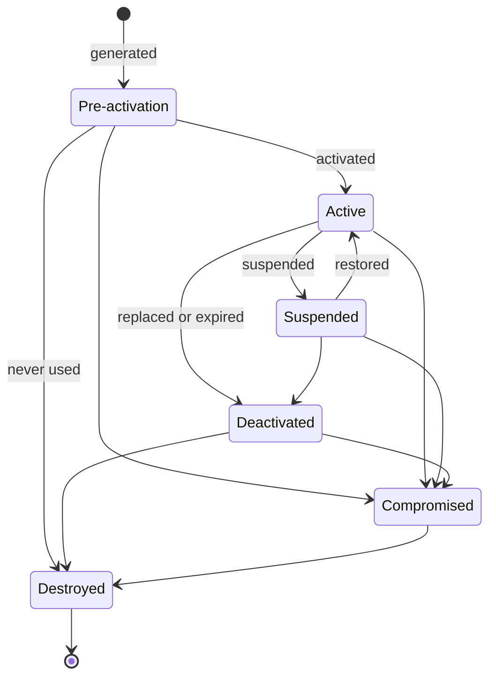

# Key management policy

How every cryptographic key, secret and certificate of an Ariva deployment is owned, made, given out, held, used, rotated, recovered, revoked and destroyed, following the key lifecycle of NIST SP 800-57 Part 1 (ASVS 5.0 V11.1.1). For a site's security officer, the operator team that holds the keys, and Dalil.

Related pages: what each key is, its algorithm, its permitted use and its code are in the [cryptographic inventory](crypto-inventory.md); this page points at its rows (K1 and so on) rather than repeating them. The protection levels L1 to L4 are those of the [data classification](data-classification.md) (L4: credentials and keys). Commands to create the secrets: [wiki 04](../../wiki/04-Deployment-Guide.md) section 6.2; backups: wiki 04 section 10; operations procedures: [wiki 10](../../wiki/10-Operations-Runbook.md); the security guide and its go-live checklist: [wiki 13](../../wiki/13-Security-Guide.md).

Status: as of 2026-10-19 (ARV-094). A rule that restates what the code, the charts or a written procedure already do cites them. A rule marked **Proposed** is not built or agreed yet; every **To confirm** is collected in section 6.

## 1. Roles

| Role | Who | Holds and does | Never |
|---|---|---|---|
| Key owner | The authority that operates the deployment: the border authority for a border deployment, the airport operator for an airport deployment (one deployment per namespace, wiki 04 section 6.1) | Owns every key of the deployment. Approves cryptoperiods, custody and who may read each Secret; receives every compromise report; decides recovery (for example a mass re-enrolment) | Shares a key with another deployment, above all between a border and an airport deployment (data boundary) |
| Custodians | The site's operator team (site IT and operations), who provide and operate the cluster, its TLS and its secrets (wiki 19 section 6) | Create the keys and Secrets with the commands of wiki 04, keep the copies in the site's secret store, run rotations, keep the go-live record and the operations log | Give a key to someone outside the custody rules of section 3.3 |
| Ariva administrators | The deployment's system administrators | Issue and rotate the credentials made inside Ariva (users' resets, devices, displays, integration clients, outbound endpoint secrets), each a critical action with a fresh second factor, audited | See a credential after it was shown once |
| Local partner | The installer of the sensors (wiki 19 section 6: device credentials and switch security) | Puts device credentials and certificates on the devices | Keeps a copy of a device credential after installing it (Proposed) |
| Partners | AODB, AMAN, ACRIS and other systems Ariva calls | Issue the outbound credentials (K17 to K20) and their CAs; revoke and reissue them | |
| Dalil Tech | The product team and its release pipeline | Owns the product's cryptography (code, defaults, this policy and the inventory), the release signing identity (K43) and the repository settings it rests on, and the keys of the dev and demo environments it runs | Holds a site's keys or credentials. Dalil reaches a site only as the customer allows (wiki 19 section 1); its support tooling collects health telemetry only |

## 2. Lifecycle states

NIST SP 800-57 Part 1 names six states. In Ariva:

| State | Meaning | Ariva examples |
|---|---|---|
| Pre-activation | Made, not yet used to protect anything | A Secret created before the release that names it (the pods wait for it); a new token public key installed as `public.pem` before the matching signing key replaces the old one (wiki 04 section 6.2, rotation step 1); a new Data Protection certificate in the secret store before `ariva-dataprotection` is replaced |
| Active | Used to protect and to process | The signing key in `ariva-token-signing`; the default Data Protection key; the current certificate; a device's live credential |
| Suspended | Not used for a while, can return | A disabled integration client (its tokens stop at once) or outbound endpoint; a disabled or locked user account; a locked integration client |
| Deactivated | No longer used to protect; may still process what it protected | `previous.pem` during a token key rotation (verifies, signs nothing); a certificate under `DataProtection:Previous` (unwraps, wraps nothing); an expired Data Protection key (unprotects, protects nothing); a backup identity kept for older backups; an allowed-signers line kept for older backups |
| Compromised | Known or suspected to be in the wrong hands | Any of the above; handled by section 3.7 and the key's own section |
| Destroyed | Gone from every place it was kept | A device credential's hash cleared when the device is retired; an archive day key deleted by the first archive write after its three days; a Secret deleted and its files shredded |

## 3. Policy

### 3.1 Generation

1. Every key, secret, salt and nonce comes from a cryptographically secure generator: `RandomNumberGenerator` in the hosts, OpenSSL, `age-keygen` or `ssh-keygen` for the operators (inventory A12). Reason: a predictable key protects nothing. The build fails on `System.Random` (analyzer CA5394).
2. Every key gives at least 128 bits of security: P-256 for the token keys, RSA 3072 or more for the Data Protection certificate, 256 random bits for every bearer credential, 160 bits for TOTP seeds, at least 32 bytes for HMAC keys and the log pseudonym key. The hosts refuse smaller where they can (`TokenKeys.RequireP256`, `DataProtectionCertificates.RequireStrong`, `OutboundRules.IsHmacKey`, `LogProtection.MinimumKeyBytes`). Reason: ASVS V11.2.3. Known exceptions: recovery codes and temporary passwords (inventory section 5, items 1 and 2).
3. No key is derived from a password, except where the code does so on purpose: PBKDF2 only verifies passwords and client secrets (A2); the SCRAM verifier is PostgreSQL's protocol (A3); the log day keys are derived from a random key, not a password (A6). Reason: a password has too little entropy to be a key (V11.4.4).
4. Operators generate a key into a file with `umask 077`, never type or paste a value on a command line, and shred the file once the copy is in the secret store, as the commands of wiki 04 section 6.2 do. Reason: shell history, process lists and stray files leak keys.
5. Every site key is made for one deployment and never reused in another: the token key pairs, the Data Protection certificate, the break-glass account, the log pseudonym key (wiki 04 section 6.2). Reason: one leak must not open two deployments, and a key shared between border and airport would cross the data boundary.
6. A key the operator chooses (the Cronz dashboard key K22, the simulator keys K44) is 32 random bytes, `openssl rand -base64 32` (wiki 04 section 6.4). Reason: the hosts check no entropy (ARV-088).

### 3.2 Distribution

1. Keys and secrets reach the pods only from Kubernetes Secrets, as read-only mounted files (token keys, the Data Protection certificate, TLS keys) or as `secretKeyRef` environment variables (the log pseudonym key, the validation reader login, the Kafka password, the log store's sender credentials). Never chart values, a ConfigMap, a committed appsettings file or an image. Reason: values files, ConfigMaps and images are read by more people and systems than a Secret. What enforces it:
   - the chart test fails a render with a literal credential in a container's `env`, a signing key mounted by any pod but its host, or the pseudonym key in a ConfigMap or as a literal (`Platform/Cloud/Ariva.K8s/tests/checks.mjs`), and the chart refuses a `logging.pseudonymKeySecret.key` that looks like a key;
   - at install and upgrade, when it can see the cluster, the chart reads the pseudonym key's Secret and refuses one that is missing or holds a key the hosts would refuse, and refuses a cluster CA Secret without `ca.crt` or with `tls.key` (`templates/validate.yaml`);
   - outside vm-local a host refuses the pseudonym key, Loki's sender credentials and the OTLP headers from a configuration file (`LogProtection.From`, `ArivaLogging`, `OtlpSettings.EnsureHeadersAreProtected`), and any host but api-main refuses the validation reader login;
   - the security scanner fails a secret value committed in configuration outside the vm-local files (SEC-120), and the committed `k8s-*` files carry empty passwords.
2. Exception, as built: the service passwords (database, Redis, SMTP) travel inside the appsettings Secrets (`base-appsettings-secret` and `<service>-appsettings-secret`), Kubernetes Secrets mounted as files, so one Secret reaches every host (ARV-083b splits them per host). The Azure DevOps release gives the registry password to Helm as a value (inventory section 5, item 19).
3. Each Secret goes to the pods that use it and no other: the user signing key to api-main only, the integration signing key to api-integration only, the validation reader to api-main and the migration Job only, the pseudonym key to the five API hosts only (never the Jobs, the web pod or the simulator), each pod certificate to its own pod. Reason: least privilege; a pod that holds no key cannot leak it.
4. Credentials made inside Ariva are shown once, with `Cache-Control: no-store`, and never logged: device and display credentials, integration client secrets and seeds, temporary passwords, TOTP enrolment, the break-glass credential. They are handed over at once: a device credential into the device or the vendor tool (wiki 11 section 6); an integration client's secret and seed on two separate channels (wiki 11 section 4). Reason: a value that is stored nowhere in clear cannot be read back.
5. Public halves and CA certificates may travel openly, but come from a source an attacker cannot change: the allowed-signers file from the operations repository or the secret store, never the backup store (wiki 04 section 10.2); CA certificates from the issuing PKI. Reason: whoever can replace a trust anchor can impersonate what it vouches for.

### 3.3 Storage and custody

1. The custodians keep a copy of every site key and secret in the site's secret store (D5), apart from the database backups and the log store: the token signing keys, the Data Protection certificate, the pseudonym key, the service passwords (wiki 04 sections 6.2 and 10.1). Kubernetes Secrets are encrypted at rest on the cluster (wiki 13 checklist item 2). Reason: a Secret lost with its namespace must be recoverable, and the copy must not share the backups' or the logs' exposure.
2. Separation of duties:
   - Nobody who reads the logs may read the log pseudonym key's Secret (K24): anyone allowed to get it, to list or watch Secrets, to create pods or to exec into the API pods can (wiki 13 checklist item 15, entry 5, and the read-only checks below it). Reason: with the key, a log reader can recompute every desk code's pseudonym.
   - The Data Protection certificate (K3) is kept apart from the database backups, which carry the key ring wrapped under it (wiki 04 section 10.1).
   - The backup identity (K41) is kept offline, in a custody apart from the certificate's (Proposed: sealed, two people, wiki 04 section 10.1). Reason: one person or one theft must not get both the backup and what unwraps its secrets.
   - Each backup signing key (K42) stays with its operator, apart from the backup store, the backup identity and the certificate; the allowed-signers file where the backup store's writers cannot change it (wiki 04 section 10.2).
   - The break-glass credential (K11) is sealed offline; two-person custody is recommended (wiki 04 section 6.2).
3. Who can read each Secret is recorded: for the pseudonym key and the log store's sender credentials it is part of the go-live record (wiki 13 checklist item 15). Proposed: the same record for the token signing keys, the Data Protection certificate and the backup identity. The deployer needs `get` on Secrets for the chart's checks (wiki 13 checklist item 3); keep that right to the release identity.
4. In the database there are only hashes (A2, A5) and Data Protection payloads (K4) of credentials, never a credential in clear, with one exception: the sensing archive day keys (K26; inventory section 5, item 12). Keys that live in memory only: K5, K23, K25.
5. Files in the pods are read-only; the signing keys mode 0400, the pod certificates 0440 through the pod's group (wiki 04 section 5).

### 3.4 Use

1. One purpose per key. The permitted use is the inventory's column; a key is never used for anything else. Built in: separate key rings for user and integration tokens, so neither verifies as the other (K1, K2); one Data Protection purpose per kind of value (inventory section 3); labelled HMAC inputs (`ariva-log-pseudonym:`, `ariva-jobs-hub`) so a key serves one thing (A6, A8); the Data Protection certificate is never a TLS certificate (K3). Reason: a key used for two things can be turned from one against the other.
   - The one exception, as built: the Data Protection certificate's RSA key pair (K3) both wraps each key ring element (RSA-OAEP, key transport) and signs it (RSA-PSS) (`OaepGcmXml.Encrypt` in `Ariva.Infra/DataProtection/OaepGcmXmlEncryption.cs`). NIST SP 800-57 Part 1 section 5.2 names key transport with signature as a pairing to avoid, because a key transport key must be kept for recovery while a signing key should be retired when it is replaced. Consequence: an old certificate is kept as long as a backup needs it (section 3.6), and while it is configured under `DataProtection:Previous` its private key can still sign a key element the hosts admit (section 4.2), so its signing use lasts as long as its recovery use. Recorded as a deviation; ARV-211 gives the key ring a separate signing key (section 6, item 23).
2. A deactivated key only processes: `previous.pem` verifies, a previous Data Protection certificate unwraps, an expired Data Protection key unprotects; none of them protects anything new. Reason: NIST SP 800-57's deactivated state.
3. No API returns a key or a credential after it was issued, and the logs omit them (`RedactionEnricher`, log inventory section 10.6). Reason: what is not shown cannot leak.
4. Cryptoperiods (the time a key may protect): as built, or Proposed where nothing sets one yet. A Proposed period is this policy's default until the owner confirms or changes it (section 6), and every key is also replaced at once on a compromise (section 3.7) and when a person who knew it leaves (section 3.5, rule 1). The Proposed periods stay within the originator usage periods NIST SP 800-57 Part 1 section 5.3 suggests (up to two years for symmetric authentication keys and private key transport keys). Where a period is shorter, the reason is among the risk factors of its section 5.3.1, chiefly personnel turnover and the number of copies of a key: a key that people type, hold or keep in a password manager has more copies and more people who knew it.

| Key | Cryptoperiod |
|---|---|
| K1, K2 token signing keys | 90 days (ADR-0026 point 5); the previous public key kept for the overlap only (section 4.1) |
| K3 Data Protection certificate | Proposed: 2 years, the previous one kept as `DataProtection:Previous` while keys it wraps are unexpired (the wiki 04 command makes it valid for 1825 days, so it is replaced well before it expires) |
| K4 Data Protection keys | 90 days, then a new default key (code) |
| K5 element key | One element |
| K6 passwords | The user's; no forced expiry |
| K7 temporary passwords | Until the first sign-in; an expiry is To confirm (ARV-088 proposes one) |
| K8, K13 TOTP seeds | Until reset or re-enrolment (as built). Proposed: K8 2 years (a symmetric authentication key, section 5.3), and re-enrolled at once on a lost or replaced device; K13 reset together with its client's secret (K12, 1 year). Nothing enforces either today |
| K9 recovery codes, K10 refresh tokens | One use each; a refresh token at most the session's 12 hours |
| K11 break-glass | Until its codes run low, an incident or a change of custody (wiki 04 section 6.2) |
| K12 integration client secrets, K14 device and K16 display credentials | Proposed: 1 year, and at once when a partner system, a device or a screen changes hands |
| K15 device certificates | The certificate's own validity, which Ariva does not check (inventory section 5, item 13) |
| K17 to K21 outbound credentials | The partner's |
| K22 Cronz dashboard key | Proposed: 90 days, and when someone who knew it leaves |
| K23 hub ticket key | One api-cronz process; each ticket 30 minutes |
| K24 log pseudonym key | Proposed: 1 year (a new key only breaks the link between pseudonyms written before and after it) |
| K25 log day keys, K26 archive day keys | One UTC day; K26 deleted by the first archive write after its three days (section 4.10) |
| K27 to K33 certificates and CAs | The issuer's; for pod certificates the wiki 04 example is 90 days, renewed 30 days before the end |
| K34 to K40 service credentials | Proposed: 1 year, and when an administrator who knew one leaves |
| K41 backup identity, K42 backup signing keys | Proposed: 2 years; a retired backup identity is kept, sealed, while backups made under it are kept |
| K43 release signing | One signing run |

### 3.5 Rotation

1. Rotate on the cryptoperiod, at once on compromise or suspicion (section 3.7), and when a person who had access to a key leaves (wiki 04 section 6.4 says so for the Cronz key; Proposed for every key a person could read).
2. Rotate with overlap where the key protects something that lasts: install the new key as pre-activation, activate it, keep the old one deactivated for the overlap, then destroy it (the token key steps of wiki 04 section 6.2, the certificate's `DataProtection:Previous`). Reason: nobody is signed out and nothing becomes unreadable.
3. In-app credentials rotate through their critical action, which audits it and stops the old value at once: device credentials (wiki 11 section 6), display credentials (`POST api/v1/admin/displays/{id}/credential`, wiki 11 section 2d), integration client secrets and seeds and outbound secrets (`PUT {id}/secret`; wiki 11 section 4), users' passwords and TOTP (wiki 11 sections 2 and 3), the break-glass account (`--rotate-break-glass`).
4. After a rotation, prove it took: the smoke tests (wiki 04 section 8), the TLS check after a certificate change (wiki 10 section 4.14), `ariva-ops.mjs keyring` after a Data Protection certificate change (wiki 04 section 10.2), a startup line in the log store after a log credential change (wiki 04 section 8, check 10).
5. Record each rotation (section 3.9).

### 3.6 Backup and recovery

1. Database backups (ARV-126) hold the key ring only wrapped, credentials only as hashes or Data Protection payloads, and no role or password (wiki 04 section 10.1); they also hold the archive day keys (K26) still in the table when they were taken (normally the last three days). Every backup file is encrypted with age (K41) and its manifest signed (K42).
2. Never in a backup: the Data Protection certificate, the token signing keys, the backup identity, the backup signing keys, the appsettings secrets and the TLS keys; each has a custody of its own (wiki 04 section 10.1).
3. Recovery of the protected values needs the Data Protection certificate in use when the backup was taken. Keep every previous certificate as long as a kept backup needs it (`ariva-ops.mjs keyring` lists, per key, the certificate it needs; wiki 04 section 10.4, step 6). Losing it with no copy cannot be undone: users enrol their authenticator again, integration clients get new seeds, outbound secrets are entered again (wiki 04 section 11; wiki 10 section 4.13).
4. Check every month that the certificate in the secret store is the one in use (`ariva-ops.mjs keyring`, wiki 10 section 5), and restore into a scratch namespace with the production certificate before go-live and after every major release (wiki 04 section 10.6).
5. A restore brings back the credentials of the backup's time: rotate again whatever was rotated since (users, integration clients, devices, displays; wiki 04 section 10.4, step 8).
6. Keys that are never backed up and are simply made again: the token signing keys (a new pair; users get new tokens), the memory-only keys (K5, K23, K25), the pod and server certificates (reissued by the site's PKI).

### 3.7 Compromise response

On a known or suspected compromise, follow the incident steps of wiki 13 section 11: contain, keep the evidence (audit trail, logs, the affected database state), tell the key owner and Dalil within the agreed time, rotate, recover, and review. For each key:
- **What to do**: the key's section in section 4 (rotate it at once, without the overlap where the key itself leaked).
- **What it invalidates**: the tokens, sessions or values the key protects, as each section says.
- **Who to tell**: always the key owner and the site's security operations; Dalil's security contact (wiki 13 section 11, contacts To be added); and whoever relies on the key: the integrator for an integration client, the partner for an outbound credential, the local partner for a device, the log store's administrators for a log credential. Data protection notification duties depend on the jurisdiction (wiki 14).
- **Evidence**: never copy the compromised value into a ticket or a log; name the key by its inventory id and its identifier (key id, certificate SHA-256 fingerprint, credential prefix).

### 3.8 Deactivation and destruction

1. A replaced key is deactivated for its overlap and then destroyed: removed from the Kubernetes Secret (or the Secret deleted), from the secret store, and any file shredded (wiki 04 section 6.2 uses `shred -u`). Reason: a key kept after its use is only a risk.
2. Keys and credentials the code destroys itself: a retired device's credential hash (a database check holds it, script `0013_device.sql`); a spent recovery code (marked used); a refresh token's successor once taken; the archive day keys, by the first archive write after their three days (`SensingArchive.Window`, `SensingArchive.DayKeysAsync`); the memory-only keys at process end.
3. Data Protection keys are never deleted today (inventory section 5, item 7). Until a procedure exists, an old key is destroyed in effect when every certificate that wraps it is destroyed. Proposed: destroy a previous Data Protection certificate only when (a) every key it wraps has expired, (b) the re-protection job reports no secret left under those keys, and (c) no kept backup needs it (`ariva-ops.mjs keyring` against the oldest kept backup).
4. Backups are destroyed with their retention (Proposed 14 days, TC-34); the backup identity that decrypts them, and the allowed-signers lines of the keys that signed them, only after the last such backup.
5. Kubernetes keeps deleted Secrets in its etcd backups and on node disks as long as the cluster does; that is the site's (To confirm in the go-live record).

### 3.9 Records

1. The go-live record already holds (wiki 13 section 7): who can read the pseudonym key's Secret and the log store's sender credentials (item 15), the cluster CA check (item 17), the CA each ingress host chains to (item 18), the pseudonym key in place (item 21), and the tested restore (item 16).
2. Proposed: the go-live record also lists, for every key of the inventory that the site holds: its id, owner and custodians, where its copy is kept, its identifier (token key id, certificate SHA-256 fingerprint, age recipient, SSH key fingerprint; never the value), the date it was made, its cryptoperiod and next rotation date, and who can read its Secret.
3. Proposed: each rotation and each destruction is recorded in the operations log (where wiki 04 section 10.3 already puts the backup hashes): the key's id, the old and new identifiers, the time in UTC, who did it (both people where custody is dual), why (scheduled, a person leaving, a compromise), the checks run after it (section 3.5, rule 4), and when the old key was destroyed. Never a value.
4. Rotations inside Ariva (devices, displays, integration clients, outbound secrets, users) are recorded by the application itself in `audit_entry`, without secrets.

## 4. Keys and key families

Algorithms, sizes and code are in the inventory rows named in each section.

### 4.1 Access token signing keys (K1 user ring, K2 integration ring)

- **Owner**: the key owner. **Custody**: the custodians; private keys in `ariva-token-signing` (api-main) and `ariva-integration-token-signing` (api-integration), public keys in `ariva-token-public` and `ariva-integration-token-public`, copies in the site's secret store.
- **Cryptoperiod**: 90 days (ADR-0026). The overlap of the previous public key: the access token lifetime, 15 minutes (wiki 04 section 6.2): only access tokens are signed, and a host accepts `previous.pem` for as long as it is mounted, so the operator removes it then. The `TokenKeys` comment's 90 days is stale (inventory section 5, item 10).
- **Rotation**: wiki 04 section 6.2, three steps (new `public.pem` with the current key as `previous.pem` and a restart of every API Deployment; the new `signing.key` and a restart of api-main; `previous.pem` removed and the Deployments restarted). The integration ring the same way with its own Secrets and api-integration (not yet written in wiki 04, To confirm).
- **Compromise**: do the same without waiting, and remove the leaked key from the public Secret at once: every token it signed is refused (wiki 04 section 6.2). Then review the audit trail and the security events of the exposure window and undo what a forged token did (accounts, grants, integration clients, outbound endpoints created or changed). A forged token can carry any claim, a fresh second factor (`amr`, `auth_time`) included, but every host still checks that a user token's session is active (`SessionValidationMiddleware`; session ids appear in the logs as `CallerSessionId`), and every integration call is checked against the client's record: active, its current token version, the caller inside its allowed networks (wiki 11 section 4).
- **Destruction**: delete the old private key from the secret store and shred any file once the rotation is done; remove `previous.pem` at step 3.

### 4.2 Data Protection certificate (K3)

- **Owner**: the key owner. **Custody**: the custodians; `ariva-dataprotection` in every API host; the copy in the site's secret store, apart from the backups.
- **Cryptoperiod**: Proposed, 2 years (section 3.4, item 4; the certificate the wiki 04 command makes is valid for 1825 days; `ariva.certificates.expires_in` warns before its end).
- **Two purposes (deviation)**: the one RSA key pair wraps every key ring element with RSA-OAEP and signs it with RSA-PSS (`OaepGcmXml.Encrypt`), against the one purpose per key of NIST SP 800-57 Part 1 section 5.2 (section 3.4, rule 1). The wrapping use needs the old certificate kept for recovery as long as a backup needs it; the signing use would have it retired at once. As built the two go together: while an old certificate is configured under `DataProtection:Previous`, an element signed with its private key is admitted (`OaepGcmXml.Decrypt` looks the certificate up by thumbprint among all configured ones), so keep a previous certificate configured only for the overlap and for a restore that needs it, and keep its key in the custody of section 3.3. ARV-211 gives the key ring a separate signing key (section 6, item 23).
- **Rotation**: wiki 04 section 6.2: a new pair, the old one under `DataProtection:Previous:0` from a second Secret, `ariva-dataprotection` replaced; new keys are wrapped by the new certificate; let `SecretReprotection` run (or run it from the jobs dashboard); the previous entry can go once the old keys have expired; keep the old certificate itself while a backup needs it (section 3.6).
- **Compromise**: the certificate's private key unwraps every key ring element, so with a copy of the database it discloses every TOTP seed and outbound secret; with write access to the database it lets a key be planted that the hosts admit. Proposed procedure (no tool for steps 2 and 3 yet, inventory section 5, item 8): (1) create a new certificate and replace `ariva-dataprotection`, keeping the compromised one under `DataProtection:Previous` no longer than needed, since while it is configured a key signed with it is admitted; (2) make the hosts stop using keys wrapped by the old certificate (a revocation of those keys); (3) if the database may also have been read, reset every user's TOTP and every integration client's seed, have the partners reissue the outbound secrets and enter them again, and let everyone sign in again (the same recovery as a lost certificate, wiki 10 section 4.13). Tell the key owner, the integrators and the partners.
- **Destruction**: section 3.8, rule 3.

### 4.3 Data Protection keys (K4, K5) and the values they protect (K8, K13, K17 to K20)

- **Owner**: the key owner. **Custody**: the database (`data_protection_key`, wrapped and signed); the values in their columns as payloads.
- **Cryptoperiod**: 90 days per key (code); `SecretReprotection` moves the long-lived values to the current key every day at 02:40 UTC.
- **Rotation**: automatic. To move every value at once, run `SecretReprotection` from the jobs dashboard.
- **Compromise**: a key ring key is only usable with the certificate (section 4.2). A planted revocation (anyone who can write to the database) makes the values under the revoked keys unreadable: delete the planted `revocation` row with the migration login and restart the hosts, or restore the database, and treat it as a database compromise (wiki 13 section 5). A value that cannot be unprotected stops only its own use: an outbound endpoint says to set its secret again (wiki 10 section 4.8f), a user re-enrols.
- **Destruction**: never deleted today (inventory section 5, item 7; section 3.8, rule 3). K5 lives in memory only and is zeroed after use.

### 4.4 People's credentials (K6 passwords, K7 temporary passwords, K8 TOTP seeds, K9 recovery codes, K10 refresh tokens)

- **Owner**: the user, within the key owner's rules. **Custody**: the user; Ariva keeps hashes (K6, K7, K9, K10) or payloads (K8).
- **Cryptoperiod**: section 3.4.
- **Rotation**: the user changes the password; an administrator resets a password or TOTP (wiki 11 sections 2 and 3); recovery codes are regenerated with a TOTP code and a recent second factor; refresh tokens rotate at every use.
- **Compromise**: reset the password, the TOTP or both; each reset ends every session of the user (`security/README.md`, administration). A reused refresh token revokes its family by itself and logs `SecurityEvent.RefreshTokenReused`. Disable the account to stop it at once. Tell the user and the key owner.
- **Destruction**: a replaced hash is overwritten; a spent recovery code stays marked used; a refresh token's successor is cleared once taken. Accounts are disabled, never deleted (wiki 11 section 2).

### 4.5 Break-glass credential (K11)

- **Owner**: the key owner. **Custody**: sealed offline, two people recommended (wiki 04 section 6.2).
- **Cryptoperiod**: until its codes run low, after an incident, or when custody changes.
- **Rotation**: `Ariva.Api.Main --rotate-break-glass` in an api-main pod: a new password and ten codes, the old codes spent, the account's sessions ended.
- **Compromise**: rotate at once; review every `SecurityEvent.BreakGlassSignIn` (9110, logged at Critical) and the audit trail since the last known good state; tell the key owner.
- **Destruction**: destroy the old sealed copy after the rotation; the old codes are already spent in the database.

### 4.6 Integration client credentials (K12 secrets, K13 TOTP seeds)

- **Owner**: the key owner; the integrator holds them. **Custody**: the integrator's system, in a secret store (wiki 08 section 14, item 13); Ariva keeps the hash and the payload.
- **Cryptoperiod**: Proposed, 1 year for K12, and at once when the partner system changes hands; K13 reset together with K12 (section 3.4, item 4).
- **Rotation**: an administrator rotates the secret or resets the seed (critical action, wiki 11 section 4); the new value is shown once; the client's current tokens stop at their next call. Whether old and new may overlap is To confirm (wiki 11 section 4); as built they do not.
- **Compromise**: disable the client (its tokens stop at once), rotate the secret and reset the seed, hand the new values over on two channels, enable it; narrow its allowed networks if the attack came from inside them (wiki 10 section 4.8d); read `integration_call` for what the client did. Tell the integrator.
- **Destruction**: the old hash and payload are overwritten; clients are disabled, never deleted, so their calls stay attributable.

### 4.7 Device and display credentials (K14, K15, K16)

- **Owner**: the key owner. **Custody**: the device or the display player; the local partner installs device credentials (wiki 19 section 6). Ariva keeps the prefix and hash, and a device's certificate pin.
- **Cryptoperiod**: Proposed, 1 year for K14 and K16, and at once when a device or a screen changes hands; K15 the certificate's own validity (section 3.4, item 4; no cadence is enforced today).
- **Rotation**: a new credential by an administrator (critical action): for a device, the old one stops at once, within a minute without the cache backplane (wiki 11 section 6); for a display, `POST api/v1/admin/displays/{id}/credential` (wiki 11 section 2d) and a new player address carrying it. A changed device certificate is pinned again (critical action).
- **Compromise**: rotate; for a device also read its data in the window (it may have been forged) and re-pin a certificate whose key may have leaked; for a display, read its proof of play in the window (ARV-144). Tell the local partner or the display's owner.
- **Destruction**: retiring a device clears its hash (a database check holds it); remove the old credential from the device or the player.

### 4.8 Outbound endpoint credentials (K17 to K21)

- **Owner**: the partner, who issues them; the key owner decides which partners Ariva calls. **Custody**: Ariva holds them only as K4 payloads and in memory in the calling host.
- **Cryptoperiod**: the partner's.
- **Rotation**: `PUT {id}/secret` when the partner reissues; a change of base URL, networks, pinned CA or token path needs the secret again (wiki 11 section 4).
- **Compromise**: disable the endpoint (it stops at once), ask the partner to revoke and reissue, set the new secret. Tell the partner.
- **Destruction**: the old payload is overwritten; endpoints are never deleted, only disabled.

### 4.9 Log pseudonym key (K24, K25)

- **Owner**: the key owner (for a border deployment, the border authority: the pseudonyms are border-only data). **Custody**: the custodians; `ariva-log-pseudonym-key`; a copy in the site's secret store, apart from the log store and its readers.
- **Cryptoperiod**: Proposed, 1 year (section 3.4, item 4). Each day key (K25) lives one UTC day.
- **Rotation**: write a new key into the Secret as wiki 04 section 6.2 creates it, then restart the five API Deployments; pseudonyms change from then on, lines already written keep theirs, and for a few minutes old and new pods disagree (wiki 10 section 4.16).
- **Compromise**: rotate. Whoever holds the old key can still recompute the pseudonyms of every line written under it, so treat the log store's desk code and track id pseudonyms up to the rotation as readable; check who could read the Secret (wiki 13 checklist item 15). Tell the key owner.
- **Destruction**: remove the old key from the secret store once rotated; nothing in Ariva keeps it.

### 4.10 Sensing archive day keys (K26)

- **Owner**: the key owner. **Custody**: the database, in clear (inventory section 5, item 12).
- **Cryptoperiod**: one UTC day of use. A key is kept until the first archive write after its day is more than three days old (`SensingArchive.Window`).
- **Rotation**: automatic, one key per day.
- **Compromise**: a database reader has the keys still in the table: normally the last three days, more when the deployment has archived nothing since (no sensing data, or api-stream stopped), since the DELETE runs only at the next write. Treat as part of a database compromise. Backups keep them as long as the backup is kept.
- **Destruction**: deleted by the archive writer at its next write (`SensingArchive.DayKeysAsync`), not on a schedule; in backups, with the backup.

### 4.11 Cronz dashboard key and hub ticket key (K22, K23)

- **Owner**: the key owner. **Custody**: the operators who use the dashboard (the customer's password manager); only its SHA-256 is configured.
- **Cryptoperiod**: K22 Proposed, 90 days and when someone who knew it leaves (section 3.4, item 4); K23 one process.
- **Rotation**: a new key, its SHA-256 in `api-cronz-appsettings-secret`, a restart of api-cronz (wiki 04 section 6.4), which also draws a new ticket key.
- **Compromise**: rotate; read the refused dashboard requests in the log (event 9601) and the job runs; the dashboard answers only the management network in its `sourceRanges` (wiki 13 section 6a). ARV-087 would replace the key by user sign-in with a second factor.
- **Destruction**: remove the old key from the password manager and from the browsers that kept it in local storage.

### 4.12 TLS certificates and CAs (K27 to K33)

- **Owner**: the key owner; issued by the site's PKI or a public CA. **Custody**: the custodians and the issuers; each in its Secret (inventory rows).
- **Cryptoperiod**: the issuer's; the wiki 04 example for pod certificates is 90 days, renewed 30 days before the end.
- **Rotation**: wiki 04 section 6.2 and wiki 10 section 4.9. The API hosts take a renewed pod certificate without a restart; the web pods, the MQTT listener (a rollout) and a replaced database, Redis or Kafka CA (a restart of the hosts) do not. When the cluster CA is replaced, keep both CA certificates in `ariva-cluster-ca` until every pod serves a new certificate, then run wiki 13 checklist item 17 again. After an ingress certificate changes, run the TLS check.
- **Compromise**: have the issuer revoke the certificate and issue a new one with a new key; replace the Secret; restart where the host does not reload. A compromised CA: a new CA, every certificate it issued reissued, the old CA removed from every trust Secret.
- **Destruction**: the old key leaves its Secret with the renewal (cert-manager's `rotationPolicy: Always` makes a new key each time); delete any copy.

### 4.13 Service credentials (K34 to K40)

- **Owner**: the key owner; issued by whoever runs the service (the site's database administrators, the brokers' operator, the mail and log store administrators, the registry). **Custody**: the custodians; the Secrets of the inventory rows.
- **Cryptoperiod**: Proposed, 1 year, and when an administrator who knew one leaves (section 3.4, item 4).
- **Rotation**: database logins: `ALTER ROLE` and both places updated (wiki 04 section 6.2); the validation reader: update its Secret and release, or run the migration by hand (wiki 04 section 6.2); Kafka, Redis, SMTP, the log store and the registry: To confirm (no procedure written), Proposed: change at the service, update the Secret, restart the hosts that read it.
- **Compromise**: rotate at once. The validation reader can be withdrawn (`ALTER ROLE ariva_validation NOLOGIN;`, wiki 04 section 6.2). Tell the service's administrators.
- **Destruction**: the old value removed from the Secret and the secret store.

### 4.14 Backup identity, backup signing keys and allowed signers (K41, K42)

- **Owner**: the key owner. **Custody**: K41 offline, apart from K3 (Proposed: sealed, two people); each K42 with its operator; `allowed_signers` where the backup store's writers cannot change it (wiki 04 section 10.2).
- **Cryptoperiod**: Proposed, 2 years (section 3.4, item 4); both kept while backups that need them are kept.
- **Rotation**: wiki 04 section 10.2: a new age pair and the new recipient given out, the old identity kept for older backups; a new signing key's line added, the old line kept while backups it signed are kept.
- **Compromise**: K41: make a new pair at once; the backups encrypted to the old one are readable by whoever holds it (their secrets still need K3, but hashes and operational data are exposed), so treat them as disclosed and tell the key owner (data protection duties, wiki 14). K42: remove its line from `allowed_signers` at once; backups it signed are then restored with `--sha256` from the operations log (wiki 04 section 10.2); review the restores made since.
- **Destruction**: section 3.8, rule 4.

### 4.15 Release signing (K43)

- **Owner**: Dalil Tech. **Custody**: no long-lived key exists: each run of `images.yml` or `offline-bundle.yml` gets a short-lived Fulcio certificate for its GitHub OIDC identity; trust rests on the repository's tag ruleset and branch protection (To confirm, wiki 04 section 6.5).
- **Cryptoperiod**: one signing run.
- **Rotation**: none needed.
- **Compromise**: a signature made by a misused workflow identity is recorded in the public Rekor log. Proposed: on suspicion, compare the log's entries for the workflow identity with the released digests, tell every site which digests to refuse, and fix the repository settings that allowed it.
- **Destruction**: nothing to destroy.

### 4.16 Simulator and development keys (K44 to K46)

- **Owner**: Dalil Tech for the dev and demo environments it runs; each developer for vm-local. **Custody**: the team's secret store (K44, K45); the developer's machine (K46).
- **Cryptoperiod and rotation**: To confirm for K44 and K45 (rotate a copied credential when it is rotated in Ariva); K46: delete and start again.
- **Compromise**: rotate; none of them opens a production deployment (the simulator refuses k8s-prd; the development users are refused outside vm-local).
- **Destruction**: delete with the environment.

## 5. Not yet built

Target procedures this policy will cover when they exist: the licence file's signing key and its offline check (wiki 11 section 12, wiki 04 section 12.5); mutual TLS for the border-to-airport feed (Proposed, wiki 13 section 6); secrets created, rotated and destroyed through a secret store (ARV-083c); per-host Kafka principals, Redis users and settings secrets (ARV-083b).

## 6. Open decisions

Every To confirm and Proposed item of this page and of the inventory's section 5:

1. The Proposed cryptoperiods (section 3.4, item 4): the Data Protection certificate (2 years), the log pseudonym key (1 year), the user TOTP seeds (2 years, sooner on a lost or replaced device) and integration client seeds (reset with the client's secret), integration client secrets and device and display credentials (1 year), the Cronz dashboard key (90 days), the service credentials (database, Kafka, Redis, SMTP, log store, registry; 1 year) and the backup identity and signing keys (2 years). The simulator keys (K44, K45, dev and demo only) have none.
2. Correcting the stale `TokenKeys` comment (90 days) to the 15 minute overlap wiki 04 gives, when the login freeze lifts.
3. The integration ring's rotation steps, to be written in wiki 04 section 6.2.
4. Whether integration client secrets and seeds may overlap during a rotation (wiki 11 section 4).
5. An expiry for temporary passwords (ARV-088), and whether their 115 bits meet ASVS V11.5.1.
6. Rotation procedures for the Kafka, Redis, SMTP, log store and registry credentials.
7. Proposed: custody of the backup identity sealed with two people (wiki 04 section 10.1).
8. Proposed: the go-live record lists every site key with its identifier, custodians, readers and next rotation date (section 3.9, rule 2), and every rotation and destruction is recorded in the operations log (rule 3).
9. Proposed: the destruction rule for a previous Data Protection certificate (section 3.8, rule 3), and a retention and destruction procedure for expired key ring entries (inventory section 5, item 7).
10. Proposed: a tool to revoke the Data Protection keys wrapped by a compromised certificate and to end every session of a deployment (section 4.2; inventory section 5, item 8).
11. Proposed: alerts on key age for the keys that have a cryptoperiod (inventory section 5, item 9).
12. Proposed: rotate every key a person could read when that person leaves (section 3.5, rule 1); the local partner keeps no copy of a device credential (section 1).
13. How the rule that Dalil staff never hold a site's keys applies where a contract has Dalil deploy Ariva (wiki 19 section 6: Dalil deploys, the customer operates).
14. Who issues device client certificates per site (K15), and whether Ariva should check their validity period (inventory section 5, item 13).
15. Whether the sensing archive day keys should be protected or kept out of the backups (inventory section 5, item 12).
16. Whether api-ingest and api-stream need the Data Protection certificate (inventory section 5, item 17).
17. Whether the Azure DevOps release should write `dalilacr-secret` itself, as the GitHub release does (inventory section 5, item 19).
18. Whether the runtime database login should be set from a SCRAM verifier, as the validation reader is (inventory section 5, item 21).
19. Outbound TLS versions and suites; `Kafka:SslCaLocation` required in k8s-prd; the collectors on the site's PKI (ARV-200) (inventory section 5, items 14 to 16).
20. The repository settings that release signing rests on: the `v*` tag ruleset and the protection of `main` (TC-54, wiki 04 section 6.5).
21. Proposed: the compromise check for release signing against the transparency log (section 4.15).
22. Who keeps the etcd backups and node disks where deleted Secrets may remain (section 3.8, rule 5).
23. The Data Protection certificate's two purposes (section 3.4, rule 1; section 4.2): whether to accept the deviation from NIST SP 800-57 Part 1 section 5.2 until ARV-211 gives the key ring a separate signing key, and how long a previous certificate may stay configured meanwhile (inventory section 5, item 22).
24. The partner-side checks: whether each `HmacSignature` partner checks the timestamp (replay), and who makes the HMAC key (inventory K19, A7).
25. Dalil's security contact and the site contacts of wiki 13 section 11 (To be added there).
