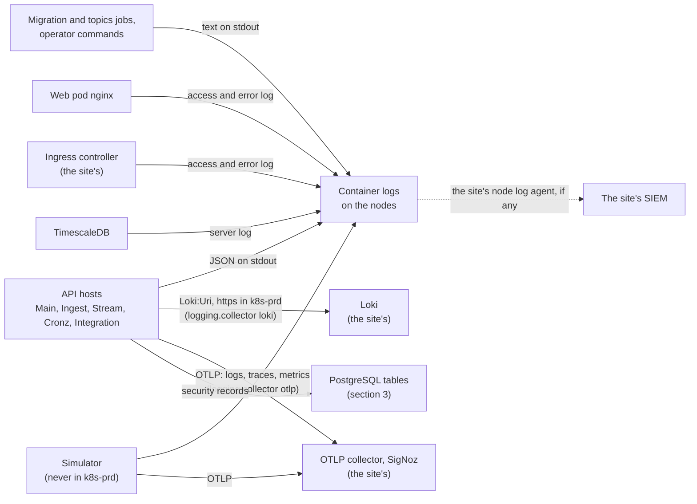

# Log inventory

Every place a log of an Ariva deployment can be written to, layer by layer. For each one: what is logged, in which format, where it is stored, who can read it, how long it is kept, and whether it can hold personal or border-only data (ASVS 5.0 V16.1.1). Section 1 lists the destinations themselves; a log goes to no other place (V16.2.3). For a site's security officer, site IT and Dalil operations.

Related pages: the database's tables are in the [data inventory](../privacy/data-inventory.md); what to watch and the procedures are in the [operations runbook](../../wiki/10-Operations-Runbook.md); the go-live record of central log collection is checklist item 15 of the [security guide](../../wiki/13-Security-Guide.md); the ASVS rows are in [asvs-l2](asvs-l2.md).

Status: this page describes the code, the charts and the controller values as of 2026-10-20 (ARV-091, ARV-091a, ARV-200). Section 10 holds the request context every host adds to its events, the security event catalogue and the log protection levels. Since ARV-091a a k8s-prd host ships its logs over TLS to Loki or to the OTLP collector, or does not start, and takes the log pseudonym key from the chart's Secret; section 8.1 is the access and retention of the shipped logs, for the go-live record. Not built yet: the sign-in, logout and refresh events (ARV-091b, after the owner's login freeze).

## How to read it

- **Personal data.** As in the data inventory: Ariva never receives a traveller's, an officer's or a document's identity. The people in its logs are its own users (staff), and the people behind a client address (a staff browser, a display, a sensor network or an integrator's system). An account id beside an action refers to a person.
- **Border-only data.** Desk and gate codes with a time, and AMAN feed content, could be joined with AMAN's records to identify an officer. So they stay in the border deployment ([data boundary](../domain/data-boundary.md), principle 5). The Ariva hosts write desk codes only as keyed pseudonyms (section 10.6), but a pseudonym with a time is still border-only data. A border deployment's logs go only to log stores of that deployment, read by its own operators. They never go to an airport deployment's store or to a shared one.
- **Credentials.** The redaction enricher keeps credentials out of every Ariva host log (sections 2.1 and 10.6). The rows say where a layer outside Ariva's code could still record one.
- **Site value To confirm.** The site decides the value and records it in its go-live record (wiki 13, checklist item 15, with section 8.1 here). Where ARV-111a proposed a value, it is given: 30 days in the log store, readable by the operations team only (TC-65).

## 1. Destinations



| # | Destination | Written by | On when | Where it is set | Section |
|---|---|---|---|---|---|
| 1 | Container standard output and error. The kubelet keeps them on each node; read them with `kubectl logs` | Every Ariva pod: the five API hosts, the migration and topics jobs, the web pod's nginx and the simulator (never in k8s-prd). Also the TimescaleDB pod and the site's ingress controller | Always | The kubelet's log rotation (cluster settings, not Ariva's) | 2, 4, 5, 6, 9 |
| 2 | Loki (the site's) | The API hosts | `Loki:Enabled` is true and `Loki:Uri` is set. Both are off in `appsettings.base.json`. The chart sets `Loki__Enabled` "true" on the five API hosts when `logging.collector` is `loki`, which `values-k8s-prd.yaml` ships (ARV-091a) | `Loki:Uri` in the appsettings secret; the switch from the chart's `logging.collector`. In k8s-prd: https only (`ArivaLogging.EnsureProductionTransport`), and reachable only through `networkPolicies.loki`, which the chart requires with `loki` | 2, 8 |
| 3 | OTLP collector, for example SigNoz (the site's): logs, traces and metrics | The API hosts and the simulator | `otel.endpoint` is set (the chart passes it as `OTEL_EXPORTER_OTLP_ENDPOINT`), or `Otlp:Enabled` is true. Empty in every committed values file. A site that ships its logs here sets `logging.collector` to `otlp` (ARV-091a) | The chart's values. In k8s-prd: https only (hosts and `templates/validate.yaml`; with `otlp` the chart requires an https `otel.endpoint` in every environment), and reachable only through `networkPolicies.otlp` | 2, 8 |
| 4 | JSON log file at `LogFile:Path` | The API hosts and the simulator | Only when `LogFile:Path` is set, and only in vm-local: a host or the simulator in any other environment refuses to start with it (ARV-091, `ArivaLogging.EnsureFileSinkIsLocal`, `SimulationLogFile.AddTo`) | Only the E2E run sets it (`LogFile__Path` in `Platform/Testing/Ariva.E2E/playwright.config.ts`). No committed appsettings file, chart value or AppHost setting does | 2, 9 |
| 5 | PostgreSQL tables of security records: audit trail, Integration API calls, alert emails, sign-in sessions, replay runs | The services, in the transaction of the change | Always | Scripts `0004`, `0006`, `0019`, `0023` and `0025`. Retention in `migration.retention` | 3 |
| 6 | TickerQ dashboard, in the memory of the Cronz process | Ariva.Api.Cronz | `Cronz:Dashboard:Enabled` with `Cronz:Dashboard:KeySha256` | The Cronz settings, and its Ingress's `sourceRanges` | 2 |
| 7 | Kafka dead-letter topics `<topic>.dlq.v1` | Every consuming host | A message fails after its retries | `TopicCatalog` (30 days), `Kafka:Topics:Overrides` | 7 |
| 8 | PostgreSQL log files in the data volume | PostgreSQL | Only when `logging_collector` is on (To confirm on the pod) | The image's settings, or the site's `ALTER SYSTEM` | 6 |
| 9 | ModSecurity audit log of the ingress controller | The site's ingress controller | Never for an Ariva Ingress: the chart's `modsecurity-snippet` ends with `SecAuditEngine Off` on each, which holds while the controller keeps `enable-modsecurity` "false" (ARV-091). Another team's Ingress on the same controller is the site's | The chart's `modsecurity-snippet` (`templates/_helpers.tpl`), and `enable-modsecurity` in the controller values (`Helm/ingress-nginx-values.yaml`) | 5 |
| 10 | Aspire dashboard, in memory on a developer's machine | Hosts and simulator run by `Platform/Cloud/Ariva.AppHost` | While the AppHost runs (vm-local only) | The AppHost | 9 |
| 11 | GitHub Actions: job logs, pull request comments and artifacts | CI jobs of `github.com/alsadderwork-coder/Ariva` | Every CI run | `.github/workflows/ci.yml`, `security-zap.yml`, `dev-environment.yml` | 9 |

In k8s-prd one collector is required (ARV-091a, ASVS 5.0 V16.4.3): every API host ships its logs over TLS to Loki (row 2) or to the OTLP collector (row 3), besides the console, or it does not start (section 2.1). The chart's `logging.collector` (`otlp` or `loki`) declares which one; the chart refuses a k8s-prd release without it, and so does any release with `logging.required` true, which the prd environment of both Helmfiles sets (state value `logShipping`). Elsewhere a collector is the environment's choice. Who reads the shipped logs and how long they are kept is section 8.1.

There are no other destinations. No Ariva host writes a log to any other file, table, topic or network service. The ingress controller's own OpenTelemetry export is off by requirement of Ariva's controller values, and pinned off on the live hub's Ingress (section 5). The browser app sends no log anywhere; the browser console stays on the device.

A destination the site adds is the site's own. Examples: a node log agent (Fluent Bit, or an OpenTelemetry collector's file log receiver) that ships the container logs to a SIEM, or the Kubernetes API server's audit log, which records who read a pod's logs. List it beside these in the go-live record, with its access and retention.

Checking a production deployment (read only). In k8s-prd, default-deny NetworkPolicies cover every Ariva pod (wiki 13, section 6a). So a log leaves a pod only through the container runtime, or to the peers the release gave. This holds only where the cluster's network plugin enforces NetworkPolicy (wiki 13, checklist item 4).

```bash
# Present only when the release gave the OTLP collector or Loki peers; NotFound means no log leaves the pods that way.
kubectl -n "$NAMESPACE" describe networkpolicy ariva-otlp-egress ariva-loki-egress
# The OTLP endpoint each Deployment exports to (empty: none).
kubectl -n "$NAMESPACE" get deploy -o jsonpath='{range .items[*]}{.metadata.name}{"\t"}{.spec.template.spec.containers[0].env[?(@.name=="OTEL_EXPORTER_OTLP_ENDPOINT")].value}{"\n"}{end}'
# ARV-091a: per Deployment, the Loki switch ("true" with logging.collector loki) and the Secret of the log pseudonym key;
# expected on the five API hosts only.
kubectl -n "$NAMESPACE" get deploy -o jsonpath='{range .items[*]}{.metadata.name}{"\t"}{.spec.template.spec.containers[0].env[?(@.name=="Loki__Enabled")].value}{"\t"}{.spec.template.spec.containers[0].env[?(@.name=="Logging__PseudonymKey")].valueFrom.secretKeyRef.name}{"\n"}{end}'
```

## 2. Ariva hosts (Main, Ingest, Stream, Cronz, Integration)

### 2.1 Pipeline, levels and redaction

Every host builds and owns its logger in `Platform/Backplane/Ariva.Api.Common/Logging/ArivaLogging.cs`. `AddAppLogging` (`Extensions/LoggingExtensions.cs`) replaces the framework's providers with it. The order is: levels from `Serilog:MinimumLevel`, then the log context (which carries the request context of section 10.1), `Application` and `Environment`, then the redaction enricher with the protection levels of section 10.6, then the sinks of section 2.2. Everything but the levels is fixed in code (ARV-091): Ariva no longer uses Serilog's configuration reader (Serilog.Settings.Configuration is removed), so no setting can add a sink, an enricher, a filter or a type to load. A host refuses to start, in every environment, vm-local included, when:
- the `Serilog` section holds any key but `MinimumLevel` (for example `WriteTo`, `AuditTo`, `Using`, `Enrich`, `Filter`, `Destructure`, `LevelSwitches`, `Properties`), or `MinimumLevel` holds anything but a level, or `Default` and `Override` (`MinimumLevel:ControlledBy`, for example), or a value that is not a Serilog level name (`ArivaLogging.EnsureOnlyLevelsAreConfigured`; `ArivaLoggingTests.Configure_Should_RefuseTheSetting_When_SerilogHoldsAnythingButLevels`). This also closes a route past the production TLS guard: a `WriteTo` entry could have sent logs to Loki over plain HTTP in k8s-prd (`SecurityEventLogTests.Host_Should_RefuseToStart_When_SerilogConfigurationSendsToLokiInClearInProduction`);
- outside vm-local: `LogFile:Path` is set, or `Logging:PseudonymKey` comes from a configuration file (section 10.6);
- `Logging:PseudonymKey` is set but malformed;
- `Loki:Username` and `Loki:Password` (ARV-091a, section 2.2): only one of them is set, or the user name holds a colon; outside vm-local also when either comes from a configuration file or `Loki:Uri` is not https;
- an OTLP header variable (`OTEL_EXPORTER_OTLP_HEADERS`, or the per-signal `OTEL_EXPORTER_OTLP_TRACES_HEADERS`, `OTEL_EXPORTER_OTLP_METRICS_HEADERS` and `OTEL_EXPORTER_OTLP_LOGS_HEADERS`; ARV-091a, section 2.2), outside vm-local while the OTLP export is on: it comes from a configuration file (the variable's name, then "comes from a configuration file; ..."), or Ariva's OTLP endpoint, or `OTEL_EXPORTER_OTLP_ENDPOINT` when it is set, is not https (the variable's name, then "is sent over https only: ..."). The file check comes first, and no message holds a value (`OtlpSettings.EnsureHeadersAreProtected`, run here and by `AddArivaTelemetry`, so the simulator obeys it too; `OtlpExportTests`, 38 cases, among them `EnsureHeadersAreProtected_Should_RefuseTheHeaders_When_TheyComeFromAFileOutsideVmLocal`, `EnsureHeadersAreProtected_Should_RefuseTheHeaders_When_TheyWouldGoInClear` and `Host_Should_RefuseToStart_When_TheOtlpHeadersWouldGoInClear` on each of the five hosts). vm-local is exempt: the Aspire AppHost sends its dashboard's key that way, over http on the machine.
- a collector's CA file (`Loki:RootCertificate`, `Otlp:RootCertificate`; ARV-200, section 2.2) that is missing, larger than 1 MiB (a device such as `/dev/zero` included), is not PEM, holds no certificate or holds a private key (the message names the setting and the path, never the contents), or that is set while that collector's address is not https; and, outside vm-local, any of OpenTelemetry's own certificate variables (`OTEL_EXPORTER_OTLP_CERTIFICATE`, `OTEL_EXPORTER_OTLP_CLIENT_CERTIFICATE`, `OTEL_EXPORTER_OTLP_CLIENT_KEY`, shared or per signal), which name the variable only (`CollectorTrust`; `CollectorTrustTests`).

In k8s-prd also (ARV-091a; `LogShippingTests`, 70 cases, among them `Host_Should_RefuseToStart_When_ProductionShipsTheLogsNowhere` and `Host_Should_RefuseToStart_When_ProductionHasNoPseudonymKey` on each of the five hosts):
- no collector over TLS (`ArivaLogging.EnsureProductionCollector`, message `ArivaLogging.NoCollector`, which names the settings and never a value). A collector counts when `Loki:Enabled` is true with an https `Loki:Uri`, or when the OTLP export is on, by `OTEL_EXPORTER_OTLP_ENDPOINT` or by `Otlp:Enabled` true with `Otlp:Endpoint`, at an https address (the variable too when it is set, since the sink reads it last). `Otlp:Endpoint` alone turns nothing on, and `OTEL_EXPORTER_OTLP_LOGS_ENDPOINT` is not read by the log sink, so neither counts (`Configure_Should_RefuseToBuild_When_ProductionShipsTheLogsNowhere`). The console stays on beside the collector;
- an enabled Loki or an OTLP endpoint that is not https (ARV-082a, `EnsureProductionTransport`);
- no `Logging:PseudonymKey` (`LogProtection.From`; section 10.6).

The transport guard runs first, so a host with `Loki:Enabled` true (the chart sets it with `logging.collector` `loki`) and no https `Loki:Uri` stops with "Loki:Uri must be https in k8s-prd" rather than the no-collector message (wiki 10, section 4.17, lists every refusal and its fix). For the collector and key rules, either the host's own environment or `Application:Environment` naming k8s-prd is enough (`Configure_Should_ApplyProductionsRules_When_OnlyTheSettingsNameK8sPrd`). Every refusal comes before any sink exists, so a host that does not start has opened no file and no connection. The one-shot commands never build this logger, so none of these refusals apply to them (section 2.3).

The simulator does not use this logger (section 9).

Levels come from `Serilog:MinimumLevel` in `Platform/Backplane/Ariva.Api.Common/appsettings.base.json` (`ArivaLoggingTests.BaseSettings_Should_HoldOnlyLevels_When_Read`). No committed environment or service file changes them.

| Category | Level |
|---|---|
| Default | Information |
| `Microsoft` | Warning |
| `Microsoft.AspNetCore.Hosting` | Warning, also fixed in code (`ArivaLogging.HostingCategory`). Its request line carries the query string, where SignalR puts `access_token` |
| `Microsoft.Hosting.Lifetime` | Information |
| `NHibernate` | Warning |
| `System` | Warning |
| `Ariva.Api.Common.Logging.SecurityEventLog` | Warning, fixed in code only (`ArivaLogging.SecurityEventCategory`): the request-level security events (section 10.2) |

A site changes a level under `Serilog:MinimumLevel` in its appsettings secret: a level name for the default, or `Default` and `Override` with a level per category. The hosting and security event categories stay at Warning whatever that says. A lower level writes more, so lower one only for a bounded investigation, then set it back.

There is no request log. No host adds request logging, and the hosting category's request lines stay below its level. The ingress controller's access log (section 5) is the request log.

Redaction (CWE-532, `RedactionEnricher.cs`) is added in code after the configuration is read, so no setting can remove it. It runs before any sink sees an event, and applies the protection levels of section 10.6 (ARV-091):
- Omit: a property, structure member or dictionary key named like a credential or a key has its value replaced with `[REDACTED]`. The names include `Authorization`, `Cookie`, `Set-Cookie`, `X-TOTP-Code`, `access_token`, `password`, `secret`, `ApiKey`, the CSRF, device and display key headers and `PseudonymKey`; the full list is `SensitiveNames`.
- Hash: track ids and desk codes become a pseudonym keyed per UTC day (`#` and 12 hex characters).
- Mask: staff email addresses keep their first character and their domain (`a***@example.com`).
- A dictionary's keys take the dictionary's level, as its values do; keys that protect alike are kept apart as `<protected key>~<n>`.
- It fails closed: a property it cannot protect is written as `[REDACTED]`, the rest of the event is still protected, and the failure is counted (`ariva.security.log_protection_failures`).
- Inside any other text, these are masked: `Bearer` and `Basic` credentials, JWTs, the query parameters `access_token`, `refresh_token`, `id_token`, `token`, `code`, `totp`, `otp`, `password` and `key`, device and display credentials (`ardk_`, `ardp_`), and email addresses.
- The request-level security events (section 10.2) lose ASP.NET Core's `RequestPath`: they name the endpoint by its route pattern instead.
- Exception messages are not rewritten, so code keeps secrets out of them (section 10.6).
- Tests: `RedactionEnricherTests`, `LogProtectionTests`, and in the E2E run the canaries of `log-redaction.spec.ts` and the scan of every host log (section 9).

Three things write to the same standard output or error outside this pipeline:
- The one-shot commands (section 2.3).
- The .NET runtime, which prints a crash before the logger exists, or an exception that ends the process, to standard error.
- NHibernate, when `Database:NHibernate:ShowSql` is on (it is off in every committed setting). NHibernate then prints SQL to standard output itself, which bypasses the redaction enricher. Keep it off outside vm-local.

### 2.2 What the hosts log, and where

| Sink | Events | Format | Stored in | Who can read it | Retention | Personal or border-only data |
|---|---|---|---|---|---|---|
| Console | Every event at or above its level. This includes: startup refusals and settings problems; health check Warnings (a Degraded dependency); Kafka producer, consumer and outbox relay events and dead letters; feed staleness; device and zone health; job runs; security events (`SecurityEvent.*`, EventIds in the 9100 range, section 10); refused device, display, integration and hub access; unhandled exceptions at Error | JSON, one object per line (`JsonFormatter` with the rendered message). Fields: `Timestamp` (ISO 8601 with offset), `Level`, `MessageTemplate`, `RenderedMessage`, `Exception` with its stack trace, `TraceId` and `SpanId` (on every event written under an activity, such as a request), and `Properties`. `Properties` holds the message's values (protected by level, section 10.6), `SourceContext`, `EventId`, `Application` and `Environment`; inside a request also ASP.NET Core's `RequestId` and `RequestPath` (the path without its query string; left out of the request-level security events) and the request context: `CallerAddress` and the caller (`CallerUserId`, with `CallerSessionId`, or `CallerClientId`, `CallerDeviceId` or `CallerDisplayId`; section 10.1). Written asynchronously with Serilog's default buffer of 10,000 events: when the buffer is full, new events are dropped rather than waited for | The container's standard output. The kubelet keeps it on the node (`/var/log/pods`); read it with `kubectl logs` | Anyone allowed `get` on `pods/log` in the release's namespace (wiki 13, checklist item 3), the node's administrators, and wherever the site's node log agent ships the logs. Site value To confirm | The kubelet's rotation: by default 5 files of 10 MiB per container (`containerLogMaxFiles`, `containerLogMaxSize`). Removed with the pod. Site value To confirm | Yes. Since ARV-091 every line written during a request names its client address and its caller by id (a user's account and session id, an integration client's id, a device's or a display's id), so the console holds staff addresses and account ids beside what they did, on every request that logs anything. Also account ids in the security events (the account and the administrator), the refused device, display and MQTT connections' addresses, and whatever an exception's text carries (section 10.6). Staff email addresses are masked (`a***@example.com`). Desk codes and track ids are hashed with a key per UTC day (`#` and 12 hex characters), for example Integration's "Border feed code ... has no AMAN desk code mapping"; in a border deployment the pseudonyms are still border-only data, since with the master key and the desk list they can be matched back. Never a password, token, key, TOTP code or cookie (omitted) |
| Loki | As the console | JSON (the Grafana Loki sink's default formatter), with the labels `app` (for example `api-main`), `environment`, `log_type` (`application`) and `level`. Sent in batches from memory: whatever is not yet sent when the pod stops is lost | The site's Loki at `Loki:Uri` (the sink adds the push path `/loki/api/v1/push`). In k8s-prd the URI must be https, or the host does not start (ARV-082a); with `logging.collector` `loki` the chart turns the sink on and a host without an https `Loki:Uri` does not start (ARV-091a). Sender credentials are optional (ARV-091a): for a Loki, or a gateway in front of it, that authenticates senders, `Loki:Username` and `Loki:Password`, sent with every batch as HTTP basic authentication (`Configure_Should_SendTheLokiCredentialsWithTheBatch_When_UsernameAndPasswordAreSet`). Both or neither, no colon in the user name, from the environment only outside vm-local (the chart's `logging.lokiCredentialsSecret`, rendered as `Loki__Username` and `Loki__Password` secretKeyRefs), over https only, and never in a message. A Loki whose certificate comes from the site's PKI (ARV-200): `Loki:RootCertificate` names its CA file (the chart's `logging.lokiCaSecretName`), which the sink then trusts alone; with it `Loki:Uri` must be https in every environment | The site's Loki users and tenants (section 8.1). Proposed: the operations team only (TC-65). Site value To confirm | Loki's own setting (section 8.1). Proposed: 30 days (TC-65). Site value To confirm | As the console |
| OTLP logs | As the console, as OTLP log records | OTLP over gRPC (4317) or HTTP (4318), with the resource attributes `service.name`, `service.namespace` (`ariva`) and `deployment.environment`. Over HTTP (`otel.protocol` `http/protobuf`) each signal has its own path after the endpoint, which keeps any path prefix of its own: `/v1/logs`, `/v1/traces`, `/v1/metrics` (`https://collector/otlp` gives `https://collector/otlp/v1/logs`); over gRPC the endpoint is used as given (`OtlpSettings.EndpointFor`; `OtlpExportTests.EndpointFor_Should_AppendTheSignalsPathOverHttpOnly_When_TheEndpointIsABase`). Batched in memory | The site's collector at `otel.endpoint`, for example SigNoz (ADR-0022). The chart passes the endpoint, the protocol and the resource attributes, and one credential only when the site names its Secret: the collector's sender headers (`otel.headersSecret`, rendered as `OTEL_EXPORTER_OTLP_HEADERS` from that Secret, sent by the log, trace and metric exporters alike; ARV-091a). Its value is a comma-separated list of `key=value` pairs whose values are percent-encoded (a space as `%20`; the trace, metric and log exporters all deliver `Authorization: Bearer <token>` decoded, `OtlpExportTests.Exporter_Should_DeliverEachHeaderDecoded_When_TheVariableIsPercentEncodedAsTheSpecificationSays`), in the form the collector's authenticator reads: `Authorization=Bearer%20<token>` for a bearer token, `Authorization=Basic%20<base64 of user:password>` for basic authentication, or another header such as `x-api-key=<key>` for a store that reads that one (section 8.1; `OtlpExportTests`). With headers the chart requires an https `otel.endpoint` in every environment, and outside vm-local, while the export is on, a host and the simulator refuse any OTLP header variable (the shared one or a per-signal one) from a configuration file or with an endpoint that is not https (section 2.1). Since ARV-091a the log sink reads the standard variables (`OTEL_EXPORTER_OTLP_ENDPOINT`, `_PROTOCOL`, `_HEADERS`, `OTEL_RESOURCE_ATTRIBUTES`, `OTEL_SERVICE_NAME`) from the host's configuration, which holds the environment, rather than from the process environment, so it ships to exactly the endpoint the guards judged (`Configure_Should_ShipOtlpLogsWhereTheHostsConfigurationSays_When_TheStandardVariablesAreSettings`). In k8s-prd the endpoint must be https. A collector whose certificate comes from the site's PKI (ARV-200): `Otlp:RootCertificate` names its CA file (the chart's `otel.caSecretName`), which the log sink and the trace and metric exporters then trust alone; with it the endpoint, and `OTEL_EXPORTER_OTLP_ENDPOINT` when it is set, must be https in every environment | As Loki (section 8.1, TC-65). Site value To confirm | As Loki. Proposed: 30 days (TC-65). Site value To confirm | As the console |
| Traces and metrics (OpenTelemetry, same endpoint) | A span for every request except the health probes, plus spans for outbound HTTP calls, database commands, and MassTransit's sends and consumes. The metrics of wiki 10, section 2a | OTLP, as OTLP logs: over HTTP at `/v1/traces` and `/v1/metrics` after the endpoint. Before ARV-091a an `http/protobuf` export posted traces and metrics (and the simulator's OTLP logs) to the endpoint's own path, which a collector does not serve, so they never arrived; gRPC, the chart's default, was not affected (`OtlpExportTests.Traces_Should_ReachTheTracesPath_When_TheProtocolIsHttpProtobuf`, `Metrics_Should_ReachTheMetricsPath_When_TheProtocolIsHttpProtobuf`) | As OTLP logs | As OTLP logs | As OTLP logs | Traces: the request attributes that OpenTelemetry's instrumentation records (for example method, route, path, status and user agent), with URL query values redacted. Redaction is OpenTelemetry .NET's default, which the hosts and the AppHost keep: never set `OTEL_DOTNET_EXPERIMENTAL_ASPNETCORE_DISABLE_URL_QUERY_REDACTION`. Also SQL text without parameter values, topic names and message ids; never a message body. Metrics: no tag holds a person, a credential or a value from a request (`MetricTagTests`) |
| JSON file | As the console | As the console. One file, shared by the process; Ariva never rotates or deletes it | The path in `LogFile:Path`. Only the E2E run sets it (section 9). vm-local only: since ARV-091 a host in any other environment refuses to start with the setting ("LogFile:Path is for vm-local only"), so no pod writes a log file (`SecurityEventLogTests.Configure_Should_RefuseTheFileSink_When_TheEnvironmentIsNotVmLocal`, `Host_Should_RefuseToStart_When_TheFileSinkIsSetOutsideVmLocal`) | Whoever can read that file | Until deleted | As the console. In the E2E run, synthetic data only |
| TickerQ dashboard | Cronz's jobs, their schedules, runs and failures (wiki 10, section 1) | TickerQ's screens and API | The memory of the Cronz process: the schedulers are held in memory (`Ariva.Api.Cronz/Jobs/JobsDashboard.cs`). Each failure is also logged to the console | Holders of the dashboard key (compared as a SHA-256), and only from the networks in its Ingress's `sourceRanges` (required in k8s-prd, ARV-085). Off unless enabled | Until the Cronz pod restarts | Possibly, in a failure's exception text |

### 2.3 The one-shot commands

These commands run before the host's logger is built:
- the migration job (`Ariva.Api.Main --migrate`)
- the topics job (`--provision-topics`)
- the break-glass installer (`--create-break-glass`, `--rotate-break-glass`)
- the stored-name check (`--check-stored-names`)
- Stream's replay commands (`--replay`, `--verify-replay`)

They log through Microsoft's simple console logger (`Ariva.Di/DatabaseMigration.cs` and the command classes beside it). Since they return before the logger is built, the k8s-prd rules of section 2.1 (a collector over TLS, the pseudonym key) do not apply to them (ARV-091a): the migration and topics Jobs and the operator commands run in k8s-prd without a collector and without the key, and the chart gives the Jobs neither the key nor Loki's credentials. A test holds each host's `Program.cs` to that order (`LogShippingTests.Program_Should_RunEveryOneShotCommandBeforeTheHostsLogger_When_ItStarts`), and others run the commands in k8s-prd with neither (`MigrationJob_Should_ReachTheDatabase_When_ProductionHasNoCollectorAndNoKey`, `StoredNameCheck_Should_ReachTheDatabase_When_ProductionHasNoCollectorAndNoKey`, `TopicsJob_Should_Succeed_When_ProductionHasNoCollectorAndNoKey`, `ReplayCommand_Should_ReachItsOwnArgumentCheck_When_ProductionHasNoCollectorAndNoKey`). Their lines stay on the pod's standard output (below); a site that wants them in its log store ships the container logs with a node log agent (section 1).

| Events | Format | Stored in | Who can read it | Retention | Personal or border-only data |
|---|---|---|---|---|---|
| Scripts applied, retention periods set, topics created, the break-glass account issued or rotated, replay results, and failures with their exception. The break-glass credential itself is never logged: it is printed once to the operator's terminal, or written to `--break-glass-output` (`BreakGlassCommand.cs`) | Plain text, one line per event, at Microsoft's default level (Information). Not JSON and no redaction enricher; never sent to Loki or OTLP | The Job pod's standard output. A command run with `kubectl exec` writes only to the operator's terminal; the Kubernetes API's audit log records the exec, not its output | `pods/log` readers in the namespace | The Jobs and their pods, with their logs, are deleted 24 hours after they finish (`ttlSecondsAfterFinished: 86400` in `templates/migration-job.yaml` and `topics-job.yaml`) | Possibly: database login names, and an exception's text. The stored-name check prints configuration; for personal texts it prints only the offending code points (wiki 10, section 4.2b) |

## 3. Security records in the database

These are not logs. They are records that the services write in the same transaction as the change they describe, and the runtime login cannot rewrite them. The data inventory lists every table with its personal data; the ones below record security-relevant events.

| Record | What it holds | Who can read it | Retention | Personal or border-only data |
|---|---|---|---|---|
| `audit_entry` (`Ariva.Infra/Timescale/Scripts/0006_audit_entry.sql`) | Every account administration action (create, update, role grant and revoke, password and TOTP reset, unlock, disable, enable), and every configuration change that writes an audit entry; the alert evaluation itself writes `Alert.Escalated` and, since ARV-190, `AlertRule.NotEvaluated` (a stored border rule that fails its metric's checks: the site and rule code, the values version, a fixed reason and the number of alerts withdrawn), as the actor `alert-evaluation`. Each entry holds: time, the acting account's id and name, action, target, short before and after summaries without secrets, client address, trace id. Append-only: the runtime role has no UPDATE, DELETE or TRUNCATE | System administrators through `GET api/v1/admin/audit-entries` (`AuditEntry.Search` and `AuditEntry.View`; no role may write an entry, `RolePermissions.cs`). Database administrators with SQL | Indefinite, with no retention job (D5) | Yes: account names and ids, client addresses, and names in the summaries. The entries of desk observation corrections hold desk codes, and the `AlertRule.NotEvaluated` entries border rule codes and withdrawn counts, which are border-only; only system administrators read them, and they hold `BorderDesks.View` |
| `integration_call` (`0025_integration_client.sql`) | Each Integration API call: client id, session, scope, method, route, site, status, payload SHA-256 and size, the caller's source address and time. Never the payload. Written once | No screen or API. Database administrators with SQL | `Database:Retention:IntegrationCallDays` (Helm `migration.retention.integrationCallDays`), default 400 days (Proposed, TC-68). Deleted daily at 03:15 UTC by the Cronz job `RelationalRetention` through `ariva_retention_purge` (`0054_retention_period.sql`) | None about people: it records calling systems and their addresses |
| `email_message` (`0023_email_message.sql`) | Each alert email: recipient, subject, body (alert facts), status, attempts, times and the sending error. The runtime role can change only how sending went, and deletes nothing | No screen. The hosts that send. SQL | `Database:Retention:AlertEmailDays`, default 180 days (Proposed, TC-67). Pending emails are never deleted. Same job | Yes: staff email addresses. A border alert's email carries border data (its lane figures) |
| `user_session` (`0004_user_session.sql`) | Each sign-in: account, authentication methods, client address, user agent, times, and revocation with its reason. Revoked, never deleted by the hosts | The hosts' session checks; no screen lists sessions. SQL | Indefinite today. A period is To confirm (TC-65) | Yes: account references, client addresses and user agents |
| `replay_run` (`0019_replay.sql`) | Each archive replay: who asked for it, the database login that recorded it, its range and its hashes, hash chained. Append-only | SQL, and the replay verification | Indefinite | Yes: the requesting operator's name |

## 4. Web pod nginx (Ariva.Web)

Ariva's `Platform/Frontplane/Ariva.Web/static/nginx/default.conf` sets no log directive except `access_log off` for `/healthz`. So the nginx image's own configuration applies (`nginx:1.30.5-alpine3.24`, see the `Dockerfile`): an access log in the image's `main` format and an error log at `notice`. The image links both to the container's standard output and standard error. The ingress routes `/api` and `/hubs` of the web host to Ariva.Api.Main, so this log covers only requests for the web app's files.

| Log | Events | Format | Stored in | Who can read it | Retention | Personal or border-only data |
|---|---|---|---|---|---|---|
| Access log | Each request for the app's files and its SPA routes, except the kubelet's `/healthz` probes | nginx `main`: client address (the ingress controller's pod), time, request line with its query string, status, bytes, referrer, user agent, and `X-Forwarded-For` (the client's address as the controller saw it) | Container standard output (`/var/log/nginx/access.log` in the image) | `pods/log` readers in the namespace, and the site's node log agent | The kubelet's rotation. Site value To confirm | Yes: client addresses and user agents of staff browsers and displays. A passenger display's URL carries its display code (`/display?code=...`) but not its credential: the credential stays in the URL fragment, which the browser never sends (`src/lib/core/displays.ts`) |
| Error log | nginx errors at `notice` and above: a missing file, a refused request, start and reload | nginx error lines with the client address, the request line and the host | Container standard error | As the access log | As the access log | Yes: client addresses and request lines |

## 4a. The malware scanner beside api-main (clamd and freshclam, ARV-092c)

Each api-main pod runs clamd and, with the signature source `public` or `mirror`, freshclam (wiki 04 section 6.7), from the ClamAV image. The chart's configuration (`ariva-platform.clamdConf` in `templates/_helpers.tpl`) sets `Foreground yes` and `LogTime yes` and no log file, so both write to the container's standard output; clean results are not logged (`LogClean` off). They are not Ariva's logger: nothing here is redacted, pseudonymised or shipped by the hosts. The site's node log agent collects them as container logs, if it collects container logs. What the scanner does for Ariva is in the host's own events: 9131, 9132 and 9133 (section 10.2).

| Log | Events | Format | Stored in | Who can read it | Retention | Personal or border-only data |
|---|---|---|---|---|---|---|
| clamd | Start, the signatures loaded and reloaded (with their versions), a detection (`instream(127.0.0.1@<port>): <signature> FOUND`), errors (a database it cannot load, a size limit, a lost connection) | clamd's own lines, with the time | Container standard output (`kubectl logs <api-main pod> -c clamd`) | `pods/log` in the namespace (the site's operators) | The kubelet's rotation, then the site's node agent, as the other container logs | None: INSTREAM carries no file name and no user; the client is the pod's loopback |
| freshclam | Each update check, the mirror it asked (the public mirrors or `uploadScan.signatures.mirrorUrl`), the databases downloaded with their versions, errors (refused, timed out, a certificate refused, a rate limit) | freshclam's own lines, with the time | Container standard output (`-c freshclam`) | As clamd | As clamd | None: the mirror's address only |

## 5. Ingress controller (the site's ingress-nginx)

The site runs the controller. Ariva ships the values the site merges in (`Platform/Cloud/Ariva.K8s/Helm/ingress-nginx-values.yaml`, written against ingress-nginx controller 1.15). Besides TLS, HSTS and forwarded headers, they set two things about logs (ARV-091):
- `log-format-upstream`: ingress-nginx 1.15's default access log format, except that the request line is written as `$request_method $uri $server_protocol` in place of `$request`. So the access log holds no query string, where a credential (the live hub's `access_token`, a credential sent by mistake) or personal data (a user search's text) could be. `$uri` is the normalised path. The chart test (`controllerValuesFindings` in `Platform/Cloud/Ariva.K8s/tests/checks.mjs`) refuses a controller format that writes `$request`, `$request_uri`, `$args`, `$query_string`, an `$arg_` variable, `$request_body`, `$http_authorization`, `$http_cookie` or a `$cookie_` variable.
- `enable-modsecurity: "false"`, for the whole controller, which must stay so. Turned on, the controller loads `/etc/nginx/modsecurity/modsecurity.conf` at the http level, and libmodsecurity's merge lets that file's audit settings override the `SecAuditEngine Off` of every Ariva Ingress, the live hub's included.

Four more settings are left at the controller's defaults on purpose, and the file says so; the chart test refuses the values that would log more (`controllerValuesFindings`):
- `error-log-level`: unset, or `notice`, `warn`, `error`, `crit`, `alert` or `emerg`. Never `info`, which writes every ModSecurity match with excerpts of the matched input, nor `debug`, which writes every request header (ingress-nginx's nginx is built with debug support).
- `log-format-escape-none`: never true (`1`, `t` and `true` are all refused). On, nginx would write control characters unescaped, so a request could forge log lines.
- `enable-opentelemetry`: off for the whole controller. ingress-nginx 1.15's OpenTelemetry module sets each span's `http.target` from the full request URI, query string included, so it would export the live hub's `access_token`. The Ariva hosts trace themselves, with query values redacted (section 2.2).
- The controller's `main-snippet`, `http-snippet`, `server-snippet` and `location-snippet`: none writes an `access_log`, `log_format`, `error_log` or `modsecurity` directive, which would get around the format above and the chart's guards.

The site applies these values to its controller before the release that brings them (wiki 18, ARV-091). A controller without them writes the default format, query strings included.

The Ariva chart (`templates/_helpers.tpl`) adds on its own Ingresses:
- The ModSecurity audit log off on every Ariva Ingress: the chart's `modsecurity-snippet` ends with `SecAuditEngine Off`. In ingress-nginx 1.15 a location with a `modsecurity-snippet` never loads `modsecurity.conf`, so no Ariva location writes an audit log. Rule matches still reach the error log (below). A site may add the OWASP Core Rule Set (`enable-owasp-core-rules`): proven in a container, the audit log stays off with it (no audit file for a CRS 403 carrying a bearer token and a cookie, nor for a refused sign-in), since the CRS only ever sets `ctl:auditEngine=Off`.
- The live hub (`web-hubs`, `/hubs` on the web host, `tokenInQuery` in `values-k8s-*.yaml`), whose WebSocket URL carries the access token: no access log, only critical errors (`error_log /dev/stderr crit`), and no OpenTelemetry spans (`enable-opentelemetry: "false"`, a key the chart sets, so a site annotation cannot turn it on; the chart test requires it on any Ingress that serves `/hubs`). The web host answers every other spelling of `/hubs` (`/HUBS`, `/Hubs`, `/%48UBS`) 404 at the server level: nginx matches the hub's location by case, so another spelling would reach another location with the token.
- Every host without the hub's Ingress (api-main's own host and every machine host) answers `/hubs` and anything under it, in any case, 404 at the server level, after the probe refusal and before nginx picks a location. So the live hub is reached through the web host only, and `https://<api-main host>/hubs/live?access_token=...` never reaches a location. The request still gets an access log line, which with the controller values' format names its path only.

`templates/validate.yaml` refuses what would undo this: a site `modsecurity-snippet` that sets `SecRuleEngine`, `SecAuditEngine`, any `SecAuditLog...` setting (`SecAuditLogParts` included) or any `SecDebugLog...` setting (`SecDebugLogLevel` included; the debug log writes headers and variables), `ctl:auditEngine` or `ctl:auditLogParts`, or loads rules (`Include`, `SecRemoteRules`); a site `modsecurity-snippet` that expands, anywhere, a macro of the request's values (`%{REQUEST_HEADERS...}`, `REQUEST_COOKIES`, `REQUEST_LINE`, `REQUEST_URI`, `REQUEST_BODY`, `FULL_REQUEST`, `QUERY_STRING`, `ARGS`, `XML`, `MATCHED_VAR`, `MATCHED_VARS` or a capture `TX.0` to `TX.9`), which a rule's `msg` or `logdata` would copy into the error log (`%{MATCHED_VAR_NAME}` is allowed: it names the variable, not its value); any annotation value that writes a `modsecurity...`, `access_log` or `error_log` directive, its name quoted or not (`"access_log"`, `'error_log'`, `'modsecurity_rules_file'`); a site `enable-opentelemetry` on the live hub's Ingress; a `tokenInQuery` that is not true or false; a `tokenInQuery` Ingress that routes anything but `/hubs` and paths under it; and `/hubs`, in any case, on an Ingress without `tokenInQuery`. The chart test fails a render that breaks the same rules.

| Log | Events | Format | Stored in | Who can read it | Retention | Personal or border-only data |
|---|---|---|---|---|---|---|
| Access log | Each request through every Ariva Ingress except `web-hubs`, the requests the server level answers itself included (the 421 for another host, the probe and `/hubs` 404s) | The controller values' `log-format-upstream` (ARV-091): client address, `$remote_user`, time, the request line as method, path and protocol without the query string, status, bytes, referrer, user agent, request length and time, upstream name and address, upstream bytes, time and status, and request id | The controller pods' standard output (the controller image links `/var/log/nginx/access.log` to it) | The site's ingress operators (`pods/log` in the controller's namespace), and its node log agent | Site value To confirm | Yes. Client addresses of staff, displays, devices and integrators. User agents. Paths, which carry the ids and codes of what was asked for. `$remote_user` is a device's code when the device authenticates with Basic. The referrer, which Ariva's own pages never send (`Referrer-Policy: no-referrer`). Never a query string, a cookie, another header or a body |
| Error log | nginx errors at `error-log-level` (the controller's default, `notice`; never `info` or `debug`, which the controller values refuse): upstream errors, configuration reloads; ModSecurity messages: a deny, such as the chart's upload rule (id 100001) with its 403, is written at error level, while other rule matches are at info and not written. With the OWASP Core Rule Set, a block writes one line at the default level, with only the anomaly score. On `web-hubs`, `crit` only | nginx error lines with the client address, the full request line (query string included), the host and the upstream; a ModSecurity message adds the rule's id, its message and nginx's request line. A site rule's message cannot copy request values (`validate.yaml` refuses those macros). The Core Rule Set's excerpts of the matched input (`Matched Data ... found within ARGS:...`) are written only at `info`, which is refused | The controller pods' standard error | As the access log | Site value To confirm | Yes: client addresses, and request lines with their query strings, on upstream errors and ModSecurity denies (a user search's text, a display code). Never the live hub's token: `/hubs` reaches a location only on `web-hubs`, which logs critical errors only |
| ModSecurity audit log | None on any Ariva Ingress (ARV-091): every Ariva location ends its rules with `SecAuditEngine Off` and loads no `modsecurity.conf`, while the controller keeps `enable-modsecurity` "false" | None | None | None | None | None from Ariva's hosts. Another team's Ingress on the same controller that turns ModSecurity on without a snippet of its own gets `modsecurity.conf` (below), and its audit log, with credentials: the site's concern, and one more reason to give Ariva a controller of its own where others create Ingresses |

The controller's own OpenTelemetry export is no destination of Ariva's logs or traces: it is off for the whole controller by requirement of the controller values, and pinned off on the live hub's Ingress by the chart. A site that turned it on would send every request's target, query string included, to its collector; the chart test refuses such controller values.

The controller's `modsecurity.conf`, for reference (ingress-nginx 1.15, ModSecurity v3.0.14): ModSecurity's recommended file, with `SecAuditEngine RelevantOnly`, `SecAuditLogRelevantStatus "^(?:5|4(?!04))"` (every 5xx, and every 4xx but 404), `SecAuditLogParts ABIJDEFHZ`, `SecAuditLogType Concurrent` and `SecAuditLogStorageDir /var/log/audit/`: one file per transaction inside the controller container, not standard output. Part B holds the request line with its query string and every request header (a bearer token, the refresh cookie); the request body is part C, which that list leaves out. The OWASP Core Rule Set only ever turns auditing off (`ctl:auditEngine=Off`). Before ARV-091 the Ariva Ingresses other than the hub's wrote no audit log either, on ingress-nginx 1.9.6 to 1.15: their audit engine was unset and the file was not loaded in their locations. The earlier text of this section assumed the file applied there; it did not.

To check the controller (read only), run these against one controller pod:

```bash
# The controller's own ModSecurity file; it applies only where a location loads it.
kubectl -n ingress-nginx exec <controller pod> -- grep -E '^Sec(AuditEngine|AuditLog|RequestBodyAccess)' /etc/nginx/modsecurity/modsecurity.conf
# The configuration the controller generated. Expected: a "SecAuditEngine Off" line in every Ariva location's rules;
# no modsecurity_rules_file line that loads /etc/nginx/modsecurity/modsecurity.conf (with the Core Rule Set on, a line
# loading the CRS's own file is expected; another team's Ingress that enables ModSecurity without a snippet would show
# modsecurity.conf in its own locations only); the "log_format upstreaminfo" line writing
# "$request_method $uri $server_protocol", with no bare $request; error_log lines at notice or above (crit in the hub's
# location), never info or debug; and no "opentelemetry on".
kubectl -n ingress-nginx exec <controller pod> -- grep -nE 'modsecurity_rules_file|SecAuditEngine|log_format upstreaminfo|error_log|opentelemetry' /etc/nginx/nginx.conf
# The controller's settings as the site applied them: error-log-level, log-format-escape-none, enable-opentelemetry and
# the four snippets (none of them may hold an access_log, log_format, error_log or modsecurity directive).
kubectl -n ingress-nginx get configmap <controller ConfigMap> -o yaml | grep -nE 'error-log-level|log-format|enable-opentelemetry|enable-modsecurity|snippet'
```

## 6. PostgreSQL and TimescaleDB

Ariva's database chart (`Platform/Cloud/Ariva.K8s/Helm/Charts/timescaledb`) passes PostgreSQL only its TLS settings (`templates/statefulset.yaml`, with `tls.enabled`). `docker-compose.dev.yml` passes none. So the `timescale/timescaledb-ha` image's settings apply: PostgreSQL's defaults, unless the image changes them. A site's own PostgreSQL has its own settings.

| Log | Events | Format | Stored in | Who can read it | Retention | Personal or border-only data |
|---|---|---|---|---|---|---|
| Server log | With PostgreSQL's defaults, it logs: errors and warnings (`log_min_messages` warning); the text of a statement that failed (`log_min_error_statement` error; its bound values only when `log_parameter_max_length_on_error` allows, default 0); failed password authentication (FATAL, with the login name); checkpoints; TimescaleDB job errors (retention, compression). Not logged by default: connections, disconnections, statements and durations | Text lines prefixed `%m [%p] ` (time and process; PostgreSQL's default `log_line_prefix`) | Standard error (the container log) while `logging_collector` is off, which is PostgreSQL's default. Files in the data directory, on the data volume, when it is on. To confirm on the pod (below) | `pods/log` readers in the namespace. With the collector on, whoever can read the data volume | The kubelet's rotation, or the collector's `log_rotation_*` settings. Site value To confirm | Possibly: login names (service logins, not people) and client addresses (pods). Also the DETAIL line of a constraint error, which names the key's values: a duplicate user name or email address, or in a border deployment a desk code (border-only) |

To see what the deployment runs (read only):

```bash
kubectl -n "$NAMESPACE" exec timescaledb-0 -- psql -U postgres -Atc "SELECT name, setting FROM pg_settings WHERE name = 'logging_collector' OR name LIKE 'log\_%' ORDER BY name"
```

What a site should set:

| Setting | Value | Why |
|---|---|---|
| `log_connections`, `log_disconnections` | `on` | Records who connected to the database, from where and for how long: each host's runtime login from its pod, the migration job, and a person's own login |
| `log_line_prefix` | `'%m [%p] %q%u@%d %r '` | Puts time, process, login, database and client address on every line |
| `log_timezone` | `'UTC'` | Matches every other Ariva time |
| `log_statement` | `'none'` (the default) or `'ddl'` | `ddl` records schema changes, and only the migration job makes them. `mod` and `all` would write the values of changed rows, among them user rows with their email addresses and hashes. `all` would also write the runtime login's password: the migration job sets it by calling `ariva_ensure_runtime_login` (script `0001_roles.sql`), and `all` logs that call's values (wiki 13, checklist item 9) |
| `log_parameter_max_length` | `0` | Keeps bound values out of any statement that is logged, in case a duration threshold or statement logging is turned on later |
| `log_parameter_max_length_on_error` | `0` (the default) | Keeps bound values out of error entries |
| `log_min_duration_statement` | `-1` (the default), or a threshold well above normal statement times, together with `log_parameter_max_length` 0 | Otherwise a slow statement is logged with its bound values |
| `pgaudit.log_parameter`, `auto_explain.log_parameter_max_length` | `off`, `0` | Only if the site loads those extensions; same reason as above |

Set them as the superuser over the pod's socket (`ALTER SYSTEM SET ...;`, then `SELECT pg_reload_conf();`), which writes `postgresql.auto.conf` on the data volume. With the site's own PostgreSQL, set them in its configuration. This is the site's change: Ariva's chart neither sets nor checks these settings.

## 7. Kafka (the site's brokers)

The brokers belong to the site (or the cluster's operator). Ariva provisions its topics (`TopicProvisioner`, the topics job) but sets nothing about the brokers' logging. No Ariva host writes a log line to Kafka.

| What | Events | Format | Stored in | Who can read it | Retention | Personal or border-only data |
|---|---|---|---|---|---|---|
| Broker logs (server, controller, state change, authorizer, request) | The broker's own events: starts, leadership, client connections and their errors, authentication failures, and ACL decisions (the authorizer logs denials; per-service ACLs are wiki 13, checklist item 10) | The broker's log4j format | The broker's own files or standard output | The site's Kafka operators | Site value To confirm | Possibly: principals (service logins such as `ariva`), client addresses (pods), topic and group names. Kafka writes no record value to these logs; keep `kafka.request.logger` at its default level (WARN) |
| Topic records (not logs, listed for the data boundary) | Ariva's facts and events: aggregates and configuration only (data boundary). In a border deployment, also the AMAN feed's four contracts, which are aggregate-only by contract (ADR-0010) | Ariva's event messages, with trace context in their headers (ADR-0022) | The topics: 3, 14 or 30 days by class, or compacted (`Ariva.Infra/Messaging/TopicCatalog.cs`, overview section 5, `Kafka:Topics:Overrides`) | Principals with read ACLs | As the topic | Configuration events may name a user (the zone profile published event names the publishing user; see the data inventory). Desk-level facts and the AMAN feed are border-only and stay in the border deployment's Kafka |
| Dead-letter topics `<topic>.dlq.v1` | Each message a consumer could not apply after its retries: source topic, partition, offset, key, headers, the record's body in base64 (cut at 512 KB), the consumer, and the error's type and message, with no stack trace (`Ariva.Infra/Messaging/Kafka/DeadLetters.cs`) | JSON | The dead-letter topics. Until Kafka takes a letter, it waits as an `outbox_message` row (ARV-171) | Principals with read ACLs on them; an operator reading them (wiki 10, section 4.5a) | 30 days (`TopicCatalog`). Never delete a dead-letter topic by hand (wiki 10, section 4.5a) | As the source record. Dead letters of AMAN feed and desk topics are border-only |

## 8. Redis, the OTLP collector and Loki (the site's)

| What | Events | Format | Stored in | Who can read it | Retention | Personal or border-only data |
|---|---|---|---|---|---|---|
| Redis | Ariva writes no log to Redis. Redis's own log (`loglevel` notice by default) records starts, persistence, and client and replication errors, without keys or values. `SLOWLOG` keeps the arguments of slow commands in memory, and `MONITOR` streams every command; both show cache keys (account and session ids) and cached values (roles, session state, live snapshots) | Redis's text log | Redis's log file or standard output | The site's Redis administrators. Restrict `SLOWLOG` and `MONITOR` to them with Redis ACLs | Site value To confirm | References only (account and session ids). No name, address or password is cached (data inventory) |
| OTLP collector and SigNoz | Receives the OTLP logs, traces and metrics of section 2.2, and the simulator's (section 9) | OTLP | The site's collector and its store | SigNoz users (the site's; section 8.1). Proposed: the operations team only (TC-65) | Site value To confirm. Proposed: 30 days (TC-65) | As section 2.2 |
| Loki | Receives the Loki logs of section 2.2 | As section 2.2 | Loki's store | Loki's users and tenants (the site's; section 8.1). Proposed: the operations team only (TC-65) | Site value To confirm. Proposed: 30 days (TC-65) | As section 2.2 |
| Their own logs | The collector's, SigNoz's and Loki's own operation | Their own | Their own | The site's operators | Site value To confirm | Possibly: the pods' client addresses |

By default the chart and the hosts configure no credential for the collector or for Loki: only an address, a protocol and resource attributes. The exceptions are optional, for a store that authenticates senders (ARV-091a, section 2.2): Loki's user name and password from `logging.lokiCredentialsSecret`, and the OTLP collector's sender headers from `otel.headersSecret`. Each comes from a Kubernetes Secret the site creates (never a chart value), reaches the five API hosts only (the headers also the simulator, which exports to the same collector in dev and demo and never runs in k8s-prd), and goes over https only: outside vm-local a host refuses Loki's pair, and a host or the simulator any OTLP header variable (the shared one or a per-signal one, while the export is on), when it comes from a configuration file or would go to a plain http address (section 2.1). No refusal names a value. In k8s-prd the logs travel over TLS, one of the two is required (section 1), and the release's NetworkPolicies let only the API hosts reach them (and the simulator reach the collector).

A border deployment's collector and Loki hold border-only data (section 2.2), so they belong to that deployment. Never share them with an airport deployment (data boundary, principle 5).

### 8.1 Access and retention of the shipped logs: the go-live record (ARV-091a)

What the site records, per store that receives Ariva's logs, in its go-live record (wiki 13, checklist item 15). Ariva's code and chart decide what is shipped and how (TLS, the sender's credential, the protection levels of section 10.6); the store's readers, its protection against change and its retention are the site's, set in the store. ASVS 5.0 V16.4.2 is met for a deployment once this record is complete.

| | Loki | OTLP collector and its store (SigNoz) | A customer SIEM |
|---|---|---|---|
| What reaches it | The five API hosts' JSON lines, pushed over https (`logging.collector` `loki`) | The hosts' OTLP log records, traces and metrics over https (`logging.collector` `otlp`) | What the site forwards: from Loki or the collector (a forwarding rule or an export), or the container logs through a node log agent (the console stays on in every pod, section 2.2) |
| What it holds | Staff client addresses and account and session ids beside what they did; masked staff email addresses; desk codes and track ids as pseudonyms, border-only data in a border deployment (sections 2.2, 10.6). Never a credential | As Loki; traces add request attributes with query values redacted (section 2.2) | As its source |
| Who may read it | Proposed: the operations team only (TC-65). Site value To confirm | As Loki. Site value To confirm | Proposed as for the other stores: the operations team only (TC-65). A SIEM's analysts are readers too, so the record names them. Site value To confirm |
| Who must not read it | The airport's staff for a border deployment's logs (data boundary, principle 5). Anyone who can read the log pseudonym key's Secret should not be a log reader as well (section 10.6) | As Loki | As Loki |
| How access is controlled at the store | Loki has no user authentication of its own: put an authenticating gateway in front of its push and query paths (or let only a Grafana with its own sign-in query it), let Ariva's sender only push (with `logging.lokiCredentialsSecret` when the gateway authenticates senders), and give the readers query access only, through the gateway or Grafana. With Loki's multi-tenancy (`auth_enabled: true`) the gateway sets the tenant. A border deployment's logs go to a Loki of that deployment | SigNoz's own users and roles (Admin, Editor, Viewer): give the readers Viewer. The collector's receiver authenticates senders where it can, with the header Ariva sends from `otel.headersSecret`. For example the `bearertokenauth` and `basicauth` extensions of the OpenTelemetry Collector's contrib distribution (they are not in the core Collector), which read the `Authorization` header: give `Authorization=Bearer%20<token>` or `Authorization=Basic%20<base64 of user:password>` respectively (the value percent-encoded, a space as `%20`). A header such as `x-api-key` works only with a store that reads that header | The SIEM's own roles: an index, source or workspace that only the recorded readers may search |
| Protection against change (immutability, append-only) | Ariva's sender can only push, and the console copy on the node is not the record. Keep Loki's log deletion API off (`deletion_mode: disabled`) or reachable by Loki's administrators only. Where the site needs more, an object store for Loki's chunks with a write-once lock (for example S3 Object Lock or Azure immutable blob storage) no longer than the retention period: the site's choice | Readers hold the Viewer role, which reads only; only the store's administrators reach its database. A write-once store underneath as for Loki: the site's choice | The SIEM's append-only or write-once storage, and its tamper evidence where it has them |
| Retention | Proposed: 30 days (TC-65). Loki deletes nothing until its compactor's retention is on (`retention_enabled: true`); `retention_period: 720h` then keeps 30 days. Site value To confirm | Proposed: 30 days (TC-65), set per signal in SigNoz's settings. Site value To confirm | Proposed: 30 days (TC-65), on the index or source. Site value To confirm |
| Alert when the lines stop | A Loki ruler alert per API host, for example `absent_over_time({app="api-main", environment="k8s-prd"}[15m])`, and the same for `api-ingest`, `api-stream`, `api-cronz` and `api-integration` (the labels Ariva's Loki sink sends: `app`, `environment`, `log_type`, `level`) | A SigNoz logs alert per host: the count of log records of `service.name` `api-main` over 15 minutes below 1, and the same for the other four | The SIEM's own alert on a silent source |
| Transport | https from every host (ARV-082a, ARV-091a). The hosts verify the store's certificate against the image's system trust store (the public CAs) or, when the site names the store's CA (ARV-200), against that CA alone: `logging.lokiCaSecretName` for Loki, `otel.caSecretName` for the collector, each a Secret whose `ca.crt` the hosts read as `Loki:RootCertificate` or `Otlp:RootCertificate`. The go-live record names which (wiki 13 checklist item 15) | As Loki | The forwarder's own, recorded by the site |

The record also names who can read the log pseudonym key's Secret (section 10.6; never the log readers) and the Secret of any sender credential, and keeps the proof that the logs arrive: a host's startup line found in the store after the release, for example `{app="api-main", environment="k8s-prd"} |= "Application started"` in Loki, or the same text in the logs of `service.name` `api-main` in SigNoz. This proof matters because a peer list that does not reach the store fails silently: `values-k8s-prd.yaml` ships `networkPolicies.loki` with the documentation network `192.0.2.0/24`, so a site that has not set `Loki:Uri` gets hosts that refuse to start, but a site that sets `Loki:Uri` and keeps that peer list gets hosts that start and logs that never leave the pods.

The proof holds at go-live only. Later the lines can stop without any host stopping: the store becomes unreachable, its certificate moves to another CA, a NetworkPolicy edit drops its peers, or it refuses the sender's credential. The sinks send in the background, so no Ariva check or shipped alert reports it; the "Alert when the lines stop" row above is the store-side alert that does, set up by the site and recorded in the go-live record. Choose a window longer than a host's normal silence (a quiet host that writes nothing for the window raises the alert too): Site value To confirm, measured in the first days of operation.

## 9. Simulator, test runs and development machines (never production)

| What | Events | Format | Stored in | Who can read it | Retention | Personal or border-only data |
|---|---|---|---|---|---|---|
| Simulator (`Platform/Simulation/Ariva.Simulation.Api`). Runs in k8s-dev, k8s-demo, vm-local and the test runs. It refuses to start in k8s-prd (`Program.cs`), and `values-k8s-prd.yaml` sets `simulationEnabled: false` | Scenario runs, emulator sends to Ariva and Ariva's answers, and operator refusals. Every category logs at Information, the framework's default, because there is no `Logging` section; so ASP.NET Core's request lines appear with their query strings | Microsoft's default providers, without Serilog or the redaction enricher: console text, plus the Debug and EventSource providers, which write only to an attached debugger or tracing tool. OTLP log records when an endpoint is set (`ExportLogs`), over HTTP at `/v1/logs` since ARV-091a. The OTLP header rules of section 2.1 apply to it (it starts its telemetry through `AddArivaTelemetry`), so in k8s-dev or k8s-demo it refuses to start when given headers with an http endpoint. JSON lines at `LogFile:Path` (`Security/SimulationLogFile.cs`), which leaves out the hosting category below Warning; vm-local only, as on the hosts: in any other environment the simulator refuses to start with the setting (ARV-091). No request context and no protection levels (section 10) | The container log in the clusters; the OTLP collector of dev and demo when one is set; the E2E run's folder | As the hosts' | As the hosts' | None real: scenario data only. The observers' user names, passwords and seeds are never logged, and reports name observers by number (`Emulators/README.md`). Operator keys travel in headers |
| E2E run (`node scripts/verify.mjs e2e`, CI's `e2e` job, the ZAP scan) | Every host's events, and the simulator's | JSON, as in section 2.2 | `Platform/Testing/Ariva.E2E/logs/<run start>/<project>.log`, one folder per run (`LogFile__Path`, `playwright.config.ts`), git-ignored (`/logs`). The hosts' standard output is discarded; their standard error joins Playwright's output | The machine's user. After the run, `tests/support/global-teardown.ts` reads the logs and fails the run on any credential, canary or MassTransit usage telemetry line, and since ARV-091 on a whole staff email address of the run (`@ariva.e2e`, which must appear masked) and on the unmapped desk code `NOSUCH9` that `aman-feed.spec.ts` sends (which must appear hashed); `tests/api/totp.spec.ts` and `tests/api/log-redaction.spec.ts` also read them (section 10) | Until deleted | Synthetic data and the run's own test accounts |
| CI on GitHub Actions (`github.com/alsadderwork-coder/Ariva`, a public repository) | Build and test output, and Playwright's output with the hosts' standard error (`e2e.log`). When a pull request run fails, a comment with the failing tests, up to 8 Error or Fatal lines from each host log (600 characters each) and the last 40 `[WebServer]` lines (`.github/workflows/ci.yml`). When the dev stack's check fails, the last 80 lines of each container log (`dev-environment.yml`) | Text | Job logs. Pull request comments, which are as public as the repository. Artifacts: `playwright-report` with `test-results` on failure (7 days), `unit-test-results` (TRX), `visual-diffs` (14 days), `zap-reports` and `zap-dev-report` (30 days) | Job logs and artifacts: per GitHub's permissions for the repository. Comments: anyone who can read the repository | Artifacts as listed. Job logs and the TRX artifact follow the repository's retention setting (GitHub's default is 90 days; To confirm in the repository's settings) | Synthetic data. For a failed test in the `api` and `functional` projects, Playwright keeps a trace (`trace: 'retain-on-failure'`) with that test's requests and their headers, so it holds the test accounts' tokens and typed passwords. Those accounts exist only in the job's own database |
| Developer machine (vm-local) | As the hosts and the simulator | As above | With `dotnet run`: the terminal. With the AppHost (`Platform/Cloud/Ariva.AppHost`): the Aspire dashboard, which keeps in memory the OTLP logs, traces and metrics and the console output of every host and the simulator. With `docker-compose.dev.yml`: Docker's log driver, for the dependencies | The developer | Until the process or the dashboard stops. Docker's logs last until the containers are removed | Development and demo seed data |

## 10. Request context, security events and protection levels (ARV-091)

Every Backplane host (Main, Ingest, Stream, Cronz, Integration) adds who and where to the events a request writes, writes the security events below under stable EventIds, and protects sensitive values by level before any sink sees an event (ASVS 5.0 V16.2.1, V16.2.5, V16.3.2, V16.3.3). The code is in `Platform/Backplane/Ariva.Api.Common`: `Logging/RequestLogContext.cs`, `Middlewares/RequestLogContextMiddleware.cs`, `Logging/SecurityEvents.cs`, `Logging/SecurityEventLog.cs`, `Logging/SecurityEventThrottle.cs`, `Logging/SecurityEventMetrics.cs`, `Security/SecurityEventResultHandler.cs`, `Logging/LogProtection.cs` and `Logging/RedactionEnricher.cs`. The simulator and the one-shot commands (section 2.3) use none of it.

### 10.1 Request context

`RequestLogContextMiddleware` runs inside `UseAppForwardedHeaders`, right after the forwarded headers middleware, so every host has it. It puts the request's context on Serilog's log context for the rest of the request, and every event the request writes carries these fields:

| Field | Where in the JSON line | Value | Set when |
|---|---|---|---|
| `TraceId`, `SpanId` | At the top level, beside `Properties` (Serilog 4.3's `JsonFormatter`) | The request's W3C trace id (32 hex characters) and span id (16). An error answer carries the same trace in its ProblemDetails `traceId`, `00-<trace id>-<span id>-01` | By Serilog, on every event written under an activity |
| `CallerAddress` | `Properties` | The client address after the forwarded headers middleware: the client the trusted proxy names (`Security:ForwardedHeaders`, the ingress controller's pod network), otherwise the connection's own address. An IPv4 address mapped to IPv6 is written as IPv4; `unknown` when the connection has none | At the start of the request |
| `CallerUserId` | `Properties` | `anonymous` until the caller is identified and for a caller without a credential; then a user's subject claim, a GUID; `unknown` for an authenticated principal whose subject is neither a GUID nor an integration client id (Ariva's own schemes issue no such subject) | When the authorization middleware decides, after authentication, the session check and the policy's own schemes (`SecurityEventResultHandler` calls `RequestLogContext.Identify`); for a request the authorization middleware did not decide that ends in 401, 403 or 429, when the request ends (section 10.2, 9129) |
| `CallerSessionId` | `Properties` | The token's `sid`: the id of the server-side session row of a user or an integration client, as it is. It authenticates nothing (every request also needs the signed token that carries it) and finds no token (refresh tokens are kept as hashes, by family), so it is not hashed; it ties a line to the session's sign-in record (`user_session`, section 3) | With `CallerUserId` or `CallerClientId` |
| `CallerClientId` | `Properties` | An integration client's public client id (`ic_...`), in place of `CallerUserId`; also the integration client the call check accepted when the principal names none | As `CallerUserId` |
| `CallerDeviceId`, `CallerDisplayId` | `Properties` | A sensor device's or a display player's id (a GUID), in place of `CallerUserId` | As `CallerUserId` |

Rules:
- Ids only: never a user name, display name, email address or credential.
- The `Caller` names belong to this enricher, which overwrites them: no message template uses them (`RequestLogContext.CallerProperties`). So a line that names another account keeps it apart: an administrator resetting a password writes the target account in its own `{UserId}` (and a target session in `{SessionId}`), and the administrator, the administrator's session and address in the `Caller` fields (`RequestLogContextTests.Enrich_Should_KeepTheTargetApartFromTheCaller_When_TheTemplateNamesAnotherAccountAndSession`, `SecurityEventLogTests.AdministratorLine_Should_KeepTheTargetApartFromTheCaller_When_ItNamesAnotherAccountAndSession`).
- An endpoint that allows anonymous callers (the sign-in, the token refresh, the health probes) names no caller while it runs: the authorization middleware does not decide there, so its lines say `anonymous` even when a token was sent.
- The values are copied when they are set, so a line written after the request has ended, by work the request started, still names that request's caller and never another's (`SecurityEventLogTests.LineWrittenAfterTheAnswer_Should_NameTheRequestsCaller_When_AnotherRequestHasRunSince`).
- Lines written outside a request (consumers, jobs, the outbox relay, MQTT connections, the security event summaries) carry no request context; their own fields say what they are about.
- The live hub's join refusals run inside the hub connection's request, so since ARV-091 they carry the caller and the address beside the connection id.

### 10.2 Security event catalogue

Every security event of the hosts has a name `SecurityEvent.<Name>` and an EventId in the 9100 range (the Cronz dashboard's two, below, are 9601 and 9602 without such a name), which stays the same across releases: an alert or a saved search keyed on the id keeps working. In the JSON line they are `Properties.EventId.Id` and `Properties.EventId.Name`. The events reach every sink of section 2.2. "Proposed alert" values are suggestions for the site's log store or SIEM, not shipped: the chart's SigNoz rules read metrics (wiki 10, section 3.1). How to search for them: wiki 10, section 4.16.

**Request-level events (ARV-091).** Written by `SecurityEventLog` in every host, at Warning, within the throttle of section 10.3. Their category (`Ariva.Api.Common.Logging.SecurityEventLog`) is held at Warning in code, so no level setting silences them (`ArivaLoggingTests.Configure_Should_KeepTheSecurityEventsAtWarning_When_TheLevelsWouldSilenceThem`). Each carries the request context (`CallerAddress`, the `Caller` id fields, `TraceId`), `Method` (one of HTTP's own methods, or `OTHER` for any other token a client sends), `Endpoint` (the endpoint's route pattern from the code, for example `api/v1/sites/{siteCode}/overflow-bands`, else its display name, else `(none)` when no endpoint matched) and `Reason` (a fixed word). Never in them: the request path (the redaction enricher drops `RequestPath` from these events, since a path can hold the refused value), the query string, a header, the body, a member name, a model state key or message, or any value the caller sent. Writing one never changes the answer: a failure while building or writing it is contained and counted as `failed` in the metric (`SecurityEventThrottleTests.Forbidden_Should_CountAFailureAndThrowNothing_When_TheEventCannotBeBuilt`).

| EventId | Name | Fires when | Fields beyond the common ones | Search or alert |
|---|---|---|---|---|
| 9114 | `AuthorizationForbidden` | The authorization middleware answers 403: the caller is authenticated, but a requirement of the endpoint's policy fails | `Reason`: `PermissionMissing` (none of the endpoint's permissions), `ScopeMissing` (an integration client without the endpoint's scope or the route's site), `DeviceZoneMismatch` (a device calling for a queue zone that is not its own) or `PolicyNotMet` (any other requirement). `Requirement`: the failed requirements as the code names them (the word Permission and the permission codes, `Scope` and the scope, `SecondFactor`, `Claim` and the claim type, `AuthenticatedUser`, or the requirement's type name), from endpoint metadata only, cut at 256 characters | An account or client with many is trying beyond its role, or the web app shows it a screen it cannot use: review its grants. Proposed alert: 20 or more from one `CallerUserId` or `CallerClientId` in 10 minutes |
| 9115 | `AuthorizationChallenged` | The authorization middleware answers 401 | `Reason`: `NotAuthenticated` (no credential, or one that did not authenticate) or `SecondFactorRequired` (a critical action without a second factor within its age: the RFC 9470 `mfa_required` answer) | Many `NotAuthenticated` from one `CallerAddress`: a scanner, or a device or integrator whose credential stopped working (compare the refusal lines below). `SecondFactorRequired` alone is normal: the web app asks for the code and sends the action again. Proposed alert: 100 or more from one address in 10 minutes |
| 9116 | `RateLimitRejected` | A rate limiting policy answers 429 | `Policy`: `global` (the per-address limiter), `auth`, `integration-auth`, `device`, `display`, `display-plays`, `upload` (since ARV-265 after authorization, so its caller is signed in: partition `user` for one user's share of the host's upload places, `host` for every place taken), `integration-batch`, `integration-aidx`, `validation-results`, `reports` (ARV-096), `backtest` or `hub-connections` (ARV-096b: a live hub negotiate refused because the replica holds `Security:Hubs:MaxConnections`; a `host` partition, after authorization, so its caller is signed in). `Partition`: the kind of partition, never its key: `address`, `device credential`, `display credential`, `host` (the concurrency policies, one per host process) or `user` (`upload`, ARV-265). Always `anonymous` (but `hub-connections` and `upload`): the limiter runs before authentication, so the client address is the only who; the user concurrency policies (`backtest`, `validation-results`, `reports`) count only requests that send credentials since ARV-096b | Sustained `auth` or `integration-auth` events from one address: password or secret guessing (compare 9101 and the integration lockouts). `host`: the replica's at-once limit is reached, a capacity question unless one address dominates the access log. Proposed alert: `auth` or `integration-auth` from one address for 10 minutes |
| 9117 | `InvalidModelRefused` | A controller answers 400 for an invalid request model: a validation attribute, a value that does not bind, a missing body | `Reason` `InvalidModel` | A steady rate from one caller is a broken client; bursts across many endpoints from one address are a scanner |
| 9118 | `StrictJsonRefused` | A controller answers 400 for a body the strict JSON reader refused: a member the model does not define, a member sent twice, a number sent as a string, JSON that does not parse (ARV-089) | `Reason` `NotStrictJson` | After an upgrade: a client that sends members the endpoint does not define (wiki 18, ARV-089). Otherwise as 9117 |
| 9119 | `RepeatedQueryRefused` | 400 for a query parameter sent more than once (ARV-089) | `Reason` `RepeatedQueryParameter` | Parameter pollution probing, or a client that builds its queries badly |
| 9127 | `NulCharacterRefused` | 400 for a NUL character in the query, a route value, a form field or a JSON string (ARV-063) | `Reason` `NulCharacter` | Almost always a scanner (ZAP sends `%00`) |
| 9128 | `SiteScopeRefused` | `[SiteScoped]` answers 404 for a `siteCode` | `Reason`: `OutsideSiteScope` (not one of the caller's sites; a site that does not exist is not one of them either) or `NotASiteCode` (a value that cannot be a site code). Never the code itself | Repeated `OutsideSiteScope` from one `CallerUserId`: a person trying other sites' data; review with the site's administrator. Proposed alert: 10 or more from one `CallerUserId` in 10 minutes |
| 9129 | `RequestRefused` | `RequestLogContextMiddleware`, when a request ends with 401, 403 or 429 and no security event above was recorded for it (one the throttle left out counts as recorded): the refusals made outside the authorization middleware and the rate limiter, without touching the code that made them. Among them: the session check's 401 for an ended or revoked session (`session_expired`), the 403 of a pending account, a service's own 403 (for example `BorderOnly`), a device on the wrong transport, the Integration API's per-client 429, the upload 429, the CSV imports' per-user 429 (ARV-155), the 401s of the sign-in (wrong credentials, and `mfa_required` when the second factor is still to come) and the 401 and 403 of the token refresh (an ended session, the CSRF check) | `Status` (401, 403 or 429) and `Reason`, fixed per status: `CredentialOrSessionRefused` (401), `AccessRefused` (403) or `LimitReached` (429). When the authorization middleware did not decide, the caller is taken from the request's principal, or from the integration client the call check accepted | A burst of `CredentialOrSessionRefused` at the sign-in endpoint from one `CallerAddress` is password guessing (compare 9101 and 9116); `AccessRefused` from one `CallerUserId` across endpoints is a person trying past a service's checks. The sign-in's `mfa_required` 401 is part of every two-step sign-in, and the web app's token refresh answers 401 when a page loads after its session has ended, so both are routine: count failures against successes rather than alerting on each. Proposed alert: 30 or more `CredentialOrSessionRefused` from one address in 10 minutes |
| 9130 | `EventsSuppressed` | Every 10 seconds while the throttle has left events out (`SecurityEventLog.SummaryPeriod`), and once more when the host stops: one line per kind | `Count` (events left out), `Kind` (the kind's name, for example `AuthorizationChallenged`), `KindEventId` (its EventId) and `Seconds` (the period covered). Written from a timer outside any request, so no request context | Any 9130 means a flood of that kind: read it with the `ariva.security.events` metric (wiki 10, section 2a). Proposed alert: any 9130 for `AuthorizationChallenged`, `RateLimitRejected` or `RequestRefused` |

**Account, administration and display events (earlier stories).** Written by Ariva.Infra services in Ariva.Api.Main, which runs these actions, except 9112. Not throttled. The fields are the message's own: `UserId` and `SessionId` here name the account and the session the event is about, while the request context adds the acting caller in its `Caller` fields.

| EventId | Name | Level | Fires when | Fields | Search or alert |
|---|---|---|---|---|---|
| 9101 | `AccountLocked` | Warning | An account reaches `Auth:Lockout:Threshold` failed sign-ins in a row (`SvcAuthenticator`) | `UserId` (the account), `LockedUntil`, `Threshold` | Proposed alert: any, to the site's administrators; several accounts within minutes is password spraying |
| 9102 | `AccountUnlocked` | Information | An administrator unlocks an account | `UserId`, `AdministratorId` | Review |
| 9103 | `PasswordChanged` | Information | An account changes its own password | `UserId`, `Count` (its other sessions ended) | |
| 9104 | `RefreshTokenReused` | Warning | A refresh token that was already used is presented again; the session is revoked | `SessionId`, `UserId` | Proposed alert: any. A copied refresh cookie, or a browser that lost a rotation |
| 9105 | `SessionsRevoked` | Information | `AccountSessions` revokes an account's sessions (its password changed or reset, disabled, a role revoked, its authenticator reset, its sites changed) | `Count`, `UserId`, `Reason` | Pairs with the event that caused it |
| 9106 | `AccountDisabled` | Warning | An administrator disables an account | `UserId`, `AdministratorId`, `Count` | Review |
| 9107 | `AccountEnabled` | Information | An administrator enables an account | `UserId`, `AdministratorId` | Review |
| 9108 | `RecoveryCodeUsed` | Warning | An account signs in with a recovery code | `UserId`, `Remaining` | Proposed alert: any; confirm with the person that they lost their authenticator |
| 9109 | `TotpEnrolled` | Information | An account confirms its authenticator | `UserId` | |
| 9110 | `BreakGlassSignIn` | Critical | The break-glass account signs in | `UserId`, `IpAddress` (the client address), `Remaining` (recovery codes left) | Proposed alert: any, at once, to the site's security officer |
| 9111 | `RecoveryCodesRegenerated` | Information | An account generates new recovery codes | `UserId` | |
| 9112 | `BreakGlassCredentialIssued` | Critical | The `--create-break-glass` or `--rotate-break-glass` command of Ariva.Api.Main issues the break-glass credential (`BreakGlassAccounts`). Written as plain text to that command's output (section 2.3), not JSON and in no log store | `Action` (`created` or `rotated`), `UserId`. Never the credential | Record it in the operations log |
| 9113 | `SteppedUp` | Information | An account confirms a second factor for a critical action | `UserId`, `SessionId` | |
| 9120 | `UserCreated` | Information | An administrator creates an account (`SvcUsers`) | `UserId`, `AdministratorId`, `Roles` | Review |
| 9121 | `PasswordReset` | Warning | An administrator resets an account's password | `UserId`, `AdministratorId`, `Count`. Never the temporary password | Review |
| 9122 | `TotpReset` | Warning | An administrator resets an account's authenticator | `UserId`, `AdministratorId`, `Count` | Review |
| 9123 | `RoleGranted` | Warning | An administrator grants a role (`SvcRoleAssignment`) | `Role`, `UserId`, `AdministratorId` | Proposed alert: any grant of the System administrator role |
| 9124 | `RoleRevoked` | Warning | An administrator revokes a role | `Role`, `UserId`, `AdministratorId`, `Count` | Review |
| 9125 | `SitesChanged` | Warning | An administrator sets an account's sites | `UserId`, `AdministratorId`, `AllSites`, `Sites` (site codes), `Count` | Review |
| 9126 | `DisplayPlaysRefused` | Warning | A display's proof of play batch holds plays the server refused (`SvcAdvertisingPlays`, ARV-144) | `DisplayId`, `SiteCode`, `Refused`, `Accepted`. Never the body | A display that keeps reporting refused plays is misconfigured or claiming airtime it did not get |
| 9131 | `UploadMalwareRefused` | Warning | The malware scan finds a known threat in an upload, which is refused (`UploadScreening`, ARV-092b; wiki 13a section 4) | `UploadKind`, `UserId` (the uploader), `Signature` (the scanner's name for it, letters, digits and `._:/-` only, else `unrecognised`). Never the file, its name or its hash | Proposed alert: any, to the site's security officer; the audit entry `Upload.MalwareRefused` holds the size and SHA-256 for the search |
| 9132 | `UploadScanUnavailable` | Warning | Outside vm-local, the malware scanner gives no verdict and the upload is refused with 503 (`UploadScreening`, ARV-092b) | `UploadKind`, `UserId`, `Reason` (a fixed name: `NotConfigured`, `TooLarge`, `ConnectFailed`, `ConnectTimedOut`, `ConnectionLost`, `TimedOut`, `ScannerError`, `SizeLimitExceeded`, `ReplyTooLong`, `NoReply`, `ReplyNotUnderstood`) | Proposed alert: several within minutes, to the operations team: no upload is taken while clamd does not answer (wiki 10 section 4.18) |
| 9133 | `UploadScanSignaturesStale` | Warning | The malware scanner's signatures are older than `MalwareScan:MaxSignatureAgeHours` (48 by default), checked every `MalwareScan:SignatureCheckMinutes` (10) through clamd's VERSION answer: written when they become stale and at most once an hour while they stay so (`ScannerSignatureMonitor`, ARV-092c); an Information line when they are fresh again | `SignatureAgeHours`, `MaxSignatureAgeHours`, `EngineVersion`, `DatabaseVersion`, `SignaturesBuiltUtc`, only what the strict pattern of the VERSION answer accepts, never the answer itself | Proposed alert: any, to the operations team; check freshclam, the site's mirror or the mounted signature set (wiki 10 section 4.18). A scanner that does not answer the check writes a throttled Warning line instead (`NoAnswer`, `BuiltInTheFuture`, `CheckFailed`) and the gauge `ariva.uploads.scanner.answered` reads 0 |

The audit trail (`audit_entry`, section 3) records the administration actions of 9102, 9106, 9107 and 9120 to 9125 too, in the same transaction, and 9131 as `Upload.MalwareRefused` in a transaction of its own: the log line is for searching and alerting, the audit entry is the record.

**Cronz dashboard events.** Written by `Ariva.Api.Cronz/Jobs/JobsDashboard.cs` at Warning; their EventIds are stable, but they have no `SecurityEvent.` name (the source generator names them after their methods) and no throttle. Residual: a refused dashboard request writes its 9601 and also a 9129, since its 401 is answered outside the authorization middleware and records no request-level event.

| EventId | Name | Fires when | Fields | Search or alert |
|---|---|---|---|---|
| 9601 | `LogRefused` | A dashboard request without a valid operator key, or a hub request without the ticket cookie, gets 401 | `Path`: the request's path under the dashboard, cut at 100 characters (it is what the caller sent) | Repeated refusals from one address: someone guessing the key. The dashboard answers its `sourceRanges` only (wiki 13, section 6a) |
| 9602 | `LogUnexpectedScript` | The dashboard page held an inline script that is neither TickerQ's nor the configuration script; it is not allowed to run | None | Any: the TickerQ package changed its page, or the page was tampered with |

**Security lines without an EventId.** Older refusals that are searched by their message text. Not throttled.

| Message (template) | Host | Level | Fields |
|---|---|---|---|
| "Device authentication refused for {CredentialPrefix} from {Address}: {Reason}" | Ingest (HTTPS devices) | Warning | The credential's prefix (the part administrators see), the address, a fixed reason |
| "MQTT device connection refused for {CredentialPrefix} from {Address}: {Reason}" | Ingest (MQTT) | Warning | As above; outside any request, so no request context |
| "Display authentication refused for display {Display} from {Address}" | Main | Warning | The display code when it is a valid code, else `(invalid)` |
| "Integration token refused: {Reason}", "Integration token refused for {ClientId}: {Reason}", "Integration call refused for {ClientId}: {Reason}" | Integration | Warning | The client id when it is well formed, a fixed reason |
| "Integration client {ClientId} locked until {Until} after {Failures} consecutive failures" | Integration | Warning | Also the audit entry `IntegrationClient.LockedOut` (wiki 10, section 4.8d) |
| "Live hub join refused for connection {Connection}: ...", "Live hub alert join refused for connection {Connection}: ..." | Main | Warning | The connection id; since ARV-091 also the `Caller` fields (section 10.1) |
| "Policy {Policy} names an unknown permission; access is denied" | Any | Error | A code fault: the endpoint denies everyone |

### 10.3 The throttle, the summaries and the metric

The request-level events (9114 to 9119, 9127 to 9129) pass a throttle per kind and host process (`SecurityEventThrottle`, CWE-400, CWE-779), so a flood of refusals costs a short lock and a counter per request instead of a line each and cannot fill the log store, while one source's flood cannot hide another source's event (CWE-223, CWE-778). In each second, per kind:
- at most 60 events in all (`SecurityEventLog.MaxPerSecond`);
- at most 3 from one source (`MaxPerSourcePerSecond`): the identified caller (a user, integration client, device or display id), otherwise the client address, an IPv4 address whole (also when it arrives mapped to IPv6) and an IPv6 address by its /64, since one host can hold a whole /64 (`RequestLogContext.SourceKey`); the logged `CallerAddress` stays whole;
- up to 1,024 sources are counted apart (`MaxSourcesPerSecond`); the sources beyond them share one overflow share of 3, so the throttle's memory does not grow with the flood.

An event left out is counted, and the counts are written as one `SecurityEvent.EventsSuppressed` line (9130) per kind every 10 seconds while there are any, and once more when the host stops (section 10.2). A pod that is killed loses at most one period's pending counts. Every request-level event, written or left out, is also counted by the metric `ariva.security.events` (meter `Ariva.Security`, tags `kind` and `outcome`: `written`, `suppressed` or `failed`; wiki 10, section 2a), so a flood is measured in full even when its lines are not. The throttle's seconds are measured as elapsed time on the host's monotonic clock (`TimeProvider.GetElapsedTime`, `SecurityEventLog.ElapsedMilliseconds`), which does not overflow however long the host runs. Residual: hiding another source's events in a kind needs 20 or more distinct sources (IPv6 counted by /64) in one second on one pod, which fill the kind's ceiling of 60 (20 sources of 3 each); the events beyond it reach only the 9130 counts and the metric, which say how many but not from whom.

Tests: `SecurityEventThrottleTests` (each source's share, the kind's ceiling, the overflow share, a new second, many threads at once, another address's event written during a flood, the summary written once and naming no caller, the counts written at shutdown, the metric counting every event, a request marked recorded when its event is left out, a failure counted and never thrown).

### 10.4 What is not logged, and why

- The sign-in success and the logout, and the sign-in failure and the refresh's refusals with their details (the account or unknown, the address, the factors): they are in the authentication code under the owner's login freeze (ARV-091b). Meanwhile a sign-in is a `user_session` row, a lockout is 9101, and the sign-in's and the refresh's 401 and 403 answers are 9129 events with a fixed reason only.
- A record outside the caller's sites looked up by id inside a service: it answers 404 exactly as a missing record does, so that its existence is not revealed (CWE-863), and the query that filters by the caller's sites cannot tell the two apart. A `siteCode` in the route or the query is checked before the service by `[SiteScoped]` and is logged (9128). A service's own 403 is logged as 9129.
- Hub method calls: SignalR authorizes each call against the hub's permission itself, and its refusal is a framework line below the `Microsoft` Warning override. The connection goes through the authorization middleware (9114, 9115), the hub's own join refusals are logged (section 10.2), and a revoked session's connections close within 5 seconds.

### 10.5 Residuals

- Exception text is not rewritten (section 10.6).
- Hiding another source's events needs 20 or more distinct sources (by /64 for IPv6) in one second on one pod; the operator then sees the 9130 counts and the metric without attribution (section 10.3).
- The rate limiter's address partitions (the `global`, `auth` and `integration-auth` policies) still key by the full client address, while the throttle takes an IPv6 client by its /64. An open decision: whether the limiter should also group IPv6 by /64 is To confirm (section 11).
- 9129 also records the refusals of the flows under the login freeze: sign-in failures, the refresh's 401 and its CSRF 403. The web app's refresh 401 when a page loads after its session has ended is routine 9129 traffic. ARV-091b adds the specific events; these lines exist already.
- A refused Cronz dashboard request writes two lines, its 9601 and a 9129 (section 10.2).
- At the ingress: nginx still names the full request line, query string included, in the error log on upstream errors and ModSecurity denies (a search query's text can appear there), and the access log format keeps `$http_referer` and `$remote_user` (section 5).
- Staff client addresses and account ids are now on every line a request writes, not only on refusals: personal data of Ariva's own users in every log store, whose retention and readers are the site's (TC-65, section 11 item 4).

### 10.6 Protection levels

The redaction enricher applies a level by the name of each property, structure member and dictionary key (compared ignoring case, with `-`, `_` and `:` removed, so `X-TOTP-Code` matches `XTotpCode`, `desk_code` matches `DeskCode` and `Loki:Password` and `Loki__Password` match `LokiPassword`), also to everything beneath it: the members of a destructured object, the elements of an array, and a dictionary's keys as well as its values (a dictionary keyed by desk code or by email address has its keys hashed or masked; `LogProtectionTests.Enrich_Should_HashTheKeys_When_ADictionaryIsKeyedByDeskCode`, `Enrich_Should_MaskTheKeys_When_ADictionaryIsKeyedByAddress`). A name beneath with a level of its own takes that level, and Omit always wins (a credential inside a hashed object stays omitted). Two dictionary keys that protect to the same text (`alice@x.com` and `anna@x.com` both mask to `a***@x.com`) are both kept, the later ones as `<protected key>~<n>` (`a***@x.com~2`), built from the protected text, never the clear key. The enricher fails closed, property by property: a property whose protection throws is written as `[REDACTED]`, the rest of the event is still protected and written, and each such failure is counted by the metric `ariva.security.log_protection_failures` (meter `Ariva.Security`, no tags; wiki 10, section 2a). An enricher that threw would let Serilog write the event as it was. The rendered message is built from the protected values (`LogProtectionTests.Enrich_Should_RenderTheMessageWithTheProtectedValues_When_TheTemplateNamesThem`).

| Level | Applies to | What is written | Key |
|---|---|---|---|
| Omit | Credentials and keys: `Authorization`, `Proxy-Authorization`, `Cookie`, `Set-Cookie`, `X-TOTP-Code`, `TotpCode`, `Otp`, `AccessToken`, `RefreshToken`, `IdToken`, `Token`, `BearerToken`, `ApiKey`, `X-Api-Key`, `Password`, `NewPassword`, `CurrentPassword`, `Secret`, `ClientSecret`, `RecoveryCode`, `X-Ariva-Csrf`, `X-Ariva-Device-Key`, `DeviceKey`, `X-Ariva-Display-Key`, `DisplayKey`, `Credential`, `PseudonymKey`, `LoggingPseudonymKey`, `LokiPassword`, `OtelExporterOtlpHeaders` and its `Traces`, `Metrics` and `Logs` variants (`OTEL_EXPORTER_OTLP_*_HEADERS`), and any longer name ending in `Password`, `Secret` or `Headers` (for example `ResetPassword`, `Kafka:SaslPassword`, `Otlp:Headers`; a name with the word only in the middle, such as `PasswordPolicy` or `SecretName`, keeps its own level, and a dictionary named exactly `Headers` is not omitted whole: each credential key in it is) (`RedactionEnricher.SensitiveNames`, `SensitiveSuffixes`; `LogProtectionTests.LevelOf_Should_ChooseTheLevelByName_When_CaseOrSeparatorsDiffer`, `RedactionEnricherTests.Enrich_Should_OmitTheShippingSecrets_When_AConfigurationDumpIsLogged`) | `[REDACTED]`, in place of the whole value whatever its shape | None |
| Hash | Pseudonymous and border-only data: `Track`, `Tracks`, `TrackId`, `TrackIds`, `Desk`, `Desks`, `DeskCode`, `DeskCodes`, `DeskKey`, `DeskKeys`, `DeskZone`, `DeskZoneKey`, and any longer name ending in `TrackId`, `TrackIds`, `DeskCode`, `DeskCodes`, `DeskKey` or `DeskKeys` (for example `AmanDeskCode`) (`LogProtection.HashedNames`) | `#` and the first 12 hex characters (48 bits) of the HMAC-SHA256 of the value's text under the key of the current UTC day, so lines about one desk or track correlate within that day and never across days; a number is hashed as its invariant text | The day's key: HMAC-SHA256 of the UTC date under `Logging:PseudonymKey` (below) |
| Mask | Staff email addresses: `Email`, `Emails`, `EmailAddress`, `EmailAddresses`, `Mail`, `MailAddress`, `Recipient`, `Recipients`, `RecipientAddress`, `ReplyTo`, and any longer name ending in `Email`, `Emails`, `EmailAddress`, `EmailAddresses`, `MailAddress`, `Recipient` or `Recipients` (for example `StaffEmail`, `AlertRecipients`) (`LogProtection.MaskedNames`) | An address keeps the first character of its local part and its domain: `a***@example.com`. Any other value keeps its first character, then `***` | None |
| None | Any other name | As logged, except inside the text: `Bearer` and `Basic` credentials, JWTs, the token query parameters, `ardk_` and `ardp_` credentials (section 2.1) and every email address are masked as above | None |

The request-level security events also carry the route pattern and the method in place of the request path (section 10.2).

The key, `Logging:PseudonymKey` (the master key):
- Base64 of at least 32 random bytes, for example from `openssl rand -base64 32`. Required in k8s-prd (ARV-091a); optional elsewhere.
- Each UTC day has its own key, HMAC-SHA256 of the date under the master key, so a pseudonym links lines of one UTC day only, never across days, with or without a configured key (`LogProtectionTests.Hash_Should_ChangeWithTheDay_When_TheSameValueIsHashedOnAnotherDay`). The day changes at midnight UTC, not at the airport's local midnight.
- Set: every host of the deployment computes the same pseudonym for the same value on the same day. Not set, outside k8s-prd only: each process draws a random master key at start, so a pseudonym correlates within one pod and one day only, and differs between pods and after a restart.
- Not set in k8s-prd: the host refuses to start ("Logging:PseudonymKey is not set: in k8s-prd every host hashes desk codes and track ids with the deployment's key, ..."; `LogShippingTests.Host_Should_RefuseToStart_When_ProductionHasNoPseudonymKey` on each of the five hosts, `Configure_Should_RefuseToBuild_When_ProductionHasNoPseudonymKey` for an empty or blank value).
- Set but not base64, or under 32 bytes: the host refuses to start ("Logging:PseudonymKey must be base64 of at least 32 random bytes, or not set at all."; `Host_Should_RefuseToStart_When_ProductionsPseudonymKeyIsMalformed`). No message names the value.
- It is a secret: outside vm-local it must come from the environment, as `Logging__PseudonymKey` from a Kubernetes Secret, never from values, an appsettings file (the appsettings secrets are mounted as files) or a ConfigMap. A host outside vm-local refuses to start when the key comes from a configuration file (`LogProtectionTests.From_Should_RefuseTheKey_When_ItComesFromAFileOutsideVmLocal`).
- The chart (ARV-091a): `logging.pseudonymKeySecret` names the Secret and its key (`values-k8s-prd.yaml`: `ariva-log-pseudonym-key`, key `pseudonym-key`), rendered as a `Logging__PseudonymKey` secretKeyRef that is not optional, on the five API hosts only: never the simulator, the web pod or the Jobs (section 2.3). The chart requires it in k8s-prd and wherever `logging.required` is true, has no value that could hold the key itself (a `pseudonymKeySecret.key` that looks like a key is refused), and at install or upgrade, when the release can see the cluster, refuses a Secret that is missing, lacks the key or holds a value the hosts would refuse (`ariva-platform.pseudonymKeyRefusal` in `templates/_helpers.tpl`, called from `validate.yaml` with Helm's `lookup`). Rendering offline (`helm template`) or into a namespace that does not exist yet cannot see the Secret, and the pods then wait for it. How to create it: wiki 04, section 6.2.
- Keep it from the log store's readers. Desk codes are few, so whoever holds the master key can recompute any day's pseudonym of every desk code and match the lines; without it nobody can. The key is itself omitted from every log. One key per deployment: never the same key in a border and an airport deployment.
- Rotating it changes the pseudonyms from then on only; lines already written keep theirs.

Where the levels do not apply:
- Exception text: Serilog hands the sinks the exception object, which the enricher cannot rewrite. Code keeps these values out of the messages it writes, but a library's message is as the library wrote it: an SMTP relay's refusal can carry a recipient's whole address, a database error a value.
- The one-shot commands (section 2.3), the .NET runtime's crash output, NHibernate's `ShowSql` output (section 2.1) and the simulator (section 9).
- The logs of the ingress controller (section 5), the web pod's nginx (section 4) and PostgreSQL (section 6): a constraint error's DETAIL line names the key's values, for example a duplicate email address or, in a border deployment, a desk code.

Tests: unit `LogProtectionTests`, `RedactionEnricherTests`, `RequestLogContextTests`, `ArivaLoggingTests` (only `Serilog:MinimumLevel` read, the security events held at Warning), `SecurityEventLogTests` (each refusal written once with who, where and why on the booted hosts, the integration client's refusals and its own limit, the refused route value and the canaries left out, the target kept apart from the caller, the file sink and a `Serilog` sink refused), `SecurityEventThrottleTests` (section 10.3), `Security/SecurityEventResultHandlerTests` (every answer exactly as the wrapped step-up handler gives it); E2E `tests/api/log-redaction.spec.ts` (on Main, Ingest, Integration and Cronz, an anonymous request found by its trace id as 9115 at Warning, with `CallerUserId` `anonymous`, the forwarded `CallerAddress`, the method, `(none)` and the reason, without `RequestPath` and without the canary it sent) and `tests/support/global-teardown.ts` (section 9).

## 11. Open points

1. **ModSecurity audit log.** Resolved in the chart (ARV-091): `SecAuditEngine Off` on every Ariva Ingress, and the controller values keep `enable-modsecurity` "false" (section 5). To confirm per site, at go-live and after each change of the controller: the controller runs Ariva's controller values, checked with the commands in section 5.
2. **Hub tokens in the controller's logs.** Resolved (ARV-091): every host without the hub's Ingress, api-main's included, answers `/hubs` 404 at the server level, so the token reaches no location that logs it, and the controller values' access log format writes no query string, so the 404's own access log line holds none either. To confirm per site with item 1: a controller still on ingress-nginx's default format would write that line with its query string, the token included.
3. **PostgreSQL's log settings** on the pod, `logging_collector` first (section 6). To confirm per site.
4. **Access and retention of every site destination**: container logs, Loki, the collector, a customer SIEM, the controller's logs and PostgreSQL's log. Site value To confirm. Proposed: 30 days, the operations team only (TC-65). For Loki, the collector and a SIEM, section 8.1 says what to record and how the store controls it. Also the period for the sign-in sessions (`user_session`, TC-65).
5. **GitHub Actions retention** for the repository's job logs and TRX artifacts. To confirm in its settings (section 9).
6. **The controller's other log settings** (section 5). To confirm per site, with the commands in section 5: `error-log-level` unset or `notice` and above (never `info` or `debug`), `log-format-escape-none` not true, `enable-opentelemetry` off for the whole controller, and no `access_log`, `log_format`, `error_log` or `modsecurity` directive in the controller's main, http, server and location snippets. The chart test checks Ariva's values file, not the controller the site runs.
7. **IPv6 clients in the rate limiter.** The security event throttle takes an IPv6 client by its /64, but the rate limiter's address partitions (`global`, `auth`, `integration-auth`) still key by the full address, so one host holding a /64 gets many partitions. An open decision: whether those partitions should group IPv6 by /64 too is To confirm (which story takes it: To confirm).
8. **The log store's certificate.** Closed by ARV-200: a site whose Loki or OTLP collector has a certificate from its own PKI gives the chart that CA (`logging.lokiCaSecretName`, `otel.caSecretName`: a Secret with `ca.crt`), and the hosts trust it alone for that store; without it they verify the store against the public CAs. The go-live record names the CA each store chains to (wiki 13 checklist item 15, with section 8.1).
