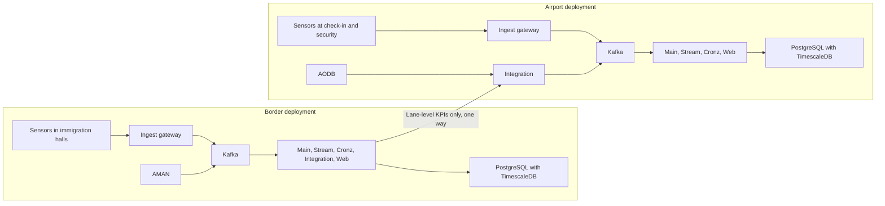

# Deployment guide

How to install Ariva on a customer's on-premises Kubernetes cluster, following AMAN's deployment conventions (Helm chart per platform, Helmfile, appsettings mounted from Kubernetes secrets, Azure DevOps release pipelines). It also covers bootstrap, smoke tests, upgrades, backup and local development.

Status: the platform and TimescaleDB charts, the Helmfile environments, the migration and Kafka topics jobs, the pipelines and the appsettings exist. Every environment is rendered and checked on each change (`Platform/Cloud/Ariva.K8s/tests/chart-security.mjs`), but no release has yet been verified on a cluster: the first release on the dev cluster is a human step (ARV-002). Steps that depend on code not yet written are marked "Target procedure" with the epic that delivers them (see [Home](Home.md) for epic names).

## 1. Deployment topologies

| Topology | Where | Modules | What crosses the boundary |
|---|---|---|---|
| Border deployment | Own namespace and database, in AMAN's cluster or a separate one | Core plus Border | In: AMAN aggregate events. Out: lane-level wait times and KPIs only |
| Airport deployment | The airport operator's environment, on premises or their private cloud | Core plus Airport Operations | In: AODB, signage acknowledgements, the border feed where one exists |
| Combined site | Two deployments | Both | One-way aggregate feed, border to airport |
| Small site | Single node, single Kafka broker, single database | Core plus one module | Same rules; reduced availability, accepted in writing |


Rules: every deployment is in-country; the airport side never gets a route into the border network; real-time measurement never depends on a WAN. A border deployment may reuse AMAN's Kafka cluster only with the dedicated `ariva.` topic prefix and ACLs.

## 2. Prerequisites

| Item | Requirement | Notes |
|---|---|---|
| Kubernetes | A supported release; the chart uses `apps/v1`, `autoscaling/v2` (Kubernetes 1.23 or later) and `networking.k8s.io/v1` Ingress | Exact minimum version: To confirm against AMAN's cluster baseline |
| Nodes | Linux x64 (images are published for `linux-x64`). One node for a small site, three for a standard site | Node size: see sizing below |
| Metrics server | Required: every Deployment has a HorizontalPodAutoscaler on CPU (60 percent) and memory (70 percent); from Kubernetes 1.27 api-main's reads api-main's own container only, not the malware scanner beside it (`ContainerResource` metrics; section 6.7). Below 1.27, where the API server refuses that metric, the chart keeps the pod's metrics, which count clamd's memory, so api-main scales out sooner: Kubernetes 1.27 or later is recommended | Without resource metrics the HPAs cannot scale |
| Ingress controller | ingress-nginx, class `nginx`, configured with Ariva's controller values: `Platform/Cloud/Ariva.K8s/Helm/ingress-nginx-values.yaml` (written against the ingress-nginx chart 4.15.1, controller 1.15.0; ARV-084). The site merges them into its own controller release and applies them before Ariva's first release, and again before a release that changes them (ARV-091 does: wiki 18); Ariva's pipelines and tools never install or change the controller | The values set `allowSnippetAnnotations: true` and `annotations-risk-level: Critical` (the chart's Ingresses carry `server-snippet`, `configuration-snippet` and `modsecurity-snippet`: the response headers, the 421 for a wrong host, the plain HTTP refusal and the upload rule; at the default High level the controller refuses them), `ssl-protocols: TLSv1.2 TLSv1.3`, `ssl-ciphers` the Mozilla intermediate TLS 1.2 list (guidelines 6.0: ECDHE-ECDSA and ECDHE-RSA with AES128-GCM-SHA256, AES256-GCM-SHA384 and CHACHA20-POLY1305; no DHE), `ssl-session-tickets: "false"`, `use-forwarded-headers: "false"`, `enable-modsecurity: "false"` (the chart turns ModSecurity on for its own Ingresses, with the audit log off; keep it "false": on for the whole controller, the controller loads its `modsecurity.conf` at the http level, whose audit settings then override the chart's `SecAuditEngine Off` on every Ingress and record request headers, bearer tokens and cookies among them; ARV-091), `log-format-upstream` (ingress-nginx 1.15's default access log format with the request line written as `$request_method $uri $server_protocol` in place of `$request`, so no query string is logged; the chart test refuses a format that writes `$request`, `$request_uri`, `$args`, `$query_string`, an `$arg_` variable, the body, the Authorization header or a cookie; ARV-091) and the controller's own HSTS at one year with includeSubDomains, no preload (a backstop: the chart sets the header itself). Left at the controller's defaults on purpose, and refused by the chart test otherwise (ARV-091): `error-log-level` unset or `notice`, `warn`, `error`, `crit`, `alert` or `emerg` (never `info`, which writes ModSecurity's matched-input excerpts, or `debug`, which writes every header); `log-format-escape-none` never true (`1`, `t` and `true` refused; on, a request could forge log lines); `enable-opentelemetry` off for the whole controller (ingress-nginx 1.15's module puts the full request URI, query string included, in each span's `http.target`, so it would export the live hub's `access_token`); and no `access_log`, `log_format`, `error_log` or `modsecurity` directive in the controller's main, http, server or location snippets. The OWASP Core Rule Set (`enable-owasp-core-rules`) may be turned on: it keeps the chart's audit log off. Protocols and suites are controller-wide, so no Ingress annotation can set them. Without these values the controller refuses the chart's Ingresses or ignores their snippets, and then the hosts lose their headers and the machine hosts serve plain HTTP; the TLS check after a release (section 6.6, wiki 10 section 4.14) fails such hosts. The controller is shared: snippets allowed at the Critical level let anyone who may create an Ingress for it write nginx configuration, so where other teams create Ingresses, give Ariva a controller of its own. TLS must end at this controller: the chart's snippets judge `$scheme`, and the controller trusts no X-Forwarded-* header, so an L7 proxy or load balancer in front that ends TLS would make every request to a machine host a 403 and drop HSTS (it fails closed); a TCP (layer 4) load balancer in front is fine. In k8s-prd the Ingress objects also proxy HTTPS to the pods and verify them with ingress-nginx's `backend-protocol` and `proxy-ssl-*` annotations (ARV-082b, section 6.2). The Kubernetes project announced the retirement of ingress-nginx in November 2025; a move to another controller or the Gateway API is To confirm, and the replacement must verify the pods' certificates and set the response headers the same way |
| Client addresses at the controller | The controller sees each client's own address: `externalTrafficPolicy: Local` on its LoadBalancer or NodePort Service, or the PROXY protocol from the load balancer in front (ARV-085) | The Cronz dashboard's source range and the hosts' trusted proxies depend on it. Behind SNAT every client arrives as a node or load balancer address: the source range then refuses everyone, or lets everyone in once someone adds those ranges, and the hosts' per-address limits and device source networks see that one address. Never put node or load balancer ranges in `sourceRanges` |
| Network policy enforcement (k8s-prd) | A network plugin (CNI) that enforces NetworkPolicy: Calico, Cilium, Antrea or the cloud's network policy engine (ARV-085) | k8s-prd renders default-deny NetworkPolicies and the firewall matrix's flows ([Network and ports](05-Network-and-Ports.md)); on a CNI that does not enforce them they are accepted and silently do nothing. Confirm it with the cluster's operators before go-live ([Security guide](13-Security-Guide.md), checklist item 4) |
| Storage class | A class for ReadWriteOnce volumes (TimescaleDB, Kafka, and the Ingest disk buffer once added) | The TimescaleDB values use the cluster default class. AMAN's Helmfile carries Longhorn and Rook-Ceph releases for this |
| DNS | One record per ingress host, `<subdomain>.<domain>` | Production subdomains in `values-k8s-prd.yaml`: `ariva`, `api-main-ariva`, `api-ingest-ariva`, `api-cronz-ariva`, `api-integration-ariva`. Replace `dalilhub.tech` with the customer's domain |
| TLS certificates | A certificate for every ingress host, chaining to a CA every client of that host trusts: a public CA, or the customer's PKI for hosts whose every client is a device the site manages (section 6.2 says which CA each certificate must chain to) | Every Ingress has a `tls` section naming its host and the secret `tlsSecretName` (default `ariva-tls`, or one per entry of `ingresses`), which must exist in the namespace before the release. The TLS check after a release verifies each host's certificate and name (section 6.6) |
| Cluster CA (k8s-prd) | A CA that issues one TLS certificate per pod (ARV-082b): cert-manager with a CA issuer, or the customer's PKI | Its certificate goes into the `ariva-cluster-ca` secret, the pods' certificates into six `ariva-*-tls` secrets (section 6.2) |
| Image registry | Pull access to `dalil.azurecr.io/ariva`, or an internal mirror such as Harbor at air-gapped sites | Pull secret `dalilacr-secret` is rendered from `imageCredentials` when a password is passed |
| Tools | kubectl, Helm 3.19.0, Helmfile 1.1.7, helm-diff plugin v3.13.0 | The versions the release pipeline installs |
| Malware scan signatures (ARV-092c) | How ClamAV's signatures reach the scanner beside each api-main pod: from ClamAV's public mirrors (`database.clamav.net`, TCP 443 out), from a mirror inside the site, or from a volume the site keeps current | The site chooses before its first production release; the chart refuses k8s-prd until it has (section 6.7). A site without internet chooses a mirror or a volume |
| Time | NTP on every node | See [Network and ports](05-Network-and-Ports.md) |
| PostgreSQL | PostgreSQL 16 or later (17 recommended) with TimescaleDB Community Edition | See dependencies below |
| Kafka | KRaft mode | Dedicated or AMAN's |
| Redis | Any supported version (To confirm) | Dedicated or AMAN's |
| Observability | An OTLP endpoint (SigNoz) or Loki, over https; in production one of them receives the hosts' logs, or the hosts do not start (ARV-091a). For the system alerts (ARV-125b) SigNoz v0.146.0 or a version that accepts its rule and dashboard schemas, with its Kubernetes collectors (kubelet volume metrics) and cert-manager's metrics scraped | Set `otel.endpoint`, and `logging.collector` with its settings (section 5); import the alert rules and dashboards (wiki 10 section 1.1) |
| Identity | None: Ariva's own local accounts with TOTP (ADR-0026). A customer's OIDC provider is ARV-134a (held by the login freeze); no Keycloak or OIDC provider is used today | When ARV-134a is built, which provider per site: To confirm |
| Mail relay | SMTP relay reachable from Integration and Cronz | For alert email and the scheduled reports (MVP) |
| Licence | Signed, offline-verifiable licence file per deployment | Basic in the MVP, complete in v1. Loading mechanism: To confirm |

## 3. Sizing

Figures for the large profile are D5's sizing assumption. The small and medium rows are Estimates, scaled linearly from the same assumptions: 30 people per sensor, 5 Hz, about 100 bytes per sample on the wire, samples stored at 1 Hz for a third of the people tracked at peak, 90-day dispute window. Replace them with measured rates after the pilot.

| Profile | Example | Sensors | People tracked at peak | Ingest messages per second | Ingest bandwidth | Stored sample rows per second | Compressed samples for 90 days | Database volume to provision | Nodes | Kafka brokers |
|---|---|---|---|---|---|---|---|---|---|---|
| Small (Estimate) | One arrivals hall, pilot scale (reference hall of 1,080 m2 needs about 15 sensors) | 15 | 450 | 2,250 | 0.23 MB/s | 150 | 12 to 24 GB | 30 GB | 1 | 1 |
| Medium (Estimate) | 8 million passengers a year, the BOQ reference airport (59 sensors) | 59 | 1,770 | 8,850 | 0.9 MB/s | 590 | 47 to 94 GB | 120 GB | 3 | 3 |
| Large (D5) | Busy terminal | 100 | 3,000 | 15,000 | 1.5 MB/s | 1,000 | 80 to 160 GB | 200 GB | 3 | 3 |

Add to the database volume: interval results, forecasts and configuration (kept indefinitely; small next to raw samples), WAL, and local backup space if backups are written to the same storage. A longer dispute window scales the sample storage linearly.

Application pods (from the chart defaults and `values-k8s-prd.yaml`: HPA minimum 2 for Main, Ingest, Stream and Web, 1 for Cronz and Integration, Simulation off):

| Host | Request per pod | Limit per pod | Replicas in production values |
|---|---|---|---|
| api-main | 250m CPU, 750Mi; with the malware scanner beside it (ARV-092c) 360m, 2014Mi | 1000m, 1000Mi; with the scanner 2500m, 2856Mi | 2 to 4 |
| api-ingest | 250m, 512Mi | 1000m, 1000Mi | 2 to 4 |
| api-stream | 500m, 750Mi | 2000m, 1500Mi | 2 to 4 |
| api-cronz | 100m, 512Mi | 1000m, 1000Mi | 1 |
| api-integration | 100m, 512Mi | 500m, 750Mi | 1 |
| web | 50m, 64Mi | 250m, 128Mi | 2 to 3 |
| simulation | 100m, 256Mi | 500m, 512Mi | Not deployed in production |

Totals at the HPA minimums: about 2.5 CPU cores and 7.5 GiB of memory requested. At the HPA maximums the limits add up to about 24 cores and 23 GiB. The malware scanner is most of the difference (ARV-092c, section 6.7): each api-main pod also runs clamd (100m and 1200Mi requested, 1000m and 1600Mi limit) and, with signatures from a mirror, freshclam (10m and 64Mi, 500m and 256Mi), because clamd holds its signatures in memory, 990 MiB measured with ClamAV 1.4.6, and every replica loads its own copy. A node that runs an api-main pod needs about 2 GiB free for it. Add TimescaleDB (500m and 2Gi requested, 2 cores and 4Gi limit, of which up to 512Mi is shared memory; `Charts/timescaledb/values.yaml`), Kafka, Redis, the ingress controller and monitoring. Node size per profile: To confirm after the Phase 1 load test at 15,000 messages per second.

## 4. Dependencies

### PostgreSQL with TimescaleDB

- PostgreSQL 17 with TimescaleDB Community Edition (Tiger Data licence): free to run on self-managed infrastructure, including production inside a product Dalil deploys for a customer; it may not be offered to third parties as a database service, which Ariva never does.
- The extension must exist on every restore target and in the HA image. The image is `timescale/timescaledb-ha:pg17-ts2.30`, pinned by digest, the same tag and digest as `docker-compose.dev.yml`, Ariva.AppHost, the integration tests and CI (`scripts/base-images.mjs --check` keeps them together).
- Options per site:
  1. The Ariva TimescaleDB chart (`Charts/timescaledb`, ARV-062), installed by the Helmfile in every environment (`timescaledb: true`). One StatefulSet replica with a `data-timescaledb-0` claim (50Gi, cluster default class; kept when the release is deleted), the Service `timescaledb` on port 5432 that the base settings expect, and a NetworkPolicy that admits only pods of the same namespace (add others in `networkPolicy.additionalFrom`). The pod runs as the image's `postgres` user (uid 1000) with a read-only root filesystem, every capability dropped and RuntimeDefault seccomp. Socket connections use peer authentication and every TCP connection, loopback included, needs a password (scram-sha-256). No replication or failover: a node loss stops the database until the pod is rescheduled with its volume.
  2. A PostgreSQL operator or Patroni with streaming replication for HA, using an image that includes TimescaleDB. The operator should match what AMAN runs (To confirm). Set `timescaledb: false` for the environment in the Helmfile.
  3. A customer-managed PostgreSQL 16 or later with TimescaleDB, set through `Database:Host`, with `timescaledb: false` in the Helmfile.
- TimescaleDB telemetry is off (`TIMESCALEDB_TELEMETRY=off` in the chart sets `timescaledb.telemetry_level` and unschedules the telemetry job). Set it yourself with options 2 and 3.

### Kafka

- KRaft mode. Standard site: three brokers, replication factor 3, `min.insync.replicas` 2, producers with `acks=all`. Small site: one broker.
- D5 recommends the Strimzi operator (KRaft only from 0.46); AMAN's Helmfile deploys Kafka with the kubelauncher chart 0.1.19. If the cluster is shared, align with AMAN's chart (To confirm).
- Ariva does not ship its own Kafka release. Either reuse AMAN's release in the same cluster (topics prefixed `ariva.`, prefix ACLs), or copy AMAN's Kafka chart values into `./Charts` and add a release to the Helmfile.
- The base settings use `kafka:9092`. If Kafka runs in another namespace, use the full service name, for example `kafka.<aman-namespace>.svc.cluster.local:9092`.

### Redis

- Holds the FusionCache second level, the SignalR backplane and idempotency keys. Not a system of record. Required for more than one Main replica.
- Reuse AMAN's Redis (keys use the instance name `ariva:`) or deploy a dedicated release from AMAN's Redis chart values. The base settings use `redis:6379`.

## 5. Configuration layering

Each .NET host loads, in this order (later wins):

1. `appsettings.base.json` (linked from Ariva.Api.Common)
2. `appsettings.base.<env>.json`
3. `appsettings.service.json` (the host's own)
4. `appsettings.service.<env>.json`
5. Environment variables (for example `Database__Password`), then command-line arguments

The environment comes from `DOTNET_ENVIRONMENT` (set by each host's ConfigMap, or the Job's env, from the `environment` value). Environments: `vm-local`, `k8s-dev`, `k8s-demo`, `k8s-prd`. There is no default (ARV-098): images are published without `environment.json`, so a container started without `DOTNET_ENVIRONMENT`, or with a name outside that list, stops at once with "No Ariva environment is set" or "Unknown Ariva environment" instead of running as `vm-local`. Set the variable when you start an image by hand (`docker run -e DOTNET_ENVIRONMENT=k8s-dev ...`, `kubectl run --env=DOTNET_ENVIRONMENT=k8s-dev ...`). A developer machine still gets `vm-local` from `environment.json` in the build output (`dotnet run`, the E2E suite and the AppHost). Each host also refuses to start when `Application:Environment` (from `appsettings.base.<environment>.json`, which a release may replace from the `APPSETTINGS_BASE` secret) is missing or names another environment, so keep that key in any replacement file. The chart test (`Ariva.K8s/tests/chart-security.mjs`) fails a render in which an Ariva .NET container does not resolve the release's environment: no `DOTNET_ENVIRONMENT`, a wrong value, a later ConfigMap or Secret overriding it, or an `--environment` argument.

In Kubernetes the two environment files are not taken from the image. The release writes them into secrets, and the chart mounts them over the image's copies:

| Secret | Key | Mounted at |
|---|---|---|
| `base-appsettings-secret` | `appsettings.base.<env>.json` | `/app/appsettings.base.<env>.json` in every .NET host |
| `<service>-appsettings-secret` (`api-main`, `api-ingest`, `api-stream`, `api-cronz`, `api-integration`, `simulation`) | `appsettings.service.<env>.json` | `/app/appsettings.service.<env>.json` in that host |
| `ariva-dataprotection` (type `kubernetes.io/tls`; name set by `dataProtectionSecretName`) | `tls.crt`, `tls.key` | `/app/secrets/dataprotection/` in every API host, read-only. Encrypts the shared Data Protection key ring at rest (ARV-008); an API pod does not start without it |
| `ariva-database-ca` and `ariva-redis-ca` (generic; names set by `databaseCaSecretName` and `redisCaSecretName`) | `ca.crt` (PEM): the internal CA that issued the PostgreSQL and the Redis server certificates | `/app/secrets/database-ca/` and `/app/secrets/redis-ca/` in every .NET host and in the `database-migration` and `kafka-topics` jobs, read-only (ARV-082a). Optional in the chart (dev and demo connect without TLS); a k8s-prd host does not start without them |
| The collectors' CAs (generic; no default name: set by `otel.caSecretName` and `logging.lokiCaSecretName`, for example `site-otlp-ca` and `site-loki-ca`) | `ca.crt` only (PEM, certificates only, at most 1 MiB): the root the OTLP collector's or Loki's certificate chains to, or the site's CA bundle; the collector sends its intermediates itself. The Secret holds `ca.crt` and nothing else: no `tls.crt`, `tls.key`, other key or keystore (the chart refuses any other key) | Only for a collector whose certificate comes from the site PKI (ARV-200; section 6.2): `/app/secrets/otlp-ca/` in the five API hosts and the simulator, `/app/secrets/loki-ca/` in the five API hosts, read-only, `ca.crt` alone. Not optional once named: the pods wait for the Secret. Each of those hosts then trusts that CA alone for its collector (`Otlp:RootCertificate`, `Loki:RootCertificate`, below). Not in the web pod or the jobs |
| `ariva-cluster-ca` (generic; name set by `podTls.caSecretName`) | `ca.crt` (PEM): the cluster CA that issued the six pod certificates below | Not mounted in any pod: the ingress controller reads it to verify every pod (`proxy-ssl-secret`, ARV-082b), so it must be in the release's namespace. k8s-prd only |
| `ariva-api-main-tls`, `ariva-api-ingest-tls`, `ariva-api-stream-tls`, `ariva-api-cronz-tls`, `ariva-api-integration-tls`, `ariva-web-tls` (type `kubernetes.io/tls`; names set by `podTls.secretNames`) | `tls.crt` (the pod's certificate, then any intermediate CA), `tls.key`. Issued by the cluster CA for the pod's Service names: `<service>-service`, `<service>-service.<namespace>.svc` and `<service>-service.<namespace>.svc.cluster.local` (for example `api-main-service`; `web-service` for the web pod) | `/app/secrets/pod-tls/` in that API host, `/etc/nginx/tls/` in the web pod: only `tls.crt` and `tls.key`, mode 0440 read through the pod's fsGroup 10001, read-only, mounted as a whole directory so that a renewal reaches it (never `subPath`; ARV-082b). k8s-prd only; a pod without its secret stays in ContainerCreating |
| `ariva-token-public` (generic; name set by `tokenPublicSecretName`) | `public.pem`, and `previous.pem` during a key rotation | `/app/secrets/token-public/` in every API host, read-only. The P-256 public keys that verify user access tokens (ARV-010a, ADR-0026); a host refuses every token without it |
| `ariva-token-signing` (generic; name set by `tokenSigningSecretName`) | `signing.key` (PKCS#8 PEM, P-256) | `/app/secrets/token-signing/` in `api-main` only, mode 0400. Signs user access tokens; no other pod mounts it (the chart test fails if one does) |
| `ariva-validation-reader` (generic; name set by `validationReader.secretName`) | `username`, `password` | Not mounted as a file: `api-main` and the `database-migration` job only get them as `Database__ValidationReader__Username` and `Password` (ARV-104g1). The validation reader login, the only login that reads the shadow nowcast; the job creates it, the validation service in api-main reads with it. Optional in dev, demo and localk8s (`validationReader.optional`), required in k8s-prd (the chart refuses to render otherwise), and the chart test fails if any other workload gets it |
| `ariva-integration-token-public` and `ariva-integration-token-signing` (generic; names set by `integrationTokenPublicSecretName` and `integrationTokenSigningSecretName`) | `public.pem` (and `previous.pem` during a rotation); `signing.key` (PKCS#8 PEM, P-256) | `/app/secrets/integration-token-public/` and `/app/secrets/integration-token-signing/` (mode 0400) in `api-integration` only. The integration client ring (ARV-042), apart from the user ring; Integration does not start without them, and the chart test fails if another pod mounts the signing key or `api-integration` lacks either |

Real credentials never live in the repository: the committed `k8s-*` files carry empty passwords.

The database connection string is not configured as text: the hosts build it from `Database:Host`, `Port`, `Name`, `Username` and `Password` with Npgsql's builder, so a password containing `;` cannot add options. Placeholders: values such as `"${Database:Host}"` reference other keys. AMAN resolves them with ConfigurationSubstitutor (the package is already in `Directory.Packages.props`). Ariva's hosts currently layer the files with framework APIs only; the substitution step arrives with the port of AMAN's configuration extension (Target procedure, implemented in Phase 0 epic Skeleton and platform). Until then, do not rely on placeholders resolving.

Main settings:

| Key | Repository default | Production guidance |
|---|---|---|
| `Application:Environment`, `Domain`, `BindingHost`, `BindingPort` | `k8s-prd`, `dalilhub.tech`, `0.0.0.0`, 8080 | Set `Domain` to the customer's domain. In k8s-prd the hosts listen on `Kestrel:Endpoints:Https` (next row), not on `BindingPort` |
| `Kestrel:Endpoints:Https` (`Url`, `SslProtocols`, `Certificate:Path`, `Certificate:KeyPath`) | not set; in production `https://*:8443`, `Tls12` and `Tls13`, `/app/secrets/pod-tls/tls.crt` and `tls.key` | Keep (ARV-082b): in k8s-prd every host serves https only, from the certificate the chart mounts from its `ariva-<service>-tls` secret. A k8s-prd host refuses to start with no endpoint, a plain one, one without `Certificate:Path` and `KeyPath` or whose files are missing, `SslProtocols` other than `Tls12` and `Tls13`, an `http://` address in `ASPNETCORE_URLS`, or `preferHostingUrls` true. The image's `ASPNETCORE_HTTP_PORTS` (8080) stays set but binds nothing, since configured endpoints take its place. On Linux the TLS 1.2 suites are ECDHE with AES-GCM or ChaCha20-Poly1305 only, and TLS 1.3 offers its three suites. A renewed certificate is served without a restart (section 6.2). vm-local, k8s-dev and k8s-demo declare no endpoint and serve plain HTTP on 8080 |
| `Application:IsHighAvailable` | `true` in `k8s-prd` | Keep |
| `Database:Host`, `Port`, `Name` | `timescaledb`, 5432, `ariva` | Point at the site's PostgreSQL |
| `Database:Username`, `Password` | `ariva_app`, empty | The runtime login every host uses (DML only). The migration job creates it and sets this password; secret only |
| `Database:Migration:Username`, `Password` | `ariva`, empty | The migration login (owner, DDL), used only by the migration job; secret only |
| `Database:ValidationReader:Username`, `Password` (api-main and the migration job only) | not set | The validation reader login (ARV-104g1): the only login that reads the shadow nowcast, a member of `ariva_validation_reader` and of nothing else, with CONNECT on the database; the migration job creates or updates it (script 0049, `ariva_ensure_validation_reader_login`) and the validation service in api-main reads `queue_minute_shadow` with it, every other read going through the runtime login. In the clusters it comes from the secret `ariva-validation-reader` (section 6.2), never from an appsettings file: a unit test fails if a committed one carries it, and the base files reach every host. It must be a login of its own: a lower-case PostgreSQL identifier, not one of Ariva's roles, not the runtime or the migration login, with a password of at least 16 printable ASCII characters that is neither of theirs; every host refuses to start otherwise (`ValidationReaderGuard`). Outside vm-local only api-main may have it set: any other host with it refuses to start. Whenever a host reaches the database at start-up (always outside vm-local), it also refuses when its runtime login can read a value of the shadow nowcast: when the login is a member of `ariva_validation_reader` or `pg_read_all_data` in PostgreSQL's MEMBER sense (any grant, inherited or not, through any chain of roles; a superuser counts as a member of every role), or when `has_column_privilege` says it may SELECT any column of `queue_minute_shadow` or one of its chunks other than the key columns `zone_key` and `minute_utc` (a grant to the login, to a role it holds such as `ariva_runtime`, or to PUBLIC, a table-level grant, ownership, or superuser). The migration job runs the same check on the runtime login and exits 1. The migration job sends PostgreSQL a SCRAM-SHA-256 verifier it computed, never the password (section 7.1). Not set: no login reads the shadow, and the validation results show no shadow figures |
| `Validation:Results` (api-main) | `Timeout` 00:03:00, `MaxConcurrentComputations` 1, `MaxRowsPerRead` 100000, `Exclusions` Strict, `MaxExcludedShare` 0.05, `RequestTimeout` 00:01:30, `FreezeInterval` 00:01:00, `FreezeRetryAfter` 01:00:00 | The validation results (ARV-104g2, ARV-104g): one computation at a time per replica (about 200 MB at a campaign of 400 zone-days; at most 4, raise only with the memory limit), how long a request may wait (503 with Retry-After after it; the computation goes on), and how often closed campaigns are frozen (revision 1 with its SHA-256) and when a failed freeze is retried. Refused at start when out of bounds. Proposed values (docs/product/decisions.md) |
| `Database:Retention:RawSensingDays`, `DeskZoneReadingDays`, `LaneStaffingDays`, `AlertEmailDays`, `IntegrationCallDays`, `ReportDeliveryDays`, `AdvertisingPlayDays` (the migration job only) | 90, 7, 90, 180, 400, 400, 400 days; in the clusters from the Helm values `migration.retention` (below), which the chart passes to the job as `Database__Retention__*` | Retention per environment (ARV-111a, [data inventory](../docs/privacy/data-inventory.md)). After the scripts the job sets the TimescaleDB retention policy of `sensing_event`, `sensing_batch` and `device_health_event` (raw sensing, one value: the contract's dispute window, TC-62), `desk_zone_reading`, `lane_staffing` and `advertising_play` (the proof of play, ARV-144) to these periods, and writes the relational periods of alert emails (TC-67), Integration API call records (TC-68) and report deliveries (TC-66) into `retention_period`, which the Cronz retention job reads. A period already in force is left alone, so a release that changes nothing changes nothing; a value out of range (raw sensing 7 to 3,650; desk zone readings 2 to 90; staffing 90 to 3,650, the alert backtest's history; the relational periods 30 to 3,650) stops the job before anything changes, and the chart refuses it first. Shortening a period drops older data at TimescaleDB's next daily run or the Cronz job's next run: agree it with the client first. The hosts never apply these; the runtime login cannot change a policy or a period |
| `Database:UseEncryption`, `RootCertificate` | `false`, empty; in production `true`, `/app/secrets/database-ca/ca.crt` | TLS with full certificate and host name verification (`SslMode=VerifyFull`) against the internal CA in `RootCertificate` alone, never the image's system store (ARV-082a); every login's connection (runtime, migration, validation reader) uses it. A k8s-prd host or job refuses to start with `UseEncryption` off, no `RootCertificate`, or no file at that path. The chart mounts the `ariva-database-ca` secret there |
| `Database:VerifySchemaOnStartup` | `true` (`false` in vm-local) | Keep: a host stops at startup when a shipped script is missing or an applied one changed |
| `Database:AllowSchemaUpdate` | `false` (`true` in vm-local) | Never `true` outside a developer machine; a unit test enforces it |
| `Redis:Enabled`, `ConnectionString`, `InstanceName` | `true` in clusters, `redis:6379`, `ariva:` | StackExchange.Redis format, for example `redis:6379,password=...` (secret only). FusionCache uses it as the shared level and the backplane; Api.Main uses it as the SignalR backplane and Api.Main and Api.Stream for the live snapshots (ARV-035), so both must point at the same Redis and `InstanceName`. Without Redis the live hub accepts connections but nothing is pushed |
| `MalwareScan:Host`, `Port`, `TimeoutSeconds`, `MaxStreamBytes` (api-main) | empty, 3310, 120, 104857600 (100 MiB) | The clamd that scans every upload before it is stored or imported (ARV-092b; [File handling guide](13a-File-Handling.md) section 4). Empty means no scanner: vm-local then takes uploads unscanned, k8s-dev and k8s-demo refuse every upload (503), and a k8s-prd api-main does not start. In k8s-prd the host must be a loopback IP address in its plain form (`127.0.0.1`, or `::1` where the pod has IPv6; not the name `localhost`): clamd speaks plain TCP, so it runs beside api-main in its pod. The chart's `uploadScan` (section 6.7, ARV-092c) runs clamd there on `127.0.0.1:3310` and gives api-main `MalwareScan__Host` `127.0.0.1` and `MalwareScan__Port` `3310` in every environment. `MaxStreamBytes` must be at least the largest upload (the advertisement video limit, `Advertising:Videos:MaxMegabytes`, at most 100 MiB), or the host does not start; clamd's own `StreamMaxLength` and `MaxFileSize` must be as large, with `AlertExceedsMax yes` (`Platform/Cloud/clamav/clamd.conf`). `TimeoutSeconds` is 5 to 600, for each file, and for all the parts of a site configuration bundle together |
| `DataProtection:CertificatePath`, `KeyPath` | `/app/secrets/dataprotection/tls.crt`, `tls.key` | Keep; the chart mounts the `ariva-dataprotection` secret there |
| `Auth:Tokens:PublicKeyPaths` | `/app/secrets/token-public/public.pem`, `previous.pem` | Keep; the first must exist, the second is read only when present (rotation) |
| `Auth:Tokens:SigningKeyPath` | `/app/secrets/token-signing/signing.key` in `api-main`'s service file only | Keep; never set it for another host |
| `Auth:Tokens:LifetimeMinutes`, `ClockSkewSeconds`, `Issuer`, `Audience` | 15, 30, `ariva`, `ariva-users` | Keep (ADR-0026). Node clocks must be NTP synchronised: 30 seconds of skew is all a token gets |
| `Auth:Lockout:Threshold`, `DurationSeconds` | 10, 900 | Keep: 10 consecutive failures lock an account for 15 minutes; an administrator can unlock earlier |
| `Auth:Sessions:AbsoluteSeconds`, `IdleSecondsAdministrator`, `IdleSecondsOperational` | 43200, 1800, 14400 | Keep (ADR-0026): 12 hours for everyone; 30 minutes idle for administrators, 4 hours for operational roles |
| `Auth:Sessions:RefreshGraceSeconds`, `CacheSeconds` | 30, 4 | Keep. The session cache bounds how long another node can still accept a revoked session when the Redis backplane is down; with it, revocation is immediate |
| `Auth:ContextWords` | empty | Words a password may not contain besides the username, `ariva` and `Application:SiteCode`, for example the airport name |
| `Auth:TotpRequired` | `true` | Keep: an account without TOTP gets only the pending scope until it enrols (ARV-010c); a unit test keeps every committed file on `true`, and a host refuses to start with `false` outside vm-local (ARV-064) |
| `Auth:Totp:Issuer` | `Ariva` | Add the site, for example `Ariva AUH`, so staff with accounts at several sites can tell the entries apart in their authenticator app |
| `Auth:Totp:BreakGlassUserName` | `break-glass` | The username the installer command gives the emergency account |
| `Auth:DevelopmentUsers` | empty | vm-local only; a host refuses to start if it is set unless both its host environment and `Application:Environment` are vm-local (the same for `Auth:TotpRequired` false) |
| `Ingest:MaxEventsPerMessage` (Ingest) | 2,000 | Events in one push at most (400 beyond); bodies are limited to 256 KB regardless |
| `Security:RateLimiting:Device:PermitLimit` (Ingest) | 600 a minute per device | Requests per device credential on device endpoints (ARV-022). Ingest also raises `Security:RateLimiting:Global:PermitLimit` to 20,000 a minute per address, because a gateway or NAT puts many sensors behind one address |
| `Security:RateLimiting:DisplayPlays` (Main) | 6 a minute per display | Proof of play batches per display credential (`POST api/v1/display/plays`, ARV-144), refused ones included; a player sends one a minute. Beyond: 429 with Retry-After, and the player keeps its plays for the next turn |
| TimescaleDB (database) | required | The migration creates the TimescaleDB extension and makes the raw sensing archive (`sensing_event`, `sensing_batch`) hypertables with compression after one day and a retention policy (90 days by default; since ARV-111a the period is `Database:Retention:RawSensingDays`, below). It fails on PostgreSQL without TimescaleDB, so raw data is never kept without a retention policy; the migration login must be able to create the extension (the TimescaleDB image's owner role can), or create it beforehand. `ariva.allow_plain_postgres = on` on a database lets local tests on plain PostgreSQL skip it |
| `Devices:Health:HeartbeatTimeoutSeconds` and `SweepSeconds` (Main) | 180 and 15 | A commissioned device not heard from for the timeout goes `Offline` and its queue zone `Degraded` (ARV-025); one replica of Main sweeps every `SweepSeconds`. Ingest reports a device's health with every status it sends and every 10 seconds while it sends data, so every device must push or report more often than half the timeout. Main consumes `ariva.device.health.v1` (consumer group `ariva-main.device-health`) |
| `Ingest:Mqtt:Enabled` (Ingest) and chart `mqtt.enabled` | false | The MQTT transport (ARV-024): an MQTT 3.1.1 and 5 broker on port 8883 (`Ingest:Mqtt:Port`, chart `mqtt.port`) that only takes device data in. TLS with the PEM certificate and key in `Ingest:Mqtt:CertificatePath` and `CertificateKeyPath`; the chart mounts the `kubernetes.io/tls` secret `mqtt.tlsSecretName` (default `ariva-mqtt-tls`) and refuses to render without it, and the host refuses clear text outside vm-local. The chart adds `api-ingest-mqtt-service` of type `mqtt.serviceType` (ClusterIP by default; LoadBalancer or NodePort keep the client address with `externalTrafficPolicy: Local`). Also `Ingest:Mqtt:ConnectsPerAddressPerMinute` (30), `MaxConnections` (2,000; size with the pod memory, up to about 1.3 MB per busy device), `MaxConnectionsPerAddress` (50; raise it where many sensors share one NAT address) and `ConnectTimeoutSeconds` (10). A renewed certificate needs a rollout. Devices on the `Mqtt` transport cannot use the HTTPS push endpoints (403), and HTTPS push devices cannot connect over MQTT |
| `Security:ClientCertificates:ForwardedHeader` (Ingest) | empty | For devices that pin a client certificate: the header in which the ingress forwards the verified certificate (ingress-nginx: `ssl-client-cert`, with `auth-tls-verify-client: optional_no_ca` and `auth-tls-pass-certificate-to-upstream: "true"` on the api-ingest ingress). The header is honoured only on connections from `Security:ForwardedHeaders` proxies and removed from every other request. A device allowlist is checked against the forwarded client address, so only the ingress controller may be trusted and reach the api-ingest pods: in k8s-prd the chart does both (ARV-085: the controller's pod network from `ingressController.podNetworks`, and NetworkPolicies that let only the controller in); in dev and demo the private ranges are trusted and no NetworkPolicy is rendered |
| `Security:ForwardedHeaders:KnownNetworks`, `KnownProxies`, `ForwardLimit` | none, none, 1; dev and demo `10.0.0.0/8`, `172.16.0.0/12`, `192.168.0.0/16`; production none in the file | The only proxies whose `X-Forwarded-For` and `X-Forwarded-Proto` a host takes (never `X-Forwarded-Host`), the last entry only, so rate limits, logs and device source networks see the client and not the controller. In the clusters set them through the Helm value `ingressController.podNetworks` (below), which the chart passes to every API host as `Security__ForwardedHeaders__KnownNetworks__0`, `__1` and so on (ARV-085). A k8s-prd host refuses to start when nothing is trusted, a network is 0.0.0.0/0 or ::/0, an IPv4 network is shorter than /14 or an IPv6 one shorter than /48, an entry does not parse or has address bits after its prefix, or an IPv6 network would trust IPv4 clients wider than a /14 through the dual-stack mapped form (below). Never set `ASPNETCORE_FORWARDEDHEADERS_ENABLED`: it trusts every proxy (the chart test refuses it) |
| `Security:RateLimiting:Auth:PermitLimit` | 10 a minute per client address | Keep; it needs `Security:ForwardedHeaders` to name the ingress network and the controller to see each client's own address (section 2), or every client shares one address |
| `Kafka:Enabled`, `BootstrapServers` | `true` in the cluster files, `kafka:9092` | Point at the site's brokers. With `false` a host keeps domain events in the outbox and cannot publish |
| `Kafka:SecurityProtocol`, `SaslMechanism`, `SaslUsername`, `SaslPassword`, `SslCaLocation` | `Plaintext` in dev and demo; `SaslSsl`, `ScramSha512`, `ariva`, the secret, `/app/secrets/kafka-ca/ca.crt` in production | A k8s-prd host with Kafka on refuses to start unless the protocol is `SaslSsl`. Create the secrets before the release: `ariva-kafka` (key `password`, read as `Kafka__SaslPassword`) and `ariva-kafka-ca` (key `ca.crt`, the cluster CA in PEM; for Strimzi, `<cluster>-cluster-ca-cert`). Both are optional mounts, so dev and demo run without them. Use a principal limited to the `ariva.` prefix (read on `aman.feed.` where the border module consumes AMAN's feed) |
| `Kafka:ServiceName` | the host (`main`, `stream`, `ingest`, `cronz`, `integration`) | Keep; consumer groups are `ariva-<service>.<purpose>`, the names operators use for lag checks |
| `Kafka:ProvisionTopics` | `true` on Api.Main only (vm-local); `false` in the clusters while the `kafka-topics` job runs | Creates missing topics and dead-letter topics at startup (never changes existing ones). In the clusters the chart's `kafka-topics` Helm hook job (`kafkaTopics.job`, on by default) does it once per release with `api-main --provision-topics`, and `api-main-configmap` sets `Kafka__ProvisionTopics=false`, so no host creates topics (section 7.2). Turn the job off where topics are created by the platform team (Strimzi `KafkaTopic` resources) |
| `Kafka:Topics:Partitions`, `ReplicationFactor`, `MinInSyncReplicas`, `Overrides` | 6, 3 and 2 in production; 1 and 1 in dev and demo | Partitions at least the Stream replica count; per-topic overrides by name (partitions, retention days). The four sensing topics (`ariva.device.track-sample.v1`, `vendor-line-crossing`, `zone-occupancy`, `interval-count`) and, since ARV-036, `ariva.device.health.v1` must keep the same partition count: the queue stream worker refuses to start otherwise (ARV-034). An existing deployment whose health topic has another count adds partitions to it before upgrading. To scale out, add partitions to all five at once (the worker takes them up within 30 seconds and still accepts records hashed over the old count); pause Ingest for the change if the zones' minute rows around it must be exact, since a moved zone's last records on its old partition and its first on the new one can briefly be applied by two instances |
| `Alerts:Evaluation:Enabled`, `IntervalSeconds`, `MaxCatchUpMinutes` | on in Api.Stream; 60 s; 180 minutes | Keep. Every Stream replica runs the worker; an advisory lock lets one evaluate per tick |
| `Stream:Enabled`, `MaxZones`, `IdleTickSeconds`, `MaxAheadSeconds`, `MaxMergeRecords`, `MaxMergeBytes` | on in Api.Stream; 2,000 zones; 15 s; 60 s; 20,000 records and 64 MB per partition | Keep. Add Stream replicas (and partitions) before a site exceeds 2,000 queue zones per instance |
| `Stream:LatenessSeconds`, `PushIntervalSeconds`, `Sites:<site code>:LatenessSeconds`, `Sites:<site code>:PushIntervalSeconds` | 90 s and 60 s for every site; no site of its own | ARV-148 (formulas F5 and F11): each queue zone runs on its events' time. Its watermark is its latest event time less the lateness, so the lateness must be at least the push interval of the site's sensors (a push carries events up to that old; the host refuses to start otherwise). Ranges: the lateness 0 to 1,800 s; the push interval 0 to 600 s and below the device silence limit of 180 s (a device pushing less often would be out between its pushes; Stream and the replay command check every site at start): set the push interval to what the sensors are configured with and the lateness to it plus the transport and clock margin (30 s by default). A device's outage ends at the start of the minute the push interval before its next push. A longer lateness closes the live minutes and bins later (by default the latest live minute is about two minutes old); a shorter one turns the older events of a push late. Give a site its own values under `Sites` (at most 500 sites, keys are site codes, either value may be left out); the replay command (`--replay`) reads the same section, so set it on every host that runs replays. A change applies to the zones loaded after it (restart Stream); events already late stay late. The desk feed in the same host takes a site's values too (ARV-149a): a queue minute the stream has written without a length counts as a gap only once its length is due, the lateness, the push interval, `IdleTickSeconds` and 15 s after the minute (180 s by default); before that the minute before stands, so desks without zones stay Idle as a wave begins. A site whose lateness is above 240 s (with the default push interval and idle tick: its D beyond 240 s plus `Border:DeskFeed:LatenessSeconds`, 330 s by default) gets no lane-context queue at all: its desks without zones follow AMAN's rows without the queue (Paused T1 after their last transaction), and Stream warns once at start naming the site code, D and the window |
| `Kafka:Outbox:*` | relay on, batch 100, poll 500 ms, keep sent 7 days, inbox 35 days, stuck after 10 attempts | Keep. One relay leads at a time across all pods (PostgreSQL advisory lock). Keep the inbox longer than the longest topic retention (30 days) |
| `Kafka:Consumers:*` | 3 retries from 200 ms to 5 s, checkpoint 5 s or 500 messages, 8 lanes | Keep retries short; a retrying message blocks its key |
| `Redis:ConnectionString`, `InstanceName`, `CaCertificatePath` | `redis:6379`, `ariva:`, empty; in production `redis:6379,ssl=true` and `/app/secrets/redis-ca/ca.crt` | Point at the site's Redis. In production the connection string must carry `ssl=true` and the server is verified against the internal CA in `CaCertificatePath` alone (ARV-082a); a k8s-prd host with Redis on refuses to start otherwise or without the file. The chart mounts the `ariva-redis-ca` secret there. A site's own connection string (in `base-appsettings-secret`) keeps `ssl=true` |
| `Timescale:Enabled`, `Crons:Enabled` | `true` | Keep |
| `Cache:DefaultDurationSeconds`, `UseDistributedCache` | 300, `true` | Keep |
| `Microservices:<Host>:External`, `Internal` | Ingress URL; `http://<service>` in dev and demo, `https://<service>` in production (ARV-082b: the Services serve 443 there) | Set External URLs to the site's hosts. No code calls the Internal addresses today; a host that starts to call another must verify it against the cluster CA (`ariva-cluster-ca`), as the database connection verifies against its own CA |
| `Serilog:MinimumLevel` (every host) | `Default` Information, with `Override` per category (`appsettings.base.json`) | The only part of the `Serilog` section a host reads (ARV-091): a level name, or `Default` and `Override` with a level per category. Any other key under `Serilog` (`WriteTo`, `AuditTo`, `Using`, `Enrich`, `Filter`, `Destructure`, `LevelSwitches`, `Properties`, `MinimumLevel:ControlledBy`) or a value that is not a level stops the host in every environment, vm-local included: sinks are set through `Loki`, `Otlp` and `otel.endpoint` only. `Microsoft.AspNetCore.Hosting` and the security events' category stay at Warning whatever is set. Remove such keys from a site's appsettings secrets before upgrading |
| `Logging__PseudonymKey` (environment variable, every host) | not set; in k8s-prd from the Secret `ariva-log-pseudonym-key` (`logging.pseudonymKeySecret`, below) | The master key that hashes track ids and desk codes in every log line, through a key per UTC day derived from it (ARV-091; [log inventory](../docs/security/log-inventory.md) section 10.6): base64 of at least 32 random bytes (section 6.2 creates it). Required in k8s-prd (ARV-091a): a host there refuses to start without it. It is a secret: outside vm-local only from the environment, from a Kubernetes Secret, which the chart passes from `logging.pseudonymKeySecret` to the five API hosts only; never in the chart's values, an appsettings file or secret (mounted as files) or a ConfigMap, since a host refuses to start when the key comes from a configuration file. Set, every host computes the same pseudonym for a value on the same day; not set (outside k8s-prd only), each process draws a random key at start. A value that is not base64 or is shorter than 32 bytes stops the host. Never give it to the log store's readers, and never use one key for a border and an airport deployment. Rotating it changes only the pseudonyms written after it |
| `Loki:Enabled`, `Loki:Uri`, `Loki:Username`, `Loki:Password` (API hosts) | `false`, not set | The Loki sink (ARV-091a; log inventory section 2.2). `Loki:Uri` is Loki's address in `base-appsettings-secret` (the sink adds `/loki/api/v1/push`), https in k8s-prd. `Loki:Enabled` comes from the chart (`Loki__Enabled` "true" with `logging.collector` `loki`), so a k8s-prd host with that collector refuses to start until `Loki:Uri` is an https address. `Loki:Username` and `Loki:Password`: only for a Loki, or a gateway in front of it, that authenticates senders (HTTP basic authentication on every batch); both or neither, no colon in the user name, and outside vm-local only from the environment (`logging.lokiCredentialsSecret`, below) and only with an https `Loki:Uri`, or the host does not start. Never in an appsettings file or secret outside vm-local |
| `Otlp:RootCertificate` (the five API hosts and the simulator), `Loki:RootCertificate` (the five API hosts) | not set: each collector is verified against the image's public roots | The CA a collector's certificate chains to (ARV-200), a PEM file of the site CA or a bundle of the site's CAs, for a collector whose certificate comes from the site PKI, which the public roots would refuse (the host starts, and its logs and telemetry never arrive). Set, that collector's client trusts the file's certificates alone, never the public roots beside them, and still checks the collector's host name; nothing else changes (the outbound integrations keep the public roots). `Otlp:RootCertificate` covers the trace, metric and log exporters and Serilog's OTLP sink, `Loki:RootCertificate` Serilog's Loki sink. With either set, a host does not start when the file is missing, holds no PEM certificate or holds a private key, or when that collector's address is not https (`Otlp:Endpoint` and `OTEL_EXPORTER_OTLP_ENDPOINT`; `Loki:Uri`). In the clusters the chart sets them, as `Otlp__RootCertificate` `/app/secrets/otlp-ca/ca.crt` and `Loki__RootCertificate` `/app/secrets/loki-ca/ca.crt`, from `otel.caSecretName` and `logging.lokiCaSecretName` (below); a host reads the file when it starts |
| `LogFile:Path` | not set | A JSON log file, for the E2E run in vm-local only (`LogFile__Path` in the Playwright configuration). A host or the simulator in any other environment refuses to start with it set (ARV-091): in the clusters the logs go to the console, Loki and the OTLP collector only |
| `Email:*` (base settings, every host) | `Enabled` false, `FromName` Ariva, `MaxPerRecipientPerHour` 20, `MaxPerMinute` 60, `PollSeconds` 10, `MaxAttempts` 8 | Alert emails (ARV-040): Main and Stream write them, Integration sends them. Set `Enabled` and `FromAddress` (one plain address) in the base settings so every host agrees |
| `Email:Smtp:*` (Integration only) | `Port` 587, `Security` `StartTls`, `TimeoutSeconds` 30 | The site's mail relay: `Host`, `Port`, `Security` (`StartTls` or `SslOnConnect`), `Username` and `Password`. Give these, and the password from the secret store, to Integration alone; no other host reads them. `Security` `None` needs `AllowInsecure`, which Integration refuses outside vm-local and k8s-dev (smtp4dev only). Integration stops at start when email is on and these do not hold together |
| `Auth:IntegrationTokens:*` (Integration only) | Issuer `ariva`, 15 minutes, 30 s skew; vm-local development key; clusters read `/app/secrets/integration-token-signing/signing.key` and `/app/secrets/integration-token-public/public.pem` (and `previous.pem` during a rotation) | The integration key ring (ARV-042): its own P-256 key pair, apart from the user ring, mounted from the `ariva-integration-token-signing` and `ariva-integration-token-public` secrets of Integration alone. Audience is always `ariva-integration` |
| `Auth:IntegrationAttemptsPerMinute` | 5 | Token exchanges one integration client may attempt in a minute |
| `Security:RateLimiting:IntegrationAuth` | 20 a minute | Token exchanges per client address |
| `Security:RateLimiting:IntegrationBatch` | 8 at once, 16 waiting | Integration API batches handled at once per Ariva.Api.Integration replica, before any body is read; the rest get 429 (ARV-043) |
| `Integration:Outbound:LabHosts` | none | Hosts outbound endpoints may reach over plain HTTP; only when both the host environment and `Application:Environment` are vm-local, refused at start elsewhere (ARV-045) |
| `Integration:Outbound:AllowLoopback` | false | Lets outbound endpoints reach this host (a local emulator); vm-local only (ARV-045) |
| `Integration:Outbound:MaxResponseBytes` | 10 MB | The largest answer Ariva reads from an outbound endpoint |
| `Integration:Outbound:PollAcris` | true | Turns the ACRIS flight pull of Ariva.Api.Integration on or off |
| `Security:RateLimiting:IntegrationAidx` | 2 at once, 4 waiting | AIDX messages (up to 5 MB) handled at once per Ariva.Api.Integration replica; the rest get 429 (ARV-044) |
| `Security:RateLimiting:IntegrationClient` | 120 a minute | Integration API calls per integration client per replica (batches, AIDX messages, connectivity checks, refused ones included), counted after its token is validated and before its body is read; 429 with `Retry-After` beyond (ARV-043, ARV-044) |
| `Security:RateLimiting:ValidationResults` (Main) | 4 at once, 8 waiting | Validation results requests handled at once per Ariva.Api.Main replica, before authentication; callers wait for a turn, the rest get 429 with Retry-After (ARV-104g) |
| `Security:RateLimiting:Reports` (Main) | 2 at once, 4 waiting | On-demand daily reports and their CSV files built at once per Ariva.Api.Main replica, before authentication; callers wait for a turn, the rest get 429 with Retry-After (ARV-096). Proposed values (docs/product/decisions.md) |
| `Security:Hubs:MaxConnections` (Main) | 1000 | Open live hub connections one Ariva.Api.Main replica holds, every session together (ARV-096b), beside the 8 a session may hold. A negotiate beyond is answered 429 with Retry-After (security event 9116, policy `hub-connections`): the screen shows its live feed as disconnected and connects again the next time it sets the zones it follows, or when it is reopened; a connection past it is closed at its handshake. Refused at start outside 10 to 20,000. Proposed: about 70 MB of buffers at the most; the pilot profile is about 60 screens per site (ARV-124 measures it) |
| `Security:RequestTimeouts:DefaultSeconds`, `ReportsSeconds`, `TransferSeconds` (every host) | 120, 60, 900 | Request timeouts (ARV-096 on Ariva.Api.Main, ARV-096b on every host): every endpoint without its own policy, the on-demand daily report and its CSV files, and the uploads, imports and stored files served whole. A request still running at its timeout has its token cancelled and, if its answer has not started, gets 503 with Retry-After 30. The validation results have their own (`Validation:Results:RequestTimeout`); the live hub has none. Refused at start outside 5 to 600, 5 to 600 and 60 to 3,600. Raise `TransferSeconds` with `Advertising:Videos:MaxMegabytes` above 28 (about 33 s a MB, the slowest upload allowed). Exempt besides the live hub: Ariva.Api.Cronz's TickerQ dashboard and its hub, and, while the login freeze lasts, Ariva.Api.Integration's token exchange. Ariva.Api.Integration's AIDX messages take `TransferSeconds` (5 MB at the slowest rate allowed takes about 170 s). Proposed values (docs/product/decisions.md, docs/security/costly-operations.md) |
| `Flights:Feeds:*` (Integration) | `DefaultStaleAfterMinutes` 20, `StaleAfterMinutes` `{ "ssim": 0 }`, `DueBeforeMinutes` 60, `DueAfterMinutes` 120, `SweepSeconds` 60 | The stale-feed alarm (ARV-041, runbook 4.3): set each live feed's agreed cadence in minutes by its feed name (0 for a feed that is not live) |
| `Simulation:Seed`, `Simulation:Sites:{site}:Seed` | 9303 (DMO), `Simulation:Sites:AUH-TA:Seed` 9304 | The seed of each scenario site the simulator plays (ARV-139b): the reference site DMO (`Simulation:Seed`, or `Simulation:Sites:DMO:Seed`) and the illustrative AUH-TA. An out-of-range seed stops the host. Simulation is disabled in production |
| `Simulation:Control:Keys` (simulation) | none | Operator keys for the scenario endpoints (ARV-027): `Name`, `Sha256` (the SHA-256 of the key as 64 lower-case hex characters, never the key) and `Scopes` (`read`, `control`). Generate a key of at least 32 random characters, keep it in the team's secret store and put only its digest in the simulation appsettings secret. With no key nothing authenticates; an invalid entry stops the host at start |
| `Simulation:Control:RerunsPerMinute` | 6 | Scenario re-runs allowed per key per minute (1 to 60) |
| `Simulation:Sensors:IngestUrl` | none | Ingest's address for the sensor emulator (ARV-028), for example the cluster service `http://api-ingest-service` or the Ingest ingress. Without it the emulator plays nothing |
| `Simulation:Sensors:AllowInsecureTransport` | `false` | Allows `http` for `IngestUrl`; device credentials then travel unencrypted, so set it only for vm-local or an in-cluster address |
| `Simulation:Sensors:Devices` | none | Devices the emulator plays (at most 150): `Site` (`DMO` when not given, or `AUH-TA`), `Sensor` (DMO: S-01 to S-59; AUH-TA: the seed's codes, such as `Q-VIS-01`), `Dialect` (`Canonical` or `Xovis`) and `Credential` (issued by Ariva at the device's registration or credential rotation; a secret). They can also be loaded at run time with `PUT api/v1/simulation/sensors/devices` |
| `Simulation:Aodb:Sites:AUH-TA:Client` (simulation) | none | The AUH-TA AODB's Ariva integration client (ARV-139b; `ClientId`, `ClientSecret`, `TotpSecret`, `PerRequestTotp`; a secret): an integration client registered for AUH-TA with `flights:write`. Without it the AUH-TA AODB pushes nothing. Can also be loaded at run time with `PUT api/v1/simulation/feeds/clients` (`aodbSites`) |
| `Simulation:Sensors:MaxSpeed`, `TickMilliseconds`, `RequestTimeoutSeconds`, `Concurrency` | 60, 250, 10, 8 | Demo minutes per wall minute at most, how often the clock is checked, the push timeout and the pushes in flight |
| `Flights:ArrivalWave:*` (main, stream, cronz) | `DelayMinutes` 11 (8 to 15), `TaxiInMinutes` 5, `LoadFactor` 0.8, `Mix` CIT 0.35, RES 0.20, VIS 0.35, CRW 0.02, TRF 0.08, `EGateShare` 0.40 | The arrival-wave projection (ARV-047, formulas F14): delay from on-block to the hall, landing to on-block, seats to passengers, and the lane mix used without AMAN's lane demand; give all six `Mix` values when you change one (the shares except `EGateShare` add up to 1). Checked at start |
| `Integration:Outbound:PollAman` (integration) | `true` | The AMAN feed pull of `AmanFeed` outbound endpoints (ARV-050); `false` stops it in this host (tests without a database) |
| `Border:DeskFeed:*` (stream) | `Enabled` true, `PollSeconds` 15, `LatenessSeconds` 90, `MaxRead` 20000, `SensorPauseSeconds` 60, `MaxSensorMinutesPerRead` 120000, `RhythmPauseMultiple` 4, `RhythmWindowMinutes` 15 | The desk feed (ARV-049): how often AMAN's stored desk and e-gate records, and (ARV-116) the staff and service zone readings the stream wrote, are read into the desk state engine, how late they may be and still apply in order, and the most records one read takes. `SensorPauseSeconds` (10 to 180, Proposed): a desk without a live AMAN session is Paused once its staff zone has been empty this long (with a session, T1 stays 3 minutes). `MaxSensorMinutesPerRead` (100 to 120,000, Proposed): the sensor-only desk engine's minutes written per read at most (ARV-117a), an exact bound; the rest follow on the next read. `RhythmPauseMultiple` (2 to 20, Proposed, ARV-149): a desk without staff or service zones is Paused only after a silence of this many times its lane's expected service time while people wait (at least 3, at most 30 minutes); `RhythmWindowMinutes` (5 to 60, Proposed): the AMAN intervals that service time is taken over. Checked at start. |
| `Border:EgateCoupling:*` (main, stream, cronz) | `RejectLane` VIS, `LagMinutes` 1, `ReferenceRejectRate` 0.07, `RateWindowMinutes` 30, `MinAttempts` 20 | E-gate rejects as manual lane demand (ARV-049, formulas F12): the lane rejected passengers join (a site rule, To confirm per site), the walk from the gates, and how the reject rate is measured from AMAN's e-gate intervals. Checked at start |
| `Cronz:Retention:Enabled`, `BatchSize`, `MaxBatchesPerRun` (cronz) | `true`, 5,000 rows, 100 batches | The relational retention job (ARV-111a, `RelationalRetention`, daily at 03:15 UTC, one replica at a time): each batch deletes at most `BatchSize` rows (100 to 10,000) of one data set in its own transaction, and one run takes at most `MaxBatchesPerRun` batches (1 to 1,000) per data set; the rest waits for the next run (wiki 10 section 4.8m). The periods are not here: they are the migration job's `Database:Retention` |
| `Staffing:*` (main, cronz) | `Enabled` true, `TargetMinutes` 10, `LaneTargetMinutes` none, `BusyCap` 0.85, `FallbackCycleSeconds` none, `ThroughputWindowMinutes` 60, `MinOpenDeskMinutes` 30, `MinExits` 20, `CycleMinMinutes` 0.2, `CycleMaxMinutes` 10, `QueueFreshMinutes` 3, `OpenFreshMinutes` 5, `StaleMinutes` 3, `MaxDeskMinuteRows` 120000, `MaxLaneDeskRows` 20000, `MaxSitesPerRun` 500; `Sites:<site code>:TargetMinutes`, `LaneTargetMinutes:<lane>`, `BusyCap`, `FallbackCycleSeconds:<lane>` | The indicative staffing recommendation (ARV-181a, formulas F16 pilot version): Ariva.Api.Cronz computes every site with an arrivals-hall lane once a minute (`Enabled` false stops the job; Api.Main still answers what is stored) and Api.Main reads it. The target wait per lane (1 to 120 minutes: the site's lane value, else the site's, else the deployment's lane value, else 10), the busy cap per desk (0.5 to 1, owner decision 2026-10-15) and the fallback cycle time per lane category in seconds (3 to 600) for a lane whose throughput cannot be measured. No fallback is shipped: set one per lane at commissioning (wiki 07), or such a lane has no recommendation. Lane keys are lane category codes (2 to 4 upper case letters), site keys site codes, at most 500 sites; both hosts refuse to start with a value out of bounds. `MaxDeskMinuteRows` (1,000 to 1,000,000) and `MaxLaneDeskRows` (lane and desk pairs, 1 to 100,000) bound one site's read: a site above either is refused with a warning, never cut short. Proposed values (docs/product/pilot-to-confirm.md) |
| `Border:Feed:AheadMinutes` (integration) | 5 (1440 in dev and demo) | How far ahead of Ariva's clock an immigration record's time may be (ARV-048); dev and demo allow the simulator's faster-than-real-time runs |
| `Kafka:Topics:ProvisionAmanFeed` | `false` (`true` in vm-local, dev and demo) | Also creates AMAN's `aman.feed.*.v1` topics where no AMAN does (the simulator plays it); in a shared cluster AMAN owns them |
| `Simulation:Ariva:IntegrationUrl`, `AllowInsecureTransport`, `SiteCode`, `RequestTimeoutSeconds` | the cluster's `http://api-integration-service` (dev, demo), `DMO`, 10 | Where the AODB, AMAN and immigration emulators reach Ariva's Integration API (ARV-029) and the site they write to; `http` only with `AllowInsecureTransport` and a loopback or in-cluster address |
| `Simulation:Ariva:MainUrl` | the cluster's `http://api-main-service` (dev, demo), `http://localhost:51001` (vm-local) | Where the emulated validation observers reach Ariva.Api.Main (ARV-104i): its normal sign-in and its capture API. Only the Ariva.Api.Main of the simulator's own deployment: a loopback address, or `api-main-service` alone or with the pod's own namespace (`K8S_NAMESPACE_NAME`, set by the chart) and `.svc` or `.svc.cluster.local`; `http` only with `AllowInsecureTransport`. Without it no rehearsal runs. In the cluster the `simulation-appsettings-secret` is mounted over `appsettings.service.<env>.json`, so the release's secret must carry it, as it carries `IntegrationUrl` |
| `Simulation:Validation:Observers` (simulation) | none | The Ariva accounts the simulator signs in as for a validation rehearsal (ARV-104i, at most 8): `UserName`, `Password` and, for an account with an authenticator, `TotpSecret` (its Base32 seed; secrets, never committed). Each is an account an administrator created with the Validation observer role and the site only, never the person who plans or starts the campaign. They can also be loaded at run time with `PUT api/v1/simulation/validation/observers`; they are never returned or logged |
| `Simulation:Validation:RehearsalTimeoutSeconds`, `RehearsalsPerMinute`, `TruthReadsPerMinute` | 180, 10, 60 | The longest one rehearsal runs before it stops, the rehearsals one operator key may start per minute (one runs at a time), and the truth reads one operator key may make per minute |
| `Simulation:Aman:Client`, `Simulation:Immigration:Client`, `Simulation:Aodb:Client` | none | The integration clients Ariva issued to the emulated AMAN (`immigration:write`), immigration system (`immigration:write`) and AODB (`flights:write`): `ClientId`, `ClientSecret`, `TotpSecret` (secrets), `PerRequestTotp`. They can also be loaded at run time with `PUT api/v1/simulation/feeds/clients`. Without one, that emulator sends nothing over REST |
| `Simulation:Aman:Kafka` | none | AMAN's Kafka (`BootstrapServers`, `SecurityProtocol`, optional SASL and CA) for the `aman.feed.*.v1` topics; set it to Ariva's cluster to demonstrate the shared-cluster feed. SASL credentials need `SaslSsl`, and `Plaintext` or `SaslPlaintext` is refused at start unless every broker is loopback or in-cluster |
| `Simulation:Aman:SiteCode`, `Sides`, `RetainMinutes`; `Simulation:Immigration:SiteCode`, `Sides` | `DMO`, `Both`, 180; `DMO`, `Departure` | The border systems' site code, the sides they report and how long the mock AMAN feed API keeps records |
| `Simulation:Aman:Mock:Clients`, `TokenMinutes`, `AuthPerMinute` | none, 15, 30 | Clients of the mock AMAN Integration API (for Ariva's outbound AMAN connector): `ClientId`, `SecretSha256` (never the secret), `TotpSecret`, `PerRequestTotp` |
| `Simulation:Aodb:Airport`, `AcrisHeader`, `AcrisKeySha256` | `DMO`, `X-Api-Key`, none | The site airport's IATA code and the API key Ariva's ACRIS pull presents (its SHA-256 only); without a key nothing can pull |
| `Seed:DemoTopology` (Main) | `true` in vm-local; set by the `demoSeed` Helm value in clusters | Seeds the fictional Demo International Airport (site `DMO`) and its zone profile v12 at startup, idempotently, then the illustrative AUH Terminal A arrivals site (`AUH-TA`, ARV-139a, flagged "Illustrative, not surveyed"). Api.Main refuses to start with it on unless both `DOTNET_ENVIRONMENT` and `Application:Environment` are `vm-local`, `k8s-dev` or `k8s-demo`. Never set it in production |

Main Helm values (`Charts/platform/values*.yaml`):

| Value | Meaning |
|---|---|
| `environment` | Selects the appsettings environment files and `DOTNET_ENVIRONMENT` |
| `imageRepository`, `buildNumber`, `imagePullPolicy` | Image is `<imageRepository>/<service>:<buildNumber>`. Production uses `IfNotPresent`; pin `buildNumber` to a build number, never a branch tag |
| `releaseVersion` | Written to `RELEASE_VERSION`, labels and telemetry; the release pipeline sets it to the build number |
| `domain`, `clusterName` | Ingress host suffix; cluster identity in telemetry |
| `replicas`, `<service>Replicas`, `<service>HpaMin`, `<service>HpaMax` | Replica counts (AMAN key style) |
| `terminationGracePeriodSeconds` | Grace period of every API pod after SIGTERM, 60 by default and at least 60 (chart render test); passed to each host as `Hosting__GracePeriodSeconds`, which refuses to start unless its 50 second shutdown timeout ends 5 seconds before it (ARV-165; the budget is in wiki 10, section 4.5a). Likewise every API pod's startup probe allows at least 130 seconds: `initialDelaySeconds` 10 plus `periodSeconds` 15 times `failureThreshold` 9 less 1, in the templates. The kubelet's probe ticks run from before the container starts, so the first counted tick can come at the initial delay and the ninth failure, which restarts the container, eight periods later (anywhere from 130 to 145 seconds; the host must fit the earlier). The value is passed as `Hosting__StartupAllowanceSeconds` (the render test checks it against the probe by that formula); a host refuses to start unless its consumers' 60 second topic wait, 30 second ready wait and a 30 second margin (the bus's start, at most 15 seconds, and a metadata request's overrun, at most 12) fit in it (ARV-176) |
| `<service>CpuRequest`, `MemRequest`, `CpuLimit`, `MemLimit` | Resource overrides per service |
| `simulationEnabled` | Deploys the simulation host; `false` in production. The chart refuses it with `podTls.enabled`: the simulator serves plain HTTP and calls the hosts over plain HTTP |
| `podTls.enabled` | Pod TLS (ARV-082b): the API hosts serve https only on container port 8443 and the web pod's nginx TLS only on 3443 (both named `https`), the probes use HTTPS, every Service serves 443, and every Ingress proxies HTTPS to it and verifies the pod against `podTls.caSecretName` under the backend Service's name (for example `api-main-service.<namespace>.svc`), TLS 1.2 or 1.3. `false` by default, so dev, demo and localk8s serve plain HTTP as before; `true` in `values-k8s-prd.yaml`. The chart refuses `false` in k8s-prd, and the prd environment of both Helmfiles (`helmfile-k8s.yaml.gotmpl`, `helmfile-offline.yaml.gotmpl`) sets it and refuses its state value `podTls` false, so no site values file turns it off. With it on, the chart refuses an Ingress that sets `backend-protocol` or a `proxy-ssl-*` annotation of its own (the chart sets them), one whose `proxy-next-upstream` drops `error` or `timeout` (ingress-nginx's default `error timeout` with 3 tries applies otherwise), one that routes to a service that does not serve TLS, and the simulator |
| `podTls.caSecretName` | The secret holding `ca.crt`, the cluster CA every Ingress verifies the pods against (default `ariva-cluster-ca`). It must be in the release's namespace |
| `podTls.secretNames.<service>` | Each pod's `kubernetes.io/tls` secret, for `api-main`, `api-ingest`, `api-stream`, `api-cronz`, `api-integration` and `web` (defaults `ariva-<service>-tls`). A site values file may rename them; the chart takes only these six keys and Kubernetes secret names |
| `ingressController.namespaceSelector`, `ingressController.podSelector` | The ingress controller's pods (ARV-085), as the label selectors of a NetworkPolicy peer: with `networkPolicies.enabled` the pods an Ingress routes to take connections from these pods alone. Defaults: the ingress-nginx chart's pod labels (`app.kubernetes.io/name: ingress-nginx`, `app.kubernetes.io/component: controller`) in the namespace `ingress-nginx` (matched by the `kubernetes.io/metadata.name` label Kubernetes sets on every namespace). Both must select something (the chart refuses an empty selector). A controller on the host network is not a pod they can match: give it a NetworkPolicy of the site's own |
| `ingressController.podNetworks` | The controller pods' network as CIDRs (ARV-085), passed to every API host as `Security:ForwardedHeaders:KnownNetworks`, the only peers whose `X-Forwarded-For` it trusts. Empty by default, which leaves the hosts' appsettings in force. Required in k8s-prd, where `values-k8s-prd.yaml` ships `10.244.0.0/16` (the pod CIDR of AKS with kubenet or Azure CNI Overlay): replace it with the site cluster's pod CIDR, or the pod ranges of the nodes that run the controller. The chart refuses what the hosts refuse at start, before anything is deployed: 0.0.0.0/0 and ::/0 and a network address with bits set after its prefix anywhere (.NET would clear them and trust the wider network), and in k8s-prd a prefix shorter than /14 (IPv4) or /48 (IPv6) and an IPv6 network that trusts IPv4 clients through the dual-stack mapped form. A pod listening on both families sees an IPv4 client as `::ffff:a.b.c.d`, and .NET 10 matches that address against an IPv6 network with IPv4 arithmetic, on the network's low 32 bits under a mask of the prefix modulo 32 bits. A prefix from /65 to /77 or from /97 to /109 therefore trusts an IPv4 range wider than a /14 and is refused, and so is any IPv6 network of /96 or wider that holds the mapped block `::ffff:0:0/96` (`::/64`, `::ffff:0:0/96`). Cilium's default IPv6 pod pool `fd00::/104` is refused by this rule: give a prefix outside the refused ranges that holds it (for example `fd00::/96`), or the controller's IPv4 pod network. For a prefix longer than /96 that is accepted, the same arithmetic still trusts an IPv4 range: `fd00::a0a:0/112` also trusts IPv4 `10.10.0.0/16`; for /96 and shorter those bits are zero, which is harmless. Pod CIDRs are rarely longer than /96. In dev and demo an environment variable replaces only its own index of the JSON's list, so a site that sets fewer `podNetworks` there keeps the remaining private ranges (production's file lists none) |
| `networkPolicies.enabled` | Default-deny NetworkPolicies for every Ariva pod and exactly the firewall matrix's flows (ARV-085; [Network and ports](05-Network-and-Ports.md), section Network policies). `false` by default, so dev, demo and localk8s render none; `true` in `values-k8s-prd.yaml`. The chart refuses `false` in k8s-prd, and the prd environment of both Helmfiles sets it and refuses its state value `networkPolicies` false, so no site values file turns it off. With it on, every `ingresses` entry must route to a service of the chart (the controller may reach the chart's pods only). Needs a CNI that enforces NetworkPolicy (section 2) |
| `networkPolicies.dns`, `database`, `kafka`, `redis`, `otlp`, `loki`, `smtp` | Each destination's peers (`to`: a list of NetworkPolicy peers, each an `ipBlock` with `cidr` and an optional `except`, or a `podSelector` with an optional `namespaceSelector`, never both) and TCP `ports` (DNS is 53 over UDP and TCP, fixed). Defaults: kube-dns in kube-system; the TimescaleDB pods (`app: timescaledb`) on 5432, Kafka (`app.kubernetes.io/name: kafka`) on 9092 and Redis (`app.kubernetes.io/name: redis`) on 6379, each in the release's namespace (a peer without a namespace selector); no peers for the OTLP collector (4317, 4318), Loki (3100) and the SMTP relay (587, 465), except that `values-k8s-prd.yaml` gives `loki` the documentation network `192.0.2.0/24` on 3100 (ARV-091a), which holds no Loki. An empty `to` opens nothing: the destination stays closed. With the policies on, the chart refuses empty `dns`, `database`, `kafka` or `redis` peers, an `otel.endpoint` without `otlp` peers, and since ARV-091a empty `loki` peers when `logging.collector` is `loki`. The chart cannot check that the peers hold the Loki of `Loki:Uri`: with production's shipped `192.0.2.0/24` and a real `Loki:Uri`, the hosts start and their logs never leave the pods, so replace the peers with Loki's own and prove at go-live that a host's startup line arrives (wiki 13, checklist item 15). In k8s-prd an ipBlock may be no wider than /8 (IPv4) or /16 (IPv6), and a namespace selector that selects every namespace needs a pod selector. Add NodeLocal DNSCache's address to `dns`, the brokers' own ports to `kafka.ports` when they advertise others, and 26379 to `redis.ports` for Sentinel |
| `networkPolicies.outbound` | api-integration's outbound endpoints (ARV-045): one entry each with a `name` (a DNS label, given once), `to` (one or more peers: the CIDRs the endpoint's addresses resolve to) and `ports`. None shipped. An endpoint an administrator registers in Ariva is reachable only once its entry is here and released ([Operations runbook](10-Operations-Runbook.md), section 4.15) |
| `networkPolicies.clamavMirror` | The signature mirror of api-main's freshclam (ARV-092c): its peers (`to`, as above: the CIDRs `database.clamav.net` or the site's mirror resolve to) and TCP `ports` (`[443]` by default; the site mirror's own port for http). Required with the NetworkPolicies on and `uploadScan.signatures.source` `public` or `mirror`, and refused wider than /8 or /16 in k8s-prd; nothing with `mounted`. The rule is the api-main pod's, so api-main's own container could reach those peers too |
| `networkPolicies.mqttSensors.from` | The sensor networks allowed to reach api-ingest's MQTT listener (`mqtt.enabled`; required with it when the policies are on), for example `- ipBlock: { cidr: 10.30.0.0/16 }`. The MQTT Service keeps the device's address (`externalTrafficPolicy: Local`), so the peers are the sensor VLANs |
| `migration.retention.rawSensingDays`, `deskZoneReadingDays`, `laneStaffingDays`, `alertEmailDays`, `integrationCallDays`, `reportDeliveryDays`, `advertisingPlayDays` | The retention periods in whole days the migration job applies (ARV-111a; `Database:Retention`, above). `values.yaml` holds the defaults (90, 7, 90, 180, 400, 400, 400); every environment file sets its own: k8s-prd and k8s-demo the defaults (raw sensing 90 days until TC-62 is answered), k8s-dev and localk8s 30 days of raw sensing (simulated data). The chart refuses an unknown key, a value that is not a whole number and a value out of range |
| `validationReader.secretName`, `validationReader.optional` | The validation reader login's secret (keys `username` and `password`; default `ariva-validation-reader`) and whether a release may run without it: `true` in dev, demo and localk8s, `false` in k8s-prd (the chart refuses `true` there and a name that is not a Kubernetes name anywhere). Without the secret in k8s-prd an upgrade fails at the migration job (a pre-upgrade hook) before any pod changes; a first install runs that job after the objects exist (post-install), so it fails there too and the new api-main pods wait in `CreateContainerConfigError` until the secret is created. Only api-main and the migration job get it (ARV-104g1) |
| `uploadScan.enabled` | The malware scanner beside api-main (ARV-092c, section 6.7): clamd in each api-main pod on `127.0.0.1:3310`, and `MalwareScan__Host` and `MalwareScan__Port` on api-main. `true` in every values file. The chart refuses `false` in k8s-prd and wherever `logging.required` is true, and the prd environment of both Helmfiles sets it (state value `uploadScan`, refused false there). Off, api-main gets no scanner: k8s-dev and k8s-demo then refuse every upload (503) |
| `uploadScan.image.repository`, `tag`, `digest` | `clamav/clamav`, `1.4.6` and its digest (1.4.5 and 1.4.6 fixed memory corruption in parsers clamd runs on every upload): the image docker-compose, the AppHost and CI run, pinned by tag and digest (`scripts/base-images.mjs --check` holds every copy to the chart's). The offline bundle's Helmfile sets the repository to `<mirror>/clamav/clamav` and the bundle's tag and digest win over a site file. The chart refuses a tag without a digest and `latest` |
| `uploadScan.signatures.source` | How the signatures arrive: `public` (freshclam from ClamAV's mirrors; dev and demo), `mirror` (freshclam from the site's mirror) or `mounted` (no freshclam; a claim the site keeps current). `values-k8s-prd.yaml` leaves it empty and the chart refuses the release until the site's values set it (section 6.7) |
| `uploadScan.signatures.mirrorUrl`, `mirrorCaSecretName` | With `mirror`: the mirror's `https://` URL (`http://` only outside production: k8s-prd and `logging.required` refuse it), a host, an optional port and path and nothing else (no credentials, query, space or quote; the chart refuses others without repeating them), written into freshclam.conf as `PrivateMirror`; and for a mirror on the site's PKI, a Secret in the release's namespace whose key `ca.crt` is the CA its certificate chains to, given to freshclam as `CURL_CA_BUNDLE` in place of the image's CA bundle (empty: the image's public roots). The chart refuses either with another source |
| `uploadScan.signatures.claimName` | With `mounted`: the PersistentVolumeClaim of the signature files (ReadOnlyMany or ReadWriteMany), mounted read-only into clamd. The chart refuses it with another source |
| `uploadScan.signatures.checksPerDay` | How often freshclam asks its mirror, 1 to 24 a day (12 by default, every two hours; ClamAV asks for at most one check an hour) |
| `uploadScan.clamd.resources`, `uploadScan.freshclam.resources` | Each container's requests and limits (cpu and memory, all four required). clamd: 100m and 1200Mi requested, 1000m and 1600Mi limit; freshclam: 10m and 64Mi, 500m and 256Mi. The chart test refuses a clamd memory request below its measured resident set (990 MiB with 1.4.6) and a freshclam limit below a whole download (128 MiB) |
| `demoSeed` | Sets `Seed__DemoTopology` on api-main to seed Demo International Airport and the illustrative `AUH-TA`; `true` in demo only. The chart refuses to render it for k8s-prd |
| `otel.endpoint`, `otel.protocol` | OTLP export target (`grpc` by default). With `http/protobuf`, give the collector's base address: each signal goes to its own path after it, keeping any path prefix (`/v1/traces`, `/v1/metrics`, `/v1/logs`; before ARV-091a traces and metrics went to the base address itself and never arrived); with `grpc` the address is used as given. In k8s-prd it is `https://` or empty (no export): the chart refuses to render another, and every host refuses to start with a plain endpoint (ARV-082a). With `logging.collector` `otlp` it is required and https in every environment (ARV-091a). Since ARV-091a `otel` takes only `endpoint`, `protocol` and `headersSecret` (and `caSecretName` since ARV-200): the chart refuses any other key under it, so remove such keys from a site values file |
| `otel.headersSecret.name`, `otel.headersSecret.key` | For a collector that authenticates senders (ARV-091a): the Kubernetes Secret and its key (default `headers`) holding the value of `OTEL_EXPORTER_OTLP_HEADERS`, the headers every OTLP exporter sends (logs, traces and metrics): a comma-separated list of `key=value` pairs whose values are percent-encoded (a space as `%20`). Give the form the collector's authenticator reads: `Authorization=Bearer%20<token>` for the contrib Collector's `bearertokenauth` extension, `Authorization=Basic%20<base64 of user:password>` for its `basicauth` extension (both are in the OpenTelemetry Collector's contrib distribution, not the core Collector), or a header such as `x-api-key=<key>` only for a store that reads that header ([log inventory](../docs/security/log-inventory.md) section 8.1). Empty name by default: no headers. With a name, the five API hosts and the simulator (which exports to the same collector in dev and demo) get it as a secretKeyRef that is not optional (a pod waits for its Secret), and the chart requires an https `otel.endpoint` in every environment (it refuses an empty one and a plain one, each with its own message). Outside vm-local, while the export is on, a host and the simulator refuse `OTEL_EXPORTER_OTLP_HEADERS` (and the per-signal `OTEL_EXPORTER_OTLP_TRACES_HEADERS`, `_METRICS_HEADERS`, `_LOGS_HEADERS`) from a configuration file, or with an `Otlp:Endpoint` or `OTEL_EXPORTER_OTLP_ENDPOINT` that is not https ([Operations runbook](10-Operations-Runbook.md), section 4.17). The headers themselves are never a value: `otel` has no key for them, and the chart test fails a render that carries them as a literal variable, in a ConfigMap, or on the web pod or the jobs. Create the Secret before setting the name (section 6.2) |
| `otel.caSecretName` | For an OTLP collector whose certificate chains to the site PKI (ARV-200): a Secret in the release's namespace whose key `ca.crt` is the PEM CA, or bundle, that certificate chains to. Empty by default: the hosts verify the collector against the image's public roots, as before. With a name, the five API hosts and the simulator (which exports to the same collector in dev and demo) mount `ca.crt` alone, read-only, at `/app/secrets/otlp-ca` (a volume that is not optional, so the pods wait for the Secret) and get `Otlp__RootCertificate` `/app/secrets/otlp-ca/ca.crt`: their exporters and Serilog's OTLP sink then trust that CA alone for the collector. The chart refuses a name that is not a Kubernetes secret name, and the value without an https `otel.endpoint` (an empty and a plain one, each with its own message): a CA is checked over TLS only. At install and upgrade, when the release can see the cluster, the chart reads the Secret with `lookup` and refuses one that is missing, whose `ca.crt` holds no PEM certificate or holds a private key (the hosts would refuse it), or that holds any key but `ca.crt`: the Secret holds `ca.crt` and nothing else, so no private key or keystore in any form (PEM, DER or PKCS#12), such as a collector's own cert-manager Certificate Secret, sits in Ariva's namespace. `helm template` and a namespace that does not exist yet see nothing, and the pods wait for the Secret. Only `ca.crt` reaches the pods; the chart test fails a render that mounts it, or sets the variable, in any other workload. Create the Secret first (section 6.2) |
| `logging.collector` | Where the five API hosts ship their logs (ARV-091a; [log inventory](../docs/security/log-inventory.md) section 1): `otlp`, `loki` or empty. Empty in `values.yaml`; `loki` in `values-k8s-prd.yaml`. Required in k8s-prd and wherever `logging.required` is true; a k8s-prd host refuses to start without a collector over TLS whatever the chart says. `otlp`: the OpenTelemetry collector at `otel.endpoint` (SigNoz, which the system alerts need), which must then be an https URL in every environment, with `networkPolicies.otlp` peers when the policies are on. `loki`: the chart gives the five API hosts `Loki__Enabled` "true", `Loki:Uri` comes from `base-appsettings-secret` (https, or a k8s-prd host does not start), and with the policies on `networkPolicies.loki` needs peers. Anything else is refused |
| `logging.pseudonymKeySecret.name`, `logging.pseudonymKeySecret.key` | The Kubernetes Secret and its key that hold `Logging:PseudonymKey` (ARV-091a): `ariva-log-pseudonym-key` and `pseudonym-key` in `values-k8s-prd.yaml`; empty name in `values.yaml` (none: each process draws its own key). With a name, the five API hosts, and no other workload, get `Logging__PseudonymKey` as a secretKeyRef that is not optional, so a pod waits for the Secret rather than start with a key of its own. Required in k8s-prd and wherever `logging.required` is true. The key itself is never a value: there is no setting for it, a `key` that looks like a key (43 or more characters of base64's alphabet) is refused, and the chart test fails on a literal `Logging__PseudonymKey`. At install and upgrade, when the release can see the cluster, the chart reads the Secret with Helm's `lookup` and refuses one that is missing, has no such key, or holds a value the hosts would refuse (not base64 of 32 or more bytes); `helm template` and a namespace that does not exist yet see nothing, and the pods then wait for the Secret. The deployer needs `get` on Secrets and on ConfigMaps in the namespace for that check (section 6.3). A site may rename the Secret or its key |
| `logging.lokiCredentialsSecret.name`, `.usernameKey`, `.passwordKey` | For a Loki, or a gateway in front of it, that authenticates senders (ARV-091a): the Kubernetes Secret and its keys (defaults `username` and `password`) of the user name and password the hosts send with every batch (HTTP basic authentication, over https only). Empty name by default: none. With a name, the five API hosts get `Loki__Username` and `Loki__Password` as secretKeyRefs that are not optional. The values themselves are never chart values |
| `logging.lokiCaSecretName` | For a Loki, or a gateway in front of it, whose certificate chains to the site PKI (ARV-200): a Secret in the release's namespace whose key `ca.crt` is the PEM CA, or bundle, that certificate chains to. Empty by default: the hosts verify Loki against the image's public roots, as before. With a name, the five API hosts (not the simulator, which sends no logs to Loki) mount `ca.crt` alone, read-only, at `/app/secrets/loki-ca` (not optional: the pods wait for the Secret) and get `Loki__RootCertificate` `/app/secrets/loki-ca/ca.crt`: Serilog's Loki sink then trusts that CA alone, and a host does not start unless `Loki:Uri` is https. Needs `logging.collector` `loki` (refused otherwise, and refused when it is not a Kubernetes secret name); the same `lookup` check as `otel.caSecretName` |
| `logging.required` | `true` makes the chart require `logging.collector` and `logging.pseudonymKeySecret.name` in any environment (`false` by default; true or false only). The prd environment of both Helmfiles sets it (state value `logShipping`, true in prd and refused false there), so no site values file can drop either |
| `monitoring.enabled` | Renders the SigNoz alert rules and dashboards into the ConfigMaps `ariva-monitoring-alerts` and `ariva-monitoring-dashboards` (ARV-125b; `true` by default). The operator imports them (wiki 10 section 1.1); the chart holds no SigNoz address or key |
| `monitoring.environment` | The `deployment.environment` every rule and dashboard reads, so that one SigNoz can take several environments without mixing them. Empty by default: the release's `environment`. It must equal the hosts' `Application:Environment` (a plain name; the chart refuses others) |
| `monitoring.channels` | Names of SigNoz notification channels every rule notifies (created in SigNoz first; plain names only, the chart refuses others). Empty by default: choose them after the import |
| `monitoring.alerts.<rule>` | Each rule's thresholds and severity, and `enabled` to leave one out. Wiki 10 section 3.1 lists the rules and their defaults; TC-36 tunes them per site. The chart refuses a value out of range. Per site, check three rules. `amanFeedStale.enabled` is `false` by default: set it `true` in border deployments. `disk.claims` names the volumes to watch (`data-timescaledb-0` by default), and `disk.namespaces` their namespaces (empty: the release's). `ingressCertificateExpiry.namespaces` names the namespaces of the certificates to watch (empty: the release's). `ingressCertificateExpiry.namespaceLabel` is the label that carries their namespace: `namespace` by default, or `exported_namespace` when the site's scrape configuration adds a `namespace` label of its own |
| `imageCredentials.registry`, `username`, `password` | Rendered into `dalilacr-secret` when a password is given |
| `tlsSecretName` | The `kubernetes.io/tls` secret of the ingress hosts' certificate (default `ariva-tls`); an `ingresses` entry may name its own. Section 6.2 says which CA it must chain to |
| `ingresses` | List of `{ name, comment, subdomain, serviceName, paths, tlsSecretName, tokenInQuery, plainHttp, sourceRanges, annotations }`. `tokenInQuery` (true or false) marks the live hub's Ingress, whose WebSocket URL carries the access token (ARV-035): it routes `/hubs` and paths under it only, keeps no access log, logs critical errors only and exports no OpenTelemetry spans (the chart sets `enable-opentelemetry: "false"` there, and refuses a site value for it). The chart refuses an Ingress that routes `/hubs` (in any case) without it, and every host without such an Ingress, api-main's included, answers `/hubs` and anything under it 404 at its server level, in any case, before any location (ARV-091); the hub's own host answers 404 for every spelling but the lowercase one. `sourceRanges` (ARV-085): the client networks allowed to reach the Ingress, CIDRs, written as ingress-nginx's `allowlist-source-range` (the name ingress-nginx 1.15 reads first; its older alias `whitelist-source-range` is still read, so a site annotation may set neither); any other client gets 403. Required on the Cronz dashboard's Ingress (`api-cronz-service`) in k8s-prd and refused there wider than /8 (IPv4) or /16 (IPv6); `values-k8s-prd.yaml` ships `192.0.2.0/24`, a documentation network no client has, so the dashboard answers 403 to everyone until the site's management network replaces it. It needs each client's own address at the controller (section 2). No `paths` entry may route `/health`, `/healthz` or anything under them: every Ingress answers them 404 at its host's server level, before any location (ARV-085), and the 404 is judged on the request's own path before any rewrite, so in every environment the chart refuses the annotations `rewrite-target` and `use-regex` and any annotation value that writes an nginx `rewrite` directive: no Ariva Ingress rewrites a path or matches one by regex, and every path reaches its pod as it is. Changed in ARV-085: the shipped values no longer set `rewrite-target: /` on the `/` Ingresses (ingress-nginx 1.15 never applied it as a rewrite there); remove it, and `use-regex`, from a site values file. `plainHttp` (ARV-084) is what the host does with plain HTTP: `refuse` (the default) answers every plain HTTP request 403 and never redirects, for the machine hosts (api-main, api-ingest, api-integration; the simulator's too); `redirect` sends a browser to HTTPS (308), for the web host (with its `/api` and `/hubs` Ingresses) and the Cronz dashboard. The Ingresses of one host share one mode, and in k8s-prd the chart refuses `redirect` on an Ingress to api-main-service, api-ingest-service or api-integration-service on a host without the web app. `annotations` are the site's own: a `server-snippet`, `configuration-snippet` or `modsecurity-snippet` is appended to the chart's (every Ingress of a host must carry the same `server-snippet`, since ingress-nginx applies one per host), and the chart refuses any other key it sets itself (`ariva.dalil.tech/plain-http`, `ssl-redirect`, `force-ssl-redirect`, `ssl-prefer-server-ciphers`, `affinity` and the `session-cookie-*` keys, `enable-modsecurity`, `enable-access-log` and `enable-opentelemetry` on the live hub's Ingress, `allowlist-source-range` and `whitelist-source-range` (set `sourceRanges` instead) and, with pod TLS, `backend-protocol` and `proxy-ssl-*`), `from-to-www-redirect`, `custom-headers`, a value that names `Strict-Transport-Security`, `X-Content-Type-Options`, `Content-Security-Policy` or `more_clear_headers`, a `modsecurity-snippet` that sets `SecRuleEngine`, `SecAuditEngine`, any `SecAuditLog...` setting (`SecAuditLogParts` included) or any `SecDebugLog...` setting (`SecDebugLogLevel` included), `ctl:auditEngine` or `ctl:auditLogParts`, or loads rules (`Include`, `SecRemoteRules`), a `modsecurity-snippet` that expands anywhere a macro of the request's values (`%{REQUEST_HEADERS...}`, `REQUEST_COOKIES`, `REQUEST_LINE`, `REQUEST_URI`, `REQUEST_BODY`, `FULL_REQUEST`, `QUERY_STRING`, `ARGS`, `XML`, `MATCHED_VAR`, `MATCHED_VARS`, or `TX.0` to `TX.9`; `%{MATCHED_VAR_NAME}` is allowed), and any annotation value that writes a `modsecurity...`, `access_log` or `error_log` directive, its name quoted or not (ARV-091: the chart keeps the ModSecurity audit log off on every Ingress, as it would record request headers, and the controller's values decide what is logged; to drop an Ingress's access log, set `enable-access-log: "false"`) |

One web build serves every site (TC-52, Proposed): the browser calls only Ariva.Api.Main, on the web app's own origin (ADR-0026), so no site address is built in, and the image and the offline bundle (section 12) carry that one build. `src/lib/core/Endpoints.ts` still reads `VITE_ARIVA_*` variables at build time for the other hosts, but no screen calls them. Should a site ever need Ariva.Api.Main on a host of its own, runtime configuration (a file the web reads at start, written by the chart) is the Proposed route rather than a build per site.

## 6. Install

The `k8s-dev` release pipeline (`Platform/Cloud/Ariva.Cicd/AzureDevOps/K8s/Release-ariva-k8s-dev.yaml`) is the reference procedure. A manual install on a customer cluster follows the same steps.

### 6.1 Prepare

1. Agree the namespace. The dev pipeline uses `ariva-k8s-dev`; for a site, use one namespace per deployment (border and airport separately).
2. Prepare the site overrides under `deploy/<site>/` in the repository: a values file with the customer's domain, subdomains, `clusterName`, `imageRepository` (mirror if air-gapped), `buildNumber`, `otel.endpoint` and, for k8s-prd, `logging` (step 6). Keep the appsettings JSON with credentials out of git.
3. Write the environment files: `appsettings.base.<env>.json` and one `appsettings.service.<env>.json` per host, starting from the committed `k8s-prd` files and adding the real hosts and passwords.
4. Check DNS, TLS, the storage class and that Kafka and Redis (and PostgreSQL, when the site provides its own) are reachable from the namespace.
5. For k8s-prd, fill in the network values in the site values file before the first release (ARV-085; section 5 explains each value, [Network and ports](05-Network-and-Ports.md) lists the flows). The read-only `kubectl get pods -A -o wide --show-labels` shows the labels, namespaces and addresses to use.
   - `ingressController.podNetworks`: the cluster's pod CIDR, or the pod ranges of the nodes that run the controller, in place of the shipped `10.244.0.0/16`. Check that the controller pods' addresses fall within it. Set `ingressController.namespaceSelector` and `podSelector` too when the controller is not the ingress-nginx chart in the namespace `ingress-nginx`.
   - The Cronz Ingress's `sourceRanges`: the management network, in place of `192.0.2.0/24`. Never node or load balancer ranges.
   - `networkPolicies`: check `dns`, `database`, `kafka` and `redis` against the cluster (the defaults expect kube-dns in kube-system and the database, the brokers and Redis in the release's namespace; give a namespace selector for brokers elsewhere, AMAN's for example), and give peers to `otlp` (with `otel.endpoint`), `loki` (Loki's own, in place of the shipped documentation network `192.0.2.0/24`, when the hosts send logs to Loki; required with `logging.collector` `loki`), `smtp` (with email on), one `outbound` entry per outbound endpoint the site will register (AODB, ACRIS, AMAN's Integration API, the SMS gateway, webhooks) and, with `mqtt.enabled`, `mqttSensors.from`. A flow without peers stays closed.
   - Confirm that the cluster's CNI enforces NetworkPolicy and that the controller sees each client's own address (section 2).
6. For k8s-prd, choose where the hosts ship their logs (ARV-091a; section 5, `logging.*`): a host there refuses to start without a collector over TLS. Production ships `logging.collector: loki`.
   - Loki: put Loki's https address in `Loki:Uri` of `appsettings.base.k8s-prd.json`, give `networkPolicies.loki` Loki's peers and port (step 5) and, when Loki or its gateway authenticates senders, create its credentials' Secret (section 6.2) and name it in `logging.lokiCredentialsSecret.name`.
   - The OTLP collector instead (SigNoz): set `logging.collector: otlp`, an https `otel.endpoint` and the collector's `networkPolicies.otlp` peers and, when the collector authenticates senders, create the headers' Secret (section 6.2) and name it in `otel.headersSecret.name`.
   - When Loki's or the OTLP collector's certificate comes from the site's own PKI rather than a public CA (ARV-200), create the CA's Secret (section 6.2) and name it in `logging.lokiCaSecretName` or `otel.caSecretName`: without it the hosts verify the collector against the image's public roots, refuse its certificate and ship nothing, though they start. Record the CA each collector chains to in the go-live record ([13 Security Guide](13-Security-Guide.md), checklist item 15).
   - Keep `logging.pseudonymKeySecret` as shipped (or rename the Secret) and create the Secret before the release (section 6.2).
   - Agree the store's readers and retention for the go-live record ([13 Security Guide](13-Security-Guide.md), checklist item 15; [log inventory](../docs/security/log-inventory.md) section 8.1).

### 6.2 Create the namespace and the appsettings secrets

```bash
export NAMESPACE=<namespace>
export ENVIRONMENT=k8s-prd

kubectl create namespace "$NAMESPACE" --dry-run=client -o yaml | kubectl apply -f -

kubectl create secret generic base-appsettings-secret \
  --from-file=appsettings.base.$ENVIRONMENT.json=./appsettings.base.$ENVIRONMENT.json \
  --namespace="$NAMESPACE" --dry-run=client -o yaml | kubectl apply -f -

for svc in api-main api-ingest api-stream api-cronz api-integration; do
  kubectl create secret generic ${svc}-appsettings-secret \
    --from-file=appsettings.service.$ENVIRONMENT.json=./${svc}/appsettings.service.$ENVIRONMENT.json \
    --namespace="$NAMESPACE" --dry-run=client -o yaml | kubectl apply -f -
done
```

Add `simulation` to the loop only where `simulationEnabled` is true (dev and demo).

The Data Protection certificate (an RSA key of 3072 bits or more) is created once per deployment and kept in the site's secret store; it is not a TLS server certificate and needs no public CA. The command below asks for no key usage extension and the hosts check none (`DataProtectionCertificates.RequireStrong` checks the key's type and size only); its key both wraps and signs the key ring ([key management policy](../docs/security/key-management.md), section 4.2):

```bash
openssl req -x509 -newkey rsa:3072 -sha256 -days 1825 -nodes \
  -subj "/CN=Ariva Data Protection ($NAMESPACE)" -keyout dp.key -out dp.crt
kubectl create secret tls ariva-dataprotection --cert=dp.crt --key=dp.key \
  --namespace="$NAMESPACE" --dry-run=client -o yaml | kubectl apply -f -
```

Every API host refuses to start with a certificate whose key is not RSA 3072 or larger, the previous ones included (ARV-080); an EC key is refused because the ring is wrapped with RSA-OAEP. Keys are stored wrapped with RSA-OAEP-SHA256 and AES-256-GCM and signed with the certificate's private key (`RSA-OAEP-256+A256GCM` in the `data_protection_key` table). The hosts admit only keys in that form, so a key planted in the table is ignored. Keys written before ARV-080 in the framework's older format are read only while `DataProtection:LegacyFormatUntil` (a date) is in the future: when upgrading an installation that holds data, set it to at least 30 days ahead in that environment's settings, let the `SecretReprotection` job run (or run it from the jobs dashboard), then remove the setting. Without it, values still under an old key (TOTP seeds, outbound secrets, refresh cookies) can no longer be read, and users re-enrol their authenticator. vm-local sets it to 2027-01-06 for developer databases; no committed cluster file sets it.

Rotation: create the new pair, add the old one under `DataProtection:Previous:0:CertificatePath` and `KeyPath` (mount it from a second secret), then replace `ariva-dataprotection`. New keys are encrypted with the new certificate; existing keys stay readable until they expire (90 days), after which the previous entry can go. The Cronz job `SecretReprotection` (daily, 02:40 UTC) rewrites stored TOTP seeds and outbound secrets under the current key, so after a roll nothing depends on an expired key for long; run it from the jobs dashboard to move them at once. Losing the certificate makes every protected value unreadable (refresh cookies, encrypted TOTP seeds); keep it in the site's secret store, apart from the database backups, which carry the key ring wrapped under it (section 10).

The web app and the API share one host (ADR-0026, ARV-010b): the `web-api` ingress in each `values-*.yaml` routes `/api`, and the `web-hubs` ingress `/hubs`, on the web host to `api-main`, so the browser keeps the refresh cookie (`__Secure-ariva_rt`, Path=/api/auth, SameSite=Strict) on that one origin and SignalR needs no cross-origin calls. Keep the web origin in `Security:Cors:AllowedOrigins`: token refresh refuses any other Origin. The observer tablet's desk log (ARV-104d) also depends on this: it keeps its minutes on Ariva's clock, read from the HTTP `Date` header of api-main's answers, which a browser lets the page read only on the same origin (`Date` is not a header CORS exposes, and Ariva does not expose it). Served from another origin (for example with `VITE_ARIVA_API_MAIN_URL` pointing at the `api-main-*` host), the desk log falls back to the tablet's own clock and says so on screen; keep the web app and api-main on one origin, and keep the ingress (or nginx) passing api-main's `Date` header or writing its own from an NTP-synchronised clock. The `api-main-*` host stays for integrations and operators. `web-hubs` is separate because the SignalR WebSocket URL carries the access token (ARV-035): it sets `tokenInQuery: true`, which turns off its access log and its OpenTelemetry spans and keeps only critical errors; the ModSecurity audit log is off on every Ariva Ingress (ARV-091). The chart refuses an Ingress that serves `/hubs` without `tokenInQuery`, and the api-main host, like every host without the hub's Ingress, answers `/hubs` 404 (ARV-091): connect the live hub through the web host. The ingress controller must allow snippet annotations (the chart already uses server and ModSecurity snippets).

The access token keys (ARV-010a, ADR-0026) are a P-256 pair per deployment, created once and kept in the site's secret store. Only `api-main` gets the private key:

```bash
openssl ecparam -name prime256v1 -genkey -noout | openssl pkcs8 -topk8 -nocrypt -out signing.key
openssl ec -in signing.key -pubout -out public.pem
kubectl create secret generic ariva-token-signing --from-file=signing.key \
  --namespace="$NAMESPACE" --dry-run=client -o yaml | kubectl apply -f -
kubectl create secret generic ariva-token-public --from-file=public.pem \
  --namespace="$NAMESPACE" --dry-run=client -o yaml | kubectl apply -f -
shred -u signing.key   # after it is in the secret store
```

Integration's own ring (ARV-042) is made the same way, with its own pair, and mounted by `api-integration` only:

```bash
openssl ecparam -name prime256v1 -genkey -noout | openssl pkcs8 -topk8 -nocrypt -out signing.key
openssl ec -in signing.key -pubout -out public.pem
kubectl create secret generic ariva-integration-token-signing --from-file=signing.key \
  --namespace="$NAMESPACE" --dry-run=client -o yaml | kubectl apply -f -
kubectl create secret generic ariva-integration-token-public --from-file=public.pem \
  --namespace="$NAMESPACE" --dry-run=client -o yaml | kubectl apply -f -
shred -u signing.key
```

Rotation every 90 days, without signing anyone out:

1. Generate the new pair. Update `ariva-token-public` with the new key as `public.pem` and the current one as `previous.pem`, then restart every API deployment so all hosts accept both keys.
2. Update `ariva-token-signing` with the new `signing.key` and restart `api-main`. New tokens carry the new key id (`kid`); tokens signed before still verify with `previous.pem`.
3. After the access token lifetime (15 minutes: only access tokens are signed; refresh tokens are opaque, ADR-0026 point 7, so they are not affected), remove `previous.pem` from `ariva-token-public` and restart the API deployments.

If the signing key leaks, do the same without waiting in step 3: remove the leaked key from `ariva-token-public` at once. Every token it signed is refused and users sign in again.

The break-glass account (ARV-010c) is the way in when every administrator is locked out or has lost their authenticator. Create it once per deployment, after the first migration, with the installer command, and keep the printed credential sealed offline (two-person custody is recommended):

```bash
kubectl exec -it deploy/api-main-deployment --namespace="$NAMESPACE" -- ./Ariva.Api.Main --create-break-glass
```

It runs inside a running api-main pod, which already has the database settings mounted; the image holds the self-contained `./Ariva.Api.Main` binary (there is no `dotnet` in the runtime-deps image). It prints the credential once and changes nothing else; `--rotate-break-glass` replaces it.

With the Ariva TimescaleDB chart (section 4), create its credentials before the first release. Generate both passwords (at least 16 characters, for example `openssl rand -base64 24`) and keep them in the customer's password manager; `migration-password` must be the `Database:Migration:Password` of `appsettings.base.<env>.json`. The database reads them only when its volume is first initialised: changing the secret later changes nothing in the database (change the password with `ALTER ROLE` and then update both places).

```bash
umask 077
openssl rand -base64 24 | tr -d '\n' > superuser-password   # no trailing newline: the secret stores the file as it is
openssl rand -base64 24 | tr -d '\n' > migration-password
kubectl create secret generic timescaledb-credentials \
  --from-file=superuser-password=./superuser-password \
  --from-file=migration-password=./migration-password \
  --namespace="$NAMESPACE" --dry-run=client -o yaml | kubectl apply -f -
rm -f superuser-password migration-password
```

A secret created from a file stores the file byte for byte, so a password file that ends with a newline gives the database a password that ends with one, and `Database:Migration:Password` in the appsettings must then carry it too or the migration job cannot sign in. A secret created before 2026-10-08 with `openssl rand -base64 24 > file` holds such a newline: keep the appsettings value identical to the secret, or rotate both. The release pipelines write these secrets with `printf '%s'` and are not affected.

Create the ingress hosts' certificate secret in every environment before the first release. Each Ingress serves the certificate of its `tlsSecretName` (default `ariva-tls`; type `kubernetes.io/tls`, `tls.crt` holding the certificate followed by any intermediate CA, and `tls.key`), so one shared secret needs a certificate that names every host of the release (`<subdomain>.<domain>`, or a wildcard for the domain); otherwise give an `ingresses` entry a secret of its own. Which CA each certificate must chain to (ARV-084):

| Certificate | Secret | Must chain to | Verified by |
|---|---|---|---|
| The web host (`<subdomain>.<domain>` of the `web` entry, with `/api`, `/hubs` and the display pages) and the Cronz dashboard | `tlsSecretName` | A CA the browsers already trust: a public CA, or the site's PKI only where every browser that opens the host (users' workstations, display kiosks) is a device the site manages with that CA installed | Browsers and kiosks |
| The machine hosts: api-main, api-ingest, api-integration | `tlsSecretName` | A public CA, or the site's PKI installed on every sensor, gateway and integration that calls the host (AODB, immigration systems, AMAN, airport apps). A client the site does not manage needs a public CA | Sensors, gateways and integrators |
| Ingest's MQTT listener (port 8883, reached directly, not through the ingress) | `mqtt.tlsSecretName` (default `ariva-mqtt-tls`) | A CA every MQTT device trusts: the site's PKI installed on the sensors, or a public CA | MQTT devices |
| Each pod, k8s-prd only | `ariva-api-*-tls`, `ariva-web-tls` (`podTls.secretNames`) | The site's cluster CA in `ariva-cluster-ca` (ARV-082b, below) | The ingress controller only |
| PostgreSQL and Redis, k8s-prd only | `timescaledb-tls`; the site's Redis | The site's internal CA in `ariva-database-ca` and `ariva-redis-ca` (ARV-082a, below) | The hosts only |

No client may be told to skip verification. The TLS check after a release (section 6.6) verifies each Ingress host's certificate for its name against Node's bundled Mozilla root store (the public CAs: run it with `NODE_EXTRA_CA_CERTS` and `--use-system-ca` unset, or a workstation that trusts the site CA would let a site-PKI host pass as public) or, given `--ca`, against the site's CA alone, and fails an expired one, one for another name and one from another CA. A machine host refuses plain HTTP only in the chart's own locations, so a cert-manager ACME HTTP-01 solver Ingress on the same host still answers over port 80.

In k8s-prd every backend connection is encrypted (ARV-082a), so create three more secrets before the first production release, all from the site's internal CA (cert-manager with a CA issuer, or the customer's PKI):

- `timescaledb-tls` (type `kubernetes.io/tls`, `tls.crt` and `tls.key`): the database server's certificate. Its names must include `timescaledb` (the hosts' `Database:Host`), and `timescaledb.<namespace>.svc` and `timescaledb.<namespace>.svc.cluster.local` if anything reaches it by those; the TimescaleDB chart's `values.yaml` has a cert-manager `Certificate` example. The prd Helmfile environment turns TLS on (`timescaledbTls`, which a site's `databaseValues` cannot turn off): the server accepts TCP connections over TLS 1.2 or later only (`hostnossl` rejected), and without this secret the database pod stays in ContainerCreating and the release waits until it times out (900 s).
- `ariva-database-ca` (generic, key `ca.crt`): the CA that issued `timescaledb-tls`. The hosts verify the server against it alone.
- `ariva-redis-ca` (generic, key `ca.crt`): the CA that issued the site Redis's certificate. Ariva ships no Redis: the site's Redis must serve TLS, with `redis` (the host in `Redis:ConnectionString`) among its certificate's names.

```bash
kubectl create secret generic ariva-database-ca --from-file=ca.crt=./internal-ca.crt --namespace="$NAMESPACE" --dry-run=client -o yaml | kubectl apply -f -
kubectl create secret generic ariva-redis-ca --from-file=ca.crt=./redis-ca.crt --namespace="$NAMESPACE" --dry-run=client -o yaml | kubectl apply -f -
```

The first production release with TLS restarts the database pod once (its arguments and `pg_hba.conf` change). When `timescaledb-tls` is renewed, the new certificate reaches the pod's files by itself; PostgreSQL reads it on `SELECT pg_reload_conf();` (as the superuser) or at the next restart. When the internal CA itself is replaced, update `ariva-database-ca` and `ariva-redis-ca` and restart the hosts.

In k8s-prd the ingress also reaches every pod over TLS (ARV-082b): each API host serves https only on 8443 and the web pod's nginx TLS only on 3443, every Service serves 443, and every Ingress verifies the pod's certificate against the site's cluster CA under the name `<service>-service.<namespace>.svc`, over TLS 1.2 or 1.3. Create seven more secrets before the first production release (section 5 lists them; a site values file may rename them with `podTls.caSecretName` and `podTls.secretNames`, never turn pod TLS off):

- `ariva-cluster-ca` (generic, key `ca.crt`): the certificate of the CA that issues the pods' certificates. No pod mounts it; the ingress controller reads it, so it must be in the release's namespace. A secret holding only `ca.crt` is enough (ingress-nginx accepts it for verifying a backend). A secret the controller cannot read makes it answer 503 for the Ingress, never plain HTTP. The key `ca.crt` is what turns the verification on: ingress-nginx writes `proxy_ssl_verify on`, the trusted CA, the depth and the `TLSv1.2 TLSv1.3` floor only when the secret holds it. A secret it can read without `ca.crt` (a `kubernetes.io/tls` secret of the CA made with `kubectl create secret tls`, or one of the pods' own `ariva-*-tls` secrets) loads without error, and the ingress then proxies to the pods encrypted but without verifying them, silently. Never point `podTls.caSecretName` at such a secret, and keep `tls.key` out of it: with `tls.crt` and `tls.key` beside `ca.crt`, ingress-nginx copies that private key to the controller and presents it to the pods as a client certificate. The chart refuses both shapes (and a `ca.crt` that is not a PEM certificate) at install or upgrade when it can see the secret (a `lookup` in `validate.yaml`; `helm template` and a release made before the secret exists cannot), and the go-live check in [13 Security Guide](13-Security-Guide.md) checklist item 17 proves it in the running controller. With pod TLS on, the chart also refuses an Ingress annotation value (a site's `configuration-snippet`, `server-snippet` or any other) that writes a `proxy_ssl` or `grpc_ssl` directive, a `*_pass` directive (`proxy_pass`, `grpc_pass`, `fastcgi_pass` and the others) or a `*_by_lua` block, so no snippet turns the verification off or proxies around it. An `include` in a site snippet is not refused (ModSecurity rule sets are included that way): review what a snippet includes.
- `ariva-api-main-tls`, `ariva-api-ingest-tls`, `ariva-api-stream-tls`, `ariva-api-cronz-tls`, `ariva-api-integration-tls` and `ariva-web-tls` (type `kubernetes.io/tls`): one per pod, issued by that CA as a TLS server certificate for the names of the pod's Service: `<service>-service`, `<service>-service.<namespace>.svc` and `<service>-service.<namespace>.svc.cluster.local` (`api-main-service` and so on; `web-service` for the web pod). `tls.crt` holds the certificate followed by any intermediate CA, at most two between it and the cluster CA. An ECDSA P-256 or an RSA key works. The chart projects only `tls.crt` and `tls.key` into the pod (mode 0440, read through the pod's fsGroup 10001, read-only), so a `ca.crt` that cert-manager adds to the secret never reaches it. A pod stays in ContainerCreating until its secret exists.

One way is cert-manager with a CA issuer for the site's cluster CA (it also writes the CA into each secret as `ca.crt`, which the chart leaves out). One `Certificate` per pod, api-main shown:

```yaml
apiVersion: cert-manager.io/v1
kind: Certificate
metadata: { name: ariva-api-main-tls, namespace: <namespace> }
spec:
  secretName: ariva-api-main-tls
  issuerRef: { kind: ClusterIssuer, name: <the site's cluster CA issuer> }
  dnsNames: [api-main-service, api-main-service.<namespace>.svc, api-main-service.<namespace>.svc.cluster.local]
  usages: [server auth, digital signature]
  privateKey: { algorithm: ECDSA, size: 256, rotationPolicy: Always }
  duration: 2160h      # 90 days
  renewBefore: 720h    # 30 days: longer than the longest gap between releases (the web pods, below)
```

With the customer's PKI instead, make a key and a signing request per pod, have the cluster CA sign each as a TLS server certificate, then create the secrets:

```bash
for SVC in api-main api-ingest api-stream api-cronz api-integration web; do
  openssl req -new -newkey ec -pkeyopt ec_paramgen_curve:P-256 -nodes -keyout "$SVC.key" -out "$SVC.csr" -subj "/CN=$SVC-service" \
    -addext "subjectAltName=DNS:$SVC-service,DNS:$SVC-service.$NAMESPACE.svc,DNS:$SVC-service.$NAMESPACE.svc.cluster.local"
done
# The PKI signs each $SVC.csr from the cluster CA (serverAuth, the names above) and returns $SVC.crt with any intermediate CA.
for SVC in api-main api-ingest api-stream api-cronz api-integration web; do
  kubectl create secret tls "ariva-$SVC-tls" --cert="$SVC.crt" --key="$SVC.key" \
    --namespace="$NAMESPACE" --dry-run=client -o yaml | kubectl apply -f -
  shred -u "$SVC.key"
done
kubectl create secret generic ariva-cluster-ca --from-file=ca.crt=./cluster-ca.crt \
  --namespace="$NAMESPACE" --dry-run=client -o yaml | kubectl apply -f -
```

Renewal differs per pod:

- The API hosts serve a renewed certificate without a restart. Once the kubelet has written the new secret into the volume, Kestrel sees the change (it checks the files and their links every 4 seconds; 6.6 seconds after the swap in a measured run) and rebinds its endpoint. During the rebind the pod refuses new connections for up to about 5 seconds and gives requests in flight 5 seconds to finish (live hub WebSockets reconnect). The ingress retries a refused connection on another pod (`proxy-next-upstream` `error timeout`, 3 tries), and readiness (every 15 seconds, 4 failures) rides out the gap, so where a host runs two or more pods (api-main and api-ingest in prd) a new request goes to another pod. api-cronz and api-integration run one pod in prd (HPA minimum 1), so for those seconds a new connection to them can fail; integrators retry as after any brief outage. api-stream has no Ingress; only its probes reach it. The certificate must stay mounted as a whole directory: a `subPath` mount never receives a renewal, and the chart refuses one.
- The web pods' nginx reads its certificate only when it starts, so a renewed `ariva-web-tls` takes effect at the pods' next restart (every release restarts them, section 6.4). Until then they serve the old certificate; should it expire first, the ingress refuses it and the web app's pages fail (502), while `/api` and `/hubs` on the web host go to api-main and keep working. Until a follow-up story (Phase 3) reloads it in place, restart the web Deployment after each renewal (`kubectl -n "$NAMESPACE" rollout restart deployment/web-deployment`, a rolling restart), or renew well inside the release cadence (with cert-manager, a `renewBefore` longer than the longest gap between releases). No alert sees the certificate nginx loaded yet: the `ingressCertificateExpiry` rule reads the secret's certificate through cert-manager, which shows the renewed date while the pods still serve the old one (wiki 10 section 4.9 shows how to compare them).

When the cluster CA itself is replaced, issue the six certificates from the new CA and keep both CA certificates in `ariva-cluster-ca`'s `ca.crt` (one PEM file) until every pod serves a new certificate, then remove the old one (a bundle in `ca.crt`: To confirm against the site's ingress-nginx version). The chart judges the secret only at a release, so after any change to `ariva-cluster-ca` between releases, run the go-live check of [13 Security Guide](13-Security-Guide.md) checklist item 17 again.

The simulator cannot run with pod TLS on (it serves and calls plain HTTP), so the chart refuses `simulationEnabled` with `podTls.enabled`; production keeps it off anyway.

The validation reader login (ARV-104g1) is the only database login that reads the shadow nowcast, for the pilot's ground-truth proof in the validation results. Create its secret before the first release in k8s-prd (required there) and wherever the validation results should show the shadow (optional elsewhere). The name must be a plain lower-case identifier of its own (not `ariva_app`, not the migration login, not an `ariva_` role); the migration job creates the login, so it does not need to exist. Only api-main and the migration job get it:

```bash
umask 077
openssl rand -base64 24 | tr -d '\n' > validation-reader-password   # no trailing newline: the secret stores the file as it is
kubectl create secret generic ariva-validation-reader \
  --from-literal=username=ariva_validation \
  --from-file=password=./validation-reader-password \
  --namespace="$NAMESPACE" --dry-run=client -o yaml | kubectl apply -f -
rm -f validation-reader-password
```

The password must be printable ASCII, with no newline: `kubectl create secret --from-file` stores the file byte for byte, so a password file that ends with a newline (as `openssl rand -base64 24 > file` writes, or an editor saves) gives api-main and the migration job a password ending in a newline, which they refuse: api-main does not start and the migration job stops, with "Database:ValidationReader:Password must be printable ASCII characters" in its log, followed by a hint about a trailing newline. The `tr -d '\n'` above prevents it; `printf '%s' "$PASSWORD" > file` does too. To change it, update the secret and run a release (or the migration by hand, section 7.1): the job sets the new password and api-main restarts with it. Never put these values in another host's appsettings: outside vm-local such a host refuses to start.

To withdraw the reader (for example after the pilot, or if its password may have leaked), run as the migration login (the owner): `ALTER ROLE ariva_validation NOLOGIN;` (it can no longer sign in) or `REVOKE ariva_validation_reader FROM ariva_validation;` (it signs in but reads nothing). Then delete the secret where it is optional: while the secret exists, the next release's migration job makes the login able to sign in again and grants it the reader role. In k8s-prd the chart requires the secret, so there a withdrawal lasts until the next release, and keeping the reader withdrawn needs the chart's rule changed (the owner's decision); rotating the password (above) is the immediate answer to a leak. Removing the secret alone does not withdraw anything: the login stays active with its last password, and a migration without the section leaves it as it is.

The log pseudonym key (ARV-091a; section 5, `logging.pseudonymKeySecret`) is required in k8s-prd: create its Secret before the first release that needs it, one key per deployment (never the same for a border and an airport deployment). Generate it into a file, so the key is never typed and never lands in the shell's history:

```bash
umask 077
openssl rand -base64 32 | tr -d '\n' > pseudonym-key   # base64 of 32 random bytes
kubectl create secret generic ariva-log-pseudonym-key \
  --from-file=pseudonym-key=./pseudonym-key \
  --namespace="$NAMESPACE" --dry-run=client -o yaml | kubectl apply -f -
shred -u pseudonym-key   # after a copy is in the site's secret store
```

Keep the copy apart from the log store, and give read access to this Secret to no one who reads the logs: with the key, anyone can recompute any day's pseudonym of every desk code. The five API pods read it as `Logging__PseudonymKey`; anyone allowed to read Secrets, exec into those pods or create pods in the namespace can read it too, so record who that is in the go-live record ([13 Security Guide](13-Security-Guide.md), checklist item 15). The chart checks the Secret at install and upgrade when it can see the cluster (it must exist, hold the key `pseudonym-key` and hold base64 of 32 or more bytes). To rotate it, write a new key into the Secret the same way and restart the five API Deployments: pseudonyms change from then on, and lines already written keep theirs (wiki 10, section 4.16).

Sender credentials for the log store, only where the store authenticates senders (ARV-091a). Write each value to its file with an editor or from the secret store, without a trailing newline (a Secret stores the file byte for byte), never on a command line. The Secret names below are examples: name them in the values.

```bash
umask 077
# Loki, or the gateway in front of it: HTTP basic authentication on every batch (logging.lokiCredentialsSecret.name).
kubectl create secret generic ariva-loki-sender \
  --from-file=username=./loki-username --from-file=password=./loki-password \
  --namespace="$NAMESPACE" --dry-run=client -o yaml | kubectl apply -f -
# The OTLP collector: the value of OTEL_EXPORTER_OTLP_HEADERS (otel.headersSecret.name), key=value pairs separated by commas,
# values percent-encoded (a space as %20). For the contrib Collector's bearertokenauth: Authorization=Bearer%20<token>;
# for its basicauth: Authorization=Basic%20<base64 of user:password>; x-api-key=<key> only for a store that reads that header.
kubectl create secret generic ariva-otlp-headers \
  --from-file=headers=./otlp-headers \
  --namespace="$NAMESPACE" --dry-run=client -o yaml | kubectl apply -f -
shred -u loki-username loki-password otlp-headers
```

Create a Secret before naming it in the values: the pods that take it wait for it otherwise. Both go over https only, and the user name holds no colon.

The collectors' CAs, only where Loki (or its gateway) or the OTLP collector presents a certificate from the site's own PKI (ARV-200; section 5, `otel.caSecretName` and `logging.lokiCaSecretName`). A collector with a certificate from a public CA needs neither: the hosts verify it against the image's public roots. Take the CA certificate from the site PKI, not from the collector. `ca.crt` holds the root the collector's certificate chains to, or the site's CA bundle: PEM, one or more `-----BEGIN CERTIFICATE-----` blocks, certificates only (never a private key), at most 1 MiB. The collector must send its intermediate certificates in its TLS handshake (its certificate file holds its certificate, then each intermediate up to the root): the hosts never download a missing intermediate (certificate downloads are off), so a collector that sends its own certificate alone is refused, and its logs and telemetry never arrive. Check both against each collector before creating its Secret, with the file the Secret will hold and the collector's host name as the hosts check it: a read only check that must end with `Verify return code: 0 (ok)`. `-verify_hostname` matters: without it a certificate issued for another name passes the check, and the hosts refuse it. openssl downloads no intermediate either, so a pass also shows the collector sends them.

```bash
# Loki, or the gateway in front of it: the host and port of Loki:Uri.
openssl s_client -connect <loki host>:<port> -servername <loki host> -verify_hostname <loki host> \
  -CAfile ./site-loki-ca.pem -verify_return_error </dev/null
# The OTLP collector: the host and port of otel.endpoint.
openssl s_client -connect <collector host>:<port> -servername <collector host> -verify_hostname <collector host> \
  -CAfile ./site-otlp-ca.pem -verify_return_error </dev/null
```

The Secret holds `ca.crt` and nothing else: create a Secret of its own, never point a value at the collector's cert-manager Certificate Secret (its `tls.crt` and `tls.key`) or at any Secret with other keys. The Secret names are examples: name them in the values.

```bash
# Loki, or the gateway in front of it (logging.lokiCaSecretName; needs logging.collector loki and an https Loki:Uri).
kubectl create secret generic site-loki-ca \
  --from-file=ca.crt=./site-loki-ca.pem \
  --namespace="$NAMESPACE" --dry-run=client -o yaml | kubectl apply -f -
# The OTLP collector (otel.caSecretName; needs an https otel.endpoint).
kubectl create secret generic site-otlp-ca \
  --from-file=ca.crt=./site-otlp-ca.pem \
  --namespace="$NAMESPACE" --dry-run=client -o yaml | kubectl apply -f -
```

Then set the values in the site values file, `logging.lokiCaSecretName: site-loki-ca` and `otel.caSecretName: site-otlp-ca`, and release. The five API hosts, and for the OTLP collector the simulator too, mount `ca.crt` alone, read-only, and from then on trust that CA alone for their collector: not the image's public roots beside it, and no other client of theirs changes (the outbound integrations keep the public roots). The same Secret may serve both collectors when one site CA issued both certificates. When the release can see the cluster the chart refuses a Secret that is missing, whose `ca.crt` holds no PEM certificate or holds a private key, or that holds any key but `ca.crt` (the Secret holds `ca.crt` only); a host refuses to start on such a `ca.crt` too, and on a collector address that is not https. A host reads the file when it starts: to move a collector to a new CA, put the old and the new CA in `ca.crt` together, restart the five API Deployments (and the simulator for the OTLP collector), move the collector to its new certificate, then remove the old CA and restart them again. Record the CA each collector chains to in the go-live record ([13 Security Guide](13-Security-Guide.md), checklist item 15).


The command prints the username, a random password and ten recovery codes once; every sign-in needs the password and one unused recovery code, is never locked out and logs `SecurityEvent.BreakGlassSignIn` (event 9110) at Critical. Alert on that event in Loki or the SIEM, for example `{app="api-main"} |= "BreakGlassSignIn"`. When the codes run low, after an incident, or when custody changes, run the same command with `--rotate-break-glass`: it issues a new password and codes and ends the account's sessions. No API can create, re-enable or reset the account. Add `--break-glass-output=<path>` to write the credential to a new owner-only file instead of the terminal.

The break-glass account reaches every site and can grant site access, so it can always bootstrap administration (ARV-012). It is not counted as an administrator: when the only regular administrator is compromised, sign in with break-glass, create a replacement administrator (with every site), then disable or revoke the compromised one; Ariva refuses to remove the last active regular administrator first.

### 6.3 Deploy the platform

Every environment uses the Helmfile, selecting its values file with `-e` (`dev`, `demo`, `prd`, `localk8s`):

```bash
helmfile apply \
  -f Platform/Cloud/Ariva.K8s/Helm/helmfile-k8s.yaml.gotmpl \
  -e prd \
  --state-values-set buildNumber=<build number> \
  --namespace "$NAMESPACE" \
  --kube-context <context> \
  --set releaseVersion=<build number> \
  --set imageCredentials.username=<registry user> \
  --set imageCredentials.password=<registry password>
```

The Helmfile applies the `timescaledb` release first and waits for the database to be ready, then the `ariva-platform` release. In prd it sets `podTls.enabled`, `networkPolicies.enabled`, `logging.required` and `uploadScan.enabled` on the platform release (state values `podTls`, `networkPolicies`, `logShipping` and `uploadScan`, true in prd and refused false there; ARV-082b, ARV-085, ARV-091a, ARV-092c), so no values file turns them off or drops the log collector, the pseudonym key's Secret or the malware scanner; dev, demo and localk8s have all four false (the scanner is still on there, from the values files). The repository gives prd no signature source for the scanner: the site's values file sets `uploadScan.signatures` (section 6.7), or the chart refuses the release. At install and upgrade the chart reads two objects of the release's namespace with Helm's `lookup`: the ConfigMap `kube-root-ca.crt`, to know it can see the cluster, and the Secrets it judges (`ariva-cluster-ca` with pod TLS, the log pseudonym key's Secret, and the collectors' CA Secrets named by `otel.caSecretName` and `logging.lokiCaSecretName`, ARV-200). The deployer's credentials need `get` on ConfigMaps and Secrets in the namespace for those checks. The platform's two Helm hook jobs run the api-main image before the upgraded pods start (after the objects exist on the first install): `database-migration` (`--migrate`, section 7.1) and `kafka-topics` (`--provision-topics`, section 7.2). A failed job fails the release; read its log with `kubectl -n "$NAMESPACE" logs job/<name>` (a failed job is kept until the next release).

The chart refuses to render production without an explicit `buildNumber` (never `trunk`, never empty) and refuses the `latest` tag everywhere. Every ingress needs a TLS certificate secret (`tlsSecretName`, default `ariva-tls`; section 6.2 says which CA it must chain to) in the namespace before the release, and the site's ingress-nginx controller needs Ariva's controller values applied first (section 2, ARV-084): with the defaults it refuses or ignores the chart's snippets. In k8s-prd the pods need theirs too, `ariva-cluster-ca` and the six `ariva-*-tls` secrets (section 6.2): a pod without its secret stays in ContainerCreating and the rollout waits. Customer sites can still layer a site file with Helm directly, using the same release name:

```bash
helm upgrade --install ariva-platform Platform/Cloud/Ariva.K8s/Helm/Charts/platform \
  --namespace "$NAMESPACE" --kube-context <context> \
  -f Platform/Cloud/Ariva.K8s/Helm/Charts/platform/values-k8s-prd.yaml \
  -f deploy/<site>/values-<site>.yaml \
  --set releaseVersion=<version> \
  --set buildNumber=<build number> \
  --set imageCredentials.username=<registry user> \
  --set imageCredentials.password=<registry password>
```

Then wait for the rollouts:

```bash
for d in api-main api-ingest api-stream api-cronz api-integration web; do
  kubectl -n "$NAMESPACE" rollout status deployment/${d}-deployment --timeout=300s
done
```

Startup probes allow up to about two minutes per .NET pod (10 seconds initial delay, 8 failures at 15-second intervals).

### 6.4 Things to know about the chart

- Every Deployment carries a `rollme` annotation with a random value (AMAN pattern), so every apply restarts every pod. Plan applies inside a maintenance window.
- The Ingest host is exposed through the shared ingress like the other APIs. The design places one Ingest instance per terminal on the sensor VLAN with a disk-backed buffer; the placement (node affinity or a separate gateway node), the persistent volume for the buffer, and keeping the Ingest ingress off the user network are Target procedures, implemented in Phase 0 epic Device gateway and simulator.
- The Cronz ingress exposes the TickerQ dashboard; restrict it to the administration network. The dashboard is off unless `Cronz:Dashboard:Enabled` is true with `Cronz:Dashboard:KeySha256`, the SHA-256 of an operator key as 64 hex digits, in `api-cronz-appsettings-secret` (the host refuses to start with a malformed digest). Generate the key with `openssl rand -base64 32`, store it in the customer's password manager, and configure only its digest (`printf %s "$KEY" | sha256sum`). The dashboard is at `/tickerq/` and asks for the key; its browser app keeps the key in the browser's local storage, so use it from an administration workstation and change the key when someone leaves. It can run, stop and restart jobs. The browser app sends the key in the Authorization header; its live notification hub gets a ticket cookie instead (HttpOnly, SameSite=Strict, valid 30 minutes and renewed by every keyed call, issued per Cronz process, so a restart only makes the page reconnect after its next call), and refuses any other origin. No key or ticket travels in a URL, so the `api-cronz` ingress keeps its access log. Restrict the dashboard to the administration network with the entry's `sourceRanges` (ARV-085; section 5): required in k8s-prd, where `values-k8s-prd.yaml` ships the documentation network `192.0.2.0/24` so that it answers 403 to everyone until the site's network replaces it; the dev and demo files carry a commented example. The chart writes `allowlist-source-range` and refuses the annotation, and its older alias `whitelist-source-range`, from a site.
- Cronz sends the scheduled reports (ARV-060) through the same mail relay as alert emails: give `api-cronz-appsettings-secret` the same `Email` section (`Enabled`, `FromAddress`, `Smtp`) as Integration's, and allow its egress to the relay. With `Email:Enabled` off it sends nothing and owes nothing. In k8s-prd the chart's NetworkPolicies open the relay (`networkPolicies.smtp`) to api-integration and api-cronz (`ariva-smtp-egress`, ARV-085).
- NetworkPolicies (ARV-085), in k8s-prd: every Ariva pod denies all traffic in and out but the firewall matrix's flows ([Network and ports](05-Network-and-Ports.md), section Network policies). The pods an Ingress routes to take connections from the ingress controller alone, on their serving port; api-stream and the jobs take none; the web pod sends nothing. The kubelet's probes need no rule, since a NetworkPolicy cannot block a pod's own node; where the CNI filters host traffic anyway (a host firewall), add a NetworkPolicy of the site's own for the nodes' addresses to 8443 and 3443. On an upgrade the migration and topics jobs (pre-upgrade hooks) run under the previous release's policies, before the new ones apply.
- The health probes are private (ARV-085), in every environment: every Ingress answers `/health`, `/healthz` and anything under them 404 at its host's server level, so `/health/readiness` and the web pod's `/healthz` answer only on the pods' own ports (section 8, check 2).
- Ports: in dev, demo and localk8s the API containers listen on 8080 and the web container on 3000, behind Services on 80. In k8s-prd (`podTls.enabled`, ARV-082b) the API containers listen on 8443 only and the web container on 3443 only (both named `https`), the probes use HTTPS (the kubelet does not verify the certificate), and every Service serves 443, which every Ingress reaches over TLS (section 6.2).
- Pods run as user 10001 with `runAsNonRoot`, a read-only root filesystem, every capability dropped and the RuntimeDefault seccomp profile; `/tmp` is a 64 MiB `emptyDir`. In the api-main pod the malware scanner's containers (clamd, freshclam and the init container that copies the image's signatures; section 6.7) run as the ClamAV image's own user (uid 100, gid 101, which owns the signature files it ships) with the same restrictions, and the pod gets no service account token. The TimescaleDB pod has the same restrictions as the image's `postgres` user (uid 1000), with emptyDirs for `/tmp`, the socket directory and `/dev/shm`, and no service account token.
- Uploaded files (floor plans, ARV-018) live on the `ariva-files` claim (`fileStorage` in the values: size 2Gi, cluster default class), mounted by api-main at `/app/data/files` (`Storage__LocalRoot`). The claim is kept when the release is deleted. Dev, demo and local use ReadWriteOnce: the api-main Deployment then uses the `Recreate` strategy (a short gap on every apply) and the chart refuses more than one api-main replica. Production runs 2 to 4 api-main replicas and asks for ReadWriteMany: set `fileStorage.storageClassName` per customer cluster to a class that supports it (`azurefile-csi` on AKS with mount options `uid=10001,gid=10001,dir_mode=0750,file_mode=0640`; NFS, CephFS or Longhorn RWX on premises). With a class that cannot, the claim stays Pending and the install waits. The api-main `/tmp` volume is 128Mi because multipart uploads over 64 KB are buffered there (one at a time: the `upload` policy; enough for a video up to the 100 MB ceiling of ARV-142b). Advertisement images and videos (ARV-142a, ARV-142b) live on the same claim: at the 20 MB video default, 2Gi holds about 90 videos with the floor plans, and a site's library may list 500 items (retired ones included, their files kept), so size `fileStorage.size` for the library the installation plans (items times size, plus floor plans and images; docs/product/decisions.md, ARV-142b point (8)). An S3-compatible store is a later option behind the same `IFileStorage`.
- The api-main and web-api ingresses allow 21m request bodies for floor plan uploads and advertisement videos at the default 20 MB (ARV-142b); the other hosts keep 10m. An installation that raises `Advertising:Videos:MaxMegabytes` above 20 raises both ingresses' `proxy-body-size` to match ([Administration guide](11-Administration-Guide.md), section 9).
- Response headers and plain HTTP at the ingress (ARV-084), in every environment. Every host sends `Strict-Transport-Security: max-age=31536000; includeSubDomains` over HTTPS (never over plain HTTP, never `preload`), `X-Content-Type-Options: nosniff` and `Content-Security-Policy: frame-ancestors 'none'` on every response, the ingress's own included (the 421 for another host, the 308 redirect, the 403 for plain HTTP, 413, ModSecurity's 403, 502, 503, 504). One known gap: a 400 that nginx answers for an invalid Host header over HTTPS has nosniff and the policy but no HSTS (nginx answers it before the server's rules run). The machine hosts (api-main, api-ingest, api-integration) answer plain HTTP with 403 and never redirect it, so a device or integration configured with an `http://` URL gets 403 instead of a silent redirect: give it the `https://` URL. The web host and the Cronz dashboard redirect plain HTTP to HTTPS with a 308; since one mode applies per host, the web host's `/api` and `/hubs` redirect too, so a client that sends a token to `http://<web host>/api` sends it in clear before the 308 (HSTS and the app's https origin keep browsers off that path). The affinity cookies (`ariva-<name>`) are Secure, SameSite=Strict, Path=/.
- Changed in ARV-084: the annotation `from-to-www-redirect` is removed from every values file and the chart refuses it. It made ingress-nginx generate a server of its own for `www.<host>`, which carried none of the headers above and needed a certificate for a name the chart's `tls` section never lists. A site that wants `www.<host>` adds it as an `ingresses` entry of its own, with a certificate that names it. Also fixed: the ModSecurity upload rule's message quote broke every Ariva Ingress at the controller (ingress-nginx wraps the snippet in `modsecurity_rules '...'`); the message is now escaped.
- Cronz runs one replica in every values file; keep it at one unless TickerQ's multi-instance behaviour is confirmed (To confirm).

### 6.5 Verify the images (signatures and SBOM)

Every image the `images` workflow pushes to GitHub Container Registry (on a version tag, or run by hand from `main`) is signed with cosign keyless (ARV-073). GitHub's OIDC token gets a short-lived Fulcio certificate naming the repository, the workflow, the ref and the commit, and the signature is recorded in the Rekor transparency log; that certificate is the image's provenance (no separate SLSA provenance attestation yet). The image's CycloneDX SBOM (Trivy) is attached as a signed attestation. Both are stored in the registry as OCI referrers (cosign 3's Sigstore bundle format), and the workflow verifies both right after pushing. The release notes (wiki 18) list every image by digest.

Trust rests on two repository settings, which the owner keeps and confirms before the first signed release (To confirm): a ruleset that lets only release maintainers create, move or delete `v*` tags, and protection on `main` (pull requests and the CI gate). Without them anyone with write access could tag an unreviewed commit and get a valid signature.

Who may have signed: the `images.yml` workflow of this repository, on a version tag or `main`. Verify with cosign 3, after `docker login ghcr.io` with a token that can read packages (the packages are private):

```bash
IMAGE=ghcr.io/alsadderwork-coder/ariva/api-main@sha256:<digest from the release notes>
SIGNER='^https://github\.com/alsadderwork-coder/Ariva/\.github/workflows/images\.yml@refs/(tags/v.+|heads/main)$'
ISSUER=https://token.actions.githubusercontent.com
REPO=alsadderwork-coder/Ariva

cosign verify --certificate-identity-regexp "$SIGNER" --certificate-oidc-issuer "$ISSUER" \
  --certificate-github-workflow-repository "$REPO" "$IMAGE"
cosign verify-attestation --type cyclonedx --certificate-identity-regexp "$SIGNER" --certificate-oidc-issuer "$ISSUER" \
  --certificate-github-workflow-repository "$REPO" "$IMAGE" \
  | head -n1 | jq -r .payload | base64 -d | jq .predicate > sbom.cdx.json   # the verified SBOM
```

A verification fails for an unsigned image, an image signed by any other workflow, repository or branch, and an image whose digest is not the one signed. Keyless verification needs the public Sigstore trust root and Rekor (wiki 05); an air-gapped site verifies on a connected machine before mirroring (section 12).

What keyless signing publishes. Rekor is a public, permanent log. Each signature adds the Fulcio certificate (repository name, workflow path, tag or branch, commit id, run URL) and the image digest to it, which discloses nothing new since the repository is public (the owner's decision of 2026-10-15, ADR-0016). The images and SBOMs stay in the private registry. If the owner wants no repository identity in the log, the alternative is key-based signing with a key in Azure Key Vault (`cosign sign --key azurekms://...`), which still records the public key and the image digest in Rekor by default but no repository identity, and publishes nothing only with a signing config that has no transparency log (verification then needs `--insecure-ignore-tlog` or a private Rekor). Nothing is signed until a version tag is pushed or the workflow is run by hand from `main`.

Images for Dalil Container Registry. The Azure DevOps builds (`Build-k8s-<service>`), which the chart deploys from `dalil.azurecr.io`, are not signed and carry no SBOM. To keep the evidence, copy the signed GitHub images instead of rebuilding them, with their referrers, and verify the copy:

```bash
oras copy -r ghcr.io/alsadderwork-coder/ariva/api-main@sha256:<digest> dalil.azurecr.io/ariva/api-main:<build number>
cosign verify --certificate-identity-regexp "$SIGNER" --certificate-oidc-issuer "$ISSUER" \
  --certificate-github-workflow-repository "$REPO" dalil.azurecr.io/ariva/api-main@sha256:<digest>
```

The digest stays the same, so the release notes' digests hold for the copy. (`cosign copy` does not carry cosign 3's referrer bundles; ORAS 1.3 does, checked on a local registry.) Signing the Azure DevOps builds themselves needs a key and is a Target procedure.

Enforcing on the cluster (optional, untested). An admission controller can refuse unsigned images and pin each pod to the digest it verified, which the chart cannot do (it takes `buildNumber` tags). An example for Kyverno 1.13 or later, which reads cosign 3's Sigstore bundles with `type: SigstoreBundle`; it checks the signature only (check the SBOM attestation with `cosign verify-attestation` at release time):

```yaml
apiVersion: kyverno.io/v1
kind: ClusterPolicy
metadata:
  name: ariva-signed-images
spec:
  validationFailureAction: Audit
  webhookTimeoutSeconds: 30
  rules:
    - name: ariva-images-signed
      match:
        any:
          - resources:
              kinds: [Pod]
              namespaces: ["<namespace>"]
      verifyImages:
        - type: SigstoreBundle
          imageReferences: ["dalil.azurecr.io/ariva/*", "ghcr.io/alsadderwork-coder/ariva/*"]
          mutateDigest: true
          required: true
          attestors:
            - entries:
                - keyless:
                    issuer: https://token.actions.githubusercontent.com
                    subjectRegExp: '^https://github\.com/alsadderwork-coder/Ariva/\.github/workflows/images\.yml@refs/(tags/v.+|heads/main)$'
                    additionalExtensions:
                      githubWorkflowRepository: alsadderwork-coder/Ariva
```

Replace `<namespace>` with the deployment's namespace (section 6.1). Keep `Audit` until every image in it is signed (the Azure DevOps builds are not, see above), then switch to `Enforce`. The policy passes Kyverno's schema but has not been run against a cluster (To confirm on the customer's cluster); the Sigstore policy-controller (`ClusterImagePolicy`) is an alternative. The policy is not part of the chart: the admission controller is the cluster owner's.

The runtime an image carries (ARV-184). The .NET images are self-contained on `runtime-deps`, which holds no .NET runtime: they run the runtime pack of the SDK they were built with, whatever the base image's tag says. Every image build, on GitHub and on Azure DevOps, fails unless both runtime packs (.NET and ASP.NET Core) are the version of its `runtime-deps` base and System.Security.Cryptography.Pkcs.dll and the SignalR assemblies are at or above the file version of the release that fixed their last advisories (`scripts/published-runtime.mjs`, in the Dockerfile's `checked` stage, which the final stage copies from). To check an image you were given, copy its `/app` out and run the same check with Node 22 from a checkout of the release:

```bash
docker create --name ariva-check <registry>/ariva/api-main@sha256:<digest>
docker cp ariva-check:/app ./ariva-app && docker rm ariva-check
node scripts/published-runtime.mjs --check ./ariva-app --runtime <the runtime-deps version in its Dockerfile, for example 10.0.13>
```

The packages an image carries (ARV-096). Every .NET image build copies `nuget.config` (nuget.org is the only source, and package source mapping sends every package there) and the `packages.lock.json` of each project it builds, then restores with `dotnet restore -r linux-x64 --locked-mode`; the restore that `dotnet publish` runs is held to the same files (`-p:RestoreLockedMode=true`). A package graph that differs from the committed lock files fails the build (NU1004), and so does a package whose content differs from its recorded hash (NU1403), on GitHub and on Azure DevOps alike. The lock files of the projects the images ship record the linux-x64 graph (`RuntimeIdentifiers`, `Directory.Build.props`); `scripts/base-images.mjs --check` fails a Dockerfile that misses a project of its closure, a lock file or `nuget.config`, or restores without locked mode.

### 6.6 Release to k8s-dev from GitHub

Until the dev cluster moves to Dalil Azure, the dev release runs from GitHub Actions (`.github/workflows/release-dev.yml`) with the images the `images` workflow pushes to `ghcr.io/alsadderwork-coder/ariva/<service>`. The Azure DevOps pipelines (`Build-k8s-*`, `Release-ariva-k8s-dev.yaml`) stay as they are for the move. Both use the same Helmfile and chart; the GitHub release only points `imageRepository` at GHCR and its pull secret at a GHCR token.

Once:

1. GitHub Actions must be able to run jobs on the account (billing and spending limit), and a runner must reach the cluster's API server. A GitHub-hosted runner reaches only a public endpoint; for a private cluster, install a self-hosted runner inside the network and set the repository variable `ARIVA_DEPLOY_RUNNER` to its label.
2. Create the environment `k8s-dev` (Settings, Environments) and set its deployment branches to `main` only. The repository is public (2026-10-15), so environments, deployment branches and required reviewers are available on GitHub Free: add the owner as a required reviewer, so that every dev release waits for an approval. Put the secrets in the environment only, never as repository secrets: GitHub falls back to a repository secret of the same name, which every workflow on every branch can read. Environment secrets: `KUBECONFIG_B64`, `APPSETTINGS_BASE`, `APPSETTINGS_API_MAIN`, `APPSETTINGS_API_INGEST`, `APPSETTINGS_API_STREAM`, `APPSETTINGS_API_CRONZ`, `APPSETTINGS_API_INTEGRATION`, `APPSETTINGS_SIMULATION`, `DB_SUPERUSER_PASSWORD`, `DB_MIGRATION_PASSWORD` (16 characters or more), `GHCR_PULL_USERNAME` and `GHCR_PULL_TOKEN` (a classic token with `read:packages` only). The header of the workflow says what each holds. Optional variables: `ARIVA_DEV_NAMESPACE` (default `ariva-k8s-dev`) and `ARIVA_DEV_TLS_CA_PEM`, the certificate (PEM; a CA certificate, not a secret) of the CA the dev hosts' certificates chain to when the runner's store does not trust it, for the TLS check below, which then trusts that CA alone. The kubeconfig should belong to a service account bound to that namespace, not a cluster administrator, with `get` on that one namespace object (a ClusterRole limited by `resourceNames`) so the run can see the namespace exists.
3. Create the one-time secrets of section 6.2 in the namespace by hand: `ariva-dataprotection`, `ariva-token-public`, `ariva-token-signing`, `ariva-integration-token-public`, `ariva-integration-token-signing` and `ariva-tls`. The release checks they exist. The validation reader's secret `ariva-validation-reader` (section 6.2) is optional in k8s-dev and not written by the workflow: create it by hand once if the dev validation results should show the shadow nowcast.
4. Have the cluster's operator apply Ariva's controller values (`Platform/Cloud/Ariva.K8s/Helm/ingress-nginx-values.yaml`, section 2) to the dev cluster's ingress-nginx. Until then every release run fails at its TLS check step, after the release.

Each release:

1. Actions, `images`, Run workflow on `main`. It builds, scans, pushes, signs and attaches the SBOM of the seven images, and its summary gives the tag (`main-<run number>`) and the digests.
2. Actions, `release-dev`, Run workflow on `main` with that tag (and approve the `k8s-dev` environment where required reviewers are set). It verifies that every image is signed by the `images` workflow (and stops if one is not), writes the appsettings, database and pull secrets, applies the Helmfile (TimescaleDB first, then the platform with its migration and Kafka topics jobs), runs the TLS check, and lists the pods with their security context in its summary.
3. Check the summary: every pod Running and ready, user 10001 (TimescaleDB 1000), non-root, read-only root filesystem. That list is the ARV-002 evidence. The user column is the pod's: in the api-main pod the malware scanner's containers run as uid 100 (section 6.7), and the read-only column lists every container.
4. Check the TLS check's table in the summary (ARV-084). After the release the workflow lists the namespace's Ingresses (`kubectl get ingress -o json`, read only) and runs `node scripts/ops/tls-check.mjs --ingresses <that list>` (with `--ca` from `ARIVA_DEV_TLS_CA_PEM` when it is set) against every host whose Ingress carries the chart's `ariva.dalil.tech/plain-http` annotation: TLS 1.0 and 1.1 and every TLS 1.2 suite outside the Mozilla intermediate list refused (an answer with any certificate counts as accepted), TLS 1.2 and 1.3 working, the certificate verified for the host in every handshake (a host whose certificate does not verify fails on that alone and is offered nothing weaker), HSTS of a year with includeSubDomains and no preload on `GET /` and on the ingress's own 413, `GET /health/readiness` answered 404 by the ingress (ARV-085), nosniff and `frame-ancestors 'none'` on that 413, that 404 and the plain HTTP answer, plain HTTP refused on the machine hosts and redirected to https on the web host and the Cronz dashboard. It is a check after the release, not a gate before it: a finding fails the run, but the release stays applied and nothing is rolled back. Fix the cause (usually the controller's values or a certificate, wiki 10 section 4.14) and run the check again by hand, or run the release again.

What the GitHub release does differently from the Azure DevOps one:

- Images are pinned by digest. The release verifies each image's signature, takes the digest from the signed payload and deploys `ghcr.io/.../<service>:<tag>@sha256:<digest>` (chart value `imageDigests`), so a tag moved after the check cannot change what runs.
- The pull secret `dalilacr-secret` is written by the workflow (type `kubernetes.io/dockerconfigjson`, for `ghcr.io`) and the chart's own copy is turned off (empty `imageCredentials.password`). The Azure DevOps release lets the chart own that secret instead. Switching between the two:
  - GitHub after Azure DevOps: the workflow stops when it finds a Helm-owned `dalilacr-secret`. Run `kubectl delete secret dalilacr-secret -n ariva-k8s-dev` once, then run the release again. The workflow writes its own secret with the annotation `helm.sh/resource-policy: keep`, because the previous Helm revision still lists `dalilacr-secret` and Helm would otherwise delete it during that same upgrade.
  - Azure DevOps after GitHub: Helm refuses to adopt the workflow's secret. Run the same `kubectl delete secret dalilacr-secret -n ariva-k8s-dev` before the first Azure DevOps release.
  Pods already running keep their images; a pod scheduled between the delete and the release cannot pull until the release writes the secret again.
- A self-hosted runner for a private cluster holds the kubeconfig while it runs. Run it ephemeral (`--ephemeral`, one job per runner), as a non-root user, on a host used for nothing else, and register it to this repository only.

### 6.7 Malware scan of uploads (ARV-092c)

Ariva.Api.Main scans every upload with ClamAV before it stores or imports it, and refuses uploads outside vm-local while no scanner answers (ARV-092b; [File handling guide](13a-File-Handling.md) section 4). clamd speaks plain TCP without TLS, so the chart runs it inside every api-main pod, listening on the pod's loopback only (`127.0.0.1:3310`): an upload never crosses the network to be scanned (ASVS 5.0 V12.3.1), and a k8s-prd api-main refuses a scanner address off its loopback. clamd has no Service and declares no port; nothing outside the pod reaches it, and no NetworkPolicy is involved (loopback traffic is never filtered).

What the chart adds to each api-main pod (`uploadScan`, section 5), all from the pinned `clamav/clamav` image, each as the image's own user (uid 100, gid 101) with a read-only root, no privilege escalation, every capability dropped and the RuntimeDefault seccomp profile; the pod gets no service account token:

| Container | Runs | Mounts (beside its `/tmp` emptyDir) | Requests, limits |
|---|---|---|---|
| `clamav-signatures` (init, sources `public` and `mirror`) | Copies the snapshot the image ships (`main.cvd`, `daily.cvd`, `bytecode.cvd`) into the signature emptyDir, so clamd can start at once | The signature emptyDir | 10m, 16Mi; 200m, 64Mi |
| `clamd` | `clamd --foreground` with the chart's `clamd.conf` (ConfigMap `api-main-clamav-configmap`): `TCPAddr 127.0.0.1`, `TCPSocket 3310`, logging to stdout, `SelfCheck 600` (it reloads changed signatures within 10 minutes), `ConcurrentDatabaseReload no`, `OfficialDatabaseOnly yes`, `MaxThreads 2` and `MaxQueue 4`, and the repository's limits (`StreamMaxLength` and `MaxFileSize` 105M, `MaxScanSize` 400M, `AlertExceedsMax yes`; the chart test holds them and `OfficialDatabaseOnly` equal to `Platform/Cloud/clamav/clamd.conf`) | Its configuration and the signatures, both read-only; `/tmp` 1536Mi (each queued upload is written there whole before its scan, and archives unpack there: at most `MaxQueue` 4 times 105M plus `MaxThreads` 2 times 400M, 1220 MiB) | 100m, 1200Mi; 1000m, 1600Mi |
| `freshclam` (sources `public` and `mirror`) | `freshclam --daemon` checking `checksPerDay` times a day (12 by default), `TestDatabases no` (it checks each `.cvd` file's digital signature but does not load the whole set a second time), `CompressLocalDatabase yes` (a database it rebuilds from incremental updates stays compressed) | Its configuration read-only, the signature emptyDir writable (1Gi: about 110 MiB of signatures, about 420 MiB at the worst moment of an update), the mirror's CA read-only when given | 10m, 64Mi; 500m, 256Mi |

Measured with the pinned image (ClamAV 1.4.6, 3,628,169 signatures, under the pod's restrictions with `docker run`): clamd holds 990 MiB once its signatures are loaded (952 MiB resident), answers 18 seconds after it starts on one core (43 seconds on half a core), scans a 100 MiB upload whole in about 7 seconds, and through a reload (`ConcurrentDatabaseReload no`) drops to about 12 MiB and climbs back to the same 951 MiB resident in 17 seconds, never holding two sets; scans wait for the reload. freshclam downloads the whole set within 128 MiB; with `TestDatabases yes` it loads the set itself and was killed at 256 MiB (measured with 1.4.3), hence the setting.

Disk. Both emptyDirs have a size limit, and the kubelet evicts the whole api-main pod (not only the scanner) when one is passed, so each is sized from what can be written there. The signatures are 110 MiB compressed (main 84 MiB, daily 22 MiB, bytecode 0.3 MiB; unpacked 225, 82 and 1.3 MiB). freshclam downloads into a temporary folder in the signature volume and renames, so a whole download from empty peaks at the final 110 MiB (measured); an incremental update of a database holds the current set, an unpacked copy of that database and its new file at once, about 420 MiB for main at the worst with `CompressLocalDatabase yes` (about 760 MiB without), against a 1Gi limit. Compressed databases took clamd about 1.5 seconds longer to load (19.7 against 18.1 seconds). clamd's `/tmp` holds each queued upload whole and what a running scan unpacks; `MaxThreads 2` (Ariva.Api.Main sends one upload at a time per pod, but a scan it gave up on at its timeout keeps running in clamd, up to `MaxScanTime`, 120 seconds) and `MaxQueue 4` bound it at 1220 MiB, against a 1536Mi limit. The chart test checks both sums. Memory per api-main replica: about 2 GiB requested and 2.8 GiB in limits with the scanner (section 3), because every replica loads its own copy of the signatures.

Probes and readiness:

- clamd has a liveness probe only, which sends `PING` through `clamdscan --ping` (no shell). It starts 60 seconds after clamd, past the signature load on a slow node, and restarts a clamd that has not answered for 90 seconds (every 30 seconds, 3 failures), longer than a reload.
- clamd has no readiness probe and no startup probe, so a clamd that runs but does not answer (during a reload, or after a liveness restart that succeeds) leaves api-main in its Service: api-main refuses uploads by itself meanwhile (503 with `Retry-After`, fail closed) and the rest of the API keeps serving. (Kubernetes counts a container whose startup probe has not yet passed as not ready, so a startup probe would take the pod out while clamd loads.) A new pod is ready when api-main is, and refuses uploads for the first 20 seconds or so, until clamd has loaded. A clamd that cannot start at all does take its pod out of the Service, since Kubernetes counts a container that is not running as not ready: a damaged signature set on a `mounted` claim, or signatures that outgrow clamd's memory limit as they load, leave the container restarting and the pod not ready until they are fixed.
- The scanner's containers are ordinary containers of the pod, not native sidecars: when a pod stops, clamd receives its SIGTERM together with api-main, so an upload caught in api-main's drain (up to 50 seconds, ARV-165) answers 503 and the client tries again.
- api-main's HorizontalPodAutoscaler reads api-main's own container (`ContainerResource` metrics, beta and on by default from Kubernetes 1.27, GA in 1.30): clamd's resident signatures and the core it uses during each reload are not api-main's load. Below 1.27 the API server drops that metric and refuses the HPA, so the chart renders the pod's metrics there (it reads the cluster's version at install, `.Capabilities.KubeVersion`; `helm template` assumes a recent one unless given `--kube-version`): they count clamd's memory, so api-main scales out sooner. Kubernetes 1.27 or later is recommended; the chart's stated minimum (section 2) is lower, To confirm against the site's cluster.
- clamd stays in the image's UTC (`TZ=Etc/UTC`): it reports its signatures' build time in its local time, which Ariva.Api.Main reads as UTC for their age. Never set `TZ` on the scanner's containers or mount a zone file (the chart test refuses both).

Choosing the signature source. `values-k8s-prd.yaml` leaves `uploadScan.signatures.source` empty, and the chart refuses a k8s-prd release until the site's values file sets it (dev and demo use `public`). Record the choice in the go-live record.

| Source | For a site that | It needs |
|---|---|---|
| `public` | Lets the cluster reach the internet | Egress from the api-main pods to `database.clamav.net` on TCP 443 (`networkPolicies.clamavMirror`, wiki 05 row 27), and DNS (already allowed) |
| `mirror` | Runs a mirror of the ClamAV databases inside its network | The mirror's URL, its CA when it is on the site's PKI, and egress to it |
| `mounted` | Carries the signature files in itself, or keeps them current another way | A claim the api-main pods mount read-only; no egress, no freshclam |

A site without internet chooses `mirror` or `mounted` (section 12.4).

Source `public`, in the site's values file:

```yaml
uploadScan:
  signatures:
    source: public
networkPolicies:
  clamavMirror:
    to:
      - ipBlock: { cidr: <a range database.clamav.net resolves to> }
    ports: [443]
```

`database.clamav.net` is served through a content delivery network whose addresses change; give the provider's published ranges (k8s-prd refuses one wider than /8) and confirm them with the site's network team (To confirm per site). Each api-main pod updates on its own, starting from the image's snapshot (built 18 October 2026 for 1.4.6, and older with every day the image stays pinned), so every new pod first downloads a whole `daily.cvd`; ClamAV blocks addresses that download too often (HTTP 429, then a cooldown). A site with several api-main replicas behind one address, or frequent releases, is better served by its own mirror.

Source `mirror`. The site runs a mirror on a machine that may reach `database.clamav.net` (or that receives the files carried in), for example with Cisco's `cvdupdate`, and serves its folder over https with any web server. Commands for the site's operator, on that machine (Ariva runs none of them):

```bash
python3 -m pip install --user cvdupdate
cvd config set --dbdir /srv/clamav-mirror
cvd update            # main.cvd, daily.cvd, bytecode.cvd and the daily .cdiff files; run it hourly, for example from cron
# serve /srv/clamav-mirror at https://clamav-mirror.site.local/ with the site's web server
```

Then, in the namespace and in the site's values file:

```bash
# only for a mirror whose certificate chains to the site's PKI: the CA alone, under the key ca.crt
kubectl -n "$NAMESPACE" create secret generic site-clamav-mirror-ca --from-file=ca.crt=site-root-ca.pem
```

```yaml
uploadScan:
  signatures:
    source: mirror
    mirrorUrl: https://clamav-mirror.site.local
    mirrorCaSecretName: site-clamav-mirror-ca   # omit for a certificate from a public CA
networkPolicies:
  clamavMirror:
    to:
      - ipBlock: { cidr: 10.80.0.5/32 }         # the mirror's address
    ports: [443]
```

freshclam asks the mirror for each database (`PrivateMirror`, no DNS lookup), first as a `.cld` and then as a `.cvd`. A `.cvd` carries ClamAV's digital signature over the whole file, which freshclam checks. A `.cld` (built from incremental updates) has no outer signature, but its `.info` member must carry a valid ClamAV signature, every other member must match the size and SHA-256 that `.info` lists, and its header must match `.info`, or clamd refuses to load it (ClamAV 1.4.6 source: `cli_loadinfo`, `cli_tgzload`, `cli_cvdload`; a refused reload leaves clamd without signatures, wiki 10 section 4.18). So a mirror cannot add or change signatures, ignore lists included; it can only withhold updates or serve older signed ones, which the staleness alarm reports (`scannerSignaturesStale`, wiki 10). In production the chart takes the mirror over https only (k8s-prd and `logging.required` refuse `http://`, ASVS 5.0 V12.3.1); outside production an `http://` mirror is accepted (give its port in `ports`). With `mirrorCaSecretName`, the Secret's `ca.crt` alone is mounted, read-only, in freshclam only, as `CURL_CA_BUNDLE`: libcurl then uses it in place of the image's CA bundle file. libcurl would still read hashed CA files in `/etc/ssl/certs`, and the pinned image has none (that folder holds the bundle only, behind a read-only root), so freshclam trusts that CA alone. Checked with freshclam 1.4.6 in throwaway derived images: a mirror whose CA was added to the image's bundle was refused when `CURL_CA_BUNDLE` named another CA, and accepted when the CA was added as a hashed file in `/etc/ssl/certs` (so check again whenever the image changes); with freshclam 1.4.3, a mirror over http and over https with a site CA (refused without the CA).

Source `mounted`. The site keeps the signature files (`main`, `daily` and `bytecode`, as `.cvd` or `.cld`) on a PersistentVolumeClaim in the release's namespace that every api-main replica can mount (ReadOnlyMany or ReadWriteMany), readable by uid 100 (mode 0644, as ClamAV writes them; the chart mounts the claim read-only and changes no ownership). The claim holds those official files and nothing else, written by one restricted identity (the site's update job), never by people or other workloads: whoever can write it decides the verdicts. clamd loads only official databases (`OfficialDatabaseOnly yes`: an unsigned signature file such as `.ndb` or a hash allowlist such as `.fp` put there is ignored, checked with 1.4.6), but an ignore list (`.ign2`) put there is still honoured and silences the detections it names (checked: the EICAR test file passed as clean). List the claim at go-live (step 1 below) and record the listing. clamd reloads changed files within 10 minutes. Replace a file whole: write the new one under another name in the same folder and rename it over the old one, as freshclam does, so a reload never reads half a file. Keep them current at least daily: the hosts alarm past 48 hours (below).

```yaml
uploadScan:
  signatures:
    source: mounted
    claimName: ariva-clamav-signatures
```

The air-gapped bundle (section 12) carries the ClamAV image but no signatures beyond the image's own snapshot (built 18 October 2026 for the pinned 1.4.6, and older every day the pin stays): until the site's mirror or claim delivers current files, every scan uses that snapshot and the staleness alarm fires.

Staleness. Every api-main checks its scanner's signatures every 10 minutes (`MalwareScan:SignatureCheckMinutes`), logs security event 9133 when they are older than `MalwareScan:MaxSignatureAgeHours` (48 by default), and exports their age (`ariva.uploads.scanner.signature_age`) and whether the scanner answered (`ariva.uploads.scanner.answered`). The chart's monitoring rules `scannerSignaturesStale` (the oldest signatures over `monitoring.alerts.scannerSignaturesStale.maxAgeHours`, 48 hours, for 15 minutes; keep it equal to `MalwareScan:MaxSignatureAgeHours`) and `scannerNotAnswering` (a scanner silent for 20 minutes) alarm on them once imported into SigNoz ([Operations runbook](10-Operations-Runbook.md) sections 3.1 and 4.18).

Go-live check, and after every release (smoke test 11, section 8):

1. Every api-main pod's clamd answers and reports current signatures (read only):

   ```bash
   for pod in $(kubectl -n "$NAMESPACE" get pods -l app=api-main -o name); do
     kubectl -n "$NAMESPACE" exec "$pod" -c clamd -- clamdscan --config-file=/etc/clamav/clamd.conf --version
   done
   ```

   Expected for each pod: `ClamAV 1.4.6/<database version>/<build time in UTC>`, built within 48 hours. A line `ClamAV 1.4.6` alone (after `Could not connect to clamd`) means clamd has not answered yet; `clamdscan` exits 0 either way, so read the line. With `public` or `mirror`, freshclam needs a few minutes after the pod starts to replace the image's snapshot.

   List the signature folder of one pod and record the listing (read only; with `mounted`, this is the claim):

   ```bash
   kubectl -n "$NAMESPACE" exec <api-main pod> -c clamd -- ls -la /var/lib/clamav
   ```

   Expected: only `main`, `daily` and `bytecode` (`.cvd` or `.cld`), plus `freshclam.dat` with `public` or `mirror`. Anything else (an ignore list `.ign2` above all) is a finding: remove it and find out who could write there.
2. An upload of the EICAR test file is refused. Tell the site's security monitoring first: the detection is logged and audited as a real one would be. On a machine whose endpoint protection may see the file (it may quarantine it), write it from two parts so no copy of the whole string sits anywhere but in the file:

   ```bash
   printf '%s%s' 'X5O!P%@AP[4\PZX54(P^)7CC)7}$EICAR' '-STANDARD-ANTIVIRUS-TEST-FILE!$H+H*' > eicar-test.png
   ```

   As a system administrator in Ariva.Web, open Zones on a level of a test or smoke site and upload `eicar-test.png` as its floor plan. Expected: the upload is refused with "The file was refused: the malware scanner found a known threat in it."; the audit trail holds `Upload.MalwareRefused` with the signature `Eicar-Test-Signature`; the hosts' log holds security event 9131; the level's floor plan is unchanged. Delete `eicar-test.png` afterwards. The upload reaches one api-main pod; step 1 shows that every other pod's scanner answers too.
3. Record in the go-live record: the signature source, each pod's signature version and build time, and the EICAR refusal (its time and the audit entry).

## 7. First-time bootstrap

### 7.1 Database

With the Ariva TimescaleDB chart, step 1 is done by the chart on the first start: the image creates the database `ariva` with the TimescaleDB extension, and the chart's init script creates the migration login (`migrationLogin`, default `ariva`, with CREATEROLE but not superuser) and makes it the database owner. The `postgres` superuser keeps the `superuser-password` and is for the database administrator only.

1. With your own PostgreSQL: create the database `ariva`, owned by the migration login (`ariva` by default; it needs CREATEROLE, not superuser), and enable the extension as a superuser: `CREATE EXTENSION IF NOT EXISTS timescaledb;`
2. Put both logins in `appsettings.base.<env>.json` in `base-appsettings-secret`: `Database:Migration:Username`/`Password` (owner) and `Database:Username`/`Password` (runtime, at least 16 characters; the login does not need to exist yet). Put the validation reader login in its own secret, `ariva-validation-reader` (section 6.2), never in an appsettings file.
3. Deploy. The Helm hook Job `database-migration` runs the api-main image with `--migrate` (after the first install, before every upgrade). It applies `Ariva.Infra/Timescale/Scripts/NNNN_*.sql` in numeric order, each in a transaction with its `schema_version` row (name, SHA-256, time, login), under a PostgreSQL advisory lock. `0001_roles.sql` creates `ariva_migration` (DDL) and `ariva_runtime` (DML only); the job then sets this environment's retention periods (ARV-111a: the hypertables' TimescaleDB retention policies and the relational periods in `retention_period`, from `Database:Retention`, logging "Retention of <table> stays N days" or "set to N days (was M)" for each), creates or updates the runtime login as a member of `ariva_runtime` and, when `Database:ValidationReader` is set (ARV-104g1), the validation reader login as a member of `ariva_validation_reader` only (script 0049). It sends the reader's password to PostgreSQL only as a SCRAM-SHA-256 verifier it computes (random salt, 4096 iterations), which PostgreSQL stores as given, so the password never reaches the server or its logs; with `log_statement = 'all'` or `pg_stat_statements.track = 'all'` the verifier can appear there (it signs no one in). The runtime login is still created from its plain password (script 0001), which such a server log would record: keep statement logging off on the database. The job stops (exit code 1, the reader login left unchanged) when the reader login is the runtime or the migration login, is privileged, holds another role, is granted to another role, owns anything or holds any privilege of its own, in any database of the server, beyond CONNECT on databases (such as SELECT on a table or a column, a default privilege or CREATE on a schema), and when the runtime login can read a value of the shadow nowcast (section 5, `Database:ValidationReader`).
4. The hosts connect as the runtime login and check `schema_version` at startup: a missing script or a changed checksum stops the pod (`SchemaBehindException` or `SchemaDriftException` in the log). Scripts are never edited once shipped; `checksums.lock` makes such an edit fail the build.
5. Check: `SELECT script_name, applied_on, applied_by FROM schema_version ORDER BY 1;` lists every script; `SELECT hypertable_name, config ->> 'drop_after' FROM timescaledb_information.jobs WHERE proc_name = 'policy_retention';` and `SELECT * FROM retention_period;` show the retention periods in force; `\dx` shows `timescaledb`; `\du ariva_app` shows membership of `ariva_runtime` only (never `ariva_validation_reader`, the NOLOGIN role created by script 0043 that alone reads the shadow nowcast; ARV-117a; a host refuses to start if it does, or holds `pg_read_all_data`, ARV-104g1); `\du ariva_validation` shows membership of `ariva_validation_reader` only, and `SELECT left(rolpassword, 19) FROM pg_authid WHERE rolname = 'ariva_validation';` (as a superuser) shows `SCRAM-SHA-256$4096:`.

Run the migration by hand (for example before a maintenance window) with the same image: `dotnet Ariva.Api.Main.dll --migrate` or `./Ariva.Api.Main --migrate`; exit code 0 means every script is applied.

Hypertable scripts revoke UPDATE and DELETE on raw sample tables from `ariva_runtime` (only TimescaleDB's retention policies, set by the migration job, remove data; the runtime login cannot change a policy). NHibernate `SchemaUpdate` is never used outside development.

### 7.2 Kafka topics

Topics come only from the fixed list in code (`KafkaTopics` constants). The chart's `kafka-topics` job (ARV-062) runs `api-main --provision-topics` before every release (after the objects exist on the first install): it creates each missing topic and its dead-letter topic with the partitions, replication, `min.insync.replicas` and retention of `Kafka:Topics` in the appsettings, never changes an existing topic, and fails the release when the broker is still unreachable after five minutes (exit code 1; Kafka off counts as success, since no host then needs topics). The hosts then run with `Kafka:ProvisionTopics` false. By default the job uses the hosts' principal (`ariva-kafka`), which then still needs create rights on `ariva.`. To take them away from the hosts, create a secret for a principal of the job's own (keys `username` and `password`, create rights on the `ariva.` prefix) and set `kafkaTopics.adminSecretName`; recommended in production. Also set the brokers' `auto.create.topics.enable` to false, so no producer can create an `ariva.` topic with broker defaults before the job has run. Run it by hand with the same image: `./Ariva.Api.Main --provision-topics`.

Where Ariva may not create topics (a shared AMAN cluster), set `kafkaTopics.job` to false; the cluster owner creates them with the same names and settings, and grants prefix ACLs on `ariva.` per service. Example for a standard site:

```bash
kafka-topics.sh --bootstrap-server <broker:port> --create \
  --topic ariva.device.track-sample.v1 --partitions <n> --replication-factor 3 \
  --config min.insync.replicas=2 --config retention.ms=259200000 --config max.message.bytes=1048576

kafka-topics.sh --bootstrap-server <broker:port> --create \
  --topic ariva.flow.nowcast.v1 --partitions <n> --replication-factor 3 \
  --config min.insync.replicas=2 --config cleanup.policy=compact --config max.message.bytes=1048576
```

| Retention class | Proposed default | `retention.ms` |
|---|---|---|
| Short | 3 days | 259200000 |
| Medium | 14 days | 1209600000 |
| Long | 30 days | 2592000000 |
| Compacted | | `cleanup.policy=compact` |

Partition counts are To confirm; zone-keyed topics need at least as many partitions as the maximum number of Stream replicas (4 in the production values). At a small site use replication factor 1 and `min.insync.replicas=1`. The `aman.feed.*` topics are created and configured by AMAN; Ariva's Integration host needs read access only.

### 7.3 First administrator

Target procedure, implemented in Phase 1 epic Authentication, roles and audit.

1. A one-time bootstrap creates the first System administrator (mechanism To confirm; it must not leave a standing default password).
2. At first sign-in the administrator must enrol TOTP before any other action. Administrators always use MFA, and critical functions require a TOTP check within the last 15 minutes.
3. The administrator creates a second System administrator: granting that role needs step-up MFA and a second administrator.
4. The bootstrap credential is disabled. Every step is written to the audit log.
5. Load the licence file, create the site (site code, languages), and register the identity provider if the customer's OIDC is used.

## 8. Smoke tests

| # | Check | Command or action | Expected |
|---|---|---|---|
| 1 | Pods ready | `kubectl -n "$NAMESPACE" get pods` | All `Running` and ready |
| 2 | Probes inside the cluster | Dev and demo: `kubectl -n "$NAMESPACE" port-forward svc/api-main-service 8080:80`, then `curl -fsS http://localhost:8080/health/readiness`. k8s-prd (the Services serve https on 443, ARV-082b): `kubectl -n "$NAMESPACE" port-forward svc/api-main-service 8443:443`, then `curl -fsS --cacert cluster-ca.crt --resolve api-main-service:8443:127.0.0.1 https://api-main-service:8443/health/readiness`, which also proves the pod's certificate against the cluster CA. The probes answer only on the pods' own ports (ARV-085), and a port-forward connects inside the pod's own network namespace, so the k8s-prd NetworkPolicies do not stop it | `{"status":"Healthy","probe":"readiness"}`; repeat for each API service |
| 3 | Web through the ingress | `curl -fsS -o /dev/null https://<web host>/login` | Exit code 0 (the sign-in page answers 200) |
| 4 | Probes not routed through the ingress (ARV-085) | `curl -s -o /dev/null -w '%{http_code}\n' https://<api-main host>/health/liveness`, and the same for `https://<web host>/healthz` | `404` for both: every Ingress answers `/health` and `/healthz` 404 at its host's server level (the TLS check, check 8, tests `/health/readiness` on every host) |
| 5 | Dependencies | Readiness will include PostgreSQL, Kafka and Redis checks (Target procedure, implemented in Phase 0 epic Skeleton and platform) | Today readiness only proves the process is up |
| 6 | Release smoke suite (ARV-128) | `npm run test:smoke` in `Platform/Testing/Ariva.E2E` with the `ARIVA_SMOKE_*` variables, from a machine that reaches the ingress (section 8.1). Never `node scripts/verify.mjs e2e`: the E2E suites write, attack and load, and refuse a target that is not on the machine they run on | 11 passed and `smoke artifacts: no credential in 2 folders.` |
| 7 | Reference scenario (dev and demo) | With a read key: `curl -fsS -H "Authorization: Bearer $KEY" http://localhost:8080/api/v1/simulation/scenario/alerts` through a port-forward to `simulation-service` | Seed 9303 gives R-001 at 1085 (18:05), R-003 for S-17 from 1100 to 1110 (18:20 to 18:30) and R-004 at 1150 (19:10); with `?site=AUH-TA`, seed 9304 gives R-001 for A-VIS at 1092 (18:12), R-003 for Q-RES-04 from 1105 to 1115 (18:25 to 18:35) and R-002 for A-EG at 1154 (19:14) |
| 8 | TLS, headers and private probes of every host (ARV-084, ARV-085), at go-live and after each release | `kubectl -n "$NAMESPACE" get ingress -o json > ingresses.json`, then `node scripts/ops/tls-check.mjs --ingresses ingresses.json` (add `--ca site-ca.pem` for hosts on the site's PKI) from a machine that reaches the ingress ([Operations runbook](10-Operations-Runbook.md), section 4.14) | Every host `PASS`, exit code 0 |
| 9 | NetworkPolicies in force (k8s-prd, ARV-085), at go-live and after a change of CNI | `kubectl -n "$NAMESPACE" get networkpolicy` (read only), and the cluster's operators confirm that its CNI enforces NetworkPolicy ([Security guide](13-Security-Guide.md), checklist item 4) | `ariva-default-deny` and one policy per flow of [Network and ports](05-Network-and-Ports.md), section Network policies, beside the database's `timescaledb`; a CNI that enforces them (without one they are silently inert) |
| 10 | The logs reach the store (k8s-prd, ARV-091a), at go-live and after a change of the collector, its address or its peers | In the store, search for each API host's startup line since the release: Loki `{app="api-main", environment="k8s-prd"} \|= "Application started"`, or in SigNoz the logs of `service.name` `api-main` with that text; repeat for `api-ingest`, `api-stream`, `api-cronz` and `api-integration` ([log inventory](../docs/security/log-inventory.md) section 8.1) | One line per pod started. None while the pods run: the store's peers (`networkPolicies.loki` or `otlp`) do not reach the address the hosts send to ([Operations runbook](10-Operations-Runbook.md), section 4.12) |
| 11 | The malware scan in force (ARV-092c), at go-live and after each release | Section 6.7, go-live check: `clamdscan --version` in the `clamd` container of every api-main pod (read only), then the EICAR test file uploaded as a floor plan | Every pod reports `ClamAV 1.4.6/<database>/<build time>` built within 48 hours; the upload is refused as a known threat, with `Upload.MalwareRefused` in the audit trail |

### 8.1 Release smoke suite (ARV-128)

TC-56, answered as Proposed (pending the owner): the end-to-end suite is never pointed at a deployed environment. Its API, functional, load, ZAP, demo and rehearsal suites create records, send attack payloads and flood the hosts, and they need the development accounts only vm-local seeds; `playwright.config.ts` refuses to load when any target it calls or writes to (the hosts, the web app, Stream, smtp4dev, Redis, Kafka, the database) is not on the machine it runs on. A deployed environment gets the read-only smoke suite instead, at go-live and after each release (after the upgrade in section 9, before the window closes). The first run against a cluster is part of ARV-137, done by the owner.

What it checks, in about a minute (11 checks; nothing is created, changed or deleted):

| Check | Expected |
|---|---|
| Ariva.Api.Main, Ariva.Api.Ingest and, when its address is given, Ariva.Api.Integration, through the ingress (ARV-085) | Each host's `/health/startup`, `/health/readiness`, `/health/liveness` and `/healthz` answered 404 (or 403) by the ingress itself, with none of a pod's marks (`X-Frame-Options`, `Referrer-Policy`, a ProblemDetails body), and with one `Strict-Transport-Security` of at least a year with `includeSubDomains`, `nosniff` and `frame-ancestors 'none'`. Then each host is shown up behind the ingress by a read it answers itself, without a credential and changing nothing: `GET /api/auth/me` (Main), `GET /api/v1/ingest/device` (Ingest) and `GET /api/v1/integration/sites/<smoke site>/flights/check` (Integration) each answer 401 with the host's ProblemDetails (`application/problem+json`, status 401, a title and a `traceId`), its challenge (`WWW-Authenticate: Bearer`, with `realm="ariva-devices"` on Ingest) and its own `X-Frame-Options: DENY`, `Referrer-Policy: no-referrer` and `default-src 'none'`, none of which the ingress writes (its own answers are nginx's HTML pages, and it never answers 401). Readiness, with the database, is read inside the cluster (section 8, check 2). Against the local E2E stack (no ingress): readiness 200 and `Healthy`, and the same 401 |
| The web app's sign-in page | 200 with the Content-Security-Policy (`frame-ancestors 'none'`, no `'unsafe-inline'`) and `nosniff`; no console error, dialog or CSP violation in Chromium; through the ingress, the web host's probe paths answered 404 (or 403) by the ingress, as above |
| Ingest device check with the test device's credential (`GET /api/v1/ingest/device`) | 401 without a credential; 200, `no-store`, the device's code and site; the Ingest clock within 5 minutes of the machine running the suite |
| The display board (`GET /api/v1/display/board`) and the player (`/display`) | 401 without a credential; 200 with entries; the player in Chromium shows the board live, without console errors or CSP violations |
| Sign-in of the smoke account (with its authenticator code) and `GET /api/auth/me`, before anything else uses the account | The Handler station manager role alone, exactly that role's permissions, none of the critical permissions (`security/critical-actions.json`), exactly the smoke site or sites (never every site, no other site), not pending; otherwise the signed-in checks refuse to run |
| The live hub on the web host (`/hubs/live`, WebSockets) | Refused without a token; the smoke site's queue zone joined; a zone of another site `forbidden` |
| The daily report's route at the smoke site (`GET /api/v1/sites/{site}/reports/daily`) | 403 for the smoke account (a Handler station manager does not read reports) and 401 without a token: the route and its authorization answer. What a report holds is checked by the E2E reports specs, not here |
| Sign-in through the web app | The live screen with the hub connected; sign-out answers 204 |
| Sign-out of the API session | 204, then the token is refused (within 5 seconds on every replica) |

Prepare once per environment (a System administrator, with a second factor for each critical step):

1. The smoke site. Proposed: a site of its own (for example `SMOKE`) with one level and a published zone profile with one queue zone and its entry and exit lines (wiki 11). Its test device never pushes, so it shows Offline on that site only (it counts once in the overall offline share of the monitoring rules), and nothing of it reaches a pilot site's reports, alerts or availability ledger.
2. The smoke account (Users and access): a user such as `smoke.<environment>` with the Handler station manager role and no other, and the smoke site only, never every site and no other site. Why this role (owner decision 2026-10-15, no role of its own): it is the least privileged existing role, with topology reads, zone profile reads, `LiveQueue.View`, alert rule reads and alerts (View, Search, Edit); none of its permissions is critical (`security/critical-actions.json`), and its one write, acknowledging its own alerts, is never sent by the smoke suite, whose client sends reads only. The server does not keep an account of this role away from every site (it does so only for the validation observer), so the smoke site only is the administrator's rule, and the suite checks it at every run: an account with another role, another permission, every site or any other site is refused before it is used. Keep it that way: the account's password and authenticator sit in a secret store, and a leaked copy reads what the account's sites allow. Sign in with it once in the web app to choose its password and enrol its authenticator (every committed environment requires one, `Auth:TotpRequired`); keep the password, the authenticator's secret (the base32 text shown at enrolment, under the QR code) and the recovery codes in the operations secret store.
3. A test device at the smoke site (Devices: register, placed in the smoke queue zone, HTTPS push); keep its credential, shown once.
4. A display at the smoke site for that queue zone (Displays); keep its code and its credential, shown once (the player address carries it after `#key=`).

Variables (environment only; nothing is read from a file, and no default points anywhere):

| Variable | Required | Value |
|---|---|---|
| `ARIVA_SMOKE_BASE_URL` | Yes | The web origin, `https://<web host>` (its `/api` and `/hubs` reach Ariva.Api.Main, ADR-0026) |
| `ARIVA_SMOKE_MAIN_URL` | Yes | `https://<api-main host>`, for its probes (not routed) and its own 401 |
| `ARIVA_SMOKE_INGEST_URL` | Yes | `https://<api-ingest host>` |
| `ARIVA_SMOKE_INTEGRATION_URL` | No | `https://<api-integration host>`, for its probes (not routed) and its own 401 |
| `ARIVA_SMOKE_USERNAME`, `ARIVA_SMOKE_PASSWORD` | Yes | The smoke account (secret: the password) |
| `ARIVA_SMOKE_TOTP_SECRET` | Where the account has an authenticator (every committed environment) | Its base32 secret (secret) |
| `ARIVA_SMOKE_SITE` | Yes | The smoke site's code, or several separated by commas: the account must hold exactly these sites |
| `ARIVA_SMOKE_ZONE` | No | A queue zone of the (first) smoke site's published profile (default: its first queue zone) |
| `ARIVA_SMOKE_DEVICE_KEY` | Yes | The test device's credential (secret) |
| `ARIVA_SMOKE_DISPLAY_CODE`, `ARIVA_SMOKE_DISPLAY_KEY` | Yes | The display's code and credential (secret: the credential) |
| `ARIVA_E2E_CHROMIUM` | No | An installed Chromium, where `npx playwright install chromium` cannot run |

Run (from a checkout of the release's tag, on a machine used by the operator alone; `read -rs` keeps the secrets out of the shell history and the screen):

```bash
cd Platform/Testing/Ariva.E2E
npm ci && npx playwright install chromium        # once per machine
export ARIVA_SMOKE_BASE_URL=https://<web host> ARIVA_SMOKE_MAIN_URL=https://<api-main host> ARIVA_SMOKE_INGEST_URL=https://<api-ingest host>
export ARIVA_SMOKE_USERNAME=smoke.<environment> ARIVA_SMOKE_SITE=<site> ARIVA_SMOKE_DISPLAY_CODE=<display code>
for name in ARIVA_SMOKE_PASSWORD ARIVA_SMOKE_TOTP_SECRET ARIVA_SMOKE_DEVICE_KEY ARIVA_SMOKE_DISPLAY_KEY; do
  read -rsp "$name: " value && export "$name=$value"; echo
done; unset value
npm run test:smoke
unset ARIVA_SMOKE_PASSWORD ARIVA_SMOKE_TOTP_SECRET ARIVA_SMOKE_DEVICE_KEY ARIVA_SMOKE_DISPLAY_KEY
```

How it stays read-only and keeps its credentials (tests/smoke/support, CWE-287, CWE-306, CWE-532):

- Only the smoke project runs (`playwright.smoke.config.ts`, the specs in `tests/smoke`). Every smoke test declares one kind, `@read`, `@write`, `@attack` or `@load`. Against a target that is not local (only `localhost`, `127.0.0.0/8` and `[::1]` are local), a test of any kind but `@read`, of no kind or of two kinds (Playwright also takes a tag from an `@word` of the title) stops the run before any test starts; a spec that does not go through the smoke guard (it imports anything but `tests/smoke/support`) stops the config from loading. Against a non-local target the suite sends only GET requests, plus the sign-in, the web app's session refresh and the sign-outs: its HTTP client refuses anything else before sending and the browser aborts it. `tests/api/smoke-guard.spec.ts` proves each refusal, and that the same probes run against a local target.
- Credentials come from the variables only. Requests go through Node's fetch (Playwright's request fixture prints request headers in its errors) to the configured origins only, without following redirects; errors name the method and path, with every secret, token and `access_token` value masked. Fields are filled without the value entering a step title (Playwright titles a fill step with its text), the display key goes into the player's session storage, never into an address. Traces, screenshots and videos are off (the config refuses `--trace` other than `off`, `--reporter`, `--ui` and `--debug`), no storage state is saved, and the run fails when a credential (or any token, device or display key) is found in `playwright-report-smoke` or `test-results-smoke`, naming the file and the variable, never the value. Delete both folders after a failed run before sharing anything from them.
- A smoke test gets the guarded page and its guards only: no request, browser, context or playwright fixture, by type and at run time, and a smoke spec that calls `fetch(`, `WebSocket(`, `XMLHttpRequest`, `newContext`, `newPage` or `.request.` stops the config from loading.
- The folders the run empties and writes stay inside the project's own git-ignored smoke folders: `ARIVA_SMOKE_REPORT_DIR` (default `playwright-report-smoke`), `--output` (default `test-results-smoke`) and `ARIVA_SMOKE_JSON_FILE` must be inside `playwright-report-smoke`, `test-results-smoke` or `test-results-smoke-runs`, or the run refuses to start.
- Each sign-in uses its own TOTP step (the replay guard takes a step once), so two runs for one account within the same 30 seconds fail the second; keep the machine's clock on NTP. A wrong password counts towards the account's lockout (10 failures, ADR-0026).
- Node's fetch ignores `HTTPS_PROXY`: run it where the ingress is reachable directly. With a private certificate authority, set `NODE_EXTRA_CA_CERTS` to its certificate.

Rotation: the smoke account's password and authenticator, the test device's credential and the display's credential sit together in the operations secret store. When an operator who had access to them leaves, or a copy may have leaked, rotate all four the same day: reset the account's password and TOTP (Users and access, critical, step-up; the account then chooses a new password and enrols a new authenticator at its next sign-in, done by a remaining operator), regenerate the device's credential (Devices) and the display's (Displays), and replace the four values in the store. The old credentials stop working at once with Redis, within a minute without it (the hosts' caches).

Never run the E2E suites (`node scripts/verify.mjs e2e`, `npx playwright test` with `playwright.config.ts`) on a machine with a port-forward or tunnel open on the hosts' ports (51001 to 51005, 51011, 51020), for example `kubectl port-forward svc/api-main-service 51001:80`: a deployed host would then answer on a local address. The suites refuse to load against a non-local address, and their global setup checks, before anything is written, that every host answers as a vm-local host of this run (a CORS preflight from `http://localhost:51011`, which only vm-local's settings allow, and this run's own simulator key), and stops the run otherwise (`tests/support/local-hosts.ts`).

The same specs run against the local E2E stack as the `smoke` project of `playwright.config.ts` (part of every ordinary E2E run): its global setup gives the smoke site `E2SM` a published profile, a test device and a display, as step 1 to 4 above, and `tests/api/smoke-config.spec.ts` runs `playwright.smoke.config.ts` itself against that stack. Against Ariva.AppHost: `node scripts/e2e-apphost.mjs --project=smoke`.

## 9. Upgrades and rollbacks

Before an upgrade:

1. Read the release notes ([Release notes and versioning](18-Release-Notes-and-Versioning.md)), especially database scripts and contract changes.
2. Confirm a recent backup (section 10).
3. Preview: `helmfile diff` or `helm diff upgrade ...` (the helm-diff plugin is installed by the pipeline).
4. Agree the window: every apply restarts all pods.

Upgrade: the build pipelines tag every image with the branch name and the build number. Re-run the install step with the new `buildNumber` and `releaseVersion`, and update the appsettings secrets first if the release notes say so. From the release with ARV-104g1 on, a k8s-prd release needs the secret `ariva-validation-reader` (section 6.2) before it starts: without it the chart's migration job cannot start, so an upgrade fails before any pod changes (on a first install the job runs after the objects exist and the new api-main pods wait in `CreateContainerConfigError`).

From the release with ARV-085 on, a k8s-prd release renders the NetworkPolicies and passes `ingressController.podNetworks` to the hosts: fill in the network values of section 6.1, step 5, before it, and confirm the CNI enforces NetworkPolicy and the controller sees client addresses (section 2). A destination with wrong peers becomes unreachable when the release applies (the hosts lose the database, Kafka or Redis, and their readiness says so), the shipped `10.244.0.0/16` is trusted until replaced, and the Cronz dashboard answers 403 until its `sourceRanges` name the management network. The migration and topics jobs are pre-upgrade hooks, so they run under the previous release's policies: none on the first upgrade with ARV-085, then always the last release's. Release a moved database's or brokers' new peers before the release that points the hosts at them. Clients that called `/health` or `/healthz` through the ingress (an external monitor) get 404 from now on: probe the pods instead (section 8, check 2).

After the upgrade, run the release smoke suite (section 8.1, Proposed by ARV-128); a failing check is a reason to roll back.

Rollback:

```bash
helm history ariva-platform -n "$NAMESPACE"
helm rollback ariva-platform <revision> -n "$NAMESPACE"
```

- Rollback restores manifests. If the release used a mutable tag such as `trunk`, the image does not roll back; this is why production pins `buildNumber`.
- The appsettings secrets are created outside Helm, so a rollback does not restore them. Keep the previous files.
- Database scripts are forward-only. A release whose scripts are not backward compatible cannot be rolled back by Helm alone; restore the database instead. Proposed rule: schema changes are additive in one release and destructive only in a later one.
- AMAN feed contracts change additively within V1, so an Ariva rollback does not break AMAN.

## 10. Backup and restore

ARV-126. The tooling lives in `scripts/ops` and runs outside every Ariva host. `ariva-db.sh` runs inside the TimescaleDB pod, whose image has bash, psql, pg_dump and pg_restore of the server's own version. `ariva-ops.mjs` runs on an operator's machine with Node 22, kubectl (a context allowed to `exec` into the namespace's pods), age 1.1 or later (https://age-encryption.org) and ssh-keygen from OpenSSH 8.1 or later. Both are proven together by an integration test that restores a backup into a fresh server and starts the hosts on it (`BackupRestoreTests`, section 10.6). The database method is a logical backup (pg_dump). Point-in-time recovery with WAL archiving depends on how PostgreSQL runs at the site (TC-26) and stays a Target procedure (section 10.7).

### 10.1 What is backed up, and where each part lives

| Item | How | Where the copy lives | Why |
|---|---|---|---|
| Database `ariva`: configuration, accounts, contracts, alerts, audit, interval results, raw samples for the dispute window, the outbox and the inbox | `ariva-ops.mjs backup`: `pg_dump` (custom format) in the database pod as the migration login, encrypted with age while it streams | The backup store, off the cluster, encrypted | System of record |
| Data Protection key ring | Inside the database (table `data_protection_key`, ARV-008), every key wrapped with RSA-OAEP-SHA256 and AES-256-GCM under the `ariva-dataprotection` certificate and signed with its key (ARV-080). It travels in the database backup; no key is ever stored unwrapped (TC-50 answered) | With the database backup | TOTP seeds, integration client seeds, outbound secrets and refresh cookies are protected with it |
| The Data Protection certificate and its key (`ariva-dataprotection`, and the previous one during a rotation) | Never in a backup | The site's secret store (created in section 6.2), apart from the backups | Without it the key ring cannot be unwrapped and every protected value is lost: users enrol their authenticator again, integration clients get new seeds, outbound secrets are entered again |
| The backup identity (the age private key that decrypts backups) | Never in a backup | Offline, in a custody separate from the certificate's (Proposed: sealed, two people, like the break-glass credential) | Without it no backup can be read. A stolen backup with its identity still reveals no protected secret without the certificate |
| The backup signing key (an operator's SSH key, Ed25519) | Never in a backup | With the operators who take backups (their machine or ssh-agent, protected by a passphrase), apart from the backup store, the backup identity and the certificate | It signs each backup's manifest. Whoever holds it can make a restore accept a dump, which the database superuser then runs: keep it like an administrator credential |
| The allowed-signers file (the signing keys' public halves) | Never in the backup store | The operations repository or the secret store, where the people who restore read it and the backup store's writers cannot change it | A restore trusts a manifest only if its signature verifies against this file |
| Uploaded files (`ariva-files` claim: floor plans, advertisement images and videos) | `ariva-ops.mjs backup --files`: a tar of `/app/data/files` streamed from api-main, encrypted with age | The backup store, beside the database backup of the same run | The `floor_plan` and `advertising_media` rows name these files by generated key |
| Token signing keys, appsettings secrets, TLS certificates, licence file | Never in a backup | The site's secret store | Needed to rebuild the deployment; a leaked signing key lets anyone mint tokens |
| Site overrides in `deploy/<site>/` | In git | git | Values without credentials |
| Kafka topics | Not backed up | | Facts with short retention; anything still to be sent waits in the PostgreSQL outbox; the compacted topics are sent again from the database after a Kafka loss (section 10.5, TC-51 answered) |
| Redis | Not backed up | | Cache, SignalR backplane and idempotency keys, not a system of record; the TOTP replay guard falls back to the database |
| Container images | Not backed up, if the registry or offline bundle keeps every released build | | Rebuildable from the repository at the release tag |
| Sensor on-board counts | Not by Ariva | | Stereo sensors keep counts on board; they backfill interval counts after an outage |

What a database backup holds: password and client secret hashes (PBKDF2), device credential and refresh token hashes, TOTP seeds and outbound secrets only as Data Protection payloads, and the key ring only wrapped. It holds no role, no password and no password verifier: roles are server objects, not part of a database dump, and a restore does not need them, because the migration job creates the runtime and validation reader logins with the deployment's own passwords. It does hold operational data (pseudonymous track samples, audit entries), which is why every backup file is encrypted. The integration test reads a seeded site's dump, and its plain SQL, for every secret of that site and finds none.

### 10.2 Prepare once

1. Create the backup identity on an offline machine and give the operators its recipient only:

```bash
age-keygen -o ariva-backup-identity.txt            # the private key: offline, never on a shared disk
age-keygen -y ariva-backup-identity.txt > ariva-backup-recipients.txt
```

   To rotate it, create a new pair and give out the new recipient; keep the old identity as long as backups encrypted to it are kept.
2. Create each backup operator's signing key and the allowed-signers file. age encrypts to a public recipient, so it proves that a file was not altered after it was encrypted, but not who encrypted it: anyone holding the recipient can make a valid `.dump.age`. The origin comes from the manifest's signature:

```bash
ssh-keygen -t ed25519 -C ops-<name>@<site> -f ariva-backup-signing      # with a passphrase; or an existing Ed25519 key in ssh-agent
printf 'ops-<name>@<site> namespaces="ariva-backup" %s\n' "$(cut -d' ' -f1,2 ariva-backup-signing.pub)" >> allowed_signers
```

   List exact principals in `allowed_signers`, one key each: no `*`, `?` or `!` pattern and no `cert-authority` line, because ssh-keygen honours those for any name the restore tries, which widens who can sign a restore without anyone noticing (the tool does not refuse them yet, ARV-183).
   Keep the private key with its operator (a passphrase, or ssh-agent), apart from the backup store, the backup identity and the Data Protection certificate. Keep `allowed_signers` where the people who restore read it and whoever can write to the backup store cannot change it (the operations repository or the secret store), never in the backup store. To rotate a signing key, or when an operator leaves, add the new key's line and sign new backups with it; keep the old line only as long as backups it signed are kept, and remove it at once if the key may have leaked (backups it signed are then restored with `--sha256` from the operations log, below).
3. Check that the certificate in the secret store is the one the deployment uses: `node scripts/ops/ariva-ops.mjs keyring --namespace "$NAMESPACE" --certificate tls.crt` (add `--certificate previous.crt` during a rotation). It lists every key with the certificate it needs (SHA-256 fingerprints, the form `openssl x509 -noout -fingerprint -sha256` prints) and fails when an unexpired key needs a certificate that was not given. It reads the certificate only; a file holding a private key is refused.
4. The operators' kubectl must be able to `exec` into `timescaledb-0` and the api-main pods of the namespace.

### 10.3 Take a backup

```bash
node scripts/ops/ariva-ops.mjs backup --namespace "$NAMESPACE" --context <context> \
  --out /backups/ariva --recipient-file ariva-backup-recipients.txt --signing-key ariva-backup-signing --files
```

It writes `ariva-<namespace>-<UTC time>.dump.age`, `.files.tar.age`, `.manifest.json` and the manifest's signature `.manifest.json.sig` (`ssh-keygen -Y sign`, namespace `ariva-backup`), each readable by the operator only and renamed into place only when complete. The manifest is not secret: PostgreSQL and TimescaleDB versions, the scripts applied, the certificates the key ring needs and each file's SHA-256. A restore runs the dump's SQL as the database superuser (section 10.4), so it accepts a file only when its SHA-256 is the one of a manifest whose signature verifies against `allowed_signers`. The printed SHA-256 values may also go in the operations log, apart from the backup store: a restore given `--sha256` from that log is the only other way to restore (for example after the signing key was withdrawn).

What happens: the wrapper copies `ariva-db.sh` into the pod's `/tmp` and runs `pg_dump --format=custom` there as the migration login over 127.0.0.1, with the password the pod already holds (`ARIVA_MIGRATION_PASSWORD`, from `timescaledb-credentials`). The dump streams through kubectl into age, so only ciphertext reaches the operator's disk, and no password passes through the operator's machine or any command line. The backup runs while the platform serves (pg_dump reads one snapshot); its warning about circular foreign keys in TimescaleDB's catalog is expected. The files are taken after the database, so every floor plan row has its file (a file without a row is harmless).

Proposed (TC-34, pending the owner): a backup every day at a quiet hour and before every upgrade (section 9); 14 daily backups kept; backup retention never longer than the dispute window plus the backup cycle, so backups do not extend the retention of raw samples. Operator-run backups are the pilot's method (owner decision 2026-10-15); a scheduled backup is a Phase 3 story.

### 10.4 Restore

A restore goes into an empty database only; `ariva-db.sh` refuses a database that already holds tables. In this order:

1. Stop the platform: scale every Ariva deployment of the namespace to 0 replicas (`kubectl -n "$NAMESPACE" scale deployment --all --replicas=0`; TimescaleDB is a StatefulSet and keeps running).
2. Give the database an empty volume the way the chart starts one: the same image (the restore needs the same TimescaleDB version, 2.30.2 on PostgreSQL 17 today), the database `ariva` with the extension, and the migration login with the same name as in the backup, owning the database (section 7.1). With the Ariva TimescaleDB chart: scale the StatefulSet to 0, delete the claim `data-timescaledb-0` (only once the backup set to restore is at hand and `ssh-keygen -Y verify -f allowed_signers -I <signer> -n ariva-backup -s <set>.manifest.json.sig < <set>.manifest.json` accepts its manifest), and scale it back to 1; the init script runs again on the new volume. With another PostgreSQL, the database administrator creates the same.
3. Restore the database:

```bash
node scripts/ops/ariva-ops.mjs restore --namespace "$NAMESPACE" --context <context> \
  --in ariva-<namespace>-<time>.dump.age --identity ariva-backup-identity.txt \
  --manifest ariva-<namespace>-<time>.manifest.json --allowed-signers allowed_signers
```

   The gate is the signed manifest. Before anything reaches the cluster, the wrapper verifies the manifest's signature (`.manifest.json.sig`, or `--signature`) against `allowed_signers` with `ssh-keygen -Y verify` in the namespace `ariva-backup`, and refuses a missing or invalid signature, a signer not in the file and a manifest that does not name the file as the database backup; only then does it take the file's SHA-256 from the manifest. The only alternative is `--sha256 <SHA-256>` given by the operator from their own operations log; a hash is never taken from anywhere else. It then copies the file into a private folder (0700, under the machine's temporary folder; it needs room for one copy of the encrypted file), hashes the copy and refuses it unless the hash matches; both decryption passes read that copy only, so the file cannot be swapped between the check and the restore, and the folder is removed afterwards, also after a failure. The first pass checks the dump in the pod (`check-dump` reads its table of contents, that is kinds, names and owners, not the SQL of each entry: only Ariva's objects owned by the migration login, TimescaleDB's catalog data and the two TimescaleDB extensions; no other extension, language, event trigger, foreign server or owner); the second restores it. The table of contents check is defence in depth, as is the check after the restore below: a forged dump with a list like Ariva's could still carry other SQL, which is why the signature is the gate. In the pod, `ariva-db.sh restore` checks that the database is empty and has TimescaleDB and that the migration login owns it and is not a superuser; creates Ariva's group roles (`ariva_migration`, `ariva_runtime`, `ariva_validation_reader`) as the migration login, as scripts 0001 and 0043 do; then runs TimescaleDB's restore mode, pg_restore and the end of restore mode as the database superuser over the pod's local socket. TimescaleDB allows nothing else: these steps stop its background workers and write its catalog and its internal schema, which belong to the extension's owner; the socket uses peer authentication, so no password is involved. Every object keeps the owner the dump records, the migration login. Statistics and the checks run as the migration login again (`ariva-db.sh check`: every object owned by the migration login; `ariva_runtime` owns nothing and cannot create objects; the migration login is neither superuser, replication nor bypassrls; Ariva's group roles have no member but the migration login and the logins named with `--runtime-login` and `--reader-login`; and nothing a forged dump could leave: no C, untrusted-language or SECURITY DEFINER function but Ariva's retention purge (`ariva_retention_purge`, ARV-111a) exactly as script 0054 ships it (owner, language, settings, the SHA-256 of its body, and EXECUTE for the owner and `ariva_runtime` only), no language but plpgsql, no extension but the TimescaleDB ones and no event trigger outside the extensions). When Ariva's roles already exist on the server with this deployment's logins as members (the database was lost, the server was not), pass those logins to the restore with `--runtime-login` and `--reader-login`; any other member stops the restore before anything changes. A restore that fails part way leaves TimescaleDB's restore mode and says so; start again from a new volume.
4. Run the migration job: a release (`helmfile apply`, section 6.3), which also starts the platform again, or `./Ariva.Api.Main --migrate` (section 7.1), which leaves it stopped. It applies the scripts newer than the backup, if any, creates or updates the runtime login and the validation reader login with this deployment's passwords (from its secrets, never from the backup) and checks that the runtime login cannot read the shadow nowcast. Then `node scripts/ops/ariva-ops.mjs check --namespace "$NAMESPACE" --runtime-login ariva_app` (add `--reader-login ariva_validation` where the validation reader exists) shows the runtime login holding `ariva_runtime` only (DML) and every other check passing.
5. Restore the files before users come back (api-main must run: it holds the claim; scale it to 1 if the platform is still stopped) and run `node scripts/ops/ariva-ops.mjs files-restore --namespace "$NAMESPACE" --in ariva-<namespace>-<time>.files.tar.age --identity ariva-backup-identity.txt --manifest ariva-<namespace>-<time>.manifest.json --allowed-signers allowed_signers`, which verifies the same way (or `--sha256` from the operations log).
6. Check the key ring against the certificate you hold: `node scripts/ops/ariva-ops.mjs keyring --namespace "$NAMESPACE" --certificate tls.crt`. A key that needs another certificate means the certificate in the secret store is not the one in use at backup time: find that one (section 6.2, `DataProtection:Previous`) before anyone signs in.
7. Start the platform if it is still stopped (`helmfile apply`, or scale the deployments back). Each host verifies `schema_version` at its start and stops on a missing or changed script. Run the release smoke suite (section 8.1).
8. Re-apply what changed after the backup, because the restore brings back the state of that time: accounts disabled, roles removed and sessions revoked since are active again; credentials rotated since (users' passwords and authenticators, integration client secrets, device and display credentials) are back to their old values, so the new ones are refused and the old ones work. Use the operations log and the change tickets (the audit entries after the backup are lost with the database), disable or rotate again, and tell the device and integration owners.
9. Kafka. If Kafka survived, the records consumed after the backup were applied to a database you no longer have. The queue stream worker reads them again from its restored positions (`stream_offset`), within the sensing topics' retention (3 days). Every other consumer keeps its position in Kafka: before the hosts start, reset each Ariva consumer group (`ariva-<service>.<purpose>`, section 5) to the backup time from the manifest, for example `kafka-consumer-groups.sh --bootstrap-server <broker:port> --group ariva-main.device-health --reset-offsets --to-datetime <takenUtc> --all-topics --execute`; their inboxes drop what is applied twice. Events sent between the backup and the loss were delivered and are not sent again; events unsent at the backup are sent again and dropped by consumers that had them. If Kafka was lost as well, follow section 10.5 after step 7.

### 10.5 After a Kafka loss: the compacted topics

Kafka holds nothing Ariva cannot rebuild (TC-51 answered). Events not yet sent wait in the outbox and go once the topics exist again. Facts on the other topics are gone from Kafka, and their effect is already in the database. The compacted topics (`TopicCatalog.CompactedTopics`: device registry, zone health, zone profile activation, desk changes, nowcast and desk state) carry each key's current state: since ARV-126 the outbox relay keeps the newest sent event of every key of these topics however old (script 0052), while older rows still go after `Kafka:Outbox:KeepSentDays`, so the database holds that state.

1. Recreate the topics before any host sends: the release's `kafka-topics` job (`helmfile apply`) or `./Ariva.Api.Main --provision-topics` (section 7.2).
2. Scale api-stream to 0: its saved positions point into the lost topics.
3. `node scripts/ops/ariva-ops.mjs after-kafka-loss --namespace "$NAMESPACE" --confirm-stream-stopped`, with `--dry-run` first to see the counts. As the migration login and in one transaction, it marks the newest event of every key of the compacted topics unsent again and clears `stream_offset`. The relay sends those events through its normal path with their original event ids; a consumer that applied one already drops it in its inbox.
4. Start api-stream. With no saved position and no committed offset on the new topics, it reads them from their start (`auto.offset.reset` earliest), as every other consumer does.

The `ariva.outbox.oldest_unsent_age` gauge reads the re-sent events' original creation time until the relay has sent them (seconds), so the outbox age alert can fire briefly (wiki 10 section 3.1). Upgrading to the release with script 0052: sent rows the relay deleted before it are gone, so a key unchanged for more than 7 days before the upgrade is sent again only after its next change.

### 10.6 Restore tests

The integration suite restores a backup on every run (`Ariva.IntegrationTests/Operations/BackupRestoreTests.cs`). Two servers start as the chart starts one (its image, initdb arguments and init script, uid 1000, read-only root filesystem). The source gets the release's migration job, Ariva.Api.Main as a cluster runs it with the demo site, an administrator with an authenticator, an integration client, an outbound endpoint with a secret, time series with a compressed chunk, a stream position and sent events of compacted topics. `ariva-db.sh` takes the backup in the source and restores it into the other server. The test then checks:

- the dump, and its plain SQL, hold no secret of the site and no role;
- the migration job (with another runtime password) leaves the runtime login with `ariva_runtime` only, no DDL, and refuses the source's password;
- Ariva.Api.Main and Ariva.Api.Integration start on the restored database with the same certificate files and verify `schema_version`;
- the administrator signs in with a code from the restored seed and reads the site exactly as before;
- the integration client's token exchange accepts a code from its restored seed and the outbound secret reads back;
- the key ring check passes with the certificate and fails with another;
- the recovery after a Kafka loss marks exactly the newest event of each compacted key;
- a host refuses to start once a script is missing from `schema_version`.

The test then plants, as the superuser and the migration login, what a forged dump could leave (a C function, a SECURITY DEFINER function, the retention purge granted to PUBLIC or with another body, an event trigger, an extra member of `ariva_runtime`, a migration login with replication) and checks that `ariva-db.sh check` fails on each.

The operator wrapper is checked by `node scripts/ops/ariva-ops.mjs --self-test` in every `verify security` run: its validation and argument arrays, and the signed path end to end with stand-ins for kubectl and age and the real ssh-keygen. A backup signs its manifest; a restore and a files restore with the signed manifest, and one with `--sha256`, decrypt only the private copy and leave no folder behind. Each of these is refused before any kubectl step and leaves no folder: a file whose SHA-256 differs from the signed manifest's or from the one given, a manifest altered after signing, a manifest without its signature, a manifest signed by a key not in `allowed_signers`, an allowed signer limited to another namespace, and the files archive given to the database restore. A file replaced after the check is never read: the restore goes on with the verified copy.

Before go-live and after every major release, restore the latest production backup into a scratch namespace (never the production one) with the same commands, run the migration job, start the hosts with the production certificate, run the smoke suite and record how long it took: that is the measured recovery time of section 11 (wiki 10 section 5).

### 10.7 Other methods

- Physical backups with pgBackRest (`stanza-create`, full and differential backups, `restore --delta` with PostgreSQL stopped), with WAL archiving for point-in-time recovery: a Target procedure, chosen with the site's PostgreSQL method (TC-26), since an operator or Patroni brings its own. The key ring and secret custody rules above apply unchanged, and restores run as the owner, never the runtime login.
- A database backup restores a whole deployment. To carry one site's configuration (topology, desk code mappings, the published zone profile, floor plans, devices, alert rules and displays) to another environment, or to rebuild a site into an empty one, use the site configuration export and import instead (ARV-122a, ARV-122b, wiki 11 section 2d): a JSON bundle of at most 20 MB with a SHA-256 manifest, imported only into an empty site by an administrator with a fresh second factor. It holds no users, secrets, credentials, calibrations, escalation contacts, audit or time series, so it is not a backup: imported devices get new credentials and are calibrated again, and displays are paired again.

## 11. Disaster recovery targets

The recovery objectives are Proposed until TC-34 (recovery point and time objectives, secondary site) is answered with the customer.

| Target | Value | Status |
|---|---|---|
| Live monitoring availability | 99.5 percent of each month at a standard three-node site | Proposed service target, to agree per contract |
| Committed interval data | No loss | Proposed |
| Recovery from a single node failure | Within 15 minutes | Proposed |
| Pilot availability | 99 percent of operating hours | Proposed pilot acceptance criterion |
| Recovery point objective for the loss of the database | Configuration, accounts and audit: the last backup, at most 24 hours with the daily backup (section 10.3). Interval results and raw samples: no loss while Kafka keeps the sensing topics (3 days) and the restored stream worker reads them again (section 10.4, step 9); otherwise the last backup | Proposed until TC-34 is answered |
| Recovery time objective for the loss of the database | 4 hours from the decision to restore to the platform serving again, at pilot scale; replaced by the time measured in the go-live restore test (section 10.6) | Proposed until TC-34 is answered |
| Recovery from the loss of Kafka | Within 1 hour: topics recreated, compacted state sent again from the database (section 10.5), no committed data lost | Proposed until TC-34 is answered |
| Loss of the Data Protection certificate with no copy | Not recoverable for protected values: users enrol their authenticator again, integration clients get new seeds, outbound secrets are entered again; everything else is intact | Consequence, not a target: keep the certificate in the secret store (section 10.1) |
| Secondary site or cold standby | None for the pilot | Proposed until TC-34 is answered |

When the whole site is down nothing is live; sensors keep on-board counts, which are backfilled; waits for the gap are `Unknown`, and SLA evaluation applies an exclusion rather than a fake value.

## 12. Air-gapped sites

The basic offline install is implemented (ARV-127): Dalil builds a signed bundle per release, the bundle is verified on a connected machine, carried in, mirrored into the site's registry and installed with its own Helmfile. Licensing, signature verification inside the site and a tools bundle remain Target procedures (section 12.5). Trust in a bundle rests on the same repository settings as the image signatures: only release maintainers may create, move or delete `v*` tags, and `main` is protected (TC-54, To confirm; section 6.5).

### 12.1 What the bundle holds

| Path | Content |
|---|---|
| `manifest.json` | Release version, build (image tag), commit, the images (source, tag, digest, mirror path), where the web build came from, and every file with its size and SHA-256 |
| `manifest.json.sigstore.json` | The manifest's keyless signature (cosign 3 Sigstore bundle). Its certificate names this repository's `offline-bundle` workflow, the ref it ran on (`v<version>`, or `main`), the commit and the trigger |
| `SHA256SUMS` | The same hashes, in the format `sha256sum -c` reads |
| `helm/helmfile.yaml.gotmpl` | `Platform/Cloud/Ariva.K8s/Helm/helmfile-offline.yaml.gotmpl`: the releases and environments of `helmfile-k8s.yaml.gotmpl`, from the packaged charts (`chart-security.mjs` requires both to render the same objects) |
| `helm/charts/ariva-platform.tgz`, `helm/charts/ariva-timescaledb.tgz` | The two charts, packaged |
| `helm/values/` | The platform chart's environment values files and the database chart's values (`timescaledb.yaml`); `images.yaml` (release version, build number, the seven Ariva digests), `timescaledb-image.yaml` (the chart's TimescaleDB tag and digest) and `clamav-image.yaml` (the platform chart's ClamAV tag and digest, ARV-092c), which the Helmfile lists after a site's own files |
| `images/<name>/` | Each image as an OCI image layout under its tag, copied by digest: the seven Ariva images with their signature and SBOM attestation (OCI referrers), TimescaleDB (`timescale/timescaledb-ha`, both platforms of the digest its chart pins) and ClamAV (`clamav/clamav`, the malware scanner beside api-main, by the digest the platform chart pins; ARV-092c) |
| `sboms/<name>.cdx.json` | Each Ariva image's CycloneDX SBOM, taken from its verified attestation |
| `web/` | The web build (section 5: one build for every site), copied out of the signed web image, where its Dockerfile puts it |

The image layers make up most of the size, several gigabytes in all (To confirm with the first real bundle). Not in the bundle: Kafka and Redis (Ariva ships no release of its own, section 4), the site's secrets (section 6.2), and the tools (Helm 3.19, Helmfile 1.1.7, kubectl, ORAS 1.3), which the site carries in with their published checksums. Nor are the ingress controller values (`Platform/Cloud/Ariva.K8s/Helm/ingress-nginx-values.yaml`, section 2) and the TLS check (`scripts/ops/tls-check.mjs`, smoke test 8) of ARV-084: take both from a checkout of the release tag.

### 12.2 Produce the bundle (Dalil)

1. After the `images` workflow has pushed and signed the build (a version tag, or run by hand from `main`), run the `offline-bundle` workflow by hand from the same tag, or from `main` at the same commit. Give it the build's image tag (for example `v1.2.0-57`) and the release version (`1.2.0`). From a tag, the version must be the tag without its `v`.
2. The workflow runs two jobs. The bundle job can only read: it takes each Ariva image only after cosign verifies that the `images` workflow signed it at this same commit, and copies it by that digest with its referrers. It then adds TimescaleDB and ClamAV by the digests their charts pin, packages the charts, copies the web build out of the signed web image (`docker create` and `docker cp`, nothing runs and no npm code is involved), and writes the manifest. The signing job is the only one that can sign as the workflow; it runs no build and no package manager (`scripts/base-images.mjs --check` refuses one in any job that can sign). It signs the manifest keyless, verifies the bundle as in section 12.3, and keeps it as the `ariva-offline-<version>` artifact for 90 days (the most GitHub keeps one for a public repository). Archive it in Dalil's release store. The run summary gives every image digest and the two SHA-256 values to record (section 12.3); put the manifest's in the release notes (wiki 18).
3. Nothing is pushed and no cluster is touched. Every pull request runs a dry run of the same script (`ci.yml`, web job): the charts, Helmfile, values and the checkout's web build with their manifest, verified, and a copy with one altered chart archive must fail. The dry run's manifest is the `offline-bundle-dry-run` artifact. A dry run carries no images and is not signed; its `images.yaml` pins no digest, so the bundle's Helmfile refuses to render it.

### 12.3 Verify before carrying it in (connected machine)

On a machine with Node 22, cosign 3 and read access to the registry, from a checkout of this repository at the release tag (never a verifier that travelled with the bundle), run from outside the bundle folder:

```bash
docker login ghcr.io       # a token that can read packages
node scripts/offline/verify.mjs /path/to/ariva-offline-1.2.0 --version 1.2.0
# a bundle built from main instead of the tag v1.2.0: add --from-main
```

The script checks the steps below in order. Nothing in the manifest is used unless step 3's first signature check holds, and the registry (step 6) is asked only when steps 1 to 5 found nothing; otherwise it reports every finding.

1. It runs from outside the bundle folder, and starts cosign in a private empty folder, so a program in the bundle cannot run in its place.
2. The folder holds regular files and folders only (no links, devices or pipes).
3. `manifest.json` is signed by this repository's `offline-bundle` workflow, run by hand on the tag `v<version>` (or on `main` with `--from-main`). The manifest must then name that version, and a second check requires the signing run's commit to be the one the manifest names.
4. Every file has its size and SHA-256, no file is missing or extra, `SHA256SUMS` agrees, and `images.yaml`, `timescaledb-image.yaml` and `clamav-image.yaml` pin exactly the manifest's version, build and digests.
5. Each image layout names the image's digest under its tag (once), holds every blob the image needs, each hashing to its name, and for an Ariva image carries its signature and SBOM attestation.
6. In the registry, each Ariva digest is signed by the `images` workflow at the manifest's commit, its CycloneDX attestation verifies, and the bundle's SBOM is the attested one.

Any failure prints `FAIL` lines and exits 1: do not carry that bundle in. Keyless verification needs the Sigstore public services (wiki 05, row 25). On success it prints the SHA-256 of `manifest.json` and of `SHA256SUMS`. Compare the first with the release notes, and record both with the transfer: they are the only reference the site has after the carry.

### 12.4 Install from the bundle (site)

1. Recheck the bundle after the carry, in its folder. `SHA256SUMS` and `manifest.json` travel with the files, so they prove nothing until their own hashes match the ones recorded in section 12.3. Then no link or special file may be present, the folder must hold exactly the files `SHA256SUMS` lists plus three (itself, the manifest and its signature), and every file must match:

```bash
sha256sum SHA256SUMS manifest.json     # must print the two values recorded at verification
find . ! -type f ! -type d | head -n 1 # must print nothing
echo $(( $(find . -type f | wc -l) - $(wc -l < SHA256SUMS) ))   # must print 3
sha256sum -c --quiet SHA256SUMS
```

2. Copy the images into the site's registry mirror (for example Harbor) with ORAS 1.3, under `<mirror>/ariva/<name>`, `<mirror>/timescale/timescaledb-ha` and `<mirror>/clamav/clamav`. `-r` carries each image's signature and SBOM attestation with it.

```bash
MIRROR=harbor.site.local/ariva-mirror      # host[:port][/path], lower case
BUILD=$(jq -r .build manifest.json)
for name in api-main api-ingest api-stream api-cronz api-integration simulation web; do
  oras copy -r --from-oci-layout "images/$name:$BUILD" "$MIRROR/ariva/$name:$BUILD"
done
TAG=$(jq -r '.images[] | select(.name == "timescaledb") | .tag' manifest.json)
oras copy -r --from-oci-layout "images/timescaledb:$TAG" "$MIRROR/timescale/timescaledb-ha:$TAG"
TAG=$(jq -r '.images[] | select(.name == "clamav") | .tag' manifest.json)
oras copy -r --from-oci-layout "images/clamav:$TAG" "$MIRROR/clamav/clamav:$TAG"
```

3. Create the secrets of section 6.2, and the pull secret for the mirror if it needs one (`imageCredentials` in the site values file, or `dalilacr-secret` created out of band). Have the site's ingress-nginx carry Ariva's controller values (section 2).
4. Install with the bundle's Helmfile. It takes every image from the mirror, each Ariva image pinned by the bundle's digest, TimescaleDB and ClamAV by their charts' tags and digests. It refuses to render without `mirror`, or when `images.yaml` does not pin all seven Ariva digests (a dry run). The site values file is the one of section 6 (domain, ingresses, `clusterName`, `otel.endpoint`, `logging`, image credentials), and `databaseValues` takes the database release's overrides (storage, resources). Neither can move an image: the mirror, `images.yaml`, `timescaledb-image.yaml` and `clamav-image.yaml` win (`chart-security.mjs` tests it). In prd this Helmfile sets pod TLS on as `helmfile-k8s.yaml.gotmpl` does (ARV-082b): the site file may rename the pod TLS secrets (`podTls.caSecretName`, `podTls.secretNames`) but cannot turn pod TLS off, so create them with the other secrets in step 3. It sets the NetworkPolicies on in prd likewise (ARV-085): the site file gives their peers, `ingressController` (with `podNetworks`) and the Cronz `sourceRanges` (section 6.1, step 5) but cannot turn them off. It requires log shipping in prd likewise (ARV-091a, state value `logShipping`, which sets `logging.required`): the site file chooses `logging.collector` and names `logging.pseudonymKeySecret` (section 6.1, step 6) but cannot drop either, so create the key's Secret with the other secrets in step 3. It runs the malware scanner beside api-main in prd likewise (ARV-092c, state value `uploadScan`, which sets `uploadScan.enabled`): the site file cannot turn it off, and must choose how the signatures arrive. A site without internet sets `uploadScan.signatures.source` to `mirror` (its own mirror, with `mirrorUrl` and, on the site's PKI, `mirrorCaSecretName`) or `mounted` (a claim it keeps current, `claimName`), as section 6.7 shows; the chart refuses prd without a source. The bundle brings no signatures but the ClamAV image's own snapshot, which is months old, so set up the mirror or the claim before go-live.

```bash
cd helm
helmfile -f helmfile.yaml.gotmpl -e prd --state-values-set mirror="$MIRROR" \
  --state-values-set siteValues=/abs/path/values-<site>.yaml \
  --state-values-set databaseValues=/abs/path/values-<site>-database.yaml apply
```

5. Run the smoke tests (section 8).

The procedure was rehearsed twice on 2026-10-16 against a local registry, with real ORAS 1.3, cosign 3 and docker and a rehearsal key in place of the keyless identity. The rehearsals covered the bundle, the web build copied out of a real web image, verification, a tampered layer refused, the checks of step 1, the mirror copy, signatures verified in the mirror, and the Helmfile render. A key carries no certificate, so the identity, ref, commit and trigger checks are proven only by the self-tests' stand-in. The first bundle of a real release proves the keyless path (To confirm).

### 12.5 Still Target procedures

1. The licence file validates offline (v1 epic Offline bundle, licensing and HA).
2. Signature verification inside the site: the mirror holds every Ariva image's signature and SBOM attestation, so an admission policy (section 6.5) could verify there, given the Sigstore trust root offline (`cosign verify --trusted-root`). Not set up or tested.
3. A tools bundle (Helm, Helmfile, kubectl, ORAS) and Kafka and Redis releases for sites that have neither.
4. No telemetry leaves the site unless the customer opts in: TimescaleDB telemetry off, OpenTelemetry only to the local collector, Dalil support tooling only where the customer allows, health data only.

## 13. Local development

Today:

```bash
dotnet restore Ariva.slnx
dotnet build Ariva.slnx
dotnet test Platform/Backplane/Ariva.UnitTests/Ariva.UnitTests.csproj

cd Platform/Backplane/Ariva.Api.Main
dotnet run                      # listens on http://localhost:51001

cd Platform/Frontplane/Ariva.Web
npm install
npm run dev                     # http://localhost:51010
```

Packages are locked (ARV-096). Every restore takes packages from nuget.org only (`nuget.config`) and records the resolved graph in each project's `packages.lock.json`; commit the lock files a change moves (a package version in `Directory.Packages.props`, a new reference) with that change, since CI restores in locked mode and fails on any difference. `dotnet restore Ariva.slnx --force-evaluate` re-resolves them all. Ariva.AppHost and Ariva.UnitTests keep one lock file per build platform, because the Aspire SDK references the dashboard and orchestrator packages of the machine that builds: CI's `packages.linux-x64.lock.json` is committed, and a Windows machine writes `packages.win-x64.lock.json` on its first restore (commit it too, or leave it untracked).

The web app calls Ariva.Api.Main on its own origin, as behind the ingress (ARV-051): `vite dev` and `vite preview` proxy `/api` and `/hubs` to `http://localhost:51001`; set `ARIVA_WEB_API_PROXY` to use another Main. Sign in with an account of `Auth:DevelopmentUsers` (vm-local) or the break-glass account.

Prerequisites: .NET 10 SDK, Node 22, Docker Desktop or Rancher Desktop; or open the repository in the dev container (`.devcontainer/`, a Codespace or Dev Containers), which has them all and starts the Compose services itself (ARV-076, docs/harness/README.md).

Local dependencies (TimescaleDB, Kafka in KRaft mode, Redis, smtp4dev and ClamAV's clamd) come from `docker-compose.dev.yml`:

```bash
node scripts/dev-up.mjs          # first run creates .env with random passwords; waits for every health check
node scripts/dev-check.mjs       # optional: proves TimescaleDB, the read-only role, Kafka, Redis auth, smtp4dev and clamd
node scripts/dev-down.mjs        # stop; add --volumes to delete the data
```

`dev-up` also writes `Platform/Backplane/Ariva.Api.Common/appsettings.local.json` (git-ignored, never in images), which every host loads in `vm-local` after the committed settings, so the hosts reach the containers with the generated credentials. It includes the validation reader login (`Database:ValidationReader`, `ariva_validation`, its password drawn into `.env` as `ARIVA_DB_VALIDATION_READER_PASSWORD` when missing; ARV-104g1), which the first host to migrate creates; on a developer machine every host loads it, as every host already loads the migration login there, whereas in the clusters only api-main and the migration job get it. Ports bind to 127.0.0.1 and default away from AMAN's local stack: PostgreSQL 5433, Kafka 19092, Redis 16379, SMTP 2525 and its web UI 5080, clamd 13310 (change them in `.env`; `ARIVA_CLAMD_PORT` for clamd); in vm-local the hosts send alert emails to that smtp4dev, so they show in its web UI. Ariva.Api.Main streams every upload to that clamd (`MalwareScan:Host` and `MalwareScan:Port` in `appsettings.local.json`; ARV-092b). clamd runs offline on the image's signature snapshot (`CLAMAV_NO_FRESHCLAMD`), with Ariva's limits from `Platform/Cloud/clamav/clamd.conf` mounted read-only; it answers about 20 seconds after it starts and holds about 1 GiB of memory, so give Docker Desktop's or Rancher Desktop's VM room for it. The read-only role `ariva_readonly` serves the postgres-dev MCP server: set `ARIVA_DEV_DATABASE_URI` to the URI `dev-up` prints. The `dev-environment` workflow runs the same scripts in CI.

Integration tests start their own containers with Testcontainers (story ARV-007) and need Docker. See [Testing strategy](16-Testing-Strategy.md).

### One F5: Ariva.AppHost (ARV-066)

`Platform/Cloud/Ariva.AppHost` (.NET Aspire 13.6) starts the same containers as compose (the same TimescaleDB image, Kafka, Redis, smtp4dev, clamd), then Ariva.Api.Main, the other four hosts once Main is ready (Main migrates the schema), the simulator and the SvelteKit dev server on 51010, with the Aspire dashboard (http://localhost:15880; the console prints its login link). It needs only the .NET SDK and Docker, not the Aspire CLI: `dotnet run --project Platform/Cloud/Ariva.AppHost`, or F5 on that project. Run compose or the AppHost, not both: the AppHost takes compose's ports (PostgreSQL 5433, Kafka 19092, Redis 16379, SMTP 2525 and 5080, clamd 13310), configurable as `AppHost:*` settings (`--AppHost:DatabasePort=15433`, for example).

- Every host runs in `vm-local` and gets its dependencies as the settings it already reads (`Database:*`, `Kafka:*`, `Redis:*`, `Email:*`); `appsettings.local.json` is not needed. Only api-main, the host that takes uploads, gets the malware scanner (`MalwareScan__Host`, `MalwareScan__Port`; ARV-092b), and it starts only once clamd answers PING with PONG (the container's health check). Only api-main gets the validation reader login (`Database__ValidationReader__*`, user `ariva_validation`, password from the `database-validation-reader-password` parameter; ARV-104g1), as in the clusters, and creates it when it migrates. Passwords are generated on the first run and kept in the AppHost project's user secrets (`dotnet user-secrets list --project Platform/Cloud/Ariva.AppHost`), never in the repository. TimescaleDB keeps its data in the `ariva-apphost-timescaledb` volume across runs.
- A host is shown ready when its `/health/readiness` answers, which now includes its database (and Redis as degraded only, ARV-066); traces, metrics and logs reach the dashboard over OTLP. URL query redaction stays on (the AppHost overrides Aspire's default), so a SignalR `access_token` never reaches a span.
- The simulator plays the reference day on request; its operator key is the `simulation-operator-key` parameter (dashboard, Parameters), sent as `Authorization: Bearer <key>`. `POST http://localhost:51020/api/v1/simulation/feeds/play` with `{"minute": 600}` emits that minute's AMAN feed to Kafka (the AMAN mimic of ARV-047 and ARV-050), which Integration's AMAN intake stores.
- Compose stays for CI and for machines without Docker access from .NET; the AppHost is development and test only and is in no image or chart.

