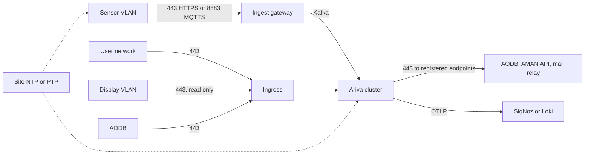

# Network and ports

The network design keeps sensors, displays, users and external systems in separate zones, with no inbound internet anywhere and no route from the airport side into the border network. This page gives the firewall matrix, time synchronisation, TLS and bandwidth figures for a site's network team and the local integration partner.

## Network zones

| Zone | Contains | Rule |
|---|---|---|
| Sensor VLAN | Overhead sensors, PoE switches, the Ingest gateway's sensor-facing interface, the MQTT broker | The gateway is the only bridge to the rest of Ariva. No other route in or out. 802.1X on switch ports. Vendor cloud connectivity disabled at government sites |
| Display VLAN | Passenger display players and signage | Reads only the read-only display endpoint and display pages |
| User network | Supervisors, duty managers, handler staff, administrators | Reaches Ariva only through the ingress on 443 |
| Cluster network | Ariva pods, PostgreSQL, Kafka, Redis | Internal service traffic; mutual TLS or network policies between services (D5) |
| Integration zone | AODB, AMAN, mail relay, airport apps | Inbound only to the Integration API through the ingress; outbound only to registered endpoints |
| Management | Kubernetes API, registry, monitoring, Dalil support access | Administrators only; Dalil support tooling pulls health telemetry only where the customer allows |

## Firewall matrix

Ports marked "check the vendor datasheet" depend on the device family. Rows marked Proposed or To confirm are not yet fixed.

| # | Source | Destination | Port and protocol | Purpose | Status |
|---|---|---|---|---|---|
| 1 | Sensors (sensor VLAN) | Ingest gateway | TCP 443, HTTPS | Webhook push of tracks, counts and health; per-device credential, TLS, source IP allowlist, 256 KB body limit | Decided |
| 2 | Sensors | MQTT broker inside Ariva.Api.Ingest (ARV-024) | TCP 8883, MQTT over TLS | Publish only, with the device code and credential (optional pinned client certificate); topic ACL per device; source networks per device; no subscriptions. Kubernetes: `api-ingest-mqtt-service` | Decided (embedded broker) |
| 3 | Ingest gateway | Sensors or perception platform | TCP 443 HTTPS (REST pull); WebSocket port per vendor | Configuration and health pull; perception platform streams. Only registered device addresses | Port per vendor: check the vendor datasheet |
| 4 | Sensors or analytics servers | Ingest listener | TCP or UDP stream, port per adapter | Length-prefixed frames, source address allowlist | Planned families only |
| 5 | Sensors | Ingest file drop | TCP 22 (SFTP) or FTPS | Interval file upload | Planned families only |
| 6 | Sensors | Site time source | UDP 123 (NTP); UDP 319 and 320 (PTP, IEEE 1588) | Clock synchronisation | Decided (NTP or PTP per device) |
| 7 | Ingest gateway | Kafka | TCP 9092 in the current settings | Publish canonical events; disk buffer while unreachable | TLS listener and port To confirm |
| 8 | AODB, immigration systems, sensor gateways | Ingress, Integration API | TCP 443, HTTPS | Integration API v1 and AIDX push; source CIDRs allowlisted per client | Decided |
| 9 | Ariva Integration | AODB, ACRIS APIs, AMAN Integration API, vendor AODB APIs | TCP 443, HTTPS | Outbound pulls to registered `OutboundEndpoint` records only; resolved IP must be inside the endpoint's allowed CIDRs; no redirects | Decided |
| 10 | AMAN | Kafka topics `aman.feed.*.v1` | TCP 9092 (shared or bridged cluster) | AMAN aggregate feed, border deployments only; prefix ACLs | Decided topics; port and TLS To confirm |
| 11 | Border Integration | Airport Integration | TCP 443, HTTPS with mutual TLS | One-way lane-level feed, pushed from the border side | Proposed, To confirm |
| 12 | Users | Ingress: Web and Main (including the SignalR WebSocket on `/hubs`) | TCP 443, HTTPS and WSS | Dashboards, configuration, live push | Decided |
| 13 | Display players (display VLAN) | Ingress: display pages and read-only display endpoint | TCP 443, HTTPS | Kiosk display pages | Decided |
| 14 | Airport apps, FIDS vendors, signage CMS | Ingress, Integration API | TCP 443, HTTPS | Wait-times API (`queues:read`), display content (`displays:read`) | v1 for the wait-times API |
| 15 | Ariva Integration | Mail relay | SMTP with STARTTLS (587) or implicit TLS (465), per relay; clear text only to smtp4dev in development (2525) | Alert email (ARV-040); only Integration connects to the relay | Site value To confirm |
| 16 | Ariva Integration | SMS gateway, operations-centre webhooks | TCP 443 | Alert channels | v1 |
| 17 | Ariva pods | PostgreSQL | TCP 5432 | Database | Decided |
| 18 | Ariva pods | Redis | TCP 6379 | Cache, backplane, idempotency | Decided |
| 19 | Ariva pods | OTLP collector (SigNoz) | TCP 4317 (OTLP gRPC) or 4318 (OTLP HTTP) | Traces, metrics, logs | Endpoint per site |
| 20 | Cluster nodes | Site NTP | UDP 123 | Server time | Decided |
| 21 | Cluster nodes | Registry (Dalil ACR or Harbor mirror) | TCP 443 | Image pulls | Decided |
| 22 | Administrators | Kubernetes API, Cronz TickerQ dashboard | Kubernetes API port per cluster; TCP 443 | Operations | Restrict to the management network |
| 23 | Dalil support tooling | Health telemetry | Mechanism To confirm (for example a customer-approved VPN) | Device status, lag, error rates only; never operational data | To confirm per customer |
| 24 | Admission controller (only with the optional image signature policy, wiki 04 section 6.5), or the release verifier's machine | Sigstore public services: the TUF trust root (`tuf-repo-cdn.sigstore.dev`) and Rekor (`rekor.sigstore.dev`) | TCP 443, HTTPS | Verifying keyless image signatures (ARV-073) | Optional; air-gapped sites verify before mirroring |
| 25 | The connected machine that verifies an offline bundle (outside the site, wiki 04 section 12.3) | Sigstore public services (as row 24) and the image registry (`ghcr.io`) | TCP 443, HTTPS | The bundle manifest's signature, each image's signature and SBOM attestation (ARV-127) | Air-gapped sites only; nothing inside the site connects out |
| 26 | Ingress controller (cluster network); the kubelet for the probes | Ariva pods: api-main, api-ingest, api-cronz, api-integration and web through their Services (api-stream: probes only) | k8s-prd: TCP 443 at each Service, to container port 8443 (API hosts) or 3443 (web), HTTPS verified against the cluster CA (ARV-082b); the kubelet probes 8443 and 3443 over HTTPS without verifying. Dev and demo: TCP 80 to 8080 or 3000, plain HTTP | Every request the ingress proxies to the hosts and the web app; health probes | Decided |

Notes:

- The chart publishes Main, Ingest, Cronz and Integration through the same ingress controller today. Keep the Ingest host off the user network (Target procedure, implemented in Phase 0 epic Device gateway and simulator) and the Cronz host on the management network only.
- Port 80 at the ingress (ARV-084): the web host and the Cronz dashboard redirect plain HTTP to 443 (308), so keep TCP 80 open to them from the user and management networks if people type addresses without `https://` (the TLS check fails a redirect host whose port 80 does not answer). The machine hosts (api-main, api-ingest, api-integration) answer every plain HTTP request 403 and never redirect it; port 80 to them may stay closed (the TLS check counts a closed port as a refusal), except for an ACME HTTP-01 solver where cert-manager issues their certificates that way.
- TLS ends at the ingress controller itself. A TCP (layer 4) load balancer in front of it is fine; an L7 proxy or load balancer that ends TLS before it is not: the hosts would see every request as plain HTTP (403 on the machine hosts, no HSTS) ([Deployment guide](04-Deployment-Guide.md), section 2).
- Nothing listens for inbound internet traffic. Outbound internet is not needed at run time; image pulls go to the registry or a local mirror.

## Time synchronisation

Waits are differences between timestamps taken at different sensors, and every number is computed in event time. Clocks therefore matter as much as coverage.

| What | Requirement |
|---|---|
| Servers and Kubernetes nodes | NTP to the site's time source. Ariva stores UTC and uses `TimeProvider.GetUtcNow()` everywhere, never local server time |
| Sensors | NTP or PTP, recorded per device as its clock source. Timestamps are taken at the sensor, never at ingestion |
| Integration clients | NTP. TOTP uses a 30-second step with one step of tolerance either side, and JWT validation allows 30 seconds of skew; a client clock that is off by more than 30 to 60 seconds (depending on where in the step it falls) starts failing authentication |
| AMAN | AMAN coarsens its timestamps to the publishing interval; interval records are aligned to the minute |

Clock offset tracking (F19): Ingest computes each sensor's offset against the site reference from `DeviceHealth` (every 10 to 30 seconds).

| Condition | Behaviour |
|---|---|
| Offset within 500 ms (an assumption to tune) | Normal |
| Offset above 500 ms and stable (standard deviation of the last 10 readings below 50 ms, Proposed) | The offset is subtracted from the sensor's timestamps and the data is flagged `Degraded` |
| Offset above 500 ms and not stable | The sensor is marked `Degraded`; waits across that sensor's boundaries are unreliable; alarm to resynchronise |

Examples from the formula tests: offsets 620, 610 and 630 ms are stable and corrected; 100, 900 and 300 ms are not stable and the sensor is degraded. See the [runbook](10-Operations-Runbook.md) procedure for clock drift.

## TLS everywhere

| Hop | Today (repository) | Target |
|---|---|---|
| Users, displays, integrators to the ingress | HTTPS at the ingress controller, with each host's certificate from its Ingress's `tls` section (`tlsSecretName`, default `ariva-tls`), chaining to a CA its clients trust: public, or the site's PKI where every client is managed ([Deployment guide](04-Deployment-Guide.md), section 6.2). TLS 1.2 and 1.3 only, TLS 1.2 suites the Mozilla intermediate list (ECDHE with AES-GCM or ChaCha20-Poly1305), no session tickets, from Ariva's controller values the site applies (`Platform/Cloud/Ariva.K8s/Helm/ingress-nginx-values.yaml`, ARV-084). HSTS of a year with includeSubDomains on every HTTPS response. Plain HTTP: 403 on the machine hosts (api-main, api-ingest, api-integration), 308 to HTTPS on the web host and the Cronz dashboard. The TLS check (`scripts/ops/tls-check.mjs`) proves all of it on the live hosts after a release | As built; the controller values are the site's to apply |
| Ingress to pods, pod to pod | k8s-prd: HTTPS (ARV-082b). Every Ingress proxies to its Service on 443 (to container port 8443 of an API host, 3443 of the web pod's nginx) and verifies the pod's certificate against the cluster CA in `podTls.caSecretName` alone, under `<service>.<namespace>.svc`, TLS 1.2 or 1.3; the pods have no plain listener, and their TLS 1.2 suites are ECDHE with AES-GCM or ChaCha20-Poly1305 only. No pod calls another today; the internal addresses are `https://<service>`. Plain HTTP in dev and demo (Service port 80 to 8080, or 3000 for the web pod) | As built for the ingress to the pods. Mutual TLS or network policies between services (D5) stay the target; network policies are ARV-085 |
| Sensors to Ingest | HTTPS push through the ingress (as above; plain HTTP answered 403), and MQTT over TLS on 8883 straight to Ingest with the device credential (client certificates optional, pinned): TLS 1.2 and 1.3 only and, on Linux, the pods' TLS 1.2 suites, ECDHE with AES-GCM or ChaCha20-Poly1305 (ARV-084; before, the operating system's defaults). A device that offers only TLS 1.0 or 1.1, or only CBC suites, cannot connect | As built |
| Services to Kafka | Plaintext `kafka:9092` in the current settings | TLS and per-service ACLs (CWE-269 control); configuration To confirm |
| Services to PostgreSQL | k8s-prd: TLS 1.2 or later, verified against the internal CA in `Database:RootCertificate` (ARV-082a); the TimescaleDB chart serves TLS from `timescaledb-tls` (its TLS 1.2 suites ECDHE with AES-GCM or ChaCha20-Poly1305 only) and accepts TCP connections over TLS only. Plain in dev and demo | As built |
| Services to Redis | k8s-prd: `ssl=true`, verified against the internal CA in `Redis:CaCertificatePath` (ARV-082a); the site's Redis must serve TLS. Plain in dev and demo | As built; the Redis server's TLS is the site's (Ariva ships no Redis) |
| Services to the OTLP collector | k8s-prd: https only (the chart and every host refuse a plain endpoint, ARV-082a) | As built |
| Outbound integrations | HTTPS only (HTTP only for allowlisted lab hosts); optional client certificate and pinned CA per endpoint | As specified |
| Border to airport feed | Not built | HTTPS with mutual TLS (Proposed) |

Data at rest is encrypted (D5); secrets live in Kubernetes secrets or a vault.

## Segmentation recommendations

1. Put every sensor and its PoE switch on a dedicated sensor VLAN per terminal, with the Ingest gateway as the only bridge. Use 802.1X on the switch ports.
2. Give displays their own VLAN that can reach only the display pages and the read-only display endpoint.
3. Keep administration interfaces (Kubernetes API, TickerQ dashboard, registry, monitoring) on a management network.
4. At a combined site, run the border and airport deployments in separate networks; allow only the one-way feed from the border Integration host to the airport Integration host.
5. If Ariva shares AMAN's cluster, use its own namespace, network policies, database and Kafka prefix ACLs.
6. Disable the vendor cloud features of sensors and perception platforms at government sites.

## Bandwidth estimates per sensor tier

Estimates of the application payload per sensor, before TLS and protocol overhead. Based on D5's assumption of about 100 bytes per sample. Confirm with the vendor and measure in the lab. The ARV-071 lab run measured about 14.5 KB for a one-second push of 150 positions in Ariva's canonical JSON (see the sizing notes below), in line with the T3 row.

| Tier | What is sent | Estimate per sensor |
|---|---|---|
| T3 Tracks | Track samples: people in view x 2 to 5 Hz x about 100 bytes | 30 people at 5 Hz: about 15 KB/s (about 120 kbit/s) |
| T2 Occupancy | Zone occupancy updates plus line counts | Small; a few hundred bytes per update (Estimate) |
| T1 Counts | Interval counts per line | Negligible; a few hundred bytes per interval (Estimate) |
| T4 On-device KPIs | Queue KPIs per interval | Negligible (Estimate) |
| Health | `DeviceHealth` every 10 to 30 seconds | Negligible |

Site totals (D5): 100 sensors at 30 people and 5 Hz are about 15,000 messages and 1.5 MB per second into the gateway, trivial for a local LAN and Kafka. Size uplinks from the sensor switches for the peak, add headroom for firmware downloads during maintenance (size per the vendor datasheet), and keep the AMAN, AODB and border-to-airport flows (aggregates only) in mind as small by comparison.

## Sizing notes: lab measurements (ARV-071)

Lab measurements from the load harness (`Platform/Testing/Ariva.LoadTests`, driven by `tests/api/load.spec.ts`), not site figures. The run was on one 2-core, 8 GB development VM that also ran PostgreSQL with TimescaleDB, Kafka, Redis, the harness and every host, so the numbers are a floor for one pod of each host rather than a capacity limit. Ariva.Api.Stream is not in the run: the harness stands in for it and announces the zone's snapshot through Redis once a second (Stream announces once a minute), so the fan-out is about 60 times production's rate per zone. Repeat the full run on the site's hardware before sizing a BOQ on it: `ARIVA_LOAD_MODE=full`, the E2E prerequisites, then `npx playwright test tests/api/load.spec.ts`; the report is `.verify/load/full/load-report.md` and `.json`.

Shape (full run, 2026-10-04, the harness's HTTP through Apizr): 40 canonical T3 sensors, each pushing 30 tracks of 5 samples (150 positions, about 14.5 KB) once a second for 120 seconds, then three times that for 30 seconds; 150 dashboards on the live hub joined to the zone, 50 passenger displays polling their board every 10 seconds (200 connections in all); one device sending 150 pushes a second for 6 seconds during the burst; then 20 bodies over 256 KB.

| Scenario | Requests | Per second | p50 ms | p95 ms | p99 ms | Outcome |
|---|---|---|---|---|---|---|
| Sensor pushes, steady (6,000 positions/s, 0.58 MB/s) | 4,800 | 40 | 8.6 | 24.7 | 1,129.7 | All 202 |
| Sensor pushes, 3x burst (18,000 positions/s, 1.74 MB/s), with the flood below at the same time | 3,600 | 120 | 16.2 | 33.2 | 45.0 | All 202 |
| Bodies over 256 KB | 20 | 5 | 2.7 | 3.7 | 18.7 | All 413 |
| One device past its limit (600 a minute), during the burst | 915 | 150 | 24.1 | 41.0 | 52.4 | 600 accepted, 315 answered 429 with Retry-After; no measured device got a 429 |
| Dashboards connect and join the zone | 150 | 74 | 8.8 | 357.9 | 436.1 | All joined |
| Snapshot delivery, publication to each dashboard | 22,500 | 147 | 6.1 | 17.2 | 27.2 | All delivered, none dropped |
| Display board polls | 767 | 5 | 10.4 | 19.6 | 31.9 | All 200 |

No request failed (no 5xx, no transport error). The steady p99 is the first second: each sensor's first push looks its credential up in the database and the hosts compile their paths; after it, pushes stay under 35 ms at p95 at three times the rate with a device flooding beside them. Earlier full runs the same day (the flood after the burst, then during it, and a hand-built HTTP client before the harness moved to Apizr) gave the same picture: burst p95 22 to 41 ms, steady p99 1.1 to 3.0 s from the first second.

| Host process (one each) | CPU average, percent of one core | CPU peak | Memory peak |
|---|---|---|---|
| Ariva.Api.Ingest | 20 | 96 | 283 MB |
| Ariva.Api.Main (hub and display boards) | 9 | 90 | 300 MB |
| Ariva.Api.Integration | 3 | 5 | 227 MB |
| Ariva.Api.Cronz | 1 | 3 | 178 MB |

What this means for sizing (Estimate, to confirm on site hardware):

- One Ingest pod with one core takes 40 T3 sensors at their rate with room for a 3x burst; plan one Ingest core per 40 to 60 T3 sensors plus a second replica for availability. T1, T2 and T4 sensors send a small fraction of this.
- One Main pod carries 200 live connections at under 10 percent of a core; connection count is not what sizes Main at a single site.
- Limits behave under load: bodies over 256 KB get 413 from their Content-Length, before they are read; a device flooding past its rate during the burst gets 429 with Retry-After while none of the 40 measured devices gets a 429; nothing turns into a 5xx.
- The hub holds at most 8 connections per signed-in session on one replica (CWE-400; `load.spec.ts` checks that a ninth is closed while the eight keep receiving). A wall of screens needs a sign-in per screen, or per few screens, not one shared session.
- Per-address limits: Ingest allows 20,000 requests a minute per address (sensors behind one gateway or NAT; 40 sensors at 3x use about 7,200), Main 1,000. Both need `Security:ForwardedHeaders` to name the ingress network, or every client shares the ingress controller's address; an operations room behind one NAT with many dashboards is the case to watch on Main.
