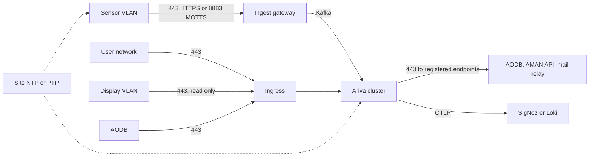

# Network and ports

The network design keeps sensors, displays, users and external systems in separate zones, with no inbound internet anywhere and no route from the airport side into the border network. This page gives the firewall matrix, time synchronisation, TLS and bandwidth figures for a site's network team and the local integration partner.

## Network zones

| Zone | Contains | Rule |
|---|---|---|
| Sensor VLAN | Overhead sensors, PoE switches, the Ingest gateway's sensor-facing interface, the MQTT broker | The gateway is the only bridge to the rest of Ariva. No other route in or out. 802.1X on switch ports. Vendor cloud connectivity disabled at government sites |
| Display VLAN | Passenger display players and signage | Reads only the read-only display endpoint and display pages |
| User network | Supervisors, duty managers, handler staff, administrators | Reaches Ariva only through the ingress on 443 |
| Cluster network | Ariva pods, PostgreSQL, Kafka, Redis | Internal service traffic; mutual TLS or network policies between services (D5). In k8s-prd every Ariva pod denies all traffic but the firewall matrix's flows (NetworkPolicies, ARV-085; section [Network policies](#network-policies-k8s-prd-arv-085) below); mutual TLS between services is not built |
| Integration zone | AODB, AMAN, mail relay, airport apps | Inbound only to the Integration API through the ingress; outbound only to registered endpoints |
| Management | Kubernetes API, registry, monitoring, Dalil support access | Administrators only; Dalil support tooling pulls health telemetry only where the customer allows |

## Firewall matrix

Ports marked "check the vendor datasheet" depend on the device family. Rows marked Proposed or To confirm are not yet fixed.

| # | Source | Destination | Port and protocol | Purpose | Status |
|---|---|---|---|---|---|
| 1 | Sensors (sensor VLAN) | Ingest gateway | TCP 443, HTTPS | Webhook push of tracks, counts and health; per-device credential, TLS, source IP allowlist, 256 KB body limit | Decided |
| 2 | Sensors | MQTT broker inside Ariva.Api.Ingest (ARV-024) | TCP 8883, MQTT over TLS | Publish only, with the device code and credential (optional pinned client certificate); topic ACL per device; source networks per device; no subscriptions. Kubernetes: `api-ingest-mqtt-service`; in k8s-prd only from the sensor networks in `networkPolicies.mqttSensors.from` (required with `mqtt.enabled`, ARV-085) | Decided (embedded broker) |
| 3 | Ingest gateway | Sensors or perception platform | TCP 443 HTTPS (REST pull); WebSocket port per vendor | Configuration and health pull; perception platform streams. Only registered device addresses | Port per vendor: check the vendor datasheet |
| 4 | Sensors or analytics servers | Ingest listener | TCP or UDP stream, port per adapter | Length-prefixed frames, source address allowlist | Planned families only |
| 5 | Sensors | Ingest file drop | TCP 22 (SFTP) or FTPS | Interval file upload | Planned families only |
| 6 | Sensors | Site time source | UDP 123 (NTP); UDP 319 and 320 (PTP, IEEE 1588) | Clock synchronisation | Decided (NTP or PTP per device) |
| 7 | Ingest gateway | Kafka | TCP 9092 in the current settings | Publish canonical events; disk buffer while unreachable | TLS listener and port To confirm |
| 8 | AODB, immigration systems, sensor gateways | Ingress, Integration API | TCP 443, HTTPS | Integration API v1 and AIDX push; source CIDRs allowlisted per client | Decided |
| 9 | Ariva Integration | AODB, ACRIS APIs, AMAN Integration API, vendor AODB APIs | TCP 443, HTTPS | Outbound pulls to registered `OutboundEndpoint` records only; resolved IP must be inside the endpoint's allowed CIDRs; no redirects. In k8s-prd also only to the CIDRs and ports of `networkPolicies.outbound` (ARV-085), so a newly registered endpoint needs a values change and a release ([Operations runbook](10-Operations-Runbook.md), section 4.15) | Decided |
| 10 | AMAN | Kafka topics `aman.feed.*.v1` | TCP 9092 (shared or bridged cluster) | AMAN aggregate feed, border deployments only; prefix ACLs | Decided topics; port and TLS To confirm |
| 11 | Border Integration | Airport Integration | TCP 443, HTTPS with mutual TLS | One-way lane-level feed, pushed from the border side | Proposed, To confirm |
| 12 | Users | Ingress: Web and Main (including the SignalR WebSocket on `/hubs` of the web host; Main's own host answers `/hubs` 404, ARV-091) | TCP 443, HTTPS and WSS | Dashboards, configuration, live push | Decided |
| 13 | Display players (display VLAN) | Ingress: display pages and read-only display endpoint | TCP 443, HTTPS | Kiosk display pages | Decided |
| 14 | Airport apps, FIDS vendors, signage CMS | Ingress, Integration API | TCP 443, HTTPS | Wait-times API (`queues:read`), display content (`displays:read`) | v1 for the wait-times API |
| 15 | Ariva Integration, Ariva Cronz | Mail relay | SMTP with STARTTLS (587) or implicit TLS (465), per relay; clear text only to smtp4dev in development (2525) | Alert email (ARV-040), sent by Integration; the scheduled reports (ARV-060), sent by Cronz through the same relay. In k8s-prd the NetworkPolicies open the relay to these two hosts only (`networkPolicies.smtp`, ARV-085) | Site value To confirm |
| 16 | Ariva Integration | SMS gateway, operations-centre webhooks | TCP 443 | Alert channels; in k8s-prd only to the entries of `networkPolicies.outbound`, as row 9 | v1 |
| 17 | Ariva pods | PostgreSQL | TCP 5432 | Database | Decided |
| 18 | Ariva pods | Redis | TCP 6379 | Cache, backplane, idempotency | Decided |
| 19 | Ariva pods | OTLP collector (SigNoz); Loki, where the hosts send logs there (`Loki:Uri`) | TCP 4317 (OTLP gRPC) or 4318 (OTLP HTTP); Loki TCP 3100 | Traces, metrics, logs | Endpoint per site; in k8s-prd closed until the site gives the peers (`networkPolicies.otlp`, `networkPolicies.loki`, ARV-085) |
| 20 | Cluster nodes | Site NTP | UDP 123 | Server time | Decided |
| 21 | Cluster nodes | Registry (Dalil ACR or Harbor mirror) | TCP 443 | Image pulls | Decided |
| 22 | Administrators (management network) | Kubernetes API; the Cronz TickerQ dashboard through the ingress | Kubernetes API port per cluster; TCP 443 | Operations | Restrict to the management network. Cronz: the chart lets its Ingress answer only the entry's `sourceRanges` (`allowlist-source-range`, ARV-085) and 403 to any other client; required in k8s-prd, where `values-k8s-prd.yaml` ships the documentation network 192.0.2.0/24 for the site to replace with its management network. The controller must see each client's own address (notes below). The Kubernetes API: the site's firewall |
| 23 | Dalil support tooling | Health telemetry | Mechanism To confirm (for example a customer-approved VPN) | Device status, lag, error rates only; never operational data | To confirm per customer |
| 24 | Admission controller (only with the optional image signature policy, wiki 04 section 6.5), or the release verifier's machine | Sigstore public services: the TUF trust root (`tuf-repo-cdn.sigstore.dev`) and Rekor (`rekor.sigstore.dev`) | TCP 443, HTTPS | Verifying keyless image signatures (ARV-073) | Optional; air-gapped sites verify before mirroring |
| 25 | The connected machine that verifies an offline bundle (outside the site, wiki 04 section 12.3) | Sigstore public services (as row 24) and the image registry (`ghcr.io`) | TCP 443, HTTPS | The bundle manifest's signature, each image's signature and SBOM attestation (ARV-127) | Air-gapped sites only; nothing inside the site connects out |
| 26 | Ingress controller (cluster network); the kubelet for the probes | Ariva pods: api-main, api-ingest, api-cronz, api-integration and web through their Services (api-stream: probes only) | k8s-prd: TCP 443 at each Service, to container port 8443 (API hosts) or 3443 (web), HTTPS verified against the cluster CA (ARV-082b); the kubelet probes 8443 and 3443 over HTTPS without verifying. Dev and demo: TCP 80 to 8080 or 3000, plain HTTP. In k8s-prd the NetworkPolicies let only the controller's pods (`ingressController.namespaceSelector` and `podSelector`) reach each routed pod, on its serving port only (ARV-085) | Every request the ingress proxies to the hosts and the web app; the health probes from the kubelet only: no Ingress routes `/health` or `/healthz`, which every host answers 404 at the ingress (ARV-085) | Decided |
| 27 | Ariva Main pods: the freshclam sidecar beside clamd (ARV-092c; `uploadScan.signatures.source` `public` or `mirror`) | ClamAV's public mirrors (`database.clamav.net`, a content delivery network) or the site's own signature mirror (`uploadScan.signatures.mirrorUrl`) | TCP 443, HTTPS (in k8s-prd and wherever `logging.required` is set, the chart refuses a mirror that is not `https://`; outside production a site mirror over http on its own port is accepted); DNS through kube-dns for the public mirrors | Signature updates, `checksPerDay` times a day (12 by default); every new api-main pod first downloads the current daily database. clamd itself listens on the pod's loopback only (`127.0.0.1:3310`): api-main sends each upload to it inside the pod, so no upload crosses the network. In k8s-prd the NetworkPolicies open the mirror to api-main's pods only (`networkPolicies.clamavMirror`, required with these sources); nothing with source `mounted`, where clamd reads a claim the site keeps current | Source per site, To confirm; air-gapped sites use a mirror or a claim |

Notes:

- The chart publishes Main, Ingest, Cronz and Integration through the same ingress controller today. Keep the Ingest host off the user network (Target procedure, implemented in Phase 0 epic Device gateway and simulator) and the Cronz host on the management network only.
- Port 80 at the ingress (ARV-084): the web host and the Cronz dashboard redirect plain HTTP to 443 (308), so keep TCP 80 open to them from the user and management networks if people type addresses without `https://` (the TLS check fails a redirect host whose port 80 does not answer). The machine hosts (api-main, api-ingest, api-integration) answer every plain HTTP request 403 and never redirect it; port 80 to them may stay closed (the TLS check counts a closed port as a refusal), except for an ACME HTTP-01 solver where cert-manager issues their certificates that way.
- TLS ends at the ingress controller itself. A TCP (layer 4) load balancer in front of it is fine; an L7 proxy or load balancer that ends TLS before it is not: the hosts would see every request as plain HTTP (403 on the machine hosts, no HSTS) ([Deployment guide](04-Deployment-Guide.md), section 2).
- The controller must see each client's own address (ARV-085): `externalTrafficPolicy: Local` on its LoadBalancer or NodePort Service, or the PROXY protocol from the load balancer in front. Behind SNAT every client arrives as a node or load balancer address: the Cronz source range (row 22) then refuses everyone, or lets everyone in once someone adds those ranges, and the hosts' per-address limits and device source networks see that one address. Never put node or load balancer ranges in `sourceRanges`.
- Nothing listens for inbound internet traffic. Outbound internet is not needed at run time; image pulls go to the registry or a local mirror. The one optional exception is row 27: a site may let the malware scanner's freshclam fetch signatures from ClamAV's public mirrors, or give it a mirror of its own.
- The malware scanner (ARV-092c) is a sidecar in every api-main pod: clamd on `127.0.0.1:3310`, which no Service exposes and nothing outside the pod can reach (clamd speaks plain TCP, so an upload is never sent across the network to be scanned). Only its signature updates leave the pod (row 27).

## Network policies (k8s-prd, ARV-085)

In k8s-prd the chart denies every Ariva pod (the five API hosts, the web pod and the migration and topics jobs, by their `app` label) all traffic in and out (`ariva-default-deny`) and allows exactly the flows of the firewall matrix, each to or from the pods that need it (`Platform/Cloud/Ariva.K8s/Helm/Charts/platform/templates/networkpolicies.yaml`). The chart refuses `networkPolicies.enabled` false in k8s-prd, and the prd environment of both Helmfiles (`helmfile-k8s.yaml.gotmpl`, `helmfile-offline.yaml.gotmpl`) sets it and refuses the state value `networkPolicies` false, so no site values file turns them off. Dev, demo and localk8s render none by default: their Kafka, Redis and controller labels are not fixed in the repository, dev and demo run the simulator, and a local cluster's network may enforce no NetworkPolicy at all (Docker Desktop's does not). Turned on there, the simulator gets its own flows (to api-main, api-ingest and api-integration on 8080, and api-integration to its AODB and AMAN emulators).

| Policy | Pods | Peers (values) | Ports | Matrix rows |
|---|---|---|---|---|
| `<app>-from-ingress-controller` | Each pod an Ingress routes to: api-main, api-ingest, api-cronz, api-integration and web (api-stream takes nothing) | In, from the ingress controller's pods: `ingressController.namespaceSelector` and `podSelector` (default: the ingress-nginx chart's labels in the namespace `ingress-nginx`) | The pod's serving port only: 8443 (API hosts) or 3443 (web) | 1, 8, 12 to 14, 22, 26 |
| `api-ingest-from-mqtt-sensors` | api-ingest, with `mqtt.enabled` | In, from `networkPolicies.mqttSensors.from`, the sensor networks (required with MQTT on) | `mqtt.port` (8883) | 2 |
| `ariva-dns-egress` | Every pod but the web pod | Out, to `networkPolicies.dns.to` (default: kube-dns in kube-system) | 53, UDP and TCP | None (inside the cluster) |
| `ariva-database-egress` | The API hosts and the migration job | Out, to `networkPolicies.database` (default: the TimescaleDB pods, `app: timescaledb`, in the release's namespace) | 5432 | 17 |
| `ariva-kafka-egress` | The API hosts and the topics job | Out, to `networkPolicies.kafka` (default: `app.kubernetes.io/name: kafka` in the release's namespace) | 9092 | 7, 10 |
| `ariva-redis-egress` | The API hosts | Out, to `networkPolicies.redis` (default: `app.kubernetes.io/name: redis` in the release's namespace) | 6379 | 18 |
| `ariva-otlp-egress` | The API hosts | Out, to `networkPolicies.otlp` (none shipped) | 4317, 4318 | 19 |
| `ariva-loki-egress` | The API hosts | Out, to `networkPolicies.loki` (`values-k8s-prd.yaml` ships the documentation network `192.0.2.0/24`, which holds no Loki, since `logging.collector` `loki` requires peers there; ARV-091a) | 3100 | 19 |
| `ariva-smtp-egress` | api-cronz, api-integration | Out, to `networkPolicies.smtp` (none shipped) | 587, 465 | 15 |
| `api-integration-outbound-egress` | api-integration | Out, one rule per entry of `networkPolicies.outbound`: a name, its peers (the CIDRs its addresses resolve to) and its ports (none shipped) | Per entry | 9, 16 |
| `ariva-clamav-mirror-egress` | api-main (its freshclam sidecar), with `uploadScan.signatures.source` `public` or `mirror` | Out, to `networkPolicies.clamavMirror` (none shipped; required with those sources, so a prd release that has not given them is refused; ARV-092c). A NetworkPolicy applies to the whole pod, so api-main's own container could reach these peers too | `networkPolicies.clamavMirror.ports` (443) | 27 |

- The web pod sends nothing and resolves no name; api-stream and the jobs take nothing; the migration job reaches only the database and the topics job only Kafka (and both DNS). api-main reaches its malware scanner on the pod's loopback, which no NetworkPolicy filters, so clamd needs no rule.
- No rule renders without its peers and ports: an empty peer list would mean every address and an empty port list every port. A flow whose peers the values leave empty is not rendered, so it stays closed: in `values-k8s-prd.yaml` the OTLP collector, the SMTP relay and the outbound endpoints, until the site gives them. Loki's flow renders there to the documentation network `192.0.2.0/24` (ARV-091a), so it reaches no Loki until the site gives Loki's own peers; the go-live record proves the logs arrive ([Security guide](13-Security-Guide.md), checklist item 15). In k8s-prd the chart refuses an ipBlock wider than /8 (IPv4) or /16 (IPv6), 0.0.0.0/0 and ::/0 among them, and a namespace selector that selects every namespace without a pod selector. NetworkPolicies add up: a site allows any other flow (a backup job, a metrics scraper) with a NetworkPolicy of its own.
- The kubelet's probes need no rule: they come from the pod's own node, which a NetworkPolicy cannot block (Kubernetes lists it among what network policies cannot do). Where the CNI filters host traffic anyway (a host firewall), the site adds a NetworkPolicy of its own for the nodes' addresses to the probe ports (8443 and 3443).
- They need a network plugin (CNI) that enforces NetworkPolicy (Calico, Cilium, Antrea, the cloud's network policy engine). On one that does not, the policies are accepted and silently do nothing: check it at go-live ([Security guide](13-Security-Guide.md), checklist item 4).
- An ingress controller on the host network is not a pod the selectors can match: give it a NetworkPolicy of the site's own.
- The TimescaleDB release keeps its own policy, `timescaledb`: PostgreSQL takes connections on 5432 only from pods of the namespace and the peers in its `networkPolicy.additionalFrom`.
- On an upgrade the migration and topics jobs run first (pre-upgrade hooks), under the previous release's policies: a database or brokers that move need their new peers released before the release that points the hosts at them.
- What a site fills in: [Deployment guide](04-Deployment-Guide.md), section 6.1. Opening a flow and reading a refused connection: [Operations runbook](10-Operations-Runbook.md), section 4.15.

## Time synchronisation

Waits are differences between timestamps taken at different sensors, and every number is computed in event time. Clocks therefore matter as much as coverage.

| What | Requirement |
|---|---|
| Servers and Kubernetes nodes | NTP to the site's time source. Ariva stores UTC and uses `TimeProvider.GetUtcNow()` everywhere, never local server time |
| Sensors | NTP or PTP, recorded per device as its clock source. Timestamps are taken at the sensor, never at ingestion |
| Integration clients | NTP. TOTP uses a 30-second step with one step of tolerance either side, and JWT validation allows 30 seconds of skew; a client clock that is off by more than 30 to 60 seconds (depending on where in the step it falls) starts failing authentication |
| AMAN | AMAN coarsens its timestamps to the publishing interval; interval records are aligned to the minute |

Clock offset tracking (F19): Ingest computes each sensor's offset against the site reference from `DeviceHealth` (every 10 to 30 seconds).

| Condition | Behaviour |
|---|---|
| Offset within 500 ms (an assumption to tune) | Normal |
| Offset above 500 ms and stable (standard deviation of the last 10 readings below 50 ms, Proposed) | The offset is subtracted from the sensor's timestamps and the data is flagged `Degraded` |
| Offset above 500 ms and not stable | The sensor is marked `Degraded`; waits across that sensor's boundaries are unreliable; alarm to resynchronise |

Examples from the formula tests: offsets 620, 610 and 630 ms are stable and corrected; 100, 900 and 300 ms are not stable and the sensor is degraded. See the [runbook](10-Operations-Runbook.md) procedure for clock drift.

## TLS everywhere

| Hop | Today (repository) | Target |
|---|---|---|
| Users, displays, integrators to the ingress | HTTPS at the ingress controller, with each host's certificate from its Ingress's `tls` section (`tlsSecretName`, default `ariva-tls`), chaining to a CA its clients trust: public, or the site's PKI where every client is managed ([Deployment guide](04-Deployment-Guide.md), section 6.2). TLS 1.2 and 1.3 only, TLS 1.2 suites the Mozilla intermediate list (ECDHE with AES-GCM or ChaCha20-Poly1305), no session tickets, from Ariva's controller values the site applies (`Platform/Cloud/Ariva.K8s/Helm/ingress-nginx-values.yaml`, ARV-084). HSTS of a year with includeSubDomains on every HTTPS response. Plain HTTP: 403 on the machine hosts (api-main, api-ingest, api-integration), 308 to HTTPS on the web host and the Cronz dashboard. The TLS check (`scripts/ops/tls-check.mjs`) proves all of it on the live hosts after a release | As built; the controller values are the site's to apply |
| Ingress to pods, pod to pod | k8s-prd: HTTPS (ARV-082b). Every Ingress proxies to its Service on 443 (to container port 8443 of an API host, 3443 of the web pod's nginx) and verifies the pod's certificate against the cluster CA in `podTls.caSecretName` alone, under `<service>.<namespace>.svc`, TLS 1.2 or 1.3; the pods have no plain listener, and their TLS 1.2 suites are ECDHE with AES-GCM or ChaCha20-Poly1305 only. No pod calls another today; the internal addresses are `https://<service>`. Plain HTTP in dev and demo (Service port 80 to 8080, or 3000 for the web pod) | As built for the ingress to the pods, and since ARV-085 the network policies of D5 in k8s-prd (section [Network policies](#network-policies-k8s-prd-arv-085)). Mutual TLS between services stays the target |
| Sensors to Ingest | HTTPS push through the ingress (as above; plain HTTP answered 403), and MQTT over TLS on 8883 straight to Ingest with the device credential (client certificates optional, pinned): TLS 1.2 and 1.3 only and, on Linux, the pods' TLS 1.2 suites, ECDHE with AES-GCM or ChaCha20-Poly1305 (ARV-084; before, the operating system's defaults). A device that offers only TLS 1.0 or 1.1, or only CBC suites, cannot connect | As built |
| Services to Kafka | Plaintext `kafka:9092` in the current settings | TLS and per-service ACLs (CWE-269 control); configuration To confirm |
| Services to PostgreSQL | k8s-prd: TLS 1.2 or later, verified against the internal CA in `Database:RootCertificate` (ARV-082a); the TimescaleDB chart serves TLS from `timescaledb-tls` (its TLS 1.2 suites ECDHE with AES-GCM or ChaCha20-Poly1305 only) and accepts TCP connections over TLS only. Plain in dev and demo | As built |
| Services to Redis | k8s-prd: `ssl=true`, verified against the internal CA in `Redis:CaCertificatePath` (ARV-082a); the site's Redis must serve TLS. Plain in dev and demo | As built; the Redis server's TLS is the site's (Ariva ships no Redis) |
| Services to the OTLP collector | k8s-prd: https only (the chart and every host refuse a plain endpoint, ARV-082a) | As built |
| api-main to the malware scanner (clamd) | Plain TCP on the pod's loopback (clamd has no TLS; ARV-092b): the chart runs clamd in every api-main pod on `127.0.0.1:3310` (ARV-092c), and k8s-prd takes a loopback `MalwareScan:Host` only, so uploads never cross the network to it in clear. docker-compose, the AppHost and CI run clamd on the machine | As built |
| freshclam to its signature mirror (row 27) | HTTPS, verified against the image's public CAs or, with `uploadScan.signatures.mirrorCaSecretName`, the site's CA; k8s-prd and `logging.required` refuse a mirror that is not `https://` (ARV-092c). Dev and demo may use an http site mirror | As built |
| Outbound integrations | HTTPS only (HTTP only for allowlisted lab hosts); optional client certificate and pinned CA per endpoint | As specified |
| Border to airport feed | Not built | HTTPS with mutual TLS (Proposed) |

Data at rest is encrypted (D5); secrets live in Kubernetes secrets or a vault.

## Segmentation recommendations

1. Put every sensor and its PoE switch on a dedicated sensor VLAN per terminal, with the Ingest gateway as the only bridge. Use 802.1X on the switch ports.
2. Give displays their own VLAN that can reach only the display pages and the read-only display endpoint.
3. Keep administration interfaces (Kubernetes API, TickerQ dashboard, registry, monitoring) on a management network.
4. At a combined site, run the border and airport deployments in separate networks; allow only the one-way feed from the border Integration host to the airport Integration host.
5. If Ariva shares AMAN's cluster, use its own namespace, network policies, database and Kafka prefix ACLs. The chart's NetworkPolicies select only Ariva's pods; point `networkPolicies.kafka` (and `redis`) at AMAN's brokers with a namespace selector for AMAN's namespace, since the defaults look in Ariva's own.
6. Disable the vendor cloud features of sensors and perception platforms at government sites.

## Bandwidth estimates per sensor tier

Estimates of the application payload per sensor, before TLS and protocol overhead. Based on D5's assumption of about 100 bytes per sample. Confirm with the vendor and measure in the lab. The ARV-071 lab run measured about 14.5 KB for a one-second push of 150 positions in Ariva's canonical JSON (see the sizing notes below), in line with the T3 row.

| Tier | What is sent | Estimate per sensor |
|---|---|---|
| T3 Tracks | Track samples: people in view x 2 to 5 Hz x about 100 bytes | 30 people at 5 Hz: about 15 KB/s (about 120 kbit/s) |
| T2 Occupancy | Zone occupancy updates plus line counts | Small; a few hundred bytes per update (Estimate) |
| T1 Counts | Interval counts per line | Negligible; a few hundred bytes per interval (Estimate) |
| T4 On-device KPIs | Queue KPIs per interval | Negligible (Estimate) |
| Health | `DeviceHealth` every 10 to 30 seconds | Negligible |

Site totals (D5): 100 sensors at 30 people and 5 Hz are about 15,000 messages and 1.5 MB per second into the gateway, trivial for a local LAN and Kafka. Size uplinks from the sensor switches for the peak, add headroom for firmware downloads during maintenance (size per the vendor datasheet), and keep the AMAN, AODB and border-to-airport flows (aggregates only) in mind as small by comparison.

## Sizing notes: lab measurements (ARV-071)

Lab measurements from the load harness (`Platform/Testing/Ariva.LoadTests`, driven by `tests/api/load.spec.ts`), not site figures. The run was on one 2-core, 8 GB development VM that also ran PostgreSQL with TimescaleDB, Kafka, Redis, the harness and every host, so the numbers are a floor for one pod of each host rather than a capacity limit. Ariva.Api.Stream is not in the run: the harness stands in for it and announces the zone's snapshot through Redis once a second (Stream announces once a minute), so the fan-out is about 60 times production's rate per zone. Repeat the full run on the site's hardware before sizing a BOQ on it: `ARIVA_LOAD_MODE=full`, the E2E prerequisites, then `npx playwright test tests/api/load.spec.ts`; the report is `.verify/load/full/load-report.md` and `.json`.

Shape (full run, 2026-10-04, the harness's HTTP through Apizr): 40 canonical T3 sensors, each pushing 30 tracks of 5 samples (150 positions, about 14.5 KB) once a second for 120 seconds, then three times that for 30 seconds; 150 dashboards on the live hub joined to the zone, 50 passenger displays polling their board every 10 seconds (200 connections in all); one device sending 150 pushes a second for 6 seconds during the burst; then 20 bodies over 256 KB.

| Scenario | Requests | Per second | p50 ms | p95 ms | p99 ms | Outcome |
|---|---|---|---|---|---|---|
| Sensor pushes, steady (6,000 positions/s, 0.58 MB/s) | 4,800 | 40 | 8.6 | 24.7 | 1,129.7 | All 202 |
| Sensor pushes, 3x burst (18,000 positions/s, 1.74 MB/s), with the flood below at the same time | 3,600 | 120 | 16.2 | 33.2 | 45.0 | All 202 |
| Bodies over 256 KB | 20 | 5 | 2.7 | 3.7 | 18.7 | All 413 |
| One device past its limit (600 a minute), during the burst | 915 | 150 | 24.1 | 41.0 | 52.4 | 600 accepted, 315 answered 429 with Retry-After; no measured device got a 429 |
| Dashboards connect and join the zone | 150 | 74 | 8.8 | 357.9 | 436.1 | All joined |
| Snapshot delivery, publication to each dashboard | 22,500 | 147 | 6.1 | 17.2 | 27.2 | All delivered, none dropped |
| Display board polls | 767 | 5 | 10.4 | 19.6 | 31.9 | All 200 |

No request failed (no 5xx, no transport error). The steady p99 is the first second: each sensor's first push looks its credential up in the database and the hosts compile their paths; after it, pushes stay under 35 ms at p95 at three times the rate with a device flooding beside them. Earlier full runs the same day (the flood after the burst, then during it, and a hand-built HTTP client before the harness moved to Apizr) gave the same picture: burst p95 22 to 41 ms, steady p99 1.1 to 3.0 s from the first second.

| Host process (one each) | CPU average, percent of one core | CPU peak | Memory peak |
|---|---|---|---|
| Ariva.Api.Ingest | 20 | 96 | 283 MB |
| Ariva.Api.Main (hub and display boards) | 9 | 90 | 300 MB |
| Ariva.Api.Integration | 3 | 5 | 227 MB |
| Ariva.Api.Cronz | 1 | 3 | 178 MB |

What this means for sizing (Estimate, to confirm on site hardware):

- One Ingest pod with one core takes 40 T3 sensors at their rate with room for a 3x burst; plan one Ingest core per 40 to 60 T3 sensors plus a second replica for availability. T1, T2 and T4 sensors send a small fraction of this.
- One Main pod carries 200 live connections at under 10 percent of a core; connection count is not what sizes Main at a single site.
- Limits behave under load: bodies over 256 KB get 413 from their Content-Length, before they are read; a device flooding past its rate during the burst gets 429 with Retry-After while none of the 40 measured devices gets a 429; nothing turns into a 5xx.
- The hub holds at most 8 connections per signed-in session on one replica (CWE-400; `load.spec.ts` checks that a ninth is closed while the eight keep receiving). A wall of screens needs a sign-in per screen, or per few screens, not one shared session.
- Per-address limits: Ingest allows 20,000 requests a minute per address (sensors behind one gateway or NAT; 40 sensors at 3x use about 7,200), Main 1,000. Both need `Security:ForwardedHeaders` to name the ingress network (in k8s-prd the chart passes `ingressController.podNetworks`, ARV-085) and the controller to see each client's own address, or every client shares one address; an operations room behind one NAT with many dashboards is the case to watch on Main.

## Sizing notes: the pilot hall through the whole pipeline (ARV-124a)

Lab measurements, not site figures: one 4-core, 15 GB cloud VM that ran PostgreSQL with TimescaleDB, Kafka (one broker, 6 partitions a topic as in production), Redis, ClamAV, the simulator, every host and the harness at once. Run: `node scripts/verify.mjs pilot-load` on fresh services (wiki 16; `tests/load/pilot-load.spec.ts` with `Ariva.LoadTests` in `ARIVA_LOAD_MODE=pilot`); report in `.verify/load/pilot/pilot-report.md` and `pilot-measurements.json`. Unlike ARV-071's run (above), Ariva.Api.Stream is in it: the snapshots, desk states and stored minutes are its own.

Shape (Proposed pilot hall profile): one arrivals hall with an immigration checkpoint and five queue zones (CIT, RES, VIS, CRW and the e-gates' EG), 20 desks and 6 e-gates on AMAN's feed (the harness produces AMAN's four topics as AMAN does), 30 T3 sensors (6 a zone, 30 people each at 5 Hz, 150 positions a push once a second: 4,500 positions a second), 50 dashboards on the live hub joined to every hall zone, 10 displays polling their board every 10 seconds, and AUH-TA's 84 seeded sensors playing their evening beside it. Each push carries the people's positions, the crossings of the entry and exit lines since the last push (each person keeps a track id from entry to exit, about 4.5 minutes) and the zone's occupancy. Phases: 5 minutes steady; 1 minute of the D5 site rate, 100 T3 sensors (the burst's 70 on 11 zones of their own, 6 or 7 each) at 15,000 positions a second, with one device sending 150 pushes a second and 20 bodies over 256 KB; then the hall's 30 sensors until Stream is back to its steady lag, at most 5 minutes.

Request path (run 3, 2026-10-21, each host with the GC heap limit .NET derives from its pod's memory limit; latencies of run 2, without the limits, were up to twice these):

| Scenario | Requests | Per second | p50 ms | p95 ms | p99 ms | Outcome |
|---|---|---|---|---|---|---|
| Hall sensors, steady (4,500 positions/s) | 9,003 | 30 | 9.8 | 29.6 | 97.1 | All 202 |
| D5 burst, 100 sensors (15,000 positions/s) | 6,000 | 100 | 10.7 | 24.1 | 61.2 | All 202 |
| Hall sensors, after the burst | 9,018 | 30 | 5.7 | 10.3 | 16.3 | All 202 |
| Bodies over 256 KB, during the burst | 20 | 5 | 6.8 | 21.0 | 36.4 | All 413 |
| One device past its limit (600 a minute), during the burst | 900 | 150 | 14.3 | 28.1 | 41.8 | 600 accepted, 300 answered 429 with Retry-After; no measured device got a 429 |
| Dashboards connect and join the 5 hall zones | 50 | 25 | 18.5 | 275.1 | 370.7 | All joined |
| Display board polls | 668 | 1 | 13.5 | 25.5 | 70.4 | All 200 |
| AMAN feed records (20 desks and 6 e-gates a minute, 3 flights) | 309 | 0.5 | 6.5 | 13.9 | 24.1 | All produced, stored and mapped |

Read this table with the next section: in runs 3 to 7 Stream stopped (out of memory in runs 3, 4 and 7, whose logs were read; runs 5 and 6 stopped at the same point, their logs not kept), before the burst in runs 3 to 5 and 7 (three to five minutes into the steady phase) and 45 seconds into it in run 6, so their burst ran without Stream's CPU, memory and database connections, or most of it. Run 5's burst latencies are not usable (a build ran beside it). The only run with Stream alive through the burst, run 2, had two failed requests: one board poll answered 503 because PostgreSQL refused a connection (53300, its 100 connections taken; below) and one of the flooding device's pushes past its limit failed in transport. No request of run 3 failed; runs 4 and 6, repeats of run 3, had three and two such resets on the flooding device and no other failure: exactly 600 of its pushes were accepted (its limit), and 297 and 298 of the other 300 got their 429, the rest a connection reset (HttpRequestError Unknown in runs 2 and 4, ResponseEnded in run 6; ARV-233, Low; not reproduced on an idle machine). Run 7, with the harness's final checks (one outcome for each push), had the same three resets on the flooding device and one more on a measured sensor's push in the burst (ResponseEnded, 1 of 6,000, within that device's rate), which fails the first test: the resets are not tied to the refusals, and Ingest logged nothing about any of them (Kestrel's connection events are below its log level).

Ariva.Api.Stream before ARV-230 (runs 2 to 7; the run with ARV-230 follows):

- A hall zone's stream state (`stream_zone_state.state_bytes`) was 18 to 23 MB of JSON (1.1 to 1.4 MB stored after PostgreSQL's compression). It was almost all the queue engine's reorder buffer, which held every track position for the zone's lateness (90 seconds) before applying it: 82,440 positions at 6 T3 sensors. AUH-TA's zones, whose simulated sensors send crossings and occupancy but no positions, hold 4 to 18 KB. Every checkpoint (every 5 seconds) writes every zone's whole state, about 90 MB of JSON for the hall.
- With the GC heap of its pod (1,125 MiB of the 1500Mi limit), Stream ran out of memory serializing a zone's state three minutes into the hall's steady rate, and stopped (`System.OutOfMemoryException` in `StreamStore.SaveStateAsync`); run 4 the same five minutes in, and runs 5 and 6 stopped five and six minutes in (run 6 at 350 s of the run, 45 seconds into the burst, its queue engine's lag at 40,248 records when the run ended; their logs were not kept); run 7 at 271 s of the run, four and a half minutes into the steady rate, the same exception in the same frames. In a cluster that is a restart, a replay from the last checkpoint and the same again, with the screens frozen meanwhile.
- Without the limit (run 2) its memory went from 257 MB to 2.35 GB (1.4 GB within 90 seconds of the steady rate), it used 70 percent of a core on average (151 at its peak), and its queue engine fell behind: the lag crept from about 300 to 1,700 records in the steady 5 minutes, reached 16,000 in the burst and kept growing at the hall's rate afterwards, about 48 records a second, to 31,000 when the run ended. Its live minutes, snapshots and desk minutes fell behind with it: when the run ended it had counted about a third of the hall's crossings. The sensing archive kept up (its lag was back 8 seconds after the burst).
- A zone with more than about 7 T3 sensors (1,050 positions a second) would reach the engine's bound of 100,000 buffered events, beyond which it refuses events of every kind, crossings included, without a log line or a metric (ARV-231, Medium).

Ariva.Api.Stream since ARV-230 (two runs of 2026-10-22 on this machine, each host with its pod's heap limit; the second, 13:19Z, passed both tests of `pilot-load.spec.ts`): the queue engine keeps a track's position samples in a run (an anchor and one pending sample, formulas F6) instead of one buffered event a sample, so a zone's state no longer grows with its sensors' position rate.

| Measure | Before ARV-230 | Since ARV-230 (run 2; run 1) |
|---|---|---|
| Stream ran | Stopped 2 to 6 minutes in (runs 3 to 7), out of its heap | Throughout (427 samples of 427) |
| Stream memory (RSS, highest) | 2.35 GB without a limit (run 2) | 512 MB; 550 MB (pod limit 1500Mi) |
| Stream CPU, average and highest | 70 percent of a core, 151 (run 2) | 47 and 115 percent; 49 and 118 |
| Queue engine lag after the D5 burst | Grew at the hall's rate, 31,000 records at the end (run 2) | Back to its steady lag 2 s after the burst (peak 2,097 records); 4 s (peak 2,543) |
| Sensing archive lag after the burst | Back in 8 s (run 2) | Back in 20 s; 26 s |
| Hall zone state, `state_bytes` (stored after compression) | 18 to 23 MB (1.1 to 1.4 MB) | 208 to 211 KB (60 to 62 KB) at the run's end; 265 to 269 KB (84 to 85 KB) |
| Burst zones' and AUH-TA's zone state | 4 to 18 KB (AUH-TA) | 25 to 29 KB (burst); AUH-TA 5.5 to 14 KB |
| Crossings counted of those Ingest accepted | About a third (run 2) | All, on every zone: each hall zone 252 or 253 entries and 78 or 79 exits, the burst zones 35 to 43 entries; every zone's stored watermark past the run's end 170 s after it |
| Database connections, peak | 97 of 97 (run 2, pools unbounded) | 67 (Ingest 26, Stream 21, Integration 12, Main 6, Cronz 2) |

The request path held as before: steady pushes p95 27.8 ms and p99 120.7 ms (8,997, all 202), the D5 burst p95 127.4 ms and p99 288.2 ms (6,000, all 202), recovery all 202, the 20 oversized pushes 413 with `Connection: close`, the flooding device exactly 600 accepted and 300 refused with 429 and Retry-After, 50 screens joined with 2,000 snapshots delivered (the fewest one screen got, 40), every board poll 200, no problem in the report and no reset. In ARV-230's unit tests, a hall zone of 20 T3 sensors at 30 people (3,000 positions a second, more than three times the run's) holds at most 0.73 MB and is never refused for a full buffer, where the engine before refused 1.4 million events in 10 minutes (`QueueEnginePositionRunTests`).

The first run's count fell short (each hall zone 96 percent of its entries and 69 percent of its exits) for two reasons of the harness, not Stream's, both fixed with it: the spec measured 150 seconds after the last push, exactly the lateness (90 s) plus the push interval (60 s), so the last seconds' crossings were not yet applied (it now waits until every zone's stored watermark is past the run's end, at most 5 minutes); and the harness's walks run on the wall clock, so about 180 people a hall zone were already inside when the run started, and their exits, whose entries Ariva never received, paired by FIFO with the earliest people other sensors of the zone held (F5: an unknown tracked exit is someone who entered before the engine started or under another sensor's id), whose own exits then counted as duplicates. The harness's people never pass from one sensor to another, so it now sends an exit only once its entry was accepted (positions for everyone, as before). An offline replay of the harness's own pushes through the engine gave the first run's numbers exactly (251 entries and 175 of 252 exits counted, 77 duplicates), the same with and without ARV-230's runs, and every crossing with the harness's fix.

Other measurements (run 2):

- Staffing job (Ariva.Api.Cronz, every minute at second 45, DMO, AUH-TA and the hall): 17 runs, median 109 ms, longest 147 ms (TickerQ's own "Job completed" line); in runs 4, 6 and 7, 39, 19 and 14 runs, longest 285, 172 and 154 ms; far inside its minute.
- TickerQ 10.0.2 (a test application, 6 runs): a run that outlasts its interval does not stop the next occurrence (a 5-second function every 2 seconds ran three to five at once); occurrences missed while the process was stopped are skipped, not run late; one occurrence in about ten fires twice, 1 to 10 ms apart, whether or not runs overlap (13 of 118). Every Cronz job tolerates a concurrent copy of itself (ADR-0020; `JobConcurrencyTests` holds new jobs to it), and the staffing job warns when a run takes its whole minute.
- Desk feed state (`desk_feed_state`, one row a site): 29 KB for the hall, 85 KB for AUH-TA, 121 KB for DMO; bounded by its engine (wiki 10, 4.8i).
- Outbox: nothing unsent at any time; the run's rows were device registry and zone health events (249).
- Redis: 1.6 MB used, 37 keys (the live snapshots and FusionCache's entries).
- Database connections (sampled every 2 seconds in runs 3, 4, 6 and 7): up to 94, 96, 95 and 94 at once, 85, 90, 94 and 85 of them the hosts' runtime login, against PostgreSQL's default 100 (97 for roles without SUPERUSER); in run 2 the burst took the last one. The hosts' pools were then Npgsql's default (up to 100 each) and every host named itself `ariva`. Since ARV-232 each replica's pool is bounded and named per host (wiki 04 section 6.9); its two runs of 2026-10-22 on this machine, one replica of each host at PostgreSQL's default 100:

  | Host (`application_name`) | Peak, pools unbounded (Npgsql's 100) | Peak with the bounds | Pool (`Database:MaxPoolSize`) |
  |---|---|---|---|
  | `ariva-ingest` | 31 | 25 | 26 |
  | `ariva-stream` | 44 | 21 (with the desk term pool) | 20 |
  | `ariva-integration` | 15 | 12 | 12 |
  | `ariva-main` | 9 | 6 | 14 |
  | `ariva-cronz` | 2 | 3 | 8 (4 in these runs; raised after them for its daily jobs at once, which did not run in them) |
  | All, the sampling session included | 97 (the server's whole allowance) | 68 | |

  Unbounded, one replica of each host filled the 97 connections PostgreSQL allows roles without SUPERUSER. With the bounds the hosts held at most 68, no request was refused a connection, no pool was exhausted (no host logged it) and no request answered 5xx. Stream stopped 127 s into the bounded run, out of the heap its pod allows (ARV-230), so its peak is that of its first two minutes; ARV-230's run measures it again through the burst. One push of the burst's 6,000 ended in a connection reset with no answer (HttpRequestException, Unknown), the reset of ARV-233 again, and the run's first test failed on it; Ingest logged no error for it.
- Connection resets (ARV-233): the cause was Ingest's 413 to the run's oversized pushes (5 a second for 4 seconds of the burst, from a hall sensor). Ingest refuses a push declaring more than 256 KB before reading it; Kestrel then will not read past the action's limit to reach the next request, so it closes the connection, but the 413 had gone out without `Connection: close`. The harness sends every device's pushes through one connection pool, so another push (the flooding device's, or a measured sensor's) could take that connection before the close reached it, and ended in ResponseEnded or an IOException, the two kinds seen. A bare Kestrel with the same limit and answer reproduced it with one shared client: about one push in ten after a 413 was reset, idle and under load; with `Connection: close` on the 413, none in 86,400 pushes. Since ARV-233 every host's answer to a declared body larger than its endpoint takes carries `Connection: close`. The run of 2026-10-22 09:58Z with it: no reset in 24,935 pushes (steady 9,000, burst 6,000 and recovery 9,015 all 202; the 20 oversized pushes 413 with `Connection: close`; the flooding device exactly 600 accepted and 300 refused with 429 and Retry-After), and the report's problems were none. Its first test then failed further on, on the hall's queue minutes: Stream stopped 133 s into the run, out of its heap (ARV-230), before it wrote them.
- Sensing archive: 3.72 million events of the hall in run 2 (11 minutes), 794 MB in `sensing_event` before its compression after a day, about 213 bytes an event. At the hall's steady rate that is about 390 million rows and 83 GB a day uncompressed; formulas F21 assumed 1,000 stored rows a second (86 million a day, 200 GB for 90 days). To confirm with the owner: whether the archive keeps every 5 Hz position, or a coarser trace is enough for disputes (Estimate; compression ratio not measured).
- The other hosts at the D5 burst: Ingest 16 percent of a core on average (a full core at its peak) and at most 293 MB; Main 6 percent and 317 MB; Integration 3 percent and 289 MB; Cronz 3 percent and 266 MB. Each fits its pod.

What this means for sizing (Estimate): Ingest, Main, Integration and Cronz are sized as ARV-071 found. Since ARV-230 one Stream replica carries the pilot hall, the D5 burst and AUH-TA's evening at about half a core and at most 550 MB, well inside its pod (1500Mi, 1,125 MiB of heap), and is back to its steady lag seconds after the burst. The connections are bounded since ARV-232 (one replica of each host held at most 67 of PostgreSQL's 97) and since ARV-233 no push is reset. ARV-124a closes with the run of 2026-10-22 13:19Z. Repeat this run on the site's hardware before a BOQ names node sizes (TC-33), and run the day-long soak (ARV-124b) for what minutes do not show.
